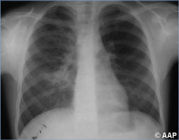
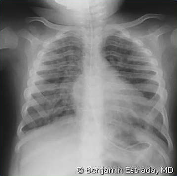
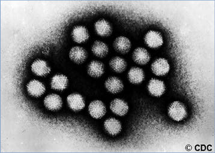

# 2. Adenovirus Infections
> Private study reference ([source credits](../../SOURCE_CREDITS.md)). PDF pages 18-21; printed pages 4-7.

## PDF page 18 | printed page 4

### CLINICAL MANIFESTATIONS

Adenovirus infections of the upper respiratory tract are common and often subclinical; when symptomatic, adenoviruses may cause common cold symptoms, pharyngitis, tonsillitis, otitis media, or pharyngoconjunctival fever. Adenoviruses occasionally cause a pertussis-like syndrome, croup, bronchiolitis, influenza-like illness, exudative tonsillitis, severe hepatitis, and hemorrhagic cystitis. Ocular adenovirus infections may present as follicular conjunctivitis or as epidemic keratoconjunctivitis. Enteric adenoviruses are an important cause of childhood gastroenteritis. Life-threatening disseminated infection, lower respiratory infection (eg, severe pneumonia, bronchiolitis obliterans), hepatitis, meningitis, and encephalitis occur occasionally, especially among young infants and immunocompromised people.

### ETIOLOGY

Adenoviruses are double-stranded, nonenveloped DNA viruses of the Adenoviridae family and Mastadenovirus genus, with more than 100 recognized types and multiple genetic variants divided into 7 species (A–G) that infect humans. Some adenovirus types are associated primarily with respiratory tract disease (types 1–5, 7, 14, 21, and 55), epidemic keratoconjunctivitis (types 8, 37, 53, 54, and 64 [previously 19a]), or gastroenteritis (types 40 and 41). Severe respiratory infections are often attributable to adenovirus types 3, 7, and 14.

### EPIDEMIOLOGY

Infection in children can occur at any age. Adenoviruses causing respiratory tract infections usually are transmitted by respiratory tract secretions through person-to-person contact, airborne droplets, and fomites. Adenoviruses are hardy viruses, can survive on environmental surfaces for long periods, and are not easily inactivated by many disinfectants. Outbreaks of febrile respiratory tract illness attributable to adenoviruses can be a significant problem in military trainees, college students, children attending overnight camps, patients hospitalized in hematopoietic cell transplant units, and residents of long-term care facilities. Community outbreaks of

adenovirus-associated pharyngoconjunctival fever have been attributed to water exposure from contaminated swimming pools and fomites, such as shared towels. Health care-associated transmission of adenoviral infections can occur in hospitals, residential institutions, and nursing homes from exposures to infected health care personnel, patients, or contaminated equipment. Adenovirus infections in solid organ transplant recipients can occur from donor tissues as well as endogenous reactivation. Epidemic keratoconjunctivitis commonly occurs by direct contact and has been associated with equipment used during eye examinations. Enteric strains of adenoviruses are transmitted by the fecal-oral route.

Adenoviruses do not demonstrate the marked seasonality of other respiratory tract viruses and instead circulate throughout the year. Enteric disease also occurs year-round and primarily affects children younger than 4 years. Adenovirus infections are most communicable during the first few days of an acute illness, but persistent and intermittent shedding for longer periods, even months, can occur, especially among people with weakened immune systems. In healthy people, infection with one adenovirus type should confer type-specific immunity or at least lessen symptoms associated with reinfection, which forms the basis of adenovirus vaccines used in military populations (see Control Measures).

The incubation period for respiratory tract infection varies from 2 to 14 days; for gastroenteritis, the incubation period is 3 to 10 days.

### DIAGNOSTIC TESTS

Methods for diagnosis of adenovirus infection include molecular detection, isolation in cell culture, and antigen detection. Molecular assays (eg, nucleic acid amplification tests [NAATs]) are the preferred diagnostic method for detection of adenoviruses, and these assays are widely available. However, the persistent and intermittent shedding that commonly follows an acute adenoviral infection can complicate the clinical interpretation of a positive molecular test result. Quantitative adenovirus assays can be useful for management of immunocompromised patients, such as hematopoietic cell and solid organ transplant recipients. Adenoviruses associated with respiratory tract and ocular disease can be isolated

## PDF page 19 | printed page 5

by culture from respiratory specimens (eg, nasopharyngeal swab, oropharyngeal swab, nasal wash, sputum) and eye secretions in standard susceptible cell lines. Rapid antigen-detection techniques, including immunofluorescence and enzyme immunoassay, have been used to detect virus in respiratory tract secretions, conjunctival swab specimens, and stool, but these methods lack sensitivity. Adenovirus typing by molecular methods is available from some reference laboratories. Although its clinical utility is limited, typing can help establish an etiologic association with disease and to investigate clusters of adenovirus-associated illness. Serodiagnosis is used primarily for epidemiologic studies and has no clinical utility.

### TREATMENT

Treatment of adenovirus infection is primarily supportive, with most adenoviral infections in otherwise healthy persons being self-limited. Symptomatic infection in immunocompromised patients, however, should be managed with reduced immunosuppression, when feasible, and consideration of use of antiviral agents, with options presented below. For immunocompromised patients with asymptomatic detection of adenovirus DNA in the blood, there is no consensus regarding optimal management. This scenario is often encountered in the transplant setting in which patients are monitored post-transplant with serial quantitative NAATs. The detection of defined thresholds of blood DNA in this setting might allow for risk-based preemptive treatment strategies including reduced immunosuppression, when appropriate, and antiviral agents.

There are no antivirals approved by the U.S. Food and Drug Administration for the treatment of adenovirus infections. Intravenous cidofovir has emerged as the preferred antiviral agent for treatment of severe, progressive, or disseminated adenovirus diseases in immunocompromised hosts, but its utilization is limited by its associated nephrotoxicity and myelotoxicity and there is no consensus on the optimal dose. Brincidofovir, an oral prodrug of cidofovir, was evaluated in a randomized controlled trial of pediatric and adult hematopoietic cell transplant recipients, and although brincidofovir-treated subjects had a tendency to lower odds of treatment failure and all-cause

mortality compared with the placebo recipients, the differences were not statistically significant. Ribavirin has shown inconsistent therapeutic benefit in case reports and a small cohort study.

There is some evidence that ganciclovir has inhibitory effects at concentrations achievable when applied topically against some adenovirus types causing keratoconjunctivitis, raising its potential role as a topical agent in this setting. For conjunctival disease, topical cidofovir has been shown to be effective in the eradication of actively replicating viruses and limiting the duration of symptoms. However, further study is needed to determine the long-term adverse effects of both topical ganciclovir and topical cidofovir.

Transplant patients with severe hypogammaglobulinemia at the time of active adenovirus infection might benefit from immunoglobulin administration. Adoptive transfer of adenovirus-specific T-lymphocytes is under investigation for the treatment of severe adenovirus diseases in hematopoietic cell transplant recipients, but there are limited data in solid organ transplant recipients and other populations.

### INFECTION PREVENTION AND CONTROL MEASURES IN HEALTH CARE SETTINGS

In addition to standard precautions for young children with respiratory tract infections, contact and droplet precautions are indicated for the duration of hospitalization. In immunocompromised patients, contact and droplet precautions should be extended because of the likelihood of prolonged shedding of the virus. For patients with conjunctivitis and for diapered and incontinent children with adenoviral gastroenteritis, contact precautions are indicated for the duration of illness.

### CONTROL MEASURES

Appropriate hand hygiene, respiratory hygiene, and cough etiquette should be followed. However, adenoviruses are difficult to inactivate with alcohol-based gels, and they may remain viable on skin, fomites, and environmental surfaces for extended periods. Thus, assiduous adherence to hand hygiene and use of disposable gloves when caring for infected patients are recommended.

## PDF page 20 | printed page 6

Children who are in group child care, particularly children from 6 months through 2 years of age, are at increased risk of adenoviral respiratory tract infections and gastroenteritis. Effective measures for preventing spread of adenovirus infection in group child care settings have not been determined, but frequent hand hygiene is recommended. If 2 or more children in a group child care setting develop conjunctivitis in the same period of time, advice should be sought from the health consultant of the program or the state health department.

Adequate chlorination of swimming pools is recommended to prevent pharyngoconjunctival fever. Epidemic keratoconjunctivitis associated with

Image 2.1 Acute follicular adenovirus conjunctivitis. Adenoviruses are resistant to alcohol, detergents, and chlorhexidine and may contaminate ophthalmologic solutions and equipment. Instruments can be disinfected by steam autoclaving or immersion in 1% sodium hypochlorite for 10 minutes.

Image 2.3 Histopathologic features of the lung with bronchiolar occlusion in an immunocompromised child who died with adenoviral pneumonia. Note interstitial mononuclear cell infiltration and hyaline membranes. Adenoviruses types 3 and 7 can cause necrotizing bronchitis and bronchiolitis. Courtesy of Edgar O. Ledbetter, MD, FAAP.

ophthalmologic practice can be difficult to control and requires use of single-dose medication dispensing and strict attention to hand hygiene and instrument sterilization procedures. Health care professionals with known or suspected adenoviral conjunctivitis should avoid direct patient contact until symptoms have resolved.

A live, nonattenuated, oral adenovirus vaccine for types 4 and 7 (2 oral tablets, 1 for each of the 2 strains) is licensed by the U.S. Food and Drug Administration for prevention of febrile acute respiratory tract disease among persons 17 through 50 years of age. The vaccine is currently only approved for use in the U.S. military.

Image 2.2 Adenoviral pneumonia in an 8-year-old girl with diffuse pulmonary infiltrate occurring bilaterally. Most adenoviral infections in the normal host are self-limited and require no specific treatment. Lobar consolidation is unusual.

## PDF page 21 | printed page 7

Image 2.4 Adenovirus pneumonia in a 4-year-old boy. Courtesy of Benjamin Estrada, MD.

Image 2.5 Transmission electron micrograph of adenovirus. Adenoviruses have a characteristic icosahedral structure. Courtesy of Centers for Disease Control and Prevention.

