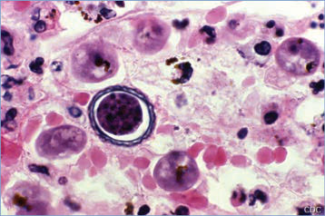
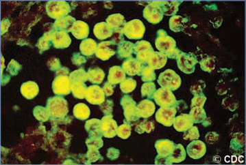
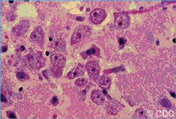
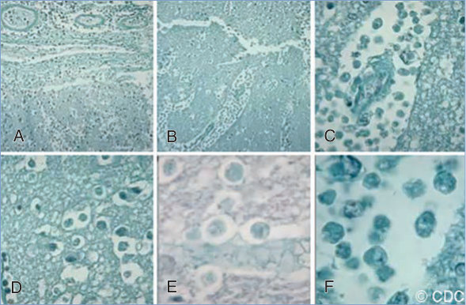

# 4. Amebic Meningoencephalitis and Keratitis (Naegleria fowleri, Acanthamoeba species, and Balamuthia mandrillaris)
> Private study reference ([source credits](../../SOURCE_CREDITS.md)). PDF pages 29-33; printed pages 15-19.

## PDF page 29 | printed page 15

(Naegleria fowleri, Acanthamoeba species, and Balamuthia mandrillaris)

### CLINICAL MANIFESTATIONS

Naegleria fowleri can cause a rapidly progressive, almost always fatal, primary amebic meningoencephalitis (PAM). Early symptoms include fever, headache, nausea, and vomiting. The illness progresses rapidly to signs of meningoencephalitis, including nuchal rigidity, lethargy, confusion, personality changes, altered level of consciousness, and rarely, disturbances of smell and taste. Seizures are common, and death generally occurs within a week of onset of symptoms. No distinct clinical features differentiate this disease from fulminant bacterial meningitis other than history of freshwater exposure.

Granulomatous amebic encephalitis (GAE) caused by Acanthamoeba species and Balamuthia mandrillaris has a more insidious onset than PAM and develops as a subacute or chronic disease. In general, patients with GAE die several weeks to months after onset of symptoms. Signs and symptoms may include altered mental status, personality changes, seizures, headaches, ataxia, cranial nerve palsies, hemiparesis, and other focal neurologic deficits. Fever often is low grade and intermittent. The course may resemble that of a bacterial brain abscess or a brain tumor. Chronic granulomatous skin lesions (pustules, nodules, ulcers) may be present with or without central nervous system (CNS) involvement, particularly in patients who are immunocompromised. Lesions may be present for months before brain involvement in some cases. Acanthamoeba also can cause rhinosinusitis, which can present alone or with skin or CNS involvement.

The most common symptoms of amebic keratitis, a vision-threatening infection usually caused by Acanthamoeba species, are eye pain (often out of proportion to clinical signs), photophobia, tearing, and foreign body sensation. Characteristic clinical findings include radial keratoneuritis and stromal ring infiltrate. Acanthamoeba keratitis

generally follows an indolent course and initially may resemble herpes simplex or bacterial keratitis; delay in diagnosis is associated with worse outcome.

### ETIOLOGY

N fowleri, Acanthamoeba species, and B mandrillaris are free-living amebae that exist as motile, infectious trophozoites and environmentally hardy cysts.

### EPIDEMIOLOGY

N fowleri is found in warm fresh water and moist soil. Most infections with N fowleri have been associated with swimming in natural bodies of warm fresh water, such as ponds, lakes, and hot springs, but other sources have included tap water from household plumbing systems and geothermal sources as well as poorly chlorinated swimming pools, splash pads, and municipal water. Disease has been reported worldwide but is uncommon. In the United States, infection occurs primarily in the summer and usually affects children and young adults. The recent northward extension of reported cases may be the result of climatic changes. Disease has followed use of tap water for ritual or therapeutic nasal irrigation or exposures related to recreational activities (eg, tap water used for a backyard waterslide). Trophozoites of the amebae invade the brain directly from the nose along the olfactory nerves via the cribriform plate.

Acanthamoeba species are distributed worldwide and have been found in soil; dust; cooling towers of electric and nuclear power plants; heating, ventilating, and air conditioning units; fresh and brackish water; whirlpool baths; and physiotherapy pools. The environmental niche of B mandrillaris is not delineated clearly, although it has been isolated from soil. CNS infection attributable to Acanthamoeba species occurs primarily in debilitated and immunocompromised people. Some patients, and nearly all reported children infected with B mandrillaris, have had no demonstrable underlying disease or defect. CNS infection by both amebae probably occurs most commonly by inhalation or direct contact with contaminated soil or water. The primary foci of these infections most likely are respiratory tract or skin, followed by hematogenous spread to the brain.

## PDF page 30 | printed page 16

Acanthamoeba rhinosinusitis and GAE have been associated with nasal rinsing with tap water. Fatal encephalitis caused by Balamuthia species transmitted by a donated organ has been reported.

Acanthamoeba keratitis occurs primarily in people who wear contact lenses,1 although it also has been associated with corneal trauma. Poor contact lens hygiene and/or disinfection practices as well as swimming with contact lenses are risk factors.

The incubation period for N fowleri infection ranges from 1 to 9 days.

The incubation periods for Acanthamoeba and Balamuthia GAE are unknown. It is believed to take several weeks or months to develop the first symptoms of CNS disease following exposure to the amebae. Patients exposed to Balamuthia through solid organ transplantation can develop symptoms of Balamuthia GAE more quickly— within a few weeks.

The incubation period for Acanthamoeba keratitis is unknown but believed to range from several days to several weeks.

### DIAGNOSTIC TESTS

In N fowleri infection, computed tomography scans of the head without contrast are unremarkable or show only cerebral edema but with contrast might show meningeal enhancement of the basilar cisterns and sulci. These changes, however, are not specific for amebic infection. Cerebrospinal fluid (CSF) pressure usually is elevated (300 to >600 mm water), and CSF indices may show a polymorphonuclear pleocytosis, red blood cells, an increased protein concentration, and a normal to very low glucose concentration. Motile trophozoites may be visualized by microscopic examination of CSF on a wet mount. If structures resembling trophozoites are seen but no motility is observed, smears of CSF should be stained with Giemsa, trichrome, or Wright stains to verify the trophozoites. Gram staining is unhelpful in N fowleri CNS infection, because heat fixation may destroy amebae. Trophozoites, but not cysts, can be visualized in sections of brain during autopsy. Microscopic images containing suspicious amebic structures can be evaluated by the morphology experts at the Centers for Disease Control and Prevention (CDC)’s DPDx (Laboratory

Identification of Parasites of Public Health Concern; www.cdc.gov/dpdx/index.html). Nucleic acid amplification tests (NAATs) and immunofluorescence assays performed on CSF and biopsy material to identify the organism are available through the CDC, as are consultation services for diagnosis and management (email: parasites@cdc.gov; telephone: 404-718-4745; after hours: 770-488-7100).

In infection with Acanthamoeba species and B mandrillaris, computed tomography and magnetic resonance imaging of the head may show single or multiple space-occupying, ring-enhancing lesions that can mimic brain abscesses, neurocysticercosis, tumors, cerebrovascular accidents, or other diseases. In GAE infections, CSF indices often are nonspecific but may include a lymphocytic pleocytosis and an increased protein concentration with normal or low glucose. Trophozoites are seen rarely in CSF and can be identified with Giemsa stain. Trophozoites and cysts can be visualized in sections of brain, skin, and other organs; in cases of Acanthamoeba keratitis, they also can be visualized in corneal scrapings and by confocal microscopy in vivo in the cornea on examination by an expert ophthalmologist. NAATs and immunofluorescence assays can be performed on clinical specimens to identify Acanthamoeba species and Balamuthia species; these tests are available through the CDC, as are consultation services for diagnosis and management (email: parasites@cdc.gov; telephone: 404-718-4745; after hours: 770-488-7100).

### TREATMENT

The most current guidance for treatment of PAM can be found on the CDC website (www.cdc. gov/parasites/naegleria/treatment-hcp.html) or by contacting the CDC (email: parasites@cdc. gov; telephone: 404-718-4745; after hours: 770-488-7100). Early diagnosis and institution of combination high-dose drug therapy is believed to be important for optimizing outcome. If meningoencephalitis possibly caused by N fowleri is suspected, treatment should not be withheld pending confirmation. Presence of amebic organisms in CSF is valuable for probable diagnosis, but confirmatory diagnostic tests should be performed. Although an effective treatment regimen for PAM has not been identified, amphotericin B deoxycholate is the drug of choice in combination

## PDF page 31 | printed page 17

with other agents. In vitro testing indicates that N fowleri is highly susceptible to amphotericin B. Miltefosine, which is approved for treatment of leishmaniasis, has been used successfully to treat PAM caused by N fowleri. The CDC no longer provides miltefosine for treatment of freeliving ameba infections; miltefosine is available commercially in the United States (impavido. com). There have been 4 U.S. survivors of PAM, and on the basis of most recent cases, treatment with the combination of amphotericin B, azithromycin, fluconazole, miltefosine, and rifampin is recommended. These patients also received dexamethasone to control cerebral edema.

Effective treatment for infections caused by Acanthamoeba species and B mandrillaris has not been established. Several patients with Acanthamoeba GAE and Acanthamoeba cutaneous infections without CNS involvement have been treated successfully with a multidrug regimen consisting of fluconazole or ketoconazole, trimethoprim-sulfamethoxazole, and rifampin. Metronidazole may be added to this combination. Miltefosine has in vitro activity against Acanthamoeba infections and also may be considered as part of combination drug therapy for Acanthamoeba GAE. Other drugs that have been used include various combinations of pentamidine, sulfadiazine, and flucytosine, often with one or more of the above drugs. Caspofungin has in vitro activity against Acanthamoeba species, but clinical data are limited for its use in this infection. Isolated Acanthamoeba skin lesions can be treated with topical application of ketoconazole and/or chlorhexidine gluconate, but skin lesions often represent disseminated disease, particularly in immunocompromised patients, which requires systemic therapy. For patients with B mandrillaris encephalitis, successful treatment typically has required multiple drugs in combination—for example, pentamidine, sulfadiazine, fluconazole, either azithromycin or clarithromycin, and flucytosine. Surgical resection of the CNS lesions, accompanied by antimicrobial therapy, also has been reported to be successful. Miltefosine has amebicidal activity against B mandrillaris in vitro.

Patients with Acanthamoeba keratitis should be evaluated and treated by an ophthalmologist. Early diagnosis and therapy are important for a good outcome.

### INFECTION PREVENTION AND CONTROL MEASURES IN HEALTH CARE SETTINGS

Standard precautions are recommended.

### CONTROL MEASURES

People should assume that there is always a slight risk of developing PAM caused by N fowleri when entering warm fresh water. Only avoidance of such water-related activities can prevent Naegleria infection, although the risk might be reduced by taking measures to limit water exposure through known routes of entry, such as getting water up the nose (eg, diving, swimming underwater, doing handstands in water). Using tap water for sinus rinses generally is discouraged, but when used should be either previously boiled or properly filtered or labeled as sterile or distilled (additional information available at www.cdc.gov/ naegleria).

Presently, no clearly defined recommendations are available to prevent GAE attributable to Acanthamoeba species or B mandrillaris; avoiding nasal rinsing with tap water is recommended.

To prevent Acanthamoeba keratitis, steps should be taken to avoid corneal trauma, such as the use of protective eyewear during high-risk activities, and contact lens users should maintain good contact lens hygiene and disinfection practices, use only sterile solutions as applicable, change lens cases frequently, and avoid swimming and showering while wearing contact lenses. Advice for people who wear contact lenses can be found on the CDC website (www.cdc.gov/ contactlenses).2

1 Centers for Disease Control and Prevention. Contact lens–related corneal infections—United States, 2005–2015. MMWR Morb Mortal Wkly Rep. 2016;65(32):817–820 2 Centers for Disease Control and Prevention. Estimated burden of keratitis—United States, 2010. MMWR Morb Mortal Wkly Rep. 2014;63(45):1027–1030

## PDF page 32 | printed page 18

A

B

Image 4.1 A, Computed tomographic scan; note the right frontobasal collection (arrow) with a midline shift from right to left. B, Brain histological features; 3 large clusters of amebic vegetative forms can be observed (hematoxylin-eosin stain, magnification ×250). Inset: positive indirect immuno fluorescent analysis on tissue section with anti–Naegleria fowleri serum. Courtesy of Emerging Infectious Diseases.

Image 4.3 Histopathologic features of amebic meningoencephalitis caused by Naegleria fowleri (direct fluorescent antibody stain). Courtesy of Centers for Disease Control and Prevention.

Image 4.2 This photomicrograph of brain tissue reveals free-living amoebas. Courtesy of Centers for Disease Control and Prevention.

Image 4.4 Balamuthia mandrillaris trophozoites in brain tissue. Courtesy of Centers for Disease Control and Prevention.

## PDF page 33 | printed page 19

A

B A

B

D E

D E

Image 4.5 A–F, Naegleria fowleri in brain tissue (trichrome stain). Courtesy of Centers for Disease Control and Prevention.

Image 4.6 This photomicrograph of a brain tissue specimen depicts the cytoarchitectural changes associated with a free-living amebic infection, which may have been caused by either Naegleria fowleri or Acanthamoeba species. Courtesy of Centers for Disease Control and Prevention.

C

C

F

F

