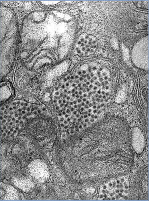
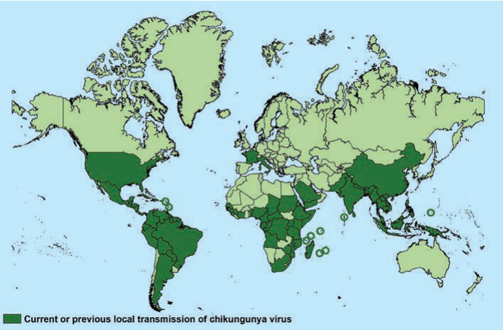
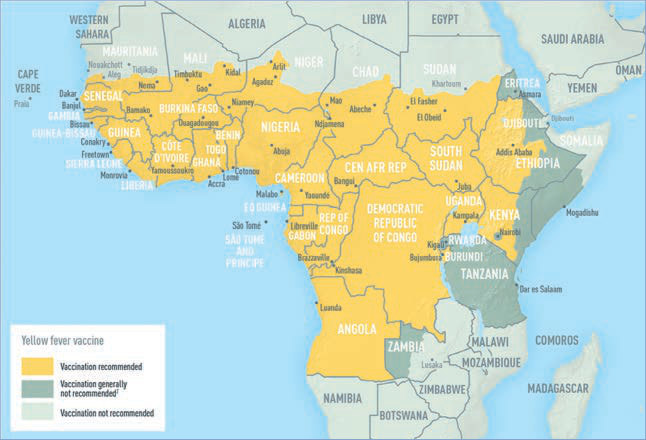
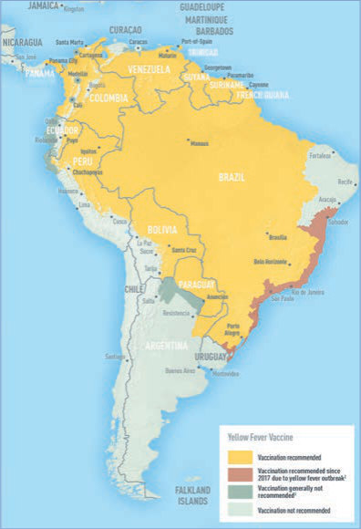

# 6. Arboviruses (Including Cache Valley, Colorado Tick Fever, Eastern Equine Encephalitis, Heartland, Jamestown Canyon, Japanese Encephalitis, La Crosse, Powassan, St. Louis Encephalitis, Tick-borne Encephalitis, and Yellow Fever Viruses)
> Private study reference ([source credits](../../SOURCE_CREDITS.md)). PDF pages 42-52; printed pages 28-38.

## PDF page 42 | printed page 28

(Including Cache Valley, Colorado Tick Fever, Eastern Equine Encephalitis, Heartland, Jamestown Canyon, Japanese Encephalitis, La Crosse, Powassan, St. Louis Encephalitis, Tick-borne Encephalitis, and Yellow Fever Viruses)

### CLINICAL MANIFESTATIONS

Most infections with arthropod-borne viruses (arboviruses) are subclinical. Symptomatic illness usually manifests as 1 of 3 primary clinical syndromes: generalized febrile illness, neuroinvasive disease, or hemorrhagic fever (Table 6.1).

• Generalized febrile illness. Most arboviruses are capable of causing a nonspecific febrile illness that often includes headache, arthralgia, myalgia, and rash. Some arboviruses can cause more characteristic clinical manifestations, such as neuroinvasive disease, severe

Table 6.1 Clinical Manifestations for Selected Domestic and International Arboviral Diseases

Virus Generalized Febrile Illness Domestic

Cache Valley Yes

Colorado tick fever Yes

Eastern equine encephalitis Yes

Heartlandb Yes

Jamestown Canyon Yes

La Crosse Yes

Powassan Yes

St. Louis encephalitis Yes

West Nile Yes

International

Chikungunyac Yes

Denguec Yes

Japanese encephalitis Yes

Tick-borne encephalitis Yes

Yellow fever Yes

Zikac Yes

a Meningitis, encephalitis, or myelitis. b As of 2021, no pediatric infections documented; however, testing of children has been limited. c Endemic with periodic outbreaks in U.S. territories (Puerto Rico, U.S. Virgin Islands, American Samoa); local mosquito-borne transmission of chikungunya, dengue, and Zika viruses previously identified in Florida and Texas; local transmission of dengue virus also previously identified in Hawaii.

polyarthralgia, thrombocytopenia and leukopenia (eg, Heartland virus), or jaundice (eg, yellow fever virus). With some arboviruses, fatigue, malaise, and weakness can linger for weeks following the initial infection.

• Neuroinvasive disease. Many arboviruses cause neuroinvasive disease, including aseptic meningitis, encephalitis, or myelitis. Less common neurologic manifestations (eg, Guillain- Barré syndrome) also can occur. Neurologic symptoms may be preceded by a prodrome similar to the generalized febrile illness, or neurologic findings may be the initial indication of infection. Specific symptoms vary by virus but can include vomiting, stiff neck, mental status changes, seizures, or focal neurologic deficits. Some viruses (eg, West Nile and Japanese encephalitis viruses) can cause a syndrome of acute flaccid paralysis, either in conjunction with meningoencephalitis or as an isolated finding. Severity and long-term outcome of the

Neuroinvasive Diseasea Hemorrhagic Fever

Yes No

Rare No

Yes No

No No

Yes No

Yes No

Yes No

Yes No

Yes No

Rare No

Rare Yes

Yes No

Yes No

No Yes

Yes No

### Geometry-detected table

|Virus|Generalized Febrile Illness|Neuroinvasive Diseasea|Hemorrhagic Fever|
|---|---|---|---|
|**Domestic**|**Domestic**|**Domestic**|**Domestic**|
|Cache Valley|Yes|Yes|No|
|Colorado tick fever|Yes|Rare|No|
|Eastern equine encephalitis|Yes|Yes|No|
|Heartlandb|Yes|No|No|
|Jamestown Canyon|Yes|Yes|No|
|La Crosse|Yes|Yes|No|
|Powassan|Yes|Yes|No|
|St. Louis encephalitis|Yes|Yes|No|
|West Nile|Yes|Yes|No|
|**International**|**International**|**International**|**International**|
|Chikungunyac|Yes|Rare|No|
|Denguec|Yes|Rare|Yes|
|Japanese encephalitis|Yes|Yes|No|
|Tick-borne encephalitis|Yes|Yes|No|
|Yellow fever|Yes|No|Yes|
|Zikac|Yes|Yes|No|

[View original table](../../tables/ch006_p0042_1.jpg)

## PDF page 43 | printed page 29

illness vary by etiologic agent and the underlying characteristics of the host, such as age, immune status, and preexisting medical conditions.

• Hemorrhagic fever. Hemorrhagic fever can be caused by some arboviruses, such as dengue and yellow fever viruses. After several days of nonspecific febrile illness, the patient may develop overt signs of hemorrhage (eg, petechiae, ecchymoses, bleeding from the nose and gums, hematemesis, melena) and shock (eg, decreased peripheral circulation, azotemia, tachycardia, hypotension). Hemorrhagic fever and shock caused by yellow fever virus has a high mortality rate and may be confused with other viral hemorrhagic fevers that can occur in the same geographic areas (eg, Argentine hemorrhagic fever, Bolivian hemorrhagic fever, Ebola, Lassa fever, or Marburg). Although dengue may be associated with severe hemorrhage, the shock is attributable primarily to a capillary leak syndrome, which, if properly treated with fluids, has a good prognosis.

### ETIOLOGY

Arboviruses are RNA viruses that are transmitted to humans primarily through bites of infected arthropods (mosquitoes, ticks, sand flies, and biting midges). More than 100 arboviruses are known to cause human disease. The viral families responsible for most arboviral infections in humans are Flaviviridae (genus Flavivirus), Togaviridae (genus Alphavirus), Peribunyaviridae (genus Orthobunyavirus), and Phenuiviridae (genera Phlebovirus and Bandavirus). Reoviridae (genus Coltivirus) also are responsible for a smaller number of human arboviral infections (eg, Colorado tick fever) (Table 6.2).

### EPIDEMIOLOGY

Most arboviruses maintain enzootic cycles of transmission between birds or small mammals and arthropod vectors. Humans and domestic animals usually are infected incidentally as “dead-end” hosts. Important exceptions are chikungunya, dengue, yellow fever, and Zika viruses, which can be spread from person-to-arthropod-to-person (anthroponotic transmission). For other arboviruses, humans usually do not develop a sustained or high enough level of viremia to infect biting arthropod vectors. Direct person-to-person spread of some arboviruses has been documented to

occur through blood transfusion, organ transplantation, sexual transmission, intrauterine transmission, perinatal transmission, and human milk. Transmission through percutaneous, mucosal, or aerosol exposure to some arboviruses has occurred rarely in laboratory and occupational settings.

Arboviral infections occur in the United States primarily from late spring through early fall, when mosquitoes and ticks are most active. The number of domestic or imported arboviral disease cases reported in the United States varies greatly by specific etiology and year. Underdiagnosis of milder disease makes accurate determination of the number of cases difficult.

In general, the risk of developing severe clinical disease for most arboviral infections in the United States is higher among adults than among children. One notable exception is La Crosse virus infection, for which children are at highest risk of severe neurologic disease and possible long-term sequelae. Eastern equine encephalitis virus causes a low incidence of disease but has a high case fatality rate (30%–40%) across all age groups.

The incubation periods for arboviral diseases typically range between 2 and 15 days. Longer incubation periods can occur in immunocompromised people and with tick-borne viruses, such as Colorado tick fever, Powassan, and tick-borne encephalitis viruses.

### DIAGNOSTIC TESTS

Arboviral infections are confirmed most frequently by detection of virus-specific antibody in serum or cerebrospinal fluid (CSF). Acute-phase serum specimens should be tested for virus-specific immunoglobulin (Ig) M antibody. With clinical and epidemiologic correlation, a positive IgM test result has good diagnostic predictive value, but cross-reaction between related arboviruses from the same viral family can occur (eg, West Nile and St. Louis encephalitis viruses, both flaviviruses). For most arboviral infections, IgM is detectable within a week after onset of illness and persists for 30 to 90 days, but longer persistence has been documented, especially with West Nile and Zika viruses. Therefore, a positive serum IgM test result occasionally can reflect a prior infection. Serum collected within 10 days of illness onset might not have detectable IgM, and the test should be

## PDF page 44 | printed page 30

Domesticd States Cache Valley Orthobunyavirus Widespread Canada, Central America, and the Caribbean Mosquitoes Colorado tick fever Coltivirus Rocky Mountain and western states Western Canada Ticks

Eastern equine encephalitis Alphavirus Eastern, Midwest, and Gulf coast states Americas Mosquitoes Heartland Bandavirus Central and Southeast None Ticks Jamestown Canyon Orthobunyavirus Widespread Canada Mosquitoes La Crosse Orthobunyavirus Midwest and Appalachia Canada Mosquitoes

Virus Genus United States Non-United States Vector

Genus, Geographic Location, and Vectors for Selected Domestic and International Arboviral Diseases

Predominant Geographic Locations

Table 6.2

St. Louis encephalitis Flavivirus Widespread Americas Mosquitoes West Nile Flavivirus Widespread Americas, Europe, Africa, Asia Mosquitoes International Chikungunya Alphavirus Imported and periodic local transmissiona Worldwide in tropical and subtropical areas Mosquitoes Dengue Flavivirus Imported and periodic local transmissiona Worldwide in tropical and subtropical areas Mosquitoes Japanese encephalitis Flavivirus Imported only Australia, and other limited parts of Asia Mosquitoes Tick-borne encephalitis Flavivirus Imported only Europe, northern Asia Ticks Yellow fever Flavivirus Imported only South America, Africa Mosquitoes Zika Flavivirus Imported and periodic local transmissiona Worldwide in tropical and subtropical areas Mosquitoes

a Endemic with periodic outbreaks in U.S. territories (Puerto Rico, U.S. Virgin Islands, American Samoa); local mosquito-borne transmission of chikungunya, dengue, and Zika viruses previously identified in Florida and Texas; local transmission of dengue virus also previously identified in Hawaii.

Powassan Flavivirus Northeast and Midwest Canada, Russia Ticks

### Geometry-detected table

|Virus|Predominant Geographic Locations|Col3|Col4|Col5|
|---|---|---|---|---|
|**Virus**|**Genus**|**United States**|**Non-United States**|**Vector**|
|**Domesticd States**|**Domesticd States**|**Domesticd States**|**Domesticd States**|**Domesticd States**|
|Cache Valley|_Orthobunyavirus_|Widespread|Canada, Central America, and the Caribbean|Mosquitoes|
|Colorado tick fever|_Coltivirus_|Rocky Mountain and western states|Western Canada|Ticks|
|Eastern equine encephalitis|_Alphavirus_|Eastern, Midwest, and Gulf coast states|Americas|Mosquitoes|
|Heartland|_Bandavirus_|Central and Southeast|None|Ticks|
|Jamestown Canyon|_Orthobunyavirus_|Widespread|Canada|Mosquitoes|
|La Crosse|_Orthobunyavirus_|Midwest and Appalachia|Canada|Mosquitoes|
|Powassan|_Flavivirus_|Northeast and Midwest|Canada, Russia|Ticks|
|St. Louis encephalitis|_Flavivirus_|Widespread|Americas|Mosquitoes|
|West Nile|_Flavivirus_|Widespread|Americas, Europe, Africa, Asia|Mosquitoes|
|**International**|**International**|**International**|**International**|**International**|
|Chikungunya|_Alphavirus_|Imported andperiodic local transmissiona|Worldwide in tropical and subtropical areas|Mosquitoes|
|Dengue|_Flavivirus_|Imported andperiodic local transmissiona|Worldwide in tropical and subtropical areas|Mosquitoes|
|Japanese encephalitis|_Flavivirus_|Imported only|Australia, and other limitedparts of Asia|Mosquitoes|
|Tick-borne encephalitis|_Flavivirus_|Imported only|Europe, northern Asia|Ticks|
|Yellow fever|_Flavivirus_|Imported only|South America, Africa|Mosquitoes|
|Zika|_Flavivirus_|Imported andperiodic local transmissiona|Worldwide in tropical and subtropical areas|Mosquitoes|

[View original table](../../tables/ch006_p0044_1.jpg)

## PDF page 45 | printed page 31

repeated on a convalescent-phase serum sample. IgG antibody generally is detectable in serum shortly after IgM and persists for years. A plaquereduction neutralization test can be performed to measure virus-specific neutralizing antibodies and to discriminate between cross-reacting antibodies in primary arboviral infections. Either seroconversion or a fourfold or greater increase in virus-specific neutralizing antibodies between acute- and convalescent-phase serum specimens collected 2 to 3 weeks apart is diagnostic of recent infection. In patients who have been immunized against or infected with another arbovirus from the same virus family in the past (ie, secondary infection), cross-reactive antibodies in both the IgM and neutralizing antibody assays might make it difficult to identify which arbovirus is causing the patient’s current illness. For some arboviral infections (eg, Colorado tick fever or Heartland virus disease), the immune response may be delayed, with IgM antibodies not appearing until 2 to 3 weeks after onset of illness and neutralizing antibodies taking up to a month to develop. Patients with significant immunosuppression (eg, patients who have received a solid organ transplant, recent chemotherapy, or certain immunosuppressive therapies, such as rituximab) may have a delayed or blunted serologic response, and nucleic acid amplification tests (NAATs) may be indicated in these cases. Immunization and travel history, date of symptom onset, and information regarding other arboviruses known to circulate in the geographic area that may cross-react in serologic assays should be considered when interpreting results.

Viral culture and NAATs for RNA detection can be performed on acute-phase serum, CSF, or tissue specimens. Arboviruses that are more likely to be detected using culture or NAATs early in the illness include Colorado tick fever, dengue, Heartland, yellow fever, and Zika viruses. For other arboviruses, results of these tests often are negative even early in the clinical course because of the relatively short duration of viremia in immunocompetent persons. Immunohistochemical staining can detect specific viral antigen in fixed tissue.

Antibody testing for common domestic arboviral diseases is performed in most state public health laboratories and many commercial laboratories. Confirmatory plaque reduction neutralization tests, viral culture, NAATs, immunohistochemical staining, and testing for less common domestic

and international arboviruses are performed at the Centers for Disease Control and Prevention (CDC; telephone: 970-221-6400) and selected other reference laboratories. Confirmatory testing typically is arranged through local and state health departments.

### TREATMENT

The primary treatment for all arboviral disease is supportive care. Although various antiviral and immunologic therapies have been evaluated for several arboviral diseases, none has shown clear benefit.

### INFECTION PREVENTION AND CONTROL MEASURES IN HEALTH CARE SETTINGS

Standard precautions are recommended.

### CONTROL MEASURES

Reduction of vectors in areas with endemic transmission is important to decrease risk of infection. Use of personal protective methods, such as insect repellent, wearing long pants and long-sleeved shirts while outdoors, conducting a full-body check for ticks after outdoor activities, staying in screened or air-conditioned dwellings, and limiting outdoor activities during peak vector feeding times, can help decrease risk of human infection. Some arboviral infections also can be prevented through screening of blood donations or through immunization. The blood supply in the United States is screened routinely for West Nile virus. Some arboviruses can be transmitted through human milk, although transmission appears rare. Mothers should be encouraged to breastfeed even in areas of active arboviral transmission because benefits of breastfeeding seem to outweigh the low risk of illness in breastfeeding infants. The CDC has issued guidance for prevention of sexual transmission.

Vaccines available in the United States to protect against arbovirus disease include the following products.

Yellow Fever Vaccine1

Live attenuated (17D strain) yellow fever vaccine is available from state-approved clinics or immunization providers. Unless contraindicated, yellow fever immunization is recommended for all people 9 months or older living in or traveling to areas with endemic disease in South America and Africa and is required by international regulations for

## PDF page 46 | printed page 32

travel to and from certain countries (wwwnc. cdc.gov/travel/). Infants younger than 6 months should not be immunized with yellow fever vaccine, because they have an increased risk of vaccine-associated encephalitis. The decision to immunize infants between 6 and 9 months of age must balance the infant’s risk of exposure with risk of vaccine-associated encephalitis.

Booster doses of yellow fever vaccine are no longer recommended for most travelers, because a single dose of yellow fever vaccine provides longlasting protection. Additional doses are recommended for certain populations (ie, people initially vaccinated when they were pregnant, patients who received a hematopoietic cell transplant after their initial vaccination, and people infected with human immunodeficiency virus; www.cdc.gov/ mmwr/preview/mmwrhtml/mm6423a5. htm#Box), as they might not have a robust or sustained immune response to yellow fever vaccine compared with other recipients. Additional doses may be administered to certain groups believed to be at increased risk for yellow fever disease because of their itinerary and duration of travel or because of more consistent exposure to the virus (eg, laboratory workers).

Yellow fever vaccine is a live-virus vaccine produced in chicken eggs and, thus, is contraindicated in people who have a history of acute hypersensitivity to eggs or egg products and in people who are immunocompromised. Procedures for immunizing people with severe egg allergy are described in the vaccine package insert. Generally, people who are able to eat eggs or egg products may receive the vaccine.

Pregnancy and breastfeeding are precautions to yellow fever vaccine administration, because rare cases of transmission of the vaccine virus in utero or through breastfeeding have been documented. Whenever possible, pregnant and breastfeeding individuals should defer travel to areas where yellow fever is endemic. If travel to an area with endemic disease is unavoidable and risks for yellow fever virus exposure are believed to outweigh the vaccination risks, a pregnant or breastfeeding person should be vaccinated. If risks of vaccination are believed to outweigh risks for yellow fever virus exposure, a pregnant or breastfeeding person should be excused from immunization and issued a medical waiver letter to fulfill health regulations.

For more detailed information on the yellow fever vaccine, including adverse events, precautions, and contraindications, visit wwwnc.cdc.gov/ travel/ or www.cdc.gov/yellowfever/ healthcareproviders/vaccine-info.html.

Japanese Encephalitis Vaccine2

Risk of Japanese encephalitis for most travelers to Asia is very low but varies based on destination, duration of travel, season, activities, and accommodations. All travelers to countries with endemic Japanese encephalitis should be informed of the potential for infection and should use personal protective measures to reduce risk of mosquito bites. For some travelers who might be at increased risk for Japanese encephalitis, Japanese encephalitis vaccine can reduce the risk for infection further. Japanese encephalitis vaccine is recommended for those becoming residents of a country with endemic transmission, longerterm travelers (eg, a month or longer), and frequent travelers to areas with endemic disease (www.cdc.gov/vaccines/hcp/acip-recs/ vacc-specific/je.html). Japanese encephalitis vaccine also should be considered for shorter-term travelers if they plan to travel outside of an urban area and have an itinerary or activities that will increase their risk of mosquito exposure in an area with endemic transmission. Information on the location of Japanese encephalitis virus transmission and detailed information on vaccine recommendations and adverse events can be obtained from the CDC (www.cdc.gov/ japaneseencephalitis/).

The Japanese encephalitis vaccine licensed in the United States is non-live Vero cell culture-derived vaccine (Ixiaro [JE-VC]) available for use in adults and children 2 months and older. The primary vaccination series is 2 doses administered 28 days apart for those younger than 18 years or older than 65 years of age, and 7–28 days apart for those 18 to 65 years of age. The dose is 0.25 mL for children 2 months through 2 years of age and 0.5 mL for adults and children 3 years and older. For adults and children, a booster dose may be administered at 1 year or longer after the primary series if ongoing exposure or re-exposure is expected.

No safety concerns have been identified in passive postmarketing surveillance of more than 1 million doses of JE-VC distributed in the United States.

## PDF page 47 | printed page 33

Safety, immunogenicity, and effectiveness of JE-VC have not been assessed in pregnant individuals.

Dengue Vaccine3

A recombinant live attenuated tetravalent dengue vaccine (Dengvaxia) is licensed in multiple countries in Asia, Latin America, and Europe. The U.S. Food and Drug Administration (FDA) has approved Dengvaxia in 2019 for use in people 6 through 16 years of age who have laboratory evidence of previous dengue virus infection and who live in areas with endemic infection. The vaccine is given as a 3-dose series with 6 months between doses. The CDC Advisory Committee on Immunization Practices (ACIP) currently recommends vaccination with the Dengvaxia vaccine for children 9 through 16 years of age who live in an area where dengue is endemic and have evidence of a previous dengue infection; as of December 2023, the ACIP had not yet voted on recommending its lower age range align with the FDA’s approved range. Recommendations for use of dengue vaccine in the United States were published in 2021, and vaccination in Puerto Rico began in 2022.

Tick-borne Encephalitis Vaccine4

A tick-borne encephalitis vaccine became available for the first time in the United States in August 2021. Risk for tick-borne encephalitis is very low for most travelers to the parts of Europe and Asia where the disease is endemic. Some people are at increased risk for infection based on their season and location of travel and their activities. Tickborne encephalitis vaccine is recommended for people who are moving or traveling to an area with endemic infection and will have extensive exposure to ticks based on their planned outdoor activities and itinerary. It may be considered for others who might engage in outdoor activities in areas with endemic infection, with the decision to vaccinate based on assessment of their planned activities and itinerary, risk factors for a poorer medical outcome, and personal perception and tolerance of risk. Detailed information on the location of tick-borne encephalitis, risk factors for infection, and vaccine considerations can be found on the CDC website (www.cdc.gov/ tick-borne-encephalitis/index.html).

The non-live tick-borne encephalitis vaccine can be used in adults and children 1 year and older. The 3-dose primary vaccination series for children and adolescents 1 through 15 years of age consists of 0.25-mL doses on day 0 (dose 1), at 1–3 months after the first vaccination (dose 2), and 5–12 months after the second vaccination (dose 3). The schedule for persons 16 years and older is similar, but dose 2 can be given as early as 14 days after dose 1. The vaccine dose recommended for people 16 years and older is 0.5 mL. A booster dose may be administered at least 3 years after completion of the primary series if ongoing exposure or re-exposure is expected.

The vaccine is contraindicated in any person with a history of a severe allergic reaction (eg, anaphylaxis) to any vaccine component, including chicken protein, neomycin, gentamicin, and protamine sulfate. A complete list of components is provided in the package insert.

Public Health Reporting

Most arboviral diseases are nationally notifiable conditions and should be reported to the appropriate local and state health authorities. Underdiagnosis of these diseases because of challenges with laboratory confirmation and lack of active surveillance is common, suggesting that the actual numbers of cases are likely significantly higher. For select arboviruses (eg, chikungunya, dengue, Zika, and yellow fever viruses), patients may remain viremic during their acute illness. Such patients pose a risk for further person-to-mosquito-toperson transmission, increasing the importance of timely reporting.

1 Centers for Disease Control and Prevention. Yellow Fever ACIP

Vaccine Recommendations. Available at: www.cdc.gov/ vaccines/hcp/acip-recs/vacc-specific/yf.html 2 Hills SL, Walter EB, Atmar RL, Fischer M. Japanese encephalitis vaccine: Recommendations of the Advisory Committee on Immunization Practices (ACIP). MMWR Recomm Rep. 2019;68(RR-2):1–33 3 Paz-Bailey G, Adams L, Wong JM, et al. Dengue vaccine: recommendations of the Advisory Committee on Immunization Practices, United States, 2021. MMWR Recomm Rep. 2021;70(6):1–16 4 Hills SL, Poehling KA, Chen WH, Staples JE. Tick-borne encephalitis vaccine: recommendations of the Advisory Committee on Immunization Practices, United States, 2023. MMWR Recomm Rep. 2023;72(RR-5):1–29

## PDF page 48 | printed page 34

A B

Image 6.1 Digital gangrene in an 8-month-old girl during week 3 of hospitalization. She was admitted to the hospital with fever, multiple seizures, and a widespread rash; chikungunya virus was detected in her plasma. A, Little finger of the left hand; B, index finger of the right hand; C, 4 toes on the right foot. Courtesy of Centers for Disease Control and Prevention/ Emerging Infectious Diseases.

Image 6.2 Cutaneous eruption of chikungunya virus infection, a generalized exanthema comprising noncoalescent lesions, occurs during the first week of the disease, as found in this patient with erythematous maculopapular lesions with islands of normal skin. Courtesy of Centers for Disease Control and Prevention/Emerging Infectious Diseases and Patrick Hochedez.

Image 6.3 An electron micrograph of eastern equine encephalomyelitis virus in a mosquito salivary gland; Alphavirus, eastern equine encephalomyelitis. Courtesy of Centers for Disease Control and Prevention.

C

## PDF page 49 | printed page 35

Image 6.4 An electron micrograph of yellow fever virus virions. Virions are spheroidal, uniform in shape, and 40–60 nm in diameter. The name yellow fever comes from the ensuing jaundice that affects some patients. The vector is the Aedes aegypti or Haemagogus species mosquito. Courtesy of Centers for Disease Control and Prevention.

Image 6.5 This colorized transmission electron micrograph depicts a salivary gland that had been extracted from a mosquito, which was infected by the eastern equine encephalitis virus, which has been colorized red (magnification ×83,900). Courtesy of Centers for Disease Control and Prevention/Fred Murphy, MD, and Sylvia Whitfield.

## PDF page 50 | printed page 36

Countries and territories where chikungunya cases have been reported* (as of October 30, 2020)

*Does not include countries or territories where only imported cases have been documented.

Data table: Countries and territories where chikungunya cases have been reported

AFRICA ASIA Angola Bangladesh Benin Bhutan Burundi Cambodia Cameroon China Central African Republic India Chad Indonesia Cote d’Ivoire Laos Dem. Republic of the Malaysia Djibouti Maldives Equatorial Guinea Myanmar (Burma) Eritrea Nepal Ethiopia Pakistan Gabon Philippines Guinea Saudi Arabia Kenya Singapore Madagascar Sri Lanka Malawi Taiwan Mauritius Thailand Mayotte Timor-Leste Mozambique Vietnam Nigeria Yemen Republic of the Congo Reunion Senegal EUROPE Seychelles France Sierra Leone Italy Somalia South Africa Sudan Tanzania Uganda Zimbabwe

Image 6.6 Countries and territories where chikungunya has been reported (as of October 30, 2020).

AMERICAS Anguilla Panama Antigua and Barbuda Paraguay Argentina Peru Aruba Puerto Rico Bahamas Saint Barthelemy Barbados Saint Kitts and Nevis Belize Saint Lucia Bolivia Saint Martin Brazil Saint Vincent & the British Virgin Islands Sint Maarten Cayman Islands Suriname Colombia Trinidad and Tobago Costa Rica Turks and Caicos Islands Cuba United States Curacao US Virgin Islands Dominica Venezuela Dominican Republic Ecuador El Salvador OCEANIA/PACIFIC ISLANDS French Guiana American Samoa Grenada Cook Islands Guadeloupe Federal States of Micronesia Guatemala Fiji Guyana French Polynesia Haiti Kiribati Honduras Marshall Islands Jamaica New Caledonia Martinique Papua New Guinea Mexico Samoa Montserrat Tokelau Nicaragua Tonga

## PDF page 51 | printed page 37

Image 6.7 Yellow fever vaccine recommendations in Africa. Courtesy of Centers for Disease Control and Prevention.

Image 6.8 Yellow fever vaccine recommendations in the Americas. Courtesy of Centers for Disease Control and Prevention.

## PDF page 52 | printed page 38

Image 6.9 This horse was displaying symptoms of the arboviral disease Venezuelan equine encephalomyelitis. Etiologic pathogens responsible for equine encephalitic diseases are transmitted to horses by mosquitoes, with reservoirs being various bird species. Courtesy of Centers for Disease Control and Prevention.

Image 6.10 A close-up anterior view of a Culex tarsalis mosquito as it was about to begin feeding. The epidemiological importance of C tarsalis lies in its ability to spread western equine encephalomyelitis, St Louis encephalitis, and California encephalitis, and C tarsalis is currently the main vector of West Nile virus in the western United States. Courtesy of Centers for Disease Control and Prevention/James Gathany.

