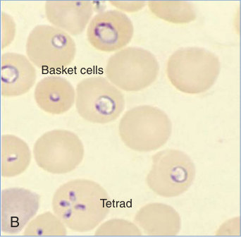
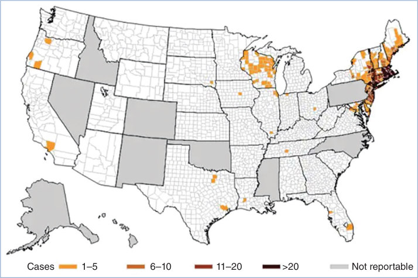

# 11. Babesiosis
> Private study reference ([source credits](../../SOURCE_CREDITS.md)). PDF pages 67-71; printed pages 53-57.

## PDF page 67 | printed page 53

### CLINICAL MANIFESTATIONS

Babesia infection in children and adolescents often is asymptomatic or associated with mild, nonspecific symptoms. The infection also can be severe and life-threatening, particularly in people who are immunocompromised, including those at the extremes of age (neonates and the elderly), those who lack a spleen, and those who have human immunodeficiency virus infection/acquired immunodeficiency syndrome or cancer or are on immunosuppressive drugs. Babesiosis, like malaria, is characterized by the presence of fever and hemolytic anemia. Clinical manifestations can include malaise and fatigue, often followed by fever, chills, sweats, anorexia, myalgia, headache, arthralgia, and/or nausea. Severe babesiosis may require hospitalization for management of marked anemia, adult respiratory distress syndrome, disseminated intravascular coagulation, congestive heart failure, renal impairment, shock, or splenic rupture. Congenital infection with nonspecific manifestations suggestive of sepsis has been reported, as has persistent relapsing disease in highly immunocompromised hosts.

Babesiosis should be considered in a patient who resides in or traveled to an area with endemic infection and develops compatible symptoms and characteristic laboratory abnormalities, including anemia, thrombocytopenia, or evidence of intravascular hemolysis (abnormal aspartate aminotransferase, alanine aminotransferase, alkaline phosphatase, lactate dehydrogenase, total and direct bilirubin concentrations, or reduced haptoglobin).

### ETIOLOGY

Babesia species are intraerythrocytic protozoa that usually are transmitted by the bite of a hard-bodied tick. The etiologic agents of human babesiosis in the United States include Babesia microti, the most common cause of infection, Babesia duncani, and rarely, Babesia divergens.

### EPIDEMIOLOGY

Babesiosis predominantly is a tick-borne zoonosis. Babesia parasites also can be transmitted via blood transfusion, via organ transplantation, and perinatally. The primary reservoir host for B microti

in the United States is the white-footed mouse (Peromyscus leucopus), and the primary tick vector is Ixodes scapularis, which can transmit other pathogens, such as Borrelia burgdorferi, the causative agent of Lyme disease, and Anaplasma phagocytophilum, the causative agent of human granulocytic anaplasmosis. A tick bite often is not noticed, in part because the nymphal stage of the tick is approximately the size of a poppy seed. White-tailed deer (Odocoileus virginianus) serve as hosts for tick procreation and a blood meal, but deer are not reservoir hosts of B microti. An increase in deer populations in the Northeast and northern Midwest during the past few decades is thought to be a major factor in the increase and spread of I scapularis ticks. Most cases of babesiosis in the United States have been reported from states on the East Coast (Connecticut, Massachusetts, New Jersey, New York, Rhode Island) and the northern Midwest (Minnesota, Wisconsin), where deer populations have increased (www.cdc.gov/parasites/babesiosis/datastatistics/maps/maps.html). Over the last few years, increasing numbers of cases have been reported from neighboring states such as Maine, New Hampshire, and Vermont. Occasional human cases of babesiosis caused by B duncani have been described in California, Oregon, and Washington State, and single cases caused by B divergens have been reported in Arkansas, Kentucky, Michigan, Missouri, and Washington State. Most U.S. vector-borne cases of babesiosis occur during late spring, summer, or fall; transfusionassociated cases can occur year-round. More than 2,000 cases of babesiosis are reported annually to the Centers for Disease Control and Prevention, but the number of cases likely is higher.

The incubation period ranges from approximately 1 to 6 weeks after a tick bite. A study of transfusion-associated cases found a median incubation period following a contaminated blood transfusion of 37 days (range, 11 to 176 days), but it may be longer (eg, latent infection can become symptomatic after splenectomy).

### DIAGNOSTIC TESTS1

Acute, symptomatic cases of babesiosis typically are diagnosed by microscopic identification of Babesia parasites on Giemsa- or Wright-stained blood smears. Babesia parasites may be confused with Plasmodium falciparum, but they can be

## PDF page 68 | printed page 54

distinguished by an experienced microscopist. The tetrad (Maltese-cross) form is pathognomonic for Babesia but often is not present.

In cases in which blood smear examination is negative but the index of suspicion for babesiosis remains high, molecular testing using a nucleic acid amplification test (NAAT) offers increased sensitivity in settings of low-level B microti parasitemia. NAAT results may remain positive for several months to more than a year after successful treatment. Some physicians may order a NAAT rather than a blood smear to confirm the diagnosis, especially if a skilled microscopist is not available. NAATs are species-specific, and most laboratories only offer B microti NAAT (www. cdc.gov/dpdx/babesiosis/index.html).

A single serologic test for Babesia antibody detection should not be used to diagnose acute disease because of difficulty distinguishing acute disease from previous infection. In geographic areas where both B microti and B burgdorferi are endemic, between 2% and 20% of patients with early Lyme disease have been reported to experience concurrent babesiosis coinfection, and 10% to 50% of patients with babesiosis have been found to be coinfected with B burgdorferi. Other tick-borne coinfections, such as anaplasmosis, should be considered as well in patients with babesiosis and/or Lyme disease. When coinfection is documented, patients should receive therapies appropriate for each infection.

### TREATMENT2

Atovaquone (administered orally) plus azithromycin (administered orally in ambulatory patients with mild to moderate disease and intravenously in hospitalized patients with severe disease) for 7 to 10 days is the regimen of choice. Oral or intravenous clindamycin plus oral quinine sulfate may be used for patients who do not respond to atovaquone and azithromycin, although quinine commonly causes serious adverse effects. Severe babesiosis can be life-threatening despite antimicrobial therapy. Limited data suggest exchange transfusion has potential benefits that may outweigh potential adverse effects, particularly in patients with high levels of parasitemia (>10%) or evidence of severe organ dysfunction. Treatment for at least 6 weeks or longer is recommended for severely immunocompromised patients experiencing persistent relapsing disease despite recommended

antibiotic therapy, with negative blood smears for 2 weeks or longer before discontinuing therapy. Higher doses of azithromycin (500 to 1,000 mg per day, orally, in adolescents/adults) should be considered when treating a highly immunocompromised patient. Limited data are available for treatment of disease caused by B duncani or B divergens, but most reported patients have been treated with intravenous clindamycin plus oral quinine. Effectiveness of atovaquone plus azithromycin in treating B duncani infection has not been evaluated.

Peripheral blood smears should be performed during acute illness to monitor Babesia parasitemia for all patients. Testing of immunocompromised patients should continue daily until parasitemia is less than 4% and then weekly until blood smear results are negative; a NAAT should be considered for those whose symptoms persist after the blood smear results have become negative. Immunocompetent persons do not require testing once symptoms have resolved; NAAT results may remain positive for months or years after appropriate treatment, and this does not indicate treatment failure.

### INFECTION PREVENTION AND CONTROL MEASURES IN HEALTH CARE SETTINGS

Standard precautions are recommended.

### CONTROL MEASURES

Recommendations for prevention of tick bites are similar to those for prevention of Lyme disease and other tick-borne infections. People with a known history of Babesia infection are deferred indefinitely from donating blood. In 2019, the U.S. Food and Drug Administration (FDA) issued guidance to industry for regional, yearround testing using a licensed NAAT for Babesia infection or use of an FDA-approved pathogenreduction device in the 14 highest-risk states (www.fda.gov/regulatory-information/ search-fda-guidance-documents/ recommendations-reducing-risk-transfusiontransmitted-babesiosis).

Public Health Reporting

Babesiosis is a nationally notifiable disease. Please refer to the state or local health department for details on reporting cases.

## PDF page 69 | printed page 55

1 Krause PJ, Auwaerter PG, Bannuru RR, et al. Clinical practice guidelines by the Infectious Diseases Society of America (IDSA): 2020 Guideline on diagnosis and management of babesiosis. Clin Infect Dis. 2021;72(2):e49–e64

A

Image 11.1 Infection with Babesia in a 6-year-old girl after a splenectomy was performed because of hereditary spherocytosis (Giemsa-stained thin smears). A, The tetrad (left side of the image), a dividing form, is pathognomonic for Babesia. Note also the variation in size and shape of the ring stage parasites (compare A and B) and the absence of pigment. Courtesy of Centers for Disease Control and Prevention.

Extracellular syncytium

Multiple parasites per erythrocyte

A

Image 11.2 Giemsa-stained (A) and Wright-stained (B) peripheral blood smear from a newborn with probable Babesia microti infection. Parasitemia was estimated in this newborn at approximately 15% on the basis of the number of parasites per 200 leukocytes counted. The smear demonstrated thrombocytopenia and parasites of variable size and morphological appearance and an absence of pigment (magnification ×1,000). Courtesy of Centers for Disease Control and Prevention/ Emerging Infectious Diseases.

2 Krause PJ, Auwaerter PG, Bannuru RR, et al. Clinical practice guidelines by the Infectious Diseases Society of America (IDSA): 2020 Guideline on diagnosis and management of babesiosis. Clin Infect Dis. 2021;72(2):e49–e64

B

Basket cells

Tetrad

B

## PDF page 70 | printed page 56

i

6

Tick takes a blood meal (sporozoites introduced into host)

i

= Infective stage

= Diagnostic stage

d

1

Sporozoites

i

a blood meal (sporozoites introduced

Sporogony

Tick

5

4

Tick takes a blood meal (ingests gametes)

Ookinete enters salivary gland

A

Fertilization in gut

Image 11.3 The Babesia microti life cycle involves 2 hosts, including a rodent, primarily the white-footed mouse (Peromyscus leucopus). During a blood meal, a Babesia-infected tick introduces sporozoites into the mouse host (1). Sporozoites enter erythrocytes and undergo asexual reproduction (budding) (2). In the blood, some parasites differentiate into male and female gametes, although these cannot be distinguished at the light microscope level (3). The definitive host is a tick, in this case the deer tick (Ixodes scapularis). Once ingested by an appropriate tick (4), gametes unite and undergo a sporogonic cycle, resulting in sporozoites (5). Transovarial transmission (also known as vertical, or hereditary, transmission) has been documented for “large” Babesia species but not for the “small” Babesia species, such as B microti (A). Humans enter the cycle when bitten by infected ticks. During a blood meal, a Babesia-infected tick introduces sporozoites into the human host (6). Sporozoites enter erythrocytes (B) and undergo asexual replication (budding) (7). Multiplication of the blood stage parasites is responsible for clinical manifestations of the disease. Humans are, for all practical purposes, dead-end hosts, and there is probably little, if any, subsequent transmission that occurs from ticks feeding on infected persons. However, human-to-human transmission is well recognized to occur through blood transfusions (8). Note: Deer are the hosts on which the adult ticks feed and are indirectly part of the Babesia cycle because they influence the tick population. When deer populations increase, tick populations also increase, thus heightening the potential for transmission. Courtesy of Centers for Disease Control and Prevention.

B

Transmitted from human to human via blood transfusion

d

8

Trophozoite

7

Merozoite

Tick takes into host)

Trophozoite

Mouse

2

Merozoite

3

Gamete

![Image 11.3 The Babesia microti life cycle involves 2 hosts, including a rodent, primarily the white-footed mouse (Peromyscus leucopus). During a blood meal, a Babesia-infected tick introduces sporozoites into the mouse host (1). Sporozoites enter erythrocytes and undergo asexual reproduction (budding) (2). In the blood, some parasites differentiate into male and female gametes, although these cannot be distinguished at the light microscope level (3). The definitive host is a tick, in this case the deer tick (Ixodes scapularis). Once ingested by an appropriate tick (4), gametes unite and undergo a sporogonic cycle, resulting in sporozoites (5). Transovarial transmission (also known as vertical, or hereditary, transmission) has been documented for “large” Babesia species but not for the “small” Babesia species, such as B microti (A). Humans enter the cycle when bitten by infected ticks. During a blood meal, a Babesia-infected tick introduces sporozoites into the human host (6). Sporozoites enter erythrocytes (B) and undergo asexual replication (budding) (7). Multiplication of the blood stage parasites is responsible for clinical manifestations of the disease. Humans are, for all practical purposes, dead-end hosts, and there is probably little, if any, subsequent transmission that occurs from ticks feeding on infected persons. However, human-to-human transmission is well recognized to occur through blood transfusions (8). Note: Deer are the hosts on which the adult ticks feed and are indirectly part of the Babesia cycle because they influence the tick population. When deer populations increase, tick populations also increase, thus heightening the potential for transmission. Courtesy of Centers for Disease Control and Prevention.](../../figures/ch011_p0070_01.jpg)

## PDF page 71 | printed page 57

Cases 1–5 6–10

Image 11.4 Number of reported cases of babesiosis by patient’s county of residence—40 states, 2020. N = 1,826; county of residence was known for all but 1 (<1%) of the 1,827 total case-patients. Courtesy of Centers for Disease Control and Prevention.

11–20 >20 Not reportable

