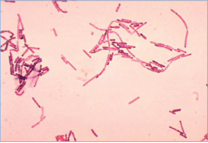
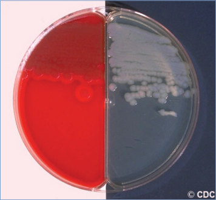

# 12. Bacillus cereus Infections and Intoxications
> Private study reference ([source credits](../../SOURCE_CREDITS.md)). PDF pages 72-74; printed pages 58-60.

## PDF page 72 | printed page 58

### CLINICAL MANIFESTATIONS

Bacillus cereus primarily causes 2 toxin-mediated foodborne illnesses, emetic and diarrheal, but it also can cause invasive extraintestinal infection. The emetic syndrome develops after a short incubation period, similar to staphylococcal foodborne illness. It is characterized by nausea, vomiting, and abdominal cramps, and diarrhea may follow in up to one third of patients. The diarrheal syndrome has a longer incubation period, is more severe, and resembles Clostridium perfringens foodborne illness. It is characterized by moderate to severe abdominal cramps and watery diarrhea, vomiting in approximately 25% of patients, and occasionally low-grade fever. Both illnesses usually are short-lived, about 24 hours, but the emetic toxin is occasionally associated with fulminant liver failure.

Invasive extraintestinal infection can be severe and includes wound and soft tissue infections; sepsis and bacteremia, including central line-associated bloodstream infection; endocarditis; osteomyelitis; purulent meningitis and ventricular shunt infection; pneumonia; and ocular infections (ie, endophthalmitis and keratitis). Infection can be acquired through use of contaminated blood products, especially platelets. B cereus is a leading cause of bacterial endophthalmitis following penetrating ocular trauma. Endogenous endophthalmitis can result from bacteremic seeding. Other ocular manifestations include an indolent keratitis related to corneal abrasions and may be seen in contact lens users or those who have undergone cataract surgery.

Rare infections attributable to B cereus strains that express anthrax toxin genes, which clinically resemble anthrax, have been reported.

### ETIOLOGY

B cereus is an aerobic and facultative anaerobic, spore-forming, gram-positive or gram-variable bacillus.

### EPIDEMIOLOGY

B cereus is ubiquitous in the environment because of the high resistance of its endospores to extreme conditions, including heat, cold, desiccation, salinity, and radiation, and commonly is present in small numbers in raw, dried, and processed foods and in the feces of healthy people. The organism is a common cause of foodborne illness in the United States but may be underrecognized because few people seek care for mild illness and health care providers and clinical laboratories do not routinely test for B cereus. Several confirmed outbreaks were reported to the Centers for Disease Control and Prevention in recent years. A wide variety of food vehicles has been implicated.

Spores of B cereus are heat resistant and can survive pasteurization, brief cooking, boiling, and high saline concentrations. Spores germinate to vegetative forms that produce enterotoxins over a wide range of temperatures, both in foods and in the gastrointestinal tract.

The diarrheal syndrome is caused by several distinct toxins that are produced after spores germinate in the gastrointestinal tract. The diarrheal toxins are heat labile and can be destroyed by heating.

The emetic syndrome occurs after eating contaminated food containing a preformed toxin called cereulide. The best known association of the emetic syndrome is with ingestion of fried rice made from boiled rice stored at room temperature overnight, because B cereus can be present in uncooked rice. However, a wide variety of foods, especially starchy foods (including cereals), cheese products, meats, and vegetables, has been implicated. The toxin is elaborated by vegetative forms that germinate from spores when the food is reheated; it is heat stable and gastric acid resistant.

Risk factors for invasive disease attributable to B cereus include history of injection drug use, presence of indwelling intravascular catheters or implanted devices, neutropenia or immunosuppression, and preterm birth. B cereus endophthalmitis has occurred after penetrating ocular trauma and injection drug use. Hospital outbreaks have been associated with contaminated medical

## PDF page 73 | printed page 59

equipment, but pseudo-outbreaks are more common and refer to sharp increases in contamination rates of clinical specimens associated with common source contamination (eg, ethanol pads or solutions, linens, blood culture media).

Foodborne illness caused by B cereus is not transmissible from person to person. The incubation period for foodborne illness is 30 minutes to 6 hours for the emetic syndrome and 6 to 15 hours for the diarrheal syndrome.

### DIAGNOSTIC TESTS

Diagnostic testing is not recommended for sporadic cases. For foodborne outbreaks, isolation of B cereus from the stool or vomitus of 2 or more ill people and not from control patients, or isolation of 105 colony-forming units/g or greater from epidemiologically implicated food, suggests that B cereus is the cause of the outbreak. Because the organism can be recovered from stool specimens from some well people, the presence of B cereus in feces or vomitus of ill people alone is not definitive evidence of infection. Food samples must be tested for both the emetic toxin and diarrheal enterotoxins, because either alone can cause illness. Although there currently is no commercial kit that detects the cereulide emetic toxin, B cereus colonies isolated from food or specimens of ill individuals may be identified using nucleic acid amplification tests for the emetic toxin gene in diagnostic laboratories.

In patients with risk factors for invasive disease (eg, preterm infants, people with immunosuppressing conditions), isolation of B cereus from wounds or from blood or other sterile body fluids is significant. The common perception of Bacillus species as “contaminants” may delay recognition and treatment of serious B cereus infections.

### TREATMENT

B cereus foodborne illness usually requires only supportive care, including rehydration. Antimicrobial therapy is indicated for patients with invasive disease. Prompt removal of any potentially contaminated foreign bodies, such as central lines or implants, is essential. For intraocular infections, an ophthalmologist should be consulted regarding surgical management and use of intravitreal antimicrobial therapy in addition to systemic therapy. B cereus is usually resistant to beta-lactam antibiotics and often to clindamycin but is susceptible to vancomycin, which is the drug of choice. Alternative drugs, including linezolid, clindamycin, aminoglycosides, erythromycin, tetracyclines, and fluoroquinolones, may be considered depending on susceptibility results.

### INFECTION PREVENTION AND CONTROL MEASURES IN HEALTH CARE SETTINGS

Standard precautions are recommended.

### CONTROL MEASURES

Proper cooking and appropriate storage of foods will help prevent foodborne illness attributable to B cereus. For example, rice cooked for later use should be refrigerated and not stored at room temperature. Information on recommended safe food handling practices, including time and temperature requirements during cooking, storage, and reheating, can be found at www. foodsafety.gov. In health care settings, careful hand hygiene and strict aseptic technique are important in caring for immunocompromised patients or patients with indwelling intravascular catheters to minimize the risk of invasive disease. The organism can survive in high concentrations of ethanol, but careful hand washing and use of 2% chlorhexidine are effective preventive measures.

## PDF page 74 | printed page 60

Image 12.1 Bacillus cereus subspecies mycoides (Gram stain). B cereus is a known cause of toxin-induced food poisoning. These organisms may appear gram variable, as shown here. Courtesy of Centers for Disease Control and Prevention.

Image 12.3 Bacillus cereus on sheep blood agar. Large, circular betahemolytic colonies are noted. The greenish color and ground-glass appearance are typical characteristics of this organism on culture media. Courtesy of Julia Rosebush, DO; Robert Jerris, PhD; and Theresa Stanley, M(ASCP).

Image 12.2 Blood agar and bicarbonate agar plate cultures of Bacillus cereus (negative result from encapsulation test). Rough colonies of B cereus on blood and bicarbonate agars. Courtesy of Centers for Disease Control and Prevention.

