# 16. Bartonella henselae (Cat-Scratch Disease)
> Private study reference ([source credits](../../SOURCE_CREDITS.md)). PDF pages 82-87; printed pages 68-73.

## PDF page 82 | printed page 68

### CLINICAL MANIFESTATIONS

Cat-scratch disease (CSD), the predominant clinical manifestation of Bartonella henselae infection, presents in 85% to 90% of children as a localized cutaneous and regional lymphadenopathy disorder. A skin papule or pustule develops within 12 days at the presumed site of inoculation in approximately two thirds of cases and usually precedes development of lymphadenopathy by 1 to 2 weeks (range, 7–60 days). Lymphadenopathy occurs in nodes that drain the site of inoculation, typically axillary, but cervical, submandibular, submental, epitrochlear, or inguinal nodes can be involved. Low-grade fever lasting several days develops in 30% of patients. The skin overlying affected lymph nodes can be normal or can be tender, warm, erythematous, and indurated, and approximately 10% to 20% of affected nodes suppurate. Typically, lymphadenopathy resolves spontaneously in 2 to 4 months.

Less common manifestations of B henselae infection likely reflect bloodborne disseminated disease and include culture-negative endocarditis, encephalopathy, osteolytic lesions, glomerulonephritis, pneumonia, thrombocytopenic purpura, erythema nodosum, and prolonged fever with granulomata in the liver and spleen. Chronic Bartonella infection in nonimmunocompromised children has not been substantiated scientifically.

Ocular manifestations occur in 5% to 10% of patients. The most classic and frequent presentation of ocular B henselae infection is Parinaud oculoglandular syndrome, which consists of follicular conjunctivitis and ipsilateral preauricular lymphadenopathy. Another occasional ocular manifestation is neuroretinitis, which is characterized by abrupt unilateral (and rarely bilateral) painless vision impairment, granulomatous optic disc swelling, and macular edema, with lipid exudates (macular star). Rare presentations include retinochoroiditis, anterior uveitis, vitritis, pars planitis, retinal vasculitis, retinitis, branch retinal arteriolar or venular occlusions, macular hole, or, very rarely, retinal detachments.

B henselae (as well as Bartonella quintana) can cause bacillary angiomatosis (vascular proliferative

lesions of skin and subcutaneous tissue) and bacillary peliosis (reticuloendothelial lesions in visceral organs, primarily the liver). These are primarily reported in immunocompromised patients, including people with human immunodeficiency virus, but can also occur in immunocompetent people.

### ETIOLOGY

B henselae is a fastidious, slow-growing, gram-negative bacillus. Other Bartonella species, such as Bartonella clarridgeiae, also have been found to cause CSD. B henselae is related closely to B quintana, a louse-borne disease that causes a distinct febrile illness with relapsing fevers, shin pain, headache, and myalgia. This illness resulted in significant disease among troops during World War I, leading to its former name of “trench fever.” People experiencing homelessness are at increased risk of B quintana infection because of lack of access to adequate sanitation and hygiene. B quintana also can cause bacillary angiomatosis and endocarditis.

### EPIDEMIOLOGY

B henselae is a common cause of regional lymphadenopathy in children. The highest incidence is found in children 5 to 9 years of age; infections occur more often during the fall and winter. Cats are the natural reservoir for B henselae, with a seroprevalence of 30% to 40% in domestic and adopted shelter cats in the United States. Other animals, including dogs, can be infected and are rarely associated with human illness. Cat-to-cat transmission occurs via the cat flea (Ctenocephalides felis), with feline infection resulting in bacteremia that usually is asymptomatic and lasts weeks to months. Fleas acquire the organism when feeding on a bacteremic cat and then shed infectious organisms in their feces. The bacteria are transmitted to humans by inoculation from cat saliva or flea feces through a scratch or wound from a cat. Most patients with CSD have a history of recent contact with apparently healthy cats, especially kittens. Kittens are nearly 5 times as likely to be bacteremic with B henselae than older cats. Cats obtained from shelters or adopted as strays also have high rates of bacteremia. There is no convincing evidence that ticks can transmit Bartonella species to humans. No evidence of person-to-person transmission exists.

## PDF page 83 | printed page 69

The incubation period from the time of the scratch to appearance of the primary cutaneous lesion is 3 to 12 days; the median period from the appearance of the primary lesion to the appearance of lymphadenopathy is 12 days (range, 7 to 60 days).

### DIAGNOSTIC TESTS

Both enzyme immunoassay (EIA) and indirect immunofluorescent antibody (IFA) platforms for detection of immunoglobulin (Ig) M and IgG serum antibodies to antigens of Bartonella species are available for diagnosis of CSD. Both platforms have limitations in sensitivity and specificity. With both types of tests, cross-reactivity with other infectious agents (such as Chlamydia pneumoniae, Coxiella burnetii, and especially other Bartonella species) is common. Elevated IgM titers may suggest recent infection, but both falsepositive and false-negative IgM test results occur. In adults, there is a high rate of anti-B henselae IgG seroprevalence in the general population attributable to prior exposure. Usually, if an IFA or EIA IgG titer is <1:64, the patient does not have acute infection. Titers between 1:64 and 1:256 may represent past or acute infection, and followup titers in 2 to 4 weeks should be considered. An IgG titer of ≥1:256 or a fourfold increase in IgG titer between acute and convalescent samples is consistent with acute infection.

Nucleic acid amplification tests (NAATs) are available in some commercial and research laboratories for testing of tissue or body fluids. Bartonella NAATs are highly specific and fairly sensitive for use on tissue, although some tests do not distinguish between the various Bartonella species. NAATs of valvular tissue can be important in cases of culture-negative endocarditis. The sensitivity of Bartonella NAATs is much lower for whole blood, and this specimen type is not generally recommended for NAATs but may be useful in select circumstances.

B henselae is a fastidious organism; recovery by routine culture requires prolonged incubation (>10 days) and rarely is successful unless performed in specialized laboratories with experienced staff.

If tissue (eg, lymph node) specimens are available, bacilli occasionally may be visualized using a silver stain (eg, Warthin-Starry or Steiner stain);

however, these stains are not specific for B henselae. Early histologic changes in lymph node specimens consist of lymphocytic infiltration with epithelioid granuloma formation. Later changes consist of polymorphonuclear leukocyte infiltration with granulomas that become necrotic and resemble granulomas from patients with tularemia, brucellosis, or mycobacterial infections.

### TREATMENT

Management of localized uncomplicated CSD primarily is aimed at relief of symptoms, because the disease is self-limited, resolving spontaneously in 2 to 4 months. No antibiotic regimen has been shown to be beneficial in improving the clinical cure rate, and in most cases, antibiotic therapy is not indicated. Painful suppurative nodes can be treated with needle aspiration for relief of symptoms. Incision and drainage should be avoided, because this may facilitate fistula formation; surgical excision generally is unnecessary.

Some experts recommend antimicrobial therapy in acutely or severely ill immunocompetent patients with systemic symptoms, particularly people with retinitis, hepatic or splenic involvement, osteomyelitis, or painful adenitis. Several antimicrobial agents (azithromycin, clarithromycin, ciprofloxacin, doxycycline, trimethoprim-sulfamethoxazole, ceftriaxone, gentamicin, and rifampin) have in vitro activity against B henselae. However, outcomes for most forms of CSD are generally excellent with or without antibiotic therapy.

Doxycycline plus rifampin are often used for treatment of patients with neuroretinitis. A duration of therapy of 4 to 6 weeks generally has been used on the basis of a small case series in young adults. Doxycycline may be used regardless of patient age. Reports in the literature note that a large majority of such patients experience significant visual recovery to 20/40 or better. Corticosteroids should be considered in conjunction with ophthalmology consultation.

Antimicrobial therapy is recommended for all immunocompromised people, because treatment of bacillary angiomatosis and bacillary peliosis has been shown to be beneficial. Azithromycin or doxycycline is effective for treatment of these conditions; therapy should be administered for 3 months for bacillary angiomatosis and for 4 months for bacillary peliosis to prevent relapse. Consultation with an infectious disease specialist

## PDF page 84 | printed page 70

is recommended for treatment in immunocompromised people.

For pediatric patients with unusual manifestations of Bartonella infection (eg, endocarditis or endovascular infection, neuroretinitis, disease in immunocompromised patients), consultation with a pediatric infectious diseases expert is recommended.

### INFECTION PREVENTION AND CONTROL MEASURES IN HEALTH CARE SETTINGS

Standard precautions are recommended.

A

Image 16.1 A 5-year-old girl presented to the emergency department with a preauricular mass and submandibular adenopathy on the left side of her face that had been visible for 2 months. An excoriation below the left eye (Panel A, red arrow), a fluctuant, tender preauricular mass (Panel A, blue arrow; and Panel B), and submandibular adenopathy (Panel A, black arrow) were observed on physical examination. The patient had no history of fevers, and her vision was unaffected. She frequently played with a cat at home. The preauricular mass was aspirated, and a purulent, brownish drainage was obtained. Given the high clinical suspicion of cat scratch disease, the patient was discharged with a 5-day prescription for oral azithromycin. The results of culture of the aspirate in chocolate agar were negative, but histopathologic analysis of the aspirate revealed an inflammatory infiltrate with necrosis. Bacilli were detected on Warthin–Starry staining. Serologic tests were positive for the causative bacterium, Bartonella henselae (IgM titer, >1:1024; IgG titer, >1:20). Parinaud’s oculoglandular syndrome, a manifestation of cat scratch disease, is characterized by involvement of the conjunctiva or the area around the eye, in association with preauricular lymphadenitis on the same side. The syndrome can occur when the inoculation site involves the conjunctiva or eyelid. On follow-up 2 months after treatment, the patient’s preauricular and submandibular adenopathy had resolved. Image reprinted with permission from Arango-Ferreira C, Castano J. Parinaud’s oculoglandular syndrome in cat scratch disease. NEJM. 2018;379:18.e31.

### CONTROL MEASURES

CSD is a preventable infection. All cats >8 weeks of age should be treated topically for fleas and ticks regularly. Effort should be undertaken to avoid scratches and bites from cats or kittens. Sites of cat scratches or bites should be washed immediately, and cats should not be allowed to lick open cuts or wounds. Immunocompromised people should avoid contact with cats younger than 1 year, stray cats, and cats that scratch or bite. Testing or treatment of cats for Bartonella infection is not recommended, nor is declawing or removal of the cat from the household.

B

![Image 16.1 A 5-year-old girl presented to the emergency department with a preauricular mass and submandibular adenopathy on the left side of her face that had been visible for 2 months. An excoriation below the left eye (Panel A, red arrow), a fluctuant, tender preauricular mass (Panel A, blue arrow; and Panel B), and submandibular adenopathy (Panel A, black arrow) were observed on physical examination. The patient had no history of fevers, and her vision was unaffected. She frequently played with a cat at home. The preauricular mass was aspirated, and a purulent, brownish drainage was obtained. Given the high clinical suspicion of cat scratch disease, the patient was discharged with a 5-day prescription for oral azithromycin. The results of culture of the aspirate in chocolate agar were negative, but histopathologic analysis of the aspirate revealed an inflammatory infiltrate with necrosis. Bacilli were detected on Warthin–Starry staining. Serologic tests were positive for the causative bacterium, Bartonella henselae (IgM titer, >1:1024; IgG titer, >1:20). Parinaud’s oculoglandular syndrome, a manifestation of cat scratch disease, is characterized by involvement of the conjunctiva or the area around the eye, in association with preauricular lymphadenitis on the same side. The syndrome can occur when the inoculation site involves the conjunctiva or eyelid. On follow-up 2 months after treatment, the patient’s preauricular and submandibular adenopathy had resolved. Image reprinted with permission from Arango-Ferreira C, Castano J. Parinaud’s oculoglandular syndrome in cat scratch disease. NEJM. 2018;379:18.e31.](../../figures/ch016_p0084_01.jpg)

## PDF page 85 | printed page 71

Image 16.2 Submental lymphadenitis caused by cat-scratch disease.

Image 16.4 Cat-scratch granuloma of the wrist with anterior axillary lymphadenitis in a 4-year-old boy. Cat-scratch disease is a common cause of prolonged lymphadenopathy in children.

Image 16.6 Papules at inoculation sites on the face of a patient with cat-scratch disease.

Image 16.3 Cat-scratch granuloma of the finger of a 6-year-old boy. This is a typical inoculation site lesion, which was noted about 10 days before the development of regional lymphadenopathy.

Image 16.5 Parinaud oculoglandular syndrome (inoculation of the conjunctivae with ipsilateral preauricular adenopathy) in a 6-year-old boy.

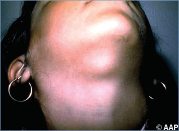

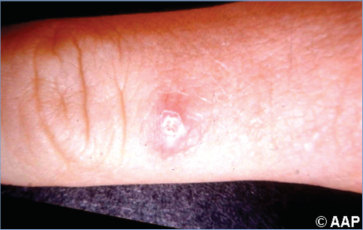

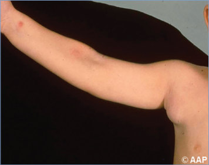

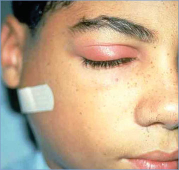

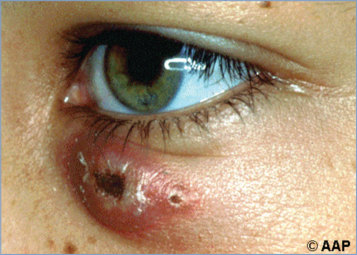

## PDF page 86 | printed page 72

Image 16.7 A papule at each of 2 inoculation sites on the arm of a patient with cat-scratch disease.

Image 16.9 Sanguinopurulent exudate aspirated from the axillary node of the patient in Image 16.8 with cat-scratch disease. Copyright Michael Rajnik, MD, FAAP.

Image 16.11 Epitrochlear suppurative adenitis of cat-scratch disease in the boy in Image 16.10, with a cat-scratch granuloma of the finger. Copyright Michael Rajnik, MD, FAAP.

Image 16.8 A 2-year-old with suppurative right axillary lymphadenopathy secondary to cat-scratch disease. Copyright Michael Rajnik, MD, FAAP.

Image 16.10 Cat-scratch disease granuloma of the finger in a 12-year-old boy with epitrochlear node involvement (see Image 16.11). Copyright Michael Rajnik, MD, FAAP.

Image 16.12 Stellate microabscess and silver-stained coccobacillary forms of Bartonella henselae within the inflammatory infiltrate of the involved lymph node (hematoxylin-eosin stain; original magnification ×12.5). Courtesy of Christopher Paddock, MD.

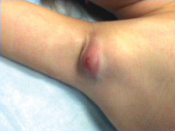

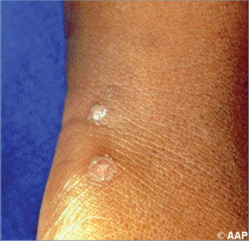

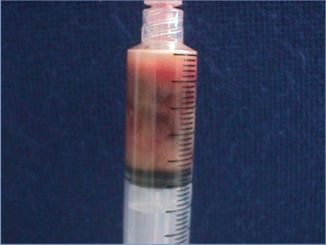

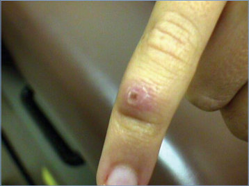

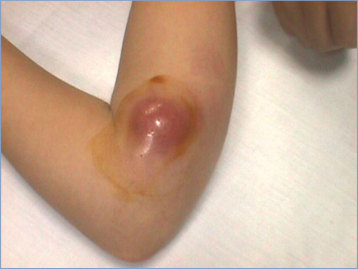

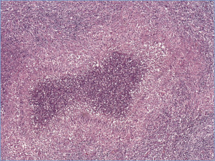

## PDF page 87 | printed page 73

Image 16.13 This 3-year-old was previously scratched on the left side of her neck by a kitten. She developed raised red bumps around the scratch on day 5. This area ulcerated slightly and was slow to heal. No fever was noted, although she was less active for the next several days and shared that her arms and legs were sore. She developed swollen posterior cervical lymph nodes about 1 week later. Physical examination indicated two 8-mm ulcerations with raised borders and a papule near an enlarged minimally tender posterior cervical node. Result from the serological test was positive for Bartonella henselae. She improved with time after a course of azithromycin. Courtesy of Will Sorey, MD.

Image 16.14 Needle aspiration of purulent material caused by cat-scratch disease. Courtesy of Ed Fajardo, MD.

![Image 16.13 This 3-year-old was previously scratched on the left side of her neck by a kitten. She developed raised red bumps around the scratch on day 5. This area ulcerated slightly and was slow to heal. No fever was noted, although she was less active for the next several days and shared that her arms and legs were sore. She developed swollen posterior cervical lymph nodes about 1 week later. Physical examination indicated two 8-mm ulcerations with raised borders and a papule near an enlarged minimally tender posterior cervical node. Result from the serological test was positive for Bartonella henselae. She improved with time after a course of azithromycin. Courtesy of Will Sorey, MD.](../../figures/ch016_p0087_01.jpg)

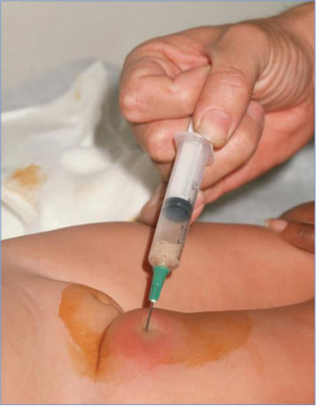
