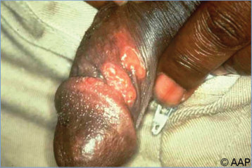
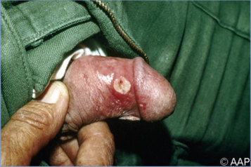
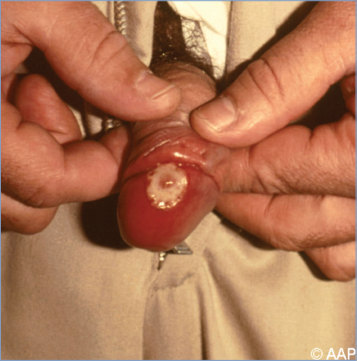
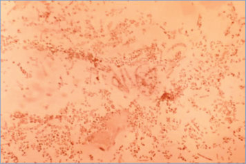

# 26. Chancroid and Cutaneous Ulcers
> Private study reference ([source credits](../../SOURCE_CREDITS.md)). PDF pages 128-131; printed pages 114-117.

## PDF page 128 | printed page 114

### CLINICAL MANIFESTATIONS

Chancroid is an acute ulcerative disease of the genitalia that occurs primarily in sexually active adolescents and adults. A clinical presentation with a painful genital ulcer and tender suppurative inguinal lymphadenopathy should raise suspicion for chancroid. An ulcer begins as an erythematous papule that becomes pustular and erodes over several days, forming a sharply demarcated, somewhat superficial lesion with a serpiginous border. The base of the ulcer is friable and can be covered with a gray or yellow, purulent exudate. Single or multiple ulcers can be present. Unlike a syphilitic chancre, which is typically painless and indurated, the chancroidal ulcer often is painful and nonindurated and can be associated with painful inguinal suppurative adenitis (bubo) ipsilateral to the lesion. Without treatment, ulcer(s) can spontaneously resolve, cause extensive erosion of the genitalia, or lead to scarring and phimosis, a painful inability to retract the foreskin of the penis.

In most male patients, chancroid manifests as a genital ulcer with or without inguinal tenderness; edema of the prepuce is common.1 In female patients, most lesions are at the vaginal introitus, and symptoms include dysuria, dyspareunia, and vaginal discharge. People with anal infection may have pain on defecation or anal bleeding. Constitutional symptoms are unusual.

### ETIOLOGY

Chancroid and cutaneous ulcers are caused by Haemophilus ducreyi, a gram-negative coccobacillus.

### EPIDEMIOLOGY

Chancroid is a sexually transmitted infection. Chancroid is prevalent in some parts of Africa and the tropics but is uncommon in the United States, and when it does occur, it is usually imported from areas with endemic infection. Thus, recent travel to or from an area with endemic infection should raise suspicion for this diagnosis. Coinfection with syphilis or herpes simplex virus (HSV) occurs in up to 20% of patients. Chancroid is a

well-established cofactor for acquisition and transmission of human immunodeficiency virus (HIV).

Because sexual contact is the major route of transmission in the United States, the diagnosis of chancroid ulcers in infants and young children, especially in the genital or perineal region, is highly suspicious of sexual abuse. However, H ducreyi is recognized as a cause of nonsexually transmitted cutaneous ulcers in children and young adults in some tropical regions and, specifically, in countries where the cutaneous ulcer disease yaws, caused by Treponema pallidum subspecies pertenue, is endemic. The acquisition of a lower extremity ulcer attributable to H ducreyi in a child without genital ulcers and reported travel to a region with endemic yaws should not be considered evidence of sexual abuse.

For both chancroid and cutaneous ulcers, the incubation period is 1 to 10 days.

### DIAGNOSTIC TESTS

Chancroid usually is diagnosed on the basis of clinical findings and by excluding other genital ulcerative diseases, such as syphilis, HSV infection, or lymphogranuloma venereum. Cutaneous ulcers can be diagnosed on the basis of clinical findings described, but clinical findings overlap, and mixed infections with H ducreyi and T pallidum subspecies pertenue (the cause of yaws) are common. Confirmation is made by isolation of H ducreyi from an ulcer (specimen should be taken from the base of the ulcer) or lymph node aspirate, although culture sensitivity is less than 80%. Because special culture media and conditions are required for isolation, laboratory personnel should be informed of the suspicion of H ducreyi. Approximately 30% to 40% of lymph node aspirates are culture positive. Nucleic acid amplification tests (NAATs) can provide a specific diagnosis but are not widely available. There is no NAAT for H ducreyi approved or cleared by the U.S. Food and Drug Administration available in the United States. Such testing can be performed by clinical laboratories that have developed their own NAAT and have conducted CLIA verification studies.

### TREATMENT

Genital strains of H ducreyi have been uniformly susceptible only to third-generation cephalosporins,

## PDF page 129 | printed page 115

macrolides, and quinolones. The prevalence of antibiotic resistance is unknown because of syndromic management of genital ulcers and the lack of diagnostic testing. Recommended regimens include azithromycin orally in a single dose, ceftriaxone intramuscularly in a single dose, ciprofloxacin orally for 3 days, or erythromycin orally for 7 days. Patients with HIV infection and those with an uncircumcised penis may require repeated or longer courses of therapy. In syndromic management approaches to genital ulcer disease, treatment will typically include syphilis as well as chancroid.

Clinical improvement occurs 3 to 7 days after initiation of therapy, and healing is complete in approximately 2 weeks. Adenitis often is slow to resolve and can require needle aspiration or surgical incision. Patients should be reexamined 3 to 7 days after initiating therapy to verify healing. If healing has not begun, the diagnosis may be incorrect or the patient may have an additional sexually transmitted infection (both of which necessitate further testing), the treatment may not have been used as instructed, or the H ducreyi strain causing the infection may be resistant to the prescribed antimicrobial therapy. Slow clinical improvement and relapses can occur after therapy, especially in people with HIV infection. Close clinical follow-up is recommended; retreatment with the original regimen usually is effective in patients who experience a relapse. In advanced cases, genital scarring and rectal or urogenital fistulas from suppurative buboes can result despite successful therapy.

Patients with chancroid should be evaluated for other sexually transmitted infections, including syphilis, HSV, chlamydia, gonorrhea, mpox, and HIV infection, at the time of diagnosis. Because chancroid is a risk factor for HIV infection and

facilitates HIV transmission, if the initial HIV test result is negative, it should be repeated 3 months after the diagnosis of chancroid. Because syphilis and H ducreyi are frequently cotransmitted, serologic testing for syphilis also should be repeated 3 months after the diagnosis of chancroid. If the hepatitis B and human papillomavirus vaccine series have not been completed, these immunizations should be offered if appropriate for age. All people who had sexual contact with patients with chancroid within 10 days before onset of the patient’s symptoms need to be examined and treated, even if they are asymptomatic.

Penicillin has long been used as empiric therapy for cutaneous ulcers in the tropics, but several beta-lactamase–producing cutaneous H ducreyi strains have been recovered. Cutaneous ulcers, therefore, should be treated with single-dose azithromycin (30 mg/kg, maximum 2 g) to cover both T pallidum subspecies pertenue (the cause of yaws) and H ducreyi. Cutaneous ulcers attributable to H ducreyi respond to single-dose azithromycin within 14 days. Given the environmental sources, it is unclear whether contacts of people with leg ulcers should be treated.

### INFECTION PREVENTION AND CONTROL MEASURES IN HEALTH CARE SETTINGS

Standard precautions are recommended.

### CONTROL MEASURES

Identification, examination, and treatment of sexual partners of patients with chancroid are important control measures. Regular condom use may decrease transmission, and penile circumcision is believed to be partially protective.

1 The terms male and female refer to sex assigned at birth.

## PDF page 130 | printed page 116

Image 26.1 Penile and inguinal chancroid caused by Haemophilus ducreyi, a gram-negative coccobacillus. This sexually transmitted infection is endemic in some areas of the United States and also occurs in discrete outbreaks. Courtesy of Centers for Disease Control and Prevention.

Image 26.3 Ulcerative chancroid lesions with inflammation of the shaft and glans penis caused by Haemophilus ducreyi. Chancroid lesions are irregular in shape, painful, and soft (nonindurated) to touch. Courtesy of Hugh Moffet, MD.

Image 26.2 Haemophilus ducreyi. Chancroid ulcerations of the penis in the same patient as in Image 26.1. Courtesy of Centers for Disease Control and Prevention.

Image 26.4 Chancroid ulcer on the glans penis. Coinfection with syphilis or human herpesvirus occurs in as many as 10% of patients. Courtesy of Hugh Moffet, MD.

## PDF page 131 | printed page 117

Image 26.5 This adolescent presented with a chancroid lesion of the groin and penis affecting the ipsilateral inguinal lymph nodes. First signs of infection typically appear 3 to 5 days after exposure, although symptoms can take up to 2 weeks to appear. Courtesy of Centers for Disease Control and Prevention.

Image 26.6 Haemophilus ducreyi is a gram-negative coccobacillus, as shown in this preparation. Courtesy of Centers for Disease Control and Prevention.

