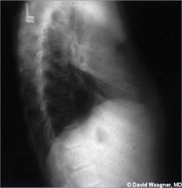
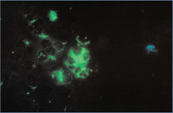

# 29. Chlamydia psittaci (Psittacosis, Ornithosis, Parrot Fever)
> Private study reference ([source credits](../../SOURCE_CREDITS.md)). PDF pages 138-141; printed pages 124-127.

## PDF page 138 | printed page 124

(Psittacosis, Ornithosis, Parrot Fever)

### CLINICAL MANIFESTATIONS

Psittacosis (ornithosis) is an acute respiratory tract infection with systemic symptoms that often include fever, nonproductive cough, dyspnea, headache, myalgia, chills, and malaise. Infection often presents as atypical pneumonia in young or middle-aged adults with abrupt fever onset, headache, and dry cough, although symptoms can also include pharyngitis, diarrhea, constipation, nausea and vomiting, abdominal pain, arthralgia, rash (Horder spots, which are macular rashes similar to the rose spots of typhoid fever), and altered mental status. Extensive interstitial pneumonia can occur, with radiographic changes characteristically more severe than would be expected from physical examination findings. Rarely, infection with Chlamydia psittaci has been reported to affect organ systems other than the respiratory tract, resulting in arthritis, endocarditis, myocarditis, pericarditis, dilated cardiomyopathy, thrombophlebitis, nephritis, hepatitis, cranial nerve palsy (including sensorineural hearing loss), transverse myelitis, meningitis, and encephalitis. Infection in pregnancy may be life-threatening to the pregnant person and cause fetal loss. Reports suggest a rare association of psittacosis with ocular adnexal marginal zone lymphomas involving orbital soft tissue, lacrimal glands, and conjunctiva.

### ETIOLOGY

C psittaci is a gram-negative, obligate intracellular bacterial pathogen that exists in 2 forms. The extracellular form is called an elementary body and is infectious. The elementary body enters the epithelial host cell and then differentiates into a replicating reticulate body within a membranebound vesicle, or inclusion.

### EPIDEMIOLOGY

Psittacosis is worldwide in distribution and tends to occur sporadically in any season. Birds are the major reservoir of C psittaci. The term psittacosis commonly is used, although the term ornithosis more accurately describes the potential for nearly all domestic and wild birds, not just psittacine birds (eg, parakeets, parrots, macaws, cockatoos),

to spread this infection. In the United States, a variety of birds including psittacine birds, poultry birds (eg, chickens, ducks, turkeys, pheasants), and pigeons have been reported as sources of human disease. Infected birds, whether they appear healthy or ill, may transmit the organism. Infection usually is acquired by direct contact or inhaling aerosolized excrement or respiratory secretions from the eyes or beaks of infected birds. Once dry, the organism remains viable for months, particularly at room temperature. Importation and illegal trafficking of exotic birds may be associated with disease in humans, because shipping, crowding, and other stress factors may increase shedding of the organism among birds with latent infection. Handling of plumage and mouth-to-beak contact are the modes of exposure described most frequently, although transmission has been reported through exposure to aviaries, poultry slaughter plants, bird exhibits, and lawn mowing. Excretion of C psittaci from birds may be intermittent or continuous for weeks or months. Pet bird owners and breeders, veterinarians, and workers at poultry slaughter plants, poultry farms, and pet shops may be at increased risk of infection. Laboratory personnel working with C psittaci also are at risk. Humanto-human transmission may occur but is rare.

The incubation period usually is 5 to 14 days but may be longer.

### DIAGNOSTIC TESTS

The diagnosis of C psittaci disease historically has been based on clinical presentation and a positive serologic test result using microimmunofluorescence (MIF) with paired sera. Although the MIF test generally is more sensitive and specific than complement fixation tests, MIF still displays cross-reactivity with other Chlamydia species in some instances. Because of this, a titer less than 1:128 should be interpreted with caution. Paired acute- and convalescent-phase serum specimens obtained at least 2 to 4 weeks apart should be obtained and performed simultaneously within a single laboratory to ensure consistency of results.1 Treatment with antimicrobial agents may suppress the antibody response and, in such cases, a third serum sample obtained 4 to 6 weeks after the acute-phase sample may be useful in confirming the diagnosis. Although serologic testing is more

## PDF page 139 | printed page 125

commonly used and available than molecular testing, serologic test results can often be ambiguous, subjective in their interpretation, and misleading because of the inherent limitations of this approach. If possible, serologic testing should be considered a supportive test that augments the findings of other more reliable assays, such as nucleic acid amplification tests (NAATs), which can distinguish C psittaci from other chlamydial species. NAATs are available within specialized laboratories (www.cdc.gov/ laboratory/specimen-submission/detail. html?CDCTestCode=CDC-10153), but none are cleared by the U.S. Food and Drug Administration for detection of C psittaci in clinical specimens. Commercial respiratory multiplex NAATs do not test for C psittaci. Because the organism is difficult to recover in culture and laboratory-acquired cases have been reported, culture generally is not recommended and should be attempted only by experienced personnel in laboratories in which strict containment measures to prevent spread of the organism are used. C psittaci currently is classified as an organism requiring biosafety level 3 biocontainment practices.

### TREATMENT

Doxycycline is the drug of choice and can be used without regard to patient age. Erythromycin and azithromycin are alternative agents and are recommended for pregnant people. Therapy should continue for 10 to 14 days after fever abates. Most C psittaci infections are responsive to antimicrobial agents within 1 to 2 days. In patients with severe infection, intravenous doxycycline may be considered.

### INFECTION PREVENTION AND CONTROL MEASURES IN HEALTH CARE SETTINGS

Standard precautions are recommended.

### CONTROL MEASURES

All birds suspected to be the source of human infection should be seen by a veterinarian for evaluation and management. Birds with C psittaci infection should be isolated and treated with appropriate antimicrobial agents.2 Birds suspected of dying from C psittaci infection should be transported to an animal diagnostic laboratory for testing as directed by the laboratory. Birds exposed to psittacosis should be also isolated and monitored by a veterinarian for signs of illness even if they do not appear ill. All potentially contaminated caging and housing areas should be disinfected thoroughly before reuse to eliminate any infectious organisms. People cleaning cages, handling birds confirmed with C psittaci, or handling birds exposed to those confirmed with C psittaci should wear personal protective equipment including a smock or coveralls, gloves, eyewear, designated footwear or shoe covers, a disposable hat, and a disposable N95 or higher respirator. C psittaci is susceptible to many but not all household disinfectants and detergents. Effective disinfectants include 1:1,000 dilutions of quaternary ammonium compounds, freshly prepared 1:32 dilutions of household bleach (1/2 cup per gallon), or other oxidizing agents such as accelerated hydrogen peroxide-based disinfectants.

Public Health Reporting

Human psittacosis is a nationally notifiable disease. Please refer to the state or local health department for details on reporting cases.

1 National Association of State Public Health Veterinarians. Compendium of measures to control Chlamydia psittaci infection among humans (psittacosis) and pet birds (avian chlamydiosis). J Avian Med Surg. 2017;31(3). Available at: www. nasphv.org/Documents/PsittacosisCompendium.pdf 2 National Association of State Public Health Veterinarians. Compendium of measures to control Chlamydia psittaci infection among humans (psittacosis) and pet birds (avian chlamydiosis). J Avian Med Surg. 2017;31(3). Available at: www.nasphv.org/Documents/PsittacosisCompendium.pdf

## PDF page 140 | printed page 126

Image 29.1 Chlamydophila psittaci pneumonia in a 16-year-old with a cough of 3 weeks’ duration. The family had several parrots in the home that were purchased from a roadside stand near the Texas–Mexico border. Interstitial pneumonia, most prominent in the lower lobe of the left lung, is shown. Complement fixation titer for C psittaci is 1:128. Copyright David Waagner, MD.

Image 29.2 Lateral chest radiograph of the patient in Image 29.1. Copyright David Waagner, MD.

Image 29.3 This mouse-brain impression smear stained with direct fluorescent antibody reveals the presence of the bacterium Chlamydophila psittaci. Psittacosis is acquired by inhaling dried secretions from birds infected with C psittaci. Although all birds are susceptible, pet birds and poultry are most frequently involved in transmission to humans. Courtesy of Centers for Disease Control and Prevention/Vester Lewis, MD.

## PDF page 141 | printed page 127

Image 29.4 Number of U.S. cases of psittacosis reported per year from 1973 to 2003. Courtesy of Morbidity and Mortality Weekly Report. Editor’s Note: Since 2010, the Centers for Disease Control and Prevention have typically received reports of fewer than 10 cases in the United States each year. However, experts believe the disease is potentially underreported and underdiagnosed.

Image 29.5 Chlamydia psittaci is a type of bacteria that often infects birds. These bacteria can infect people and cause psittacosis. Psittacosis can cause mild illness or pneumonia. To help prevent this illness, precautions should be taken when handling and cleaning birds and cages. Courtesy of Centers for Disease Control and Prevention.

