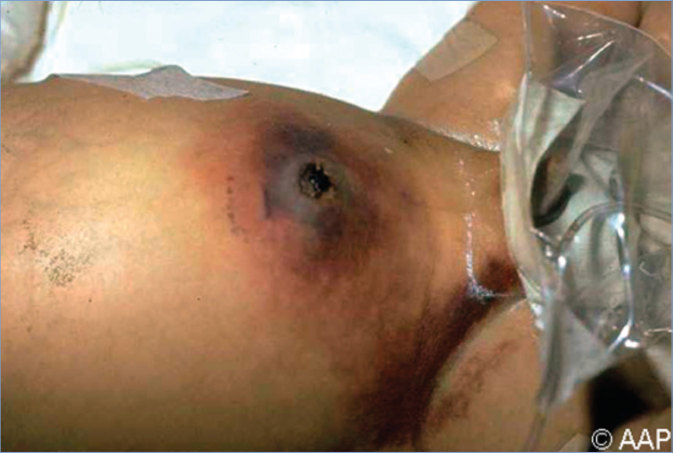
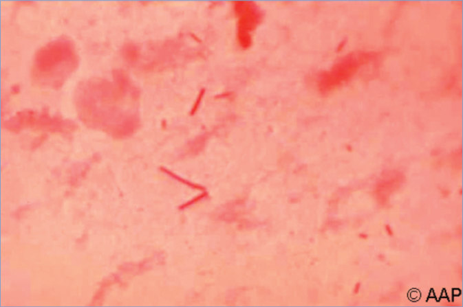

# 32. Clostridial Myonecrosis (Gas Gangrene)
> Private study reference ([source credits](../../SOURCE_CREDITS.md)). PDF pages 156-158; printed pages 142-144.

## PDF page 156 | printed page 142

(Gas Gangrene)

### CLINICAL MANIFESTATIONS

Disease onset is heralded by acute and progressive pain at the site of the wound, often initially out of proportion to the appearance of the affected area. Later, there is edema, increasing exquisite tenderness, and exudate. Systemic findings include tachycardia disproportionate to the degree of fever, pallor, and diaphoresis. Crepitus is suggestive but not pathognomonic of Clostridium infection and is not always present. Tense bullae containing thin, serosanguineous, or dark fluid develop in the overlying skin and areas of green-black cutaneous necrosis appear. Fluid in the bullae has a foul odor. Disease can progress rapidly with development of hypotension, renal failure, and alterations in mental status. Diagnosis is based on clinical manifestations, including the characteristic appearance of necrotic muscle at surgery. Untreated clostridial myonecrosis, also known as gas gangrene, can lead to disseminated myonecrosis, suppurative visceral infection, septicemia, and death within hours.

Nontraumatic gas gangrene usually is caused by Clostridium septicum and is a complication of bacteremia, which is the result of an occult gastrointestinal mucosal lesion (most commonly colon cancer) or a complication of neutropenic colitis, leukemia, or diabetes mellitus.

### ETIOLOGY

Clostridial myonecrosis is caused by Clostridium species, most often Clostridium perfringens. Other Clostridium species (eg, Clostridium sordellii, C septicum, Clostridium novyi) have also been associated with myonecrosis. These organisms are large, gram-positive, spore-forming, anaerobic bacilli with blunt ends. Disease manifestations are caused by potent clostridial exotoxins. Mixed infection with other gram-positive and gram-negative bacteria is common.

### EPIDEMIOLOGY

Clostridial myonecrosis usually results from contamination of deep open wounds. The sources of

Clostridium species are soil, contaminated foreign bodies, and human and animal feces. Dirty surgical or traumatic wounds, particularly those with retained foreign bodies or significant amounts of devitalized tissue, predispose to disease. Cases have occurred in people who inject drugs, in association with contaminated black tar heroin. Rarely, nontraumatic gas gangrene occurs in immunocompromised people, most frequently in those with underlying malignancy, neutrophil dysfunction, or diseases associated with bowel ischemia.

The incubation period from the time of injury is 6 hours to 4 days.

### DIAGNOSTIC TESTS

Anaerobic cultures of wound exudate, involved soft tissue and muscle, and blood should be performed. Matrix-assisted laser desorption/ ionization–time-of-flight devices have an approved indication from the U.S. Food and Drug Administration to identify C perfringens. Because Clostridium species are ubiquitous, their recovery from a wound is not diagnostic unless typical clinical manifestations are present. A Gram-stained smear of wound discharge demonstrating characteristic gram-positive bacilli and few, if any, polymorphonuclear leukocytes suggests clostridial infection. Tissue specimens (not swab specimens) for anaerobic culture must be obtained to confirm the diagnosis. Because some pathogenic Clostridium species are exquisitely sensitive to oxygen, care should be taken when collecting and processing a sample to optimize anaerobic growth conditions. A radiograph of the affected site might demonstrate gas in the tissue, but this is a nonspecific finding that is not always present. Occasionally, blood cultures are positive and are considered diagnostic.

### TREATMENT

• Prompt and complete surgical excision of necrotic tissue and removal of foreign material is essential. Repeated surgical débridement may be required to ensure complete removal of all infected tissue. Vacuum-assisted wound closure can be used following multiple débridements.

## PDF page 157 | printed page 143

• Management of shock, fluid and electrolyte imbalance, hemolytic anemia, and other complications is crucial.

• High-dose penicillin G should be administered intravenously. Clindamycin, metronidazole, meropenem, ertapenem, and chloramphenicol are alternative drugs for patients with a serious penicillin allergy or for treatment of polymicrobial infections. The combination of penicillin G and clindamycin may be superior to penicillin alone because of the theoretical benefit of clindamycin inhibiting toxin synthesis.

• Hyperbaric oxygen may be beneficial, but effectiveness data from adequately controlled clinical studies are not available.

Image 32.1 Clostridial omphalitis in an infant with myonecrosis of the abdominal wall (periumbilical). Early and complete surgical excision of necrotic tissue and careful management of shock, fluid balance, and other complications are crucial for survival.

### INFECTION PREVENTION AND CONTROL MEASURES IN HEALTH CARE SETTINGS

Standard precautions are recommended.

### CONTROL MEASURES

Prompt and careful débridement, copious lavage of contaminated wounds, and removal of foreign material should be performed.

Penicillin G (50,000 U/kg per day) or clindamycin (20–30 mg/kg per day) has been used for prophylaxis in patients with grossly contaminated wounds, but there are no data on recommended duration or the effectiveness of such preventative measures.

## PDF page 158 | printed page 144

Image 32.2 Gram stain of a tissue aspirate from a patient with clostridial omphalitis showing the characteristic morphological features of Clostridia bacilli, erroneously stained gram negative, and sparse polymorphonuclear leukocytes.

