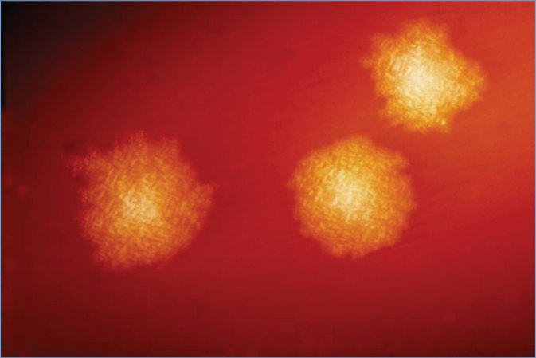

# 33. Clostridioides difficile (Formerly Clostridium difficile)
> Private study reference ([source credits](../../SOURCE_CREDITS.md)). PDF pages 159-164; printed pages 145-150.

## PDF page 159 | printed page 145

### CLINICAL MANIFESTATIONS

Clostridioides difficile (formerly Clostridium difficile) is associated with a wide spectrum of gastrointestinal illness, ranging from asymptomatic colonization (common, especially in young infants) to severe and prolonged colitis with shock. In children, C difficile infections are rarely fatal. Mild to moderate illness is characterized by watery diarrhea, low-grade fever, and abdominal pain. In the past, hospital onset of symptoms was believed to be the most common presentation. However, recent studies have found that C difficile often is diagnosed in nonhospitalized children. Pseudomembranous colitis is characterized by diarrhea with mucus in feces, abdominal cramps and pain, fever, and systemic toxicity. Toxic megacolon (acute dilatation of the colon) should be considered in children who develop marked abdominal tenderness and distension with minimal diarrhea and may be associated with hemodynamic instability. Other complications of C difficile disease include intestinal perforation, hypotension, shock, and death. Complicated infections are less common in children than adults. Severe or fatal disease is more likely to occur in neutropenic children with leukemia, infants with Hirschsprung disease, and patients with inflammatory bowel disease. Extraintestinal manifestations of C difficile infection are uncommon but can include bacteremia, wound infections, and reactive arthritis. Clinical illness attributable to C difficile is considered very rare in children younger than 12 months.

C difficile colonization occurs when there are no attributable clinical symptoms but test results are positive for C difficile organism or its toxins. C difficile disease occurs when attributable clinical symptoms are present in the setting of tests which are positive for C difficile organisms or its toxins.

### ETIOLOGY

C difficile is a spore-forming, obligate anaerobic, gram-positive bacillus. Some strains produce exotoxins (toxins A and B), which are responsible for the clinical manifestations of disease when there is overgrowth of C difficile in the intestine.

### EPIDEMIOLOGY

C difficile is shed in feces. People can acquire infection from the stool of other colonized or infected people through the fecal-oral route. Any surface (including hands), device, or material that has become contaminated with feces may also transmit C difficile spores. Hospitals, nursing homes, and child care facilities are major reservoirs for C difficile. Risk factors for acquisition of the bacterium include prolonged hospitalization and exposure to an infected person either in the hospital or the community. Risk factors for C difficile disease include antimicrobial therapy, repeated enemas, proton pump inhibitor therapy, prolonged placement of feeding tubes (including nasogastric, gastrostomy, and jejunostomy tubes), underlying bowel disease, gastrointestinal tract surgery, renal insufficiency, and immunocompromised state. C difficile colitis has been associated with exposure to almost every antimicrobial agent; amoxicillin, clindamycin, cephalosporins, carbapenems, and fluoroquinolones are the agents most frequently associated with C difficile infection, particularly for recurrent C difficile disease and infections with epidemic strains. The ribotype 027 (formerly known as NAP-1/BI/027) strain is a virulent strain of C difficile because of increased toxin production and is associated with an increased risk of severe and recurrent disease. Ribotype 027 strains of C difficile have emerged as a cause of outbreaks among adults and are reported sporadically in children.

C difficile disease and associated hospitalizations among children ≥1 year of age and adults in the United States decreased 24% from 2011 to 2017, after adjustment for more sensitive diagnostic testing (nucleic acid amplification tests [NAATs]). The overall decrease was driven by a 36% decrease in health care-associated cases, while

## PDF page 160 | printed page 146

community-associated cases did not change. The incidence of pediatric community-associated C difficile disease may be twice as frequent as health care-associated disease.

Asymptomatic intestinal colonization with C difficile (including toxin-producing strains) is common in children younger than 2 years; up to 50% of healthy infants are colonized. Colonization rates drop to 5% to 12% in healthy children 5 to 18 years. The rate of asymptomatic colonization with C difficile in hospitalized adults ranges from 3% to 26%.

The incubation period is unknown; colitis usually develops 5 to 10 days after initiation of the causative antimicrobial therapy but can occur on the first day of treatment and up to 10 weeks after therapy cessation.

### DIAGNOSTIC TESTS

Endoscopic findings of pseudomembranes (2- to 5-mm, raised yellowish plaques) and hyperemic, friable rectal mucosa suggesting pseudomembranous colitis are highly correlated with C difficile disease. More commonly, the diagnosis of C difficile disease is based on laboratory detection of C difficile toxin(s) or toxin gene(s) in a diarrheal stool specimen. In general, laboratory tests for C difficile should not be ordered for a patient who is having formed stools unless ileus or toxic megacolon is suspected. Similarly, C difficile tests should not be ordered on a patient who is receiving laxatives or stool softeners or has evidence suggestive of a viral or noninfectious cause of diarrhea. Notwithstanding the availability of several test methods, there currently is no generally agreed on gold standard laboratory test method for the diagnosis of C difficile disease.

Molecular assays using NAATs have become the most common diagnostic test for toxigenic strains of C difficile in both adult and pediatric hospitals. NAATs detect genes responsible for the production of toxins A and B, rather than free toxins A and B in the stool, which instead are detected by enzyme immunoassay (EIA). EIAs for the toxins are rapid, performed easily, and highly specific for diagnosis of C difficile disease, but their sensitivity is relatively low. The cell culture cytotoxicity assay, which also tests for toxin in stool, is more

sensitive than the EIA but is labor intensive and has a long turnaround time, limiting its usefulness in the clinical setting.

NAATs combine excellent sensitivity and analytic specificity and provide results to clinicians in times comparable to EIAs. However, detecting toxin gene(s) in patients who are only colonized with C difficile is common and likely contributes to misdiagnosis of C difficile disease in children with other causes of diarrhea, leading to unnecessary antibiotic treatment for C difficile. Several steps can be taken to reduce the likelihood of misdiagnosis/overdiagnosis of C difficile disease related to use of highly sensitive NAATs. Age should be considered, because colonization with C difficile in infants younger than 12 months is common and symptomatic infection in this age group is not believed to occur; therefore, C difficile diagnostic testing on samples from children younger than 12 months is discouraged unless other infectious and noninfectious causes of diarrhea have been excluded and should be limited to infants with significant diarrhea and underlying Hirschsprung disease, other severe motility disorders, or evidence of pseudomembranous colitis or in an outbreak situation.

Likewise, testing should not be performed routinely in toddlers with diarrhea who are 12 through 23 months of age unless other infectious or noninfectious causes have been excluded. For children 24 months and older, testing is recommended if there is new onset of prolonged and worsening diarrhea and risk factors (eg, inflammatory bowel disease, immunocompromising condition) or a recent course of antibiotics or health care exposures. Because shedding of C difficile in the stool can persist for several months after treatment and symptom resolution, tests of cure should not be performed. Rather, response to therapy should be based on symptom resolution.

A 2- or 3-stage approach to testing for C difficile increases the positive predictive value compared with 1-stage testing. Multistep algorithms have been suggested by the Infectious Diseases Society of America guidelines1 that incorporate testing for stool toxin (EIA); testing for glutamate dehydrogenase (GDH), an enzyme expressed by both toxigenic and nontoxigenic strains of C difficile; and

## PDF page 161 | printed page 147

NAAT depending on whether the laboratory has prespecified criteria for which stool samples to test (eg, diarrheal stool samples on patients who are not receiving laxatives). This approach could include a NAAT alone or EIA as part of a multistep algorithm (GDH plus EIA, GDH plus EIA arbitrated by NAAT, or NAAT plus toxin). If diagnostic stewardship is not performed, the testing would include EIA as part of a multistep algorithm as outlined above (and not NAAT alone).

### TREATMENT

A central tenet to control C difficile disease is the discontinuation of precipitating antimicrobial therapy. Stopping these agents allows for reemergence of healthy commensal gut flora, which prevent C difficile infection. A variety of therapies are available; use of a particular treatment modality is dependent on severity of illness, the number of recurrences of infection, tolerability of adverse effects, and cost. Recommended therapies for first occurrence, first recurrence, and second recurrence are provided in Table 33.1. Drugs that decrease intestinal motility should not be administered. Asymptomatic patients should not be treated.

When using oral vancomycin, some experts recommend oral administration of the intravenous formulation of vancomycin to reduce costs and risk of recurrence. The intravenous formulation is less expensive than the product available for oral use. Intravenously administered vancomycin is not effective for C difficile disease.

Fidaxomicin is approved by the U.S. Food and Drug Administration for treatment of C difficileassociated diarrhea in adults and children 6 months and older. Studies have demonstrated equivalent effectiveness to oral vancomycin, although subjects with life-threatening and fulminant infection, hypotension, septic shock, peritoneal signs, significant dehydration, or toxic megacolon were excluded. Secondary outcomes from trials in both children and adults suggest a lower C difficile recurrence rate in individuals receiving fidaxomicin versus vancomycin. On the basis of these limited data in children, fidaxomicin may be considered for treatment of the initial C difficile episode. However, given equivalent effectiveness to oral vancomycin and the

significantly higher cost of fidaxomicin, many experts limit use of fidaxomicin for treatment of C difficile recurrences. No comparative data of fidaxomicin versus metronidazole are available.

Up to 20% of patients experience a recurrence after discontinuing therapy, but infection usually responds to a second course of the same treatment. Metronidazole should not be used for treatment of a second recurrence or for prolonged therapy, because neurotoxicity is possible. A variety of tapered or pulsed regimens of oral vancomycin have been used to treat recurrent disease (Table 33.1).

Fecal transplant (intestinal microbiota transplantation) appears to be safe and effective in adults as well as children. In a multicenter retrospective study of 335 children with a C difficile infection that had been unresponsive to antibiotic treatment, 81% had a successful outcome following a single fecal transplant. In 2022, the U.S. Food and Drug Administration approved Rebyota, a fecal microbiota product, with the indication to prevent recurrent C difficile infections in individuals 18 years or older, following successful antibiotic treatment of C difficile infection. Rebyota is not indicated for the treatment of C difficile infection. Bezlotoxumab, a human monoclonal antibody that neutralizes C difficile toxin B, is approved to reduce the recurrence of infection in at-risk adults receiving C difficile-directed antibacterial treatment. Pharmacokinetic and safety data support a dose of 10 mg/kg in children 1 to <18 years of age, although pediatric effectiveness data are not yet available. These or other therapies may be appropriate for third recurrences of disease in children, especially in consultation with an infectious disease or gastroenterology expert. Cholestyramine is not recommended. Other potential adjunctive therapies of unclear effectiveness include immunoglobulin therapy and probiotics (particularly Saccharomyces boulardii and kefir).

### INFECTION PREVENTION AND CONTROL MEASURES IN HEALTH CARE SETTINGS

In addition to standard precautions, contact precautions and a private room (if feasible) are recommended at the time that disease is suspected through resolution of diarrhea.

## PDF page 162 | printed page 148

Table 33.1 Treatments for Clostridioides difficile Disease

Severity Recommendation First Occurrence Mild-moderate Metronidazole, 30 mg/kg/day, PO, every 6 h (preferred), every 6 h for 10 days (maximum 500 mg/dose)

OR

Vancomycin, 40 mg/kg/day, PO, every 6 h for 10 days (maximum 125 mg/dose)

For pregnant/breastfeeding or metronidazole-intolerant patients: Vancomycin, 40 mg/kg/day, PO, every 6 h for 10 days (maximum 125 mg/dose)

In patients for whom oral therapy cannot reach colon: To above regimen, ADD vancomycin, 500 mg/100 mL normal saline enema, as needed every 8 h until improvement Severea Vancomycin, 40 mg/kg/day, PO, every 6 h for 10 days (maximum 125 mg/dose) Severe and complicatedb

If no abdominal distension (use both for 10 days): Vancomycin, 40 mg/kg/day, PO, every 6 h (maximum 125 mg/dose) PLUS metronidazole, 30 mg/kg/day, IV, every 6 h (maximum 500 mg/dose)

If complicated with ileus or toxic colitis and/or significant abdominal distension (use all for 10 days): Vancomycin, 40 mg/kg/day, PO, every 6 h (maximum 500 mg/dose) PLUS metronidazole, 30 mg/kg/day, IV, every 6 h (maximum 500 mg/dose) PLUS vancomycin, 500 mg/100 mL normal saline enema, as needed every 8 h until improvement First Recurrence Mild-moderate Same regimen as for first occurrence (see above) Severe Vancomycin, 40 mg/kg/day, PO, every 6 h (maximum 125 mg/dose) Second (or Additional) Recurrence All Vancomycin, PO, as pulsed or prolonged tapered dose with one of the following regimens: • Vancomycin orally, 10 mg/kg/dose (maximum 125 mg/dose) 4 times a day for 7 days, then 3 times a day for 7 days, then twice a day for 7 days, then once daily for 7 days, then once every other day for 7 days, then every 72 hours for 7 days

OR

• Vancomycin, orally, 10 mg/kg/dose (maximum 125 mg/dose) 4 times a day for 14 days, then twice a day for 7 to 14 days, then once daily for 7 to 14 days, then every 2 to 3 days for 2 to 8 weeks

OR

• Vancomycin, orally, 10 mg/kg/dose (maximum 125 mg/dose) 4 times a day for 14 days, then rifaximin, orally, 400 mg, 3 times a day for 14 days (note that rifaximin dosing in pediatric patients is not well described; it is poorly water-soluble and minimally absorbed and should be avoided if the patient recently has received rifaximin for C difficile disease or another indication).

OR

Fidaxomicinc weight band dosingd twice daily for 10 days

OR

Fecal microbiota product or transplantation, in eligible patients

PO indicates orally; IV, intravenously.

a Severe: not well defined in children, but should be considered in the presence of leukocytosis, leukopenia, or worsening renal function. b Severe and complicated: intensive care unit admission, hypotension or shock, pseudomembranous colitis by endoscopy, ileus, toxic megacolon. c May be considered for treatment of the initial C difficile episode. However, given high cost and equivalent effectiveness to oral vancomycin, many experts limit use to treatment of C difficile recurrences. d Per dose: 4 kg to <7 kg, 80 mg; 7 kg to <9 kg, 120 mg; 9 kg to <12.5 kg, 160 mg; ≥12.5 kg, 200 mg.

### Geometry-detected table

|Severity|Recommendation|
|---|---|
|**First Occurrence**|**First Occurrence**|
|Mild-moderate|Metronidazole, 30 mg/kg/day, PO, every 6 h (preferred), every 6 h for 10 days (maximum 500 mg/dose) OR Vancomycin, 40 mg/kg/day, PO, every 6 h for 10 days (maximum 125 mg/dose) For pregnant/breastfeeding or metronidazole-intolerant patients: Vancomycin, 40 mg/kg/day, PO, every 6 h for 10 days (maximum 125 mg/dose) In patients for whom oral therapy cannot reach colon: To above regimen,**ADD** vancomycin, 500 mg/100 mL normal saline enema, as needed every 8 h until improvement|
|Severea|Vancomycin, 40 mg/kg/day, PO, every 6 h for 10 days (maximum 125 mg/dose)|
|Severe and complicatedb|If no abdominal distension (use both for 10 days): Vancomycin, 40 mg/kg/day, PO, every 6 h (maximum 125 mg/dose) **PLUS** metronidazole, 30 mg/kg/day, IV, every 6 h (maximum 500 mg/dose) If complicated with ileus or toxic colitis and/or signifcant abdominal distension (use all for 10 days): Vancomycin, 40 mg/kg/day, PO, every 6 h (maximum 500 mg/dose) **PLUS** metronidazole, 30 mg/kg/day, IV, every 6 h (maximum 500 mg/dose) **PLUS** vancomycin, 500 mg/100 mL normal saline enema, as needed every 8 h until improvement|
|**First Recurrence**|**First Recurrence**|
|Mild-moderate|Same regimen as for frst occurrence(see above)|
|Severe|Vancomycin, 40 mg/kg/day, PO, every 6 h(maximum 125 mg/dose)|
|**Second(or Additional) Recurrence**|**Second(or Additional) Recurrence**|
|All|Vancomycin, PO, as pulsed or prolonged tapered dose with one of the following regimens: •  Vancomycin orally, 10 mg/kg/dose (maximum 125 mg/dose) 4 times a day for 7 days, then 3 times a day for 7 days, then twice a day for 7 days, then once daily for 7 days, then once every other day for 7 days, then every 72 hours for 7 days OR •  Vancomycin, orally, 10 mg/kg/dose (maximum 125 mg/dose) 4 times a day for 14 days, then twice a day for 7 to 14 days, then once daily for 7 to 14 days, then every 2 to 3 days for 2 to 8 weeks OR •  Vancomycin, orally, 10 mg/kg/dose (maximum 125 mg/dose) 4 times a day for 14 days, then rifaximin, orally, 400 mg, 3 times a day for 14 days (note that rifaximin dosing in pediatric patients is not well described; it is poorly water-soluble and minimally absorbed and should be avoided if the patient recently has received rifaximin for_C diffcile_ disease or another indication). OR Fidaxomicinc weight band dosingd twice daily for 10 days OR Fecal microbiotaproduct or transplantation, in eligiblepatients|

[View original table](../../tables/ch033_p0162_1.jpg)

## PDF page 163 | printed page 149

### CONTROL MEASURES

Exercising meticulous hand hygiene, properly handling contaminated waste (including diapers), disinfecting fomites, and limiting use of antimicrobial agents are the best available methods for control of C difficile infection. Gloves and gowns should be worn for all in-room care to prevent hand contamination and perform hand hygiene immediately after glove removal. Because no single method of hand hygiene will eliminate all C difficile spores, using gloves to prevent hand contamination remains critical for preventing C difficile transmission via the hands of health care personnel. During an outbreak, after contact with a C difficile-infected patient, optimal hand hygiene includes removing gloves and washing hands with soap and water instead of alcoholbased hand sanitizers. In nonoutbreak hospital settings, either handwashing with soap and water or use of alcohol-based hand sanitizers is adequate; this is supported by data showing hospitals

Image 33.1 Clostridioides difficile (formerly Clostridium difficile) is a gram-positive, spore-forming bacteria that can be part of the normal intestinal flora in as many as 50% of children younger than 2 years. It is a cause of pseudomembranous enterocolitis and antibiotic-associated diarrhea in older children and adults. Courtesy of AAP News.

relying on alcohol-based hand hygiene do not have more frequent C difficile outbreaks.

Thorough cleaning of hospital rooms and bathrooms of patients with C difficile disease, as well as disinfection of reusable equipment with which infected patients had contact, is essential. Because C difficile spores are difficult to kill with standard hospital disinfectants approved by the U.S. Environmental Protection Agency, many health care facilities have instituted the use of disinfectants with sporicidal activity (eg, hypochlorite).

Children with C difficile diarrhea should be excluded from child care settings until stools are contained in the diaper, and for the child who is continent, until stool frequency is no more than 2 stools above that child’s normal frequency.

1 McDonald LC, Gerding DN, Johnson S, et al. Clinical practice guidelines for Clostridium difficile infection in adults and children: 2017 update by the Infectious Diseases Society of America (IDSA) and Society for Healthcare Epidemiology of America (SHEA). Clin Infect Dis. 2018;66(7):e1–e48

## PDF page 164 | printed page 150

Image 33.2 This photograph depicts Clostridioides difficile (formerly Clostridium difficile) colonies after 48 hours’ growth on a blood agar plate (magnification ×4.8). Courtesy of Centers for Disease Control and Prevention.

Image 33.3 This micrograph depicts gram-positive Clostridioides difficile (formerly Clostridium difficile) from a stool sample culture obtained with a 0.1-μm filter. People can become infected if they touch items or surfaces that are contaminated with C difficile spores and then touch their mouths or mucous membranes. Health care workers can spread the bacteria to other patients or contaminate surfaces through hand contact. Courtesy of Centers for Disease Control and Prevention/ Lois S. Wiggs.

