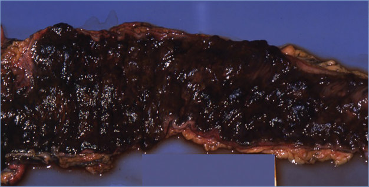
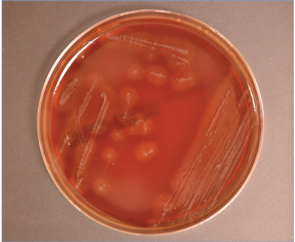

# 34. Clostridium perfringens Foodborne Illness
> Private study reference ([source credits](../../SOURCE_CREDITS.md)). PDF pages 165-167; printed pages 151-153.

## PDF page 165 | printed page 151

### CLINICAL MANIFESTATIONS

Clostridium perfringens foodborne illness is characterized by a sudden onset of watery diarrhea and moderate-to-severe crampy, mid-epigastric pain. Symptoms usually resolve within 24 hours. The shorter incubation period, shorter duration of illness, and absence of fever in most patients differentiate C perfringens foodborne disease from shigellosis and salmonellosis. As compared with foodborne illnesses associated with heavy metals, Staphylococcus aureus enterotoxins, Bacillus cereus emetic toxin, and fish and shellfish toxins, C perfringens foodborne illness is infrequently associated with vomiting. Diarrheal illness caused by B cereus diarrheal enterotoxins can be indistinguishable from that caused by C perfringens. Necrotizing colitis and death from constipation have been described in patients with disease attributable to C perfringens type A who received antidiarrheal medications. Enteritis necroticans (also known as pigbel) results from hemorrhagic necrosis of the midgut and is a cause of severe illness and death attributable to C perfringens infection caused by contamination with Clostridium strains carrying a β toxin. Rare cases have been reported in the highlands of Papua New Guinea and in Thailand; protein malnutrition is an important risk factor. Additionally, enteritis necroticans attributed to C perfringens type C has been reported in a child with poorly controlled diabetes in the United States who consumed chitterlings (pig intestine).

### ETIOLOGY

Typical illness is caused by a heat-labile C perfringens enterotoxin, produced during sporulation in the small intestine. C perfringens type F (formerly cpe-positive type A), which produces α toxin and enterotoxin, commonly causes foodborne illness. Enteritis necroticans is caused by C perfringens type C, which produces a β toxin that causes necrotizing small bowel inflammation.

### EPIDEMIOLOGY

C perfringens is a gram-positive, spore-forming bacillus that is ubiquitous in the environment and the intestinal tracts of humans and animals and is commonly present in raw meat and poultry. Spores of C perfringens that survive cooking can germinate and multiply rapidly during slow cooling, when stored at temperatures from 20°C to 60°C (68°F–140°F), and during inadequate reheating. At an optimum temperature, C perfringens has one of the fastest rates of growth of any bacterium. Illness results from consumption of food containing high numbers of vegetative organisms (>105 colony forming units [CFU]/g) that produce enterotoxin in the intestine of the consumer.

Ingestion of the organism is commonly associated with foods prepared by restaurants or caterers or in institutional settings (eg, schools and camps) where food is prepared in large quantities, cooled slowly, and may be stored inappropriately for prolonged periods. Beef, poultry, gravies, and dried or precooked foods are commonly implicated sources. Most outbreaks occur in November or December, often linked to consumption of popular holiday foods. Illness is not transmissible from person-to-person.

The incubation period is 6 to 24 hours, usually 8 to 12 hours.

### DIAGNOSTIC TESTS

Because the fecal flora of healthy people commonly includes C perfringens, counts of C perfringens of 106 CFU/g of feces or greater obtained within 48 hours of onset of illness support the diagnosis in symptomatic people. The diagnosis also can be supported by detection of enterotoxin in stool. C perfringens can be confirmed as the source of an outbreak if 106 CFU/g are isolated from stool, enterotoxin is demonstrated in the stool of 2 or more ill people, or the concentration of organisms is at least 105 CFU/g in the implicated food. Although C perfringens is an anaerobe, special transport conditions are unnecessary. Whole stool, rather than rectal swab specimens, should be obtained, transported in ice packs, and

## PDF page 166 | printed page 152

tested within 24 hours. For enumeration and enterotoxin testing, obtaining stool specimens in bulk without added transport media is required.

### TREATMENT

C perfringens foodborne illness is typically self-limited. Oral rehydration or, occasionally, intravenous fluid and electrolyte replacement may be indicated to prevent or treat dehydration. Antimicrobial agents are not indicated.

### INFECTION PREVENTION AND CONTROL MEASURES IN HEALTH CARE SETTINGS

Standard precautions are recommended.

Image 34.1 This slide shows hemorrhagic necrosis of the intestine in a patient with Clostridium perfringens sepsis. Courtesy of Dimitris P. Agamanolis, MD.

### CONTROL MEASURES

Preventive measures depend on limiting proliferation of C perfringens in foods by cooking foods thoroughly and maintaining food at warmer than 60°C (140°F) or cooler than 7°C (45°F). Meat dishes should be served hot. Leftovers should be reheated to at least 74°C (165°F). Foods should never be held at room temperature to cool; they should be refrigerated in shallow containers after removal from warming devices or serving tables as soon as possible and within 2 hours of preparation. Information on recommended safe food handling practices, including time and temperature requirements during cooking, storage, and reheating, can be found at www.foodsafety.gov.

## PDF page 167 | printed page 153

Image 34.2 Clostridium perfringens, an anaerobic, gram-positive, spore-forming bacillus, causes a broad spectrum of pathological effects, including food poisoning. In Papua New Guinea, C perfringens is a cause of severe illness and death called enteritis necroticans (locally known as pigbel). Courtesy of Hugh Moffet, MD.

Image 34.4 Clostridium perfringens on phenylethyl alcohol–blood agar. A double zone of hemolysis is often observed as surrounding individual colonies. Courtesy of Julia Rosebush, DO; Robert Jerris, PhD; and Theresa Stanley, M(ASCP).

Image 34.3 This photomicrograph reveals numbers of Clostridium perfringens bacteria grown in Schaedler broth and subsequently stained with Gram stain (magnification ×1,000). C perfringens is a spore-forming, heat-resistant bacterium that can cause foodborne disease. The spores persist in the environment and often contaminate raw food materials. These bacteria are found in mammalian feces and soil. Courtesy of Centers for Disease Control and Prevention/Don Stalons.

