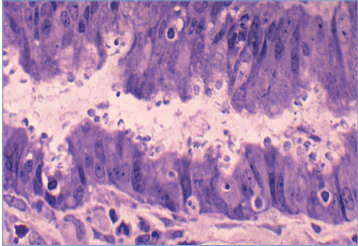
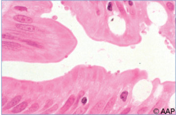

# 39. Cryptosporidiosis
> Private study reference ([source credits](../../SOURCE_CREDITS.md)). PDF pages 197-202; printed pages 183-188.

## PDF page 197 | printed page 183

### CLINICAL MANIFESTATIONS

Cryptosporidiosis commonly presents with frequent, nonbloody, watery diarrhea, although infection can be asymptomatic. Other symptoms include abdominal cramps, fatigue, fever, vomiting, anorexia, and weight loss. In an immunocompetent person, symptomatic cryptosporidiosis is self-limited, usually resolving within 2 to 3 weeks. Cryptosporidium infection is a common cause of moderate to severe diarrhea and poor growth among young children in resource-limited countries.

In an immunocompromised person, such as a child who has received a solid organ transplant or has advanced human immunodeficiency virus (HIV) disease, cryptosporidiosis can result in profuse diarrhea lasting weeks to months, which can lead to severe, even life-threatening dehydration, malnutrition, and wasting. The diagnosis of cryptosporidiosis should be considered in any immunocompromised person with diarrhea. Extraintestinal (eg, pulmonary or biliary tract) cryptosporidiosis has been reported in immunocompromised people and is associated with CD4+ T-lymphocyte counts less than 50/mm3.

### ETIOLOGY

Cryptosporidia are oocyst-forming coccidian protozoa. Approximately 20 Cryptosporidium species or genotypes have been reported to infect humans, but Cryptosporidium hominis and Cryptosporidium parvum cause more than 90% of cases of human cryptosporidiosis. Oocysts are excreted in feces of an infected host and as few as 10 oocysts can cause infection. Cryptosporidium oocysts can tolerate extreme environmental conditions and can survive in water and soil for several months. Even in properly chlorinated pools, Cryptosporidium oocysts can survive for more than 7 days.

### EPIDEMIOLOGY

Cryptosporidium organisms can be transmitted between humans and to humans via contaminated water or food or from infected animals. Extensive waterborne disease outbreaks have been associated with contamination of drinking water and recreational water (eg, pools, lakes, and

splash pads). Cryptosporidium infection is the leading cause of outbreaks associated with treated recreational water venues (eg, swimming pools and splash pads), responsible for 76 (49%) of 155 U.S. outbreaks during 2015–2019 for which an infectious cause was identified, and 84% of all cases from those 155 outbreaks.

In children, the incidence of cryptosporidiosis is greatest during summer and early fall, corresponding to the outdoor swimming season. The incidence of reported cryptosporidiosis is highest in children 1 through 4 years of age.

Foodborne transmission can occur; Cryptosporidium organisms have been detected on raw produce and in raw or unpasteurized apple cider and milk. People can acquire infections from pets, livestock, and from animals found in petting zoos, particularly preweaned bovine calves, lambs, and goat kids. Cryptosporidium organisms can spread by person-to-person transmission and result in outbreaks in child care settings and are a cause of travelers’ diarrhea (www.cdc.gov/parasites/ crypto/audience-travelers.html).

The incubation period of Cryptosporidium species usually is 2 to 10 days. Recurrence of symptoms has been reported frequently. In immunocompetent people, oocyst shedding usually ceases within 2 weeks after symptoms completely abate. In immunocompromised people, the period of oocyst shedding can continue for months.

### DIAGNOSTIC TESTS

Molecular methods are being used increasingly for diagnosis of cryptosporidiosis and are now the standard of care. Nucleic acid amplification tests that target multiple gastrointestinal tract pathogens in a single assay have a sensitivity of 97% and a specificity of 98% for Cryptosporidium organisms.

Nonmolecular testing, including direct fluorescent antibody detection of oocysts in stool and enzyme immunoassays or rapid point-of-care lateral flow immunochromatographic tests targeting cryptosporidial antigens in stool, can provide rapid results, but their potential false-positive results and low positive predictive values still necessitate molecular confirmation. The detection of oocysts on microscopic examination of stool specimens

## PDF page 198 | printed page 184

can be accomplished by direct wet mount if concentration of the oocysts is high. Alternatively, the formalin ethyl acetate stool concentration method can be used followed by staining of the stool specimen with a modified Kinyoun acid-fast stain. Oocysts generally are small (4–6 μm in diameter) and can be missed in a rapid scan of a slide. At least 3 stool specimens collected on separate days should be examined before considering test results to be negative, because shedding can be intermittent. Organisms also can be identified in intestinal fluid, tissue samples, or biopsy specimens.

### TREATMENT

Supportive therapy with volume and electrolyte repletion is recommended for all patients with cryptosporidiosis. Immunocompetent people might not need specific therapy. If treatment of diarrhea associated with cryptosporidiosis is indicated, a 3-day course of nitazoxanide oral suspension has been approved by the U.S. Food and Drug Administration for non–HIV-infected, immunocompetent people 1 year or older.

In children with HIV infection, nitazoxanide alone in a 3-day course is generally ineffective in the treatment of Cryptosporidium diarrhea. Improvement in CD4+ T-lymphocyte count associated with antiretroviral therapy (ART) can lead to resolution of symptoms and cessation of oocyst shedding. For this reason, administration of combination ART is the primary treatment for cryptosporidiosis in patients with HIV infection. Given the seriousness of cryptosporidiosis in immunocompromised people, a 14-day course of nitazoxanide can be considered in immunocompromised HIV-infected children in conjunction with immune restoration with ART.1 In immunocompromised children, including some children with HIV infection, paromomycin or azithromycin have been used in case series with some success as single agents, in combination, or in combination with nitazoxanide (either agent or both). There are few data on the use of paromomycin or azithromycin in immunocompetent children with Cryptosporidium diarrhea, so they should be considered for use primarily in immunocompromised children, and should be used in immunocompetent children only if nitazoxanide has failed or is not available.

### INFECTION PREVENTION AND CONTROL MEASURES IN HEALTH CARE SETTINGS

In addition to standard precautions, contact precautions are recommended for diapered or incontinent people for the duration of illness. Hydrogen peroxide is preferred over bleach for environmental cleaning because of the organism’s extreme chlorine tolerance.

### CONTROL MEASURES

Appropriate control and prevention measures should be implemented promptly to prevent pathogen transmission. In general, these measures include the following, and other measures might be indicated depending on suspected source and mode of transmission:

• Wash hands frequently with soap and water. Alcohol-based hand sanitizers are not effective against Cryptosporidium species.

• Do not swim or participate in recreational water activities if sick with diarrhea. If cryptosporidiosis is diagnosed, wait 2 weeks after diarrhea has stopped completely before participating in recreational water activities.

• Avoid swallowing recreational water. Additional information on healthy swimming can be found at www.cdc.gov/healthyswimming.

• Do not consume food or drink that might be contaminated, such as water from lakes or rivers; inadequately treated water (eg, while traveling in areas with unsafe water); fruits or vegetables washed in water that might be contaminated; or unpasteurized milk or apple cider.

• If immunocompromised, avoid contact with farm animals and their feces (see www.cdc. gov/parasites/crypto/gen_info/ prevent_ic.html).

Public Health Reporting

Cryptosporidiosis cases are reportable to local, state, and territorial health departments.

1 Panel on Opportunistic Infections in HIV-Exposed and HIV-

Infected Children. Guidelines for the Prevention and Treatment of Opportunistic Infections in Children with and Exposed to HIV. Available at: https://clinicalinfo.hiv.gov/ en/guidelines/hiv-clinical-guidelines-pediatricopportunistic-infections/whats-new

## PDF page 199 | printed page 185

Image 39.1 This micrograph of a direct fecal smear is stained to detect Cryptosporidium species, an intracellular protozoan parasite. With a modified cold Kinyoun acidfast staining technique and under an oil immersion lens, Cryptosporidium species oocysts, which are acid fast, stain red, and yeast cells, which are not acid fast, stain green. Courtesy of Centers for Disease Control and Prevention.

Image 39.3 Histopathologic features of cryptosporidiosis, intestine. Plastic-embedded, toluidine blue–stained section shows numerous Cryptosporidium organisms at luminal surfaces of epithelial cells. Courtesy of Centers for Disease Control and Prevention.

Image 39.2 This micrograph of a stool smear reveals Cryptosporidium parvum as the cause of this patient’s cryptosporidiosis. Cryptosporidium is a microscopic parasite that can live in the intestines of humans and animals. The parasite is protected by an outer shell that allows it to survive outside the body for long periods and makes it resistant to chlorine disinfection. Courtesy of Centers for Disease Control and Prevention.

Image 39.4 Cryptosporidium, a spore-forming coccidian protozoan, can be seen on the brush border of intestinal mucosa. Cryptosporidium does not invade below the epithelial layer of the mucosa, so fecal leukocytes are absent.

## PDF page 200 | printed page 186

Image 39.5 Cryptosporidiosis of gallbladder in a patient with AIDS. Histopathologic features of gallbladder epithelium include numerous Cryptosporidium organisms along luminal surfaces of epithelial cells. Courtesy of Centers for Disease Control and Prevention.

Image 39.6 Reported cryptosporidiosis outbreaks (N = 444), by exposure jurisdiction—United States, 2009–2017. Exposure districts are states, the District of Columbia (DC), and Puerto Rico (PR). These numbers largely depend on public health capacity and reporting requirements, which vary across jurisdictions and do not necessarily indicate the actual occurrence of cryptosporidiosis outbreaks in a given jurisdiction. Courtesy of Morbidity and Mortality Weekly Report.

DC PR

41–80

14–40

5–13

1–4

Not reported

## PDF page 201 | printed page 187

Image 39.7 Incidence* of reported cryptosporidiosis cases, by year and case classification—National Notifiable Diseases Surveillance System, United States, 2010–2019 (N = 105,211). * Cases per 100,000 population per year. § Probable, suspected, or unknown cases. Courtesy of Centers for Disease Control and Prevention.

## PDF page 202 | printed page 188

Image 39.8 Life cycle of Cryptosporidium. Sporulated oocysts, containing 4 sporozoites, are excreted by the infected host through feces and, possibly, other routes, such as respiratory secretions (1). Transmission of Cryptosporidium parvum occurs mainly through contact with contaminated water (eg, drinking or recreational water). Occasionally, food sources, such as chicken salad, may serve as vehicles for transmission. Many outbreaks in the United States have occurred in water parks, community swimming pools, and child care centers. Zoonotic transmission of C parvum occurs through exposure to infected animals or exposure to water contaminated by feces of infected animals (2). After ingestion (and, possibly, inhalation) by a suitable host (3), excystation (a) occurs. The sporozoites are released and parasitize epithelial cells (b, c) of the gastrointestinal tract or other tissues. In these cells, the parasites undergo asexual multiplication (schizogony or merogony) (d–f) and then sexual multiplication (gametogony), producing microgamonts (male) (g) and macrogamonts (female) (h). On fertilization of the macrogamonts by the microgametes (i), oocysts (j, k) develop that sporulate in the infected host. Two different types of oocysts are produced: the thick-walled, which is commonly excreted from the host (j), and the thin-walled (k), which is primarily involved in autoinfection. Oocysts are infective on excretion, thus permitting direct and immediate fecal-oral transmission. Note that oocysts of Cyclospora cayetanensis, another important coccidian parasite, are unsporulated at excretion and do not become infective until sporulation is completed. Refer to the life cycle of C cayetanensis for further details. Courtesy of Centers for Disease Control and Prevention.

![Image 39.8 Life cycle of Cryptosporidium. Sporulated oocysts, containing 4 sporozoites, are excreted by the infected host through feces and, possibly, other routes, such as respiratory secretions (1). Transmission of Cryptosporidium parvum occurs mainly through contact with contaminated water (eg, drinking or recreational water). Occasionally, food sources, such as chicken salad, may serve as vehicles for transmission. Many outbreaks in the United States have occurred in water parks, community swimming pools, and child care centers. Zoonotic transmission of C parvum occurs through exposure to infected animals or exposure to water contaminated by feces of infected animals (2). After ingestion (and, possibly, inhalation) by a suitable host (3), excystation (a) occurs. The sporozoites are released and parasitize epithelial cells (b, c) of the gastrointestinal tract or other tissues. In these cells, the parasites undergo asexual multiplication (schizogony or merogony) (d–f) and then sexual multiplication (gametogony), producing microgamonts (male) (g) and macrogamonts (female) (h). On fertilization of the macrogamonts by the microgametes (i), oocysts (j, k) develop that sporulate in the infected host. Two different types of oocysts are produced: the thick-walled, which is commonly excreted from the host (j), and the thin-walled (k), which is primarily involved in autoinfection. Oocysts are infective on excretion, thus permitting direct and immediate fecal-oral transmission. Note that oocysts of Cyclospora cayetanensis, another important coccidian parasite, are unsporulated at excretion and do not become infective until sporulation is completed. Refer to the life cycle of C cayetanensis for further details. Courtesy of Centers for Disease Control and Prevention.](../../figures/ch039_p0202_01.jpg)
