# 43. Cytomegalovirus Infection
> Private study reference ([source credits](../../SOURCE_CREDITS.md)). PDF pages 212-223; printed pages 198-209.

## PDF page 212 | printed page 198

### CLINICAL MANIFESTATIONS

Manifestations of acquired human cytomegalovirus (CMV) infection vary with age and immunocompetence of the host. Asymptomatic infections are the most common, particularly in children. An infectious mononucleosis-like syndrome with prolonged fever and mild hepatitis, occurring in the absence of heterophile antibody production (“monospot negative”), may occur in adolescents and adults. End-organ disease, including pneumonia, colitis, retinitis, meningoencephalitis, or transverse myelitis, or a CMV syndrome characterized by fever, thrombocytopenia, leukopenia, and mild hepatitis may occur in immunocompromised hosts, including people receiving treatment for malignant neoplasms, people infected with human immunodeficiency virus (HIV), and people receiving immunosuppressive therapy for solid organ or hematopoietic cell transplantation. Less commonly, patients treated with biologic response modifiers can exhibit CMV end-organ disease, such as retinitis and hepatitis.

Congenital CMV infection has a spectrum of clinical manifestations but usually is not evident at birth (asymptomatic congenital CMV infection). Approximately 10% of infants with congenital CMV infection exhibit clinical findings that are evident at birth (symptomatic congenital CMV disease), with manifestations including jaundice attributable to direct hyperbilirubinemia, petechiae attributable to thrombocytopenia, purpura, hepatosplenomegaly, microcephaly, intracerebral (typically periventricular) calcifications, and retinitis. Developmental delays can occur among affected infants in later infancy and early childhood. Death attributable to congenital CMV is estimated to occur in 3% to 10% of infants with symptomatic disease or 0.3% to 1.0% of all infants with congenital CMV infection.

Congenital CMV infection is the leading nongenetic cause of sensorineural hearing loss (SNHL) in children in the United States. Approximately 20% of all hearing loss at birth and 25% of all hearing loss at 4 years of age is attributable to congenital CMV infection. SNHL is the most common sequela following congenital CMV infection,

with SNHL occurring in up to 50% of children with congenital infections that are symptomatic at birth and up to 15% of those with asymptomatic infections. Approximately 40% of infected children who ultimately develop SNHL will not have hearing loss detectable within the first month of life, illustrating the risk of late-onset SNHL in these populations. Approximately 50% of children with CMV-associated SNHL continue to have further deterioration (progression) of their hearing loss over time.

Infection acquired during the intrapartum period from cervical secretions or in the postpartum period from human milk usually is not associated with clinical illness in term infants. In preterm infants, however, postpartum infection resulting from human milk or from transfusion from CMVseropositive donors has been associated with hepatitis, interstitial pneumonitis, colitis, hematologic abnormalities including thrombocytopenia, neutropenia, leukopenia, and a viral sepsis syndrome.

### ETIOLOGY

Human CMV, also known as human herpesvirus 5, is a member of the herpesvirus family (Herpesviridae), the beta-herpesvirus subfamily (Betaherpesvirinae), and the Cytomegalovirus genus. The viral genome contains double-stranded DNA that range in size from 196,000 to 240,000 bp encoding at least 166 proteins and is the largest of the human herpesvirus genomes.

### EPIDEMIOLOGY

CMV is highly species-specific, and only human CMV has been shown to infect and cause disease in humans. The virus is ubiquitous, and CMV strains exhibit extensive genetic diversity. Transmission occurs horizontally (by direct person-to-person contact with virus-containing secretions), vertically (from mother to infant before, during, or after birth), and via transfusions of blood, platelets, and white blood cells from infected donors. CMV also can be transmitted with solid organ or hematopoietic cell transplantation. Infections have no seasonal predilection. CMV persists in leukocytes and tissue cells after a primary infection, with intermittent virus shedding; symptomatic reinfection can occur throughout the lifetime of the infected person, particularly under conditions of immunosuppression.

## PDF page 213 | printed page 199

Reinfection with other strains of CMV can occur in seropositive hosts, including pregnant people. In the United States, there appear to be 3 periods in life when there is an increased incidence of CMV acquisition: early childhood, adolescence, and the childbearing years.

Horizontal transmission probably is the result of exposure to saliva, urine, or genital secretions from infected individuals. Spread of CMV in households and child care centers is well documented. Excretion rates from urine or saliva in children 1 to 3 years of age who attend child care centers usually range from 30% to 40% but can be as high as 70%. In addition, children who attend child care frequently excrete large quantities of virus for prolonged periods. Young children can transmit CMV to their parents, including those who may be pregnant, and other caregivers, including child care staff. In adolescents and adults, sexual transmission occurs, as evidenced by detection of virus in seminal and cervical fluids. As such, CMV is considered to be a sexually transmitted infection.

CMV-seropositive healthy people have latent CMV in their leukocytes and tissues; hence, blood transfusions and organ transplantation can result in transmission. Severe CMV disease following transfusion or solid organ transplantation is more likely to occur if the recipient is CMV seronegative before transplantation. In contrast, among nonautologous hematopoietic cell transplant (HCT) recipients, CMV-seropositive individuals who receive transplants from seronegative donors are at greatest risk of disease when exposed to CMV after transplantation, likely because of the failure of the transplanted graft to provide immunity to the recipient. Latent CMV may reactivate in immunosuppressed individuals and result in disease if immunosuppression is severe (eg, in patients with acquired immunodeficiency syndrome [AIDS] or solid organ or HCT recipients).

Vertical transmission of CMV to an infant occurs in one of the following time periods: (1) in utero (congenital), by transplacental passage of parental bloodborne virus; (2) at birth (perinatal), by passage through an infected genital tract; or (3) following birth (postnatal), via ingestion of CMVpositive human milk. Approximately 5 per 1,000 live-born infants are infected in utero and excrete CMV at birth, making this the most common

congenital viral infection in the UnitedvStates. Significant racial and ethnic differences exist in the prevalence of congenital CMV, with the highest prevalence of CMV in Black newborn infants (9.5/1,000 live births) and lower prevalence in non-Hispanic white infants (2.7/1,000 live births) and Hispanic white infants (3.0/1,000 live births). In utero fetal infection can occur in pregnant people with no preexisting CMV immunity (primary infection) or in pregnant people with preexisting antibodies to CMV (nonprimary infection) either by acquisition of a different viral strain during pregnancy or by reactivation of an existing infection. Congenital infection and associated sequelae can occur irrespective of the trimester when the pregnant person is infected, but severe sequelae are associated more commonly with infection acquired during the first trimester. Damaging fetal infections and sequelae can occur following both primary and nonprimary infections in the pregnant person. It is estimated that more than three-quarters of infants with congenital CMV infection in the United States are born to a person with nonprimary infection; in nations with near-universal CMV seroprevalence, most damaging congenital CMV infections occur in infants born to people with nonprimary infection.

Among infants who acquire infection perinatally from cervical secretions or postnatally from human milk, preterm infants born before 32 weeks’ gestation and with a birth weight less than 1,500 g are at greater risk of developing CMV disease than are full-term infants. Most infants who acquire CMV from ingestion of human milk from a CMV-seropositive parent do not develop clinical illness or sequelae, likely because of the presence of passively transferred antibody.

The incubation period for horizontally transmitted CMV infections is highly variable. Infection usually manifests 3 to 12 weeks after blood transfusions and between 1 and 4 months after organ transplantation. For vertical transmission through human milk in preterm infants, the median time to onset of CMV viruria is 7 weeks (range, 3–24 weeks).

### DIAGNOSTIC TESTS

The diagnosis of CMV disease is confounded by the ubiquity of the virus, the high rate of asymptomatic excretion, the frequency of reactivated

## PDF page 214 | printed page 200

infections, reinfection with different strains of CMV, the development of serum immunoglobulin (Ig) M CMV-specific antibodies in some episodes of reactivation and reinfection, and concurrent infection with other pathogens.

Viral DNA can be detected by nucleic acid amplification tests (NAATs) in tissues and some fluids, including cerebrospinal fluid (CSF), amniotic fluid, human milk, aqueous and vitreous humor fluids, urine, saliva and other respiratory secretions, and peripheral blood. Detection of CMV DNA by NAAT in blood does not necessarily indicate acute infection or disease, especially in immunocompetent people. Several quantitative NAATs for detection of CMV have been cleared by the U.S. Food and Drug Administration (FDA). These assays are sensitive, use standardized international units for reporting, provide rapid results compared with culture, and generally are the preferred method for detecting CMV DNA. The same specimen type should always be used when testing any given patient over time. Antigenemia assays also have been cleared by the FDA, but they are labor intensive and require timely processing of specimens to obtain accurate results. Because of these drawbacks, molecular assays are preferred.

CMV can be isolated in conventional cell culture from urine, saliva, peripheral blood leukocytes, human milk, semen, cervical secretions, and other tissues and body fluids. Recovery of virus from a target organ provides supportive evidence that the disease is caused by CMV infection. Standard viral cultures must be maintained for more than 28 days before considering such cultures negative. Shell vial culture coupled with staining of cells using immunofluorescence antibody techniques for immediate early antigen provides results within 24 to 36 hours but is not available in many laboratories.

Various serologic assays, including immunofluorescence assays, latex agglutination assays, and enzyme immunoassays, are available for detecting both IgG and IgM CMV-specific antibodies. Single serum specimens for IgG antibody testing are useful in screening for past infection in individuals at risk for CMV reactivation or for screening potential organ transplant donors and recipients. For diagnosis of suspected recent infection, testing for CMV IgG in paired sera obtained at least 2 weeks apart and testing for IgM in a single serum

specimen may be useful. Determination of lowavidity CMV IgG in the presence of CMV IgM in a pregnant person can suggest more recent infection.

Fetal CMV infection can be diagnosed by detection of CMV DNA in amniotic fluid. Congenital infection with CMV requires detection of CMV or CMV DNA in urine, saliva, blood, or CSF obtained within 3 weeks of birth; detection beyond this initial period of life could reflect postnatal acquisition of virus. NAATs of saliva swab specimens from neonates have been shown to be >95% sensitive for the identification of congenital CMV infection. Positive saliva swab specimen test results require confirmation with testing of urine because of potential contamination of saliva with CMV in human milk. The analytical sensitivity of CMV NAAT of dried blood spots is lower, limiting use of this type of specimen for widespread screening for congenital CMV infection. A positive NAAT result from a neonatal dried blood spot confirms congenital infection, but a negative result does not rule out congenital infection. Differentiation between congenital and perinatal infection is difficult at later than 3 weeks of age unless clinical manifestations of the former, such as chorioretinitis or periventricular calcifications, are present. At least 1 commercial assay has been cleared by the FDA for detection of CMV DNA from saliva of neonates within the first 3 weeks of life. IgM serologic methods have reduced sensitivity and specificity and may yield false-positive results, making serologic diagnosis of congenital CMV infection unreliable.

Targeted CMV newborn screening, in which infants who do not pass their newborn hearing screening are tested for CMV in saliva or urine within the first 2 to 3 weeks of life, is mandated in several states, and many birth hospitals have implemented targeted screening programs as standard of care. Universal screening of all newborn infants for CMV has been undertaken in Ontario and Saskatchewan, Canada, beginning in 2019 and 2022, respectively, and in 2022 Minnesota became the first state to add congenital CMV to its newborn screening program.

### TREATMENT

Intravenous ganciclovir is approved for induction and maintenance treatment of retinitis caused by

## PDF page 215 | printed page 201

acquired or recurrent CMV infection in immunocompromised adult patients, including people living with HIV, and for prophylaxis and treatment of CMV disease in adult transplant recipients. Valganciclovir, the oral prodrug of ganciclovir, is approved for treatment (induction and maintenance) of CMV retinitis in immunocompromised adult patients, including people living with HIV, and for prevention of CMV disease in kidney, kidney-pancreas, or heart transplant recipients at high risk of CMV disease. Valganciclovir also is approved for prevention of CMV disease in pediatric kidney transplant patients 4 months and older and for pediatric heart transplant patients 1 month and older. Ganciclovir and valganciclovir are used to treat CMV infections of other sites (esophagus, colon, lungs) and for preemptive treatment of immunosuppressed adults with CMV antigenemia or viremia. Valganciclovir is available in both tablet and powder for oral solution formulations. Oral ganciclovir and ganciclovir ocular implants are no longer available in the United States.

Neonates with moderately to severely symptomatic congenital CMV disease with or without central nervous system involvement have improved audiologic and neurodevelopmental outcomes at 2 years of age when treated with oral valganciclovir for 6 months. The dose should be adjusted each month to account for weight gain. Neonates with isolated SNHL have improved audiologic outcomes when treated with oral valganciclovir for 6 weeks, with treatment begun by 13 weeks following birth. Treatment of mildly symptomatic neonates has not been studied. Treatment recommendations by degree of symptomatology are provided in Table 43.1. Infants with asymptomatic congenital CMV infection should not receive antiviral treatment outside the confines of a research study.

Therapy can be accomplished using oral valganciclovir for the entire treatment course, because drug exposure following appropriate dosing of valganciclovir is the same as that achieved with intravenous ganciclovir. If an infant is unable to absorb medications reliably from the gastrointestinal tract (eg, because of necrotizing enterocolitis or other bowel disorders), intravenous ganciclovir can be used initially. Significant neutropenia occurs in approximately 20% of infants treated with oral valganciclovir and in approximately 65% of infants treated with parenteral ganciclovir. Absolute

neutrophil counts should be measured weekly for 6 weeks, then at 8 weeks, then monthly for the duration of antiviral treatment; serum alanine aminotransferase concentration should be measured monthly during treatment. When it occurs, neutropenia is more common during the first 4 to 6 weeks of therapy; if the absolute neutrophil count reproducibly drops below 500 cells/mm3, either treatment can be held until counts recover above 750 cells/mm3, or granulocyte colony-stimulating factor can be administered once daily for 1 to 3 consecutive days.

Patients with symptomatic or asymptomatic congenital CMV infection should have serial audiologic assessments throughout childhood. The American Academy of Pediatrics Bright Futures: Guidelines for Health Supervision of Infants, Children, and Adolescents, 4th Edition, recommends hearing screening/assessment at 4, 6, 9, 12, 15, 18, 24, and 30 months of age for children with congenital CMV, in addition to the standard hearing testing recommended for all children at 4, 5, 6, 8, and 10 years of age.

Preterm infants with perinatally acquired CMV infection can have symptomatic, end-organ disease (eg, pneumonitis, hepatitis, thrombocytopenia). Antiviral treatment has not been studied in this population. If such patients are treated with parenteral ganciclovir, a reasonable approach is to treat for 2 weeks and then reassess responsiveness to therapy. If clinical data suggest benefit of treatment, an additional 1 to 2 weeks of parenteral ganciclovir can be considered if symptoms and signs have not resolved. Valganciclovir generally is not a reasonable alternative in this setting, given the degree of illness these infants experience and the corresponding effect that this potentially could have on gastrointestinal tract absorption of valganciclovir and first-pass hepatic metabolism to ganciclovir.

In HCT recipients, the combination of immunoglobulin intravenous (IGIV) or CMV-IGIV and intravenous ganciclovir has been reported to be synergistic in treatment of CMV pneumonia. Unlike CMV-IGIV, IGIV products have varying anti-CMV antibody concentrations from lot to lot, are not tested routinely for their quantities of anti- CMV antibodies, and do not have a specified titer of antibodies to CMV that have correlated with effectiveness.

## PDF page 216 | printed page 202

Valganciclovir and foscarnet have been approved for treatment and maintenance therapy of CMV retinitis in adults with AIDS, and letermovir has been approved in adults for prophylaxis of CMV infection and disease in adult CMV-seropositive recipients of allogeneic HCT. Foscarnet is more toxic (with high rates of limiting nephrotoxicity) but may be advantageous for some people living with HIV infection, including people with disease caused by ganciclovir-resistant virus or people who are unable to tolerate ganciclovir. Cidofovir can be used for CMV retinitis in adults with AIDS when there is a need to avoid both ganciclovir and foscarnet, but it is associated with significant nephrotoxicity and increased risk of immune recovery uveitis, hypotony, and neutropenia. In November 2021, maribavir was approved as the first drug for treating adults and pediatric patients (12 years and older and weighing at least 35 kg) with post-transplant CMV infection or disease that does not respond (with or without genetic mutations that cause resistance) to available antiviral treatment for CMV.

CMV establishes lifelong persistent infection, and as such, it is not eliminated from the body with antiviral treatment of CMV disease. Until immune reconstitution is achieved with antiretroviral therapy, chronic suppressive therapy should be administered to people living with HIV with a history of CMV end-organ disease (eg, retinitis, colitis, pneumonitis) to prevent recurrence. Discontinuing prophylaxis may be considered for pediatric patients 6 years and older with CD4+ T-lymphocyte counts of >100 cells/mm3 for >6 consecutive months and for children younger than 6 years with percentages of total CD4+ T-lymphocytes of >15% for >6 consecutive months. For immunocompromised children with CMV retinitis, such decisions should be made in close consultation with an ophthalmologist and should account for such factors as magnitude and duration of CD4+ T-lymphocyte cell increases, anatomic location of the retinal lesion, vision in the contralateral eye, and the feasibility of regular ophthalmologic monitoring. All patients who have had anti-CMV maintenance therapy discontinued should continue to undergo regular ophthalmologic monitoring at 3- to 6-month intervals for early detection of CMV relapse as well as immune reconstitution uveitis.1

### INFECTION PREVENTION AND CONTROL MEASURES IN HEALTH CARE SETTINGS

Standard precautions are recommended.

### CONTROL MEASURES

Care of Exposed People

When caring for children, hand hygiene, particularly after changing diapers, is advised to decrease transmission of CMV. Because asymptomatic excretion of CMV is common in people of all ages, a child with congenital CMV infection should not be treated differently from other children.

Although unrecognized exposure to people who are shedding CMV likely is common, concern may arise when immunocompromised patients or pregnant people, including health care professionals, are exposed to patients with clinically recognizable CMV infection. Standard precautions should be sufficient to interrupt transmission of CMV.

Child Care

Workers in child care centers capable of becoming pregnant should be aware of CMV and its potential risks and should have access to appropriate hand hygiene measures to minimize occupationally acquired infection (www.cdc.gov/cmv/ index.html).

Immunoprophylaxis

CMV-IGIV is generally not recommended for prophylaxis of CMV disease in solid organ transplant recipients. CMV-IGIV may be useful for prevention of CMV in high-risk heart, lung, and small bowel transplant recipients when used in combination with antiviral agents.2,3 The use of CMV-IGIV in pregnant people to prevent CMV transmission to the fetus is not recommended because of lack of effectiveness in randomized controlled clinical trials. Evaluation of investigational vaccines in healthy volunteers and renal transplant recipients is in progress, but to date, only inconsistent evidence of effectiveness has been reported.

Prevention of Transmission by Blood Transfusion

Transmission of CMV by blood transfusion to newborn infants or other immunocompromised

## PDF page 217 | printed page 203

hosts has been virtually eliminated by use of CMV antibody-negative donors and the use of leukoreduced blood products.

Prevention of Transmission by Human Milk

Pasteurization of donated human milk can decrease the likelihood of CMV transmission. Holder pasteurization (62.5°C [144.5°F] for 30 minutes) and short-term pasteurization (72°C [161.6°F] for 15 seconds) of human milk appear to inactivate CMV; short-term pasteurization may be less harmful to the beneficial constituents of human milk. Freezing human milk at 220°C (24°F) for the sole purpose of reducing CMV infectivity is not advised because, although it may reduce the viral load of CMV, it does not change the risk of CMV sepsis-like syndrome and freezing reduces the bioactivity of human milk. If fresh donated human milk is needed for infants born to CMV antibody-negative birthing parents, providing these infants with milk from only CMV antibody-negative donors should be considered. For infants already infected with CMV, either congenitally or postnatally, the benefits of human milk from their birthing parents outweigh any risk of additional CMV exposure.

Prevention of Transmission in Transplant Recipients

CMV-seronegative recipients of tissue from CMV-seropositive donors are at high risk of CMV

disease. If such circumstances cannot be avoided, prophylactic administration of antiviral therapy or monitoring for viremia and administering preemptive antiviral therapy are options to decrease the incidence of CMV disease. Monitoring and preemptive therapy result in lower risk for drug-associated toxicity. For solid organ transplant patients receiving antiviral prophylaxis, the risk of delayedonset CMV disease is highest during the first 3 months after cessation of antiviral prophylaxis. Among CMV-negative recipients of a liver transplant from a CMV-positive donor, preemptive therapy recently has been shown to significantly reduce CMV disease compared with prophylaxis.

1 Panel on Opportunistic Infections in HIV-Exposed and HIV-

Infected Children. Guidelines for the Prevention and Treatment of Opportunistic Infections in Children with and Exposed to HIV. Available at: https://clinicalinfo.hiv.gov/en/guidelines/hiv-clinical-guidelines-pediatric-opportunisticinfections/whats-new 2 Kotton CN, Kumar D, Caliendo AM, et al; The Transplantation

Society International CMV Consensus Group. The Third International Consensus Guidelines on the management of cytomegalovirus in solid-organ transplantation. Transplantation. 2018;102(6):900–931 3 Razonable RR, Humar A. Cytomegalovirus in solid organ transplant recipients. Guidelines of the American Society of Transplantation Infectious Diseases Community of Practice. Clin Transplant. 2019;33(9):e13512

## PDF page 218 | printed page 204

Table 43.1 Classification of Congenital Cytomegalovirus Disease Severity and Treatment Recommendations

CMV Disease Severity Signs and Symptoms Moderately to severely symptomatic

One or more of the following:

• Single severe or multiorgan disease (eg, significant liver enzyme abnormalities and marked hepatosplenomegaly) or life-threatening organ dysfunction • Multiple persistent (eg, 2 weeks) manifestations attributable to congenital CMV infection: thrombocytopenia, petechiae, hepatomegaly, splenomegaly, hepatitis (increased aminotransferases or direct bilirubin) • Central nervous system involvement such as microcephaly, radiographic abnormalities (ventriculomegaly, intracerebral calcifications, white matter changes, periventricular echogenicity, cortical or cerebellar malformations, migration abnormalities), abnormal cerebrospinal fluid indices for age, chorioretinitis, or the detection of CMV DNA in cerebrospinal fluidGreater than 2 mild disease manifestations (see below)

Asymptomatic with isolated sensorineural hearing loss

No clinically apparent signs to suggest congenital CMV disease, but sensorineural hearing loss

Mildly symptomatic Two or fewer transient (eg, <2 weeks) or clinically insignificant findings (eg, petechiae, mild hepatomegaly, thrombocytopenia, raised levels of alanine aminotransferase)

Asymptomatic No apparent signs to suggest congenital CMV disease, and normal hearing

Modified from Rawlinson W, Boppana S, Fowler KB, et al. Congenital cytomegalovirus infection in pregnancy and the neonate: consensus recommendations for prevention, diagnosis, and therapy. Lancet Infect Dis. 2017;17(6):e177–e188; and Luck SE, Wieringa JW, Blázquez-Gamero D, et al. Congenital cytomegalovirus: a European expert consensus statement on diagnosis and management. Pediatr Infect Dis J. 2017;36(12):1205–1213. a If an infant is unable to absorb medications reliably from the gastrointestinal tract (eg, because of necrotizing enterocolitis or other bowel disorders), intravenous ganciclovir can be used initially. b Antiviral treatment can start from birth through 12 weeks 6 days following delivery.

Treatment

Valganciclovira given orally for 6 months; treatment should be started within the first 13 weeks following birthb

Valganciclovir may be offered and given orally for 6 weeks; treatment should be started within the first 13 weeks following birthb

There are insufficient data to recommend routine treatment, but it may be considered on a case by case basis in consultation with a pediatric infectious diseases expert

Therapy not recommended outside of a research study

### Geometry-detected table

|CMV Disease Severity|Signs and Symptoms|Treatment|
|---|---|---|
|Moderately to severely symptomatic|One or more of the following: •  Single severe or multiorgan disease (eg, signifcant liver enzyme abnormalities and marked hepato- splenomegaly) or life-threatening organ dysfunction •  Multiple persistent (eg,2 weeks) manifestations attributable to congenital CMV infection: thrombo- cytopenia, petechiae, hepatomegaly, splenomegaly, hepatitis (increased aminotransferases or direct bilirubin) •  Central nervous system involvement such as micro- cephaly, radiographic abnormalities (ventriculo- megaly, intracerebral calcifcations, white matter changes, periventricular echogenicity, cortical or cerebellar malformations, migration abnormalities), abnormal cerebrospinal fuid indices for age, chorioretinitis, or the detection of CMV DNA in cerebrospinal fuidGreater than 2 mild disease manifestations(see below)|Valganciclovira given orally for 6 **months**; treatment should be started within the frst 13 weeks following birthb|
|Asymptomatic with isolated sensorineural hearing loss|No clinically apparent signs to suggest congenital CMV disease, but sensorineural hearing loss|Valganciclovir may be offered and given orally for 6**weeks**; treatment should be started within the frst 13 weeks following birthb|
|Mildly symptomatic|Two or fewer transient (eg,<2 weeks) or clinically insignifcant fndings (eg, petechiae, mild hepato- megaly, thrombocytopenia, raised levels of alanine aminotransferase)|There are insuffcient data to rec- ommend routine treatment, but it may be considered on a case by case basis in consultation with a pediatric infectious diseases expert|
|Asymptomatic|No apparent signs to suggest congenital CMV disease, and normal hearing|Therapy not recommended outside of a research study|

[View original table](../../tables/ch043_p0218_1.jpg)

## PDF page 219 | printed page 205

Image 43.1 Transmission electron micrograph of cytomegalovirus particles (purple) found within intracellular vesicles of an infected macrophage (blue). Image captured at the National Institute of Allergy and Infectious Diseases Integrated Research Facility in Fort Detrick in Frederick, Maryland.

Image 43.3 A newborn with cytomegalovirus infection and hemorrhagic skin lesions on the back.

Image 43.2 A 3-week-old with congenital cytomegalovirus infection with purpuric skin lesions and hepatosplenomegaly. Courtesy of Edgar O. Ledbetter, MD, FAAP.

Image 43.4 Cytomegalovirus infection, congenital, with characteristic “blueberry muffin” lesions. Copyright David Clark, MD.

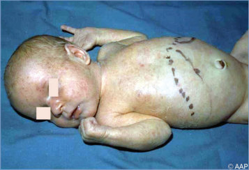

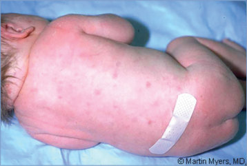

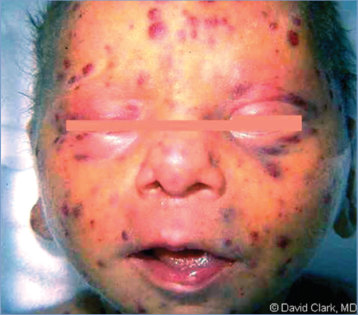

## PDF page 220 | printed page 206

Image 43.5 Infant with lethal congenital cytomegalovirus disease with purpuric skin lesions and striking hepatosplenomegaly. Courtesy of Edgar O. Ledbetter, MD, FAAP.

Image 43.7 Neonate with congenital cytomegalovirus infection with purpuric skin lesions.

Image 43.6 Infant in Image 43.5, with lethal cytomegalovirus disease, with radiographic changes in long bones of osteitis characterized by fine vertical metaphyseal striations. Courtesy of Edgar O. Ledbetter, MD, FAAP.

Image 43.8 Characteristic white perivascular infiltrates in the retina of an infant with congenital cytomegalovirus infection. Courtesy of George Nankervis, MD.

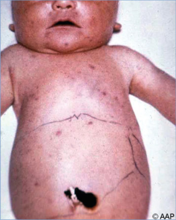

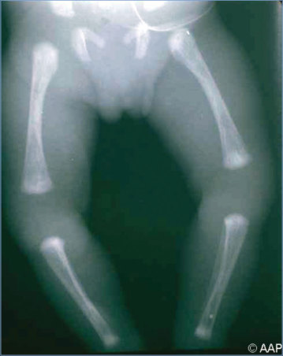

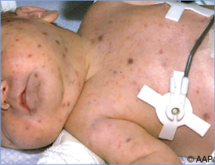

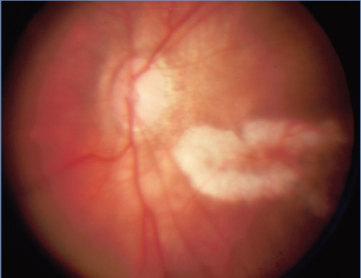

## PDF page 221 | printed page 207

Image 43.9 Axial T2-weighted magnetic resonance image demonstrates periventricular germinolytic cysts (arrows). Also notable are the periventricular white matter hyperintensities that represent demyelination and gliosis.

Image 43.12 Histopathologic features of cytomegalovirus infection of the kidney. Intranuclear inclusions are surrounded by a halo and the nuclear membrane, giving an owl-eye appearance. Courtesy of Centers for Disease Control and Prevention.

Image 43.10 Congenital cytomegalovirus encephalitis. Microcephaly and cerebral calcification. Courtesy of Dimitris P. Agamanolis, MD.

Image 43.11 Cytomegalovirus inclusion cells within renal glomeruli. Courtesy of Edgar O. Ledbetter, MD, FAAP.

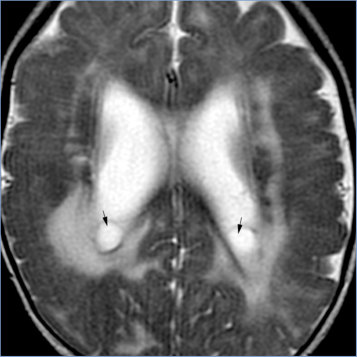

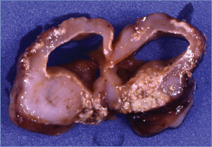

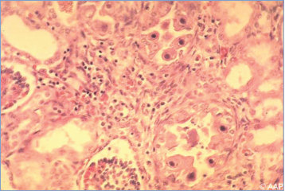

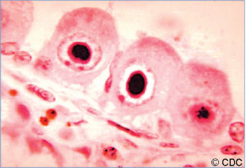

## PDF page 222 | printed page 208

Image 43.13 Cytomegalovirus infection with periventricular calcification. Courtesy of Benjamin Estrada, MD.

Image 43.15 Widespread “brushfire retinitis” in an infant with congenital cytomegalovirus infection. The perivascular infiltrates and diffuse hemorrhage may result in complete blindness whenever macular involvement occurs. Courtesy of George Nankervis, MD.

Image 43.14 Cytomegalovirus infection with periventricular calcification. Courtesy of Benjamin Estrada, MD.

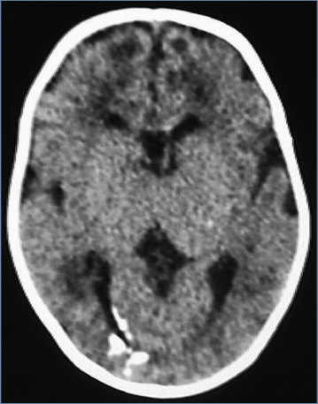

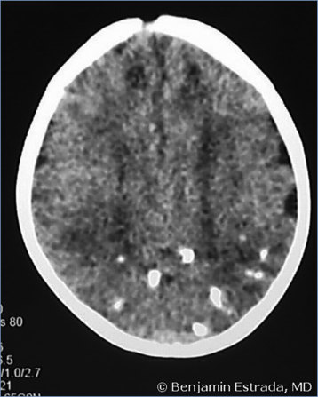

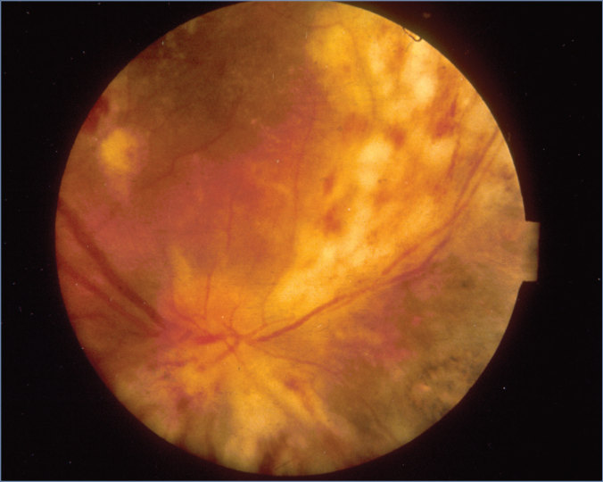

## PDF page 223 | printed page 209

Image 43.16 A neonate with congenital cytomegalovirus infection with Peters anomaly, which was later treated by corneal transplant. Peters anomaly is the term most frequently used when the mesodermal dysgenesis of the anterior ocular segment includes a central stromal opacity with a defect in the posterior stroma and the Descemet membrane. Courtesy of Larry Frenkel, MD.

