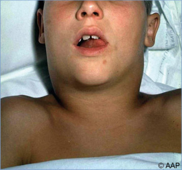
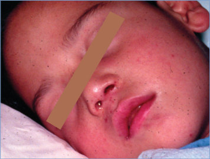
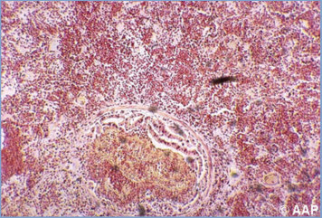
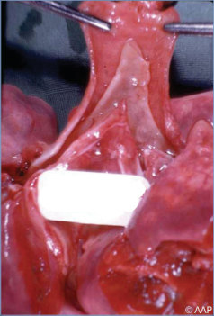
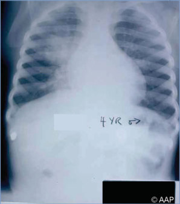
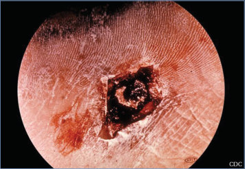
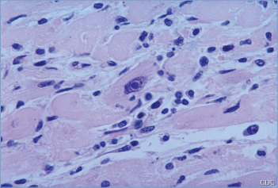
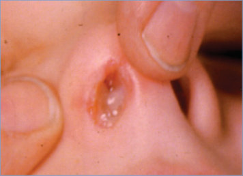
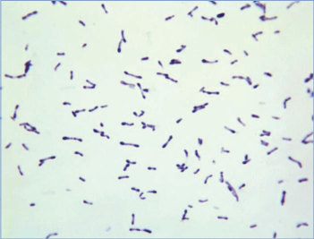
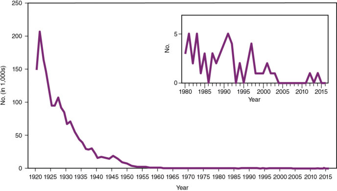

# 45. Diphtheria
> Private study reference ([source credits](../../SOURCE_CREDITS.md)). PDF pages 232-239; printed pages 218-225.

## PDF page 232 | printed page 218

### CLINICAL MANIFESTATIONS

Respiratory tract diphtheria usually presents as membranous nasopharyngitis, obstructive laryngotracheitis, or bloody nasal discharge. Local infections are associated with low-grade fever and gradual onset of manifestations over 1 to 2 days. Less commonly, diphtheria presents as cutaneous, vaginal, conjunctival, or otic infection. Cutaneous diphtheria is more common in tropical areas and among people in urban areas lacking housing; the disease is typically mild and associated with shallow, indistinct ulcers. With upper respiratory infection, extensive neck swelling with cervical lymphadenitis (bull neck) is a sign of severe disease. Life-threatening complications of respiratory diphtheria include upper airway obstruction caused by membrane formation, myocarditis with heart block, and cranial and peripheral neuropathies. Palatal palsy, noted by nasal speech, frequently occurs in pharyngeal diphtheria. Case fatality rates attributable to respiratory disease are 5% to 10% and up to 50% in untreated people.

### ETIOLOGY

Diphtheria is caused by toxigenic strains of Corynebacterium diphtheriae. Toxigenic strains of 2 zoonotic strains, Corynebacterium ulcerans and Corynebacterium pseudotuberculosis, also have emerged as important causes of diphtheria-like illness. C diphtheriae is an irregularly staining, gram-positive, non–spore-forming, nonmotile, pleomorphic bacillus with 4 biotypes (mitis, intermedius, gravis, and belfanti). All biotypes of C diphtheriae may be toxigenic or nontoxigenic. Bacteria remain confined to superficial layers of skin or mucosal surfaces, inducing a local inflammatory reaction. Within several days of respiratory tract infection, a dense pseudomembrane forms, becoming adherent to tissue. Toxigenic strains produce an exotoxin that consists of an enzymatically active A domain and a binding B domain, which promotes the entry of the A toxin into the cell. The toxin, an ADP-ribosylase, inhibits protein synthesis in all cells, including myocardial, renal, and peripheral nerve cells, resulting in myocarditis, acute tubular necrosis, and delayed peripheral nerve conduction. Nontoxigenic strains

of C diphtheriae can cause an exudative pharyngitis and also have been associated with invasive infections including endocarditis and osteomyelitis.

### EPIDEMIOLOGY

Humans are believed to be the sole reservoir of C diphtheriae. Infection is spread by respiratory tract droplets and by contact with discharges from skin lesions. In untreated people, organisms can be present in discharges from the nose and throat and from eye and skin lesions for 2 to 6 weeks after infection. Patients treated with an appropriate antimicrobial agent usually are not infectious beginning 48 hours after treatment is initiated. Transmission results from close contact with patients or carriers. People traveling to areas with endemic diphtheria or people who come into contact with infected travelers from such areas are at increased risk of infection; rarely, fomites or milk products can serve as vehicles of transmission. Severe disease occurs more often in people who are unimmunized or inadequately immunized. Fully immunized people may be asymptomatic carriers or have mild sore throat.

Prior to 2019, respiratory disease caused by C diphtheriae, regardless of toxigenicity status, was nationally notifiable. From 2000 through 2018, 8 cases of respiratory diphtheria were reported in the United States; however, the last bacteriologically confirmed case caused by toxigenic C diphtheriae occurred in 1997. There has been increasing recognition of cutaneous diphtheria, with 4 toxigenic cases identified from 2015 to 2018 among travelers to areas with endemic diphtheria. Therefore, beginning in 2019, national notification requirements were changed to capture disease caused by toxigenic C diphtheriae originating from any anatomic (respiratory or nonrespiratory) site. In the years 2019–2020, there were cases of nonrespiratory diphtheria (2 cutaneous infections and 1 bloodstream infection) reported in the United States.

The incidence of respiratory diphtheria is greatest during fall and winter, but summer epidemics may occur in warm climates where skin infections are prevalent. Globally, endemic diphtheria occurs in parts of Africa, Latin American, Asia, the Middle East, and Europe, where immunization coverage with diphtheria toxoid-containing vaccines is suboptimal. Since 2011, large outbreaks have been

## PDF page 233 | printed page 219

reported in Indonesia, Laos, Haiti, Venezuela, Yemen, and Bangladesh. In 2020, the World Health Organization reported 10,107 global cases of diphtheria; although this was a decline in the number of reported cases compared with previous years, reporting was likely impacted by the COVID-19 pandemic.

The incubation period usually is 2 to 5 days (range, 1–10 days).

### DIAGNOSTIC TESTS

Laboratory personnel should be notified if C diphtheriae is suspected. Specimens for culture should be obtained from the nares and throat and from any mucosal or cutaneous lesion. Obtaining multiple samples from respiratory sites increases yield of culture. Material should be obtained for culture from beneath the membrane (if present) or a portion of the membrane. Specimens collected for culture can be placed in any transport medium or in a sterile container and transported at 4°C. All isolates of C diphtheriae should be sent through the state health department to the Centers for Disease Control and Prevention (CDC) to verify toxigenicity status.

### TREATMENT

Antitoxin

Because patients with respiratory diphtheria can deteriorate rapidly, a single dose of diphtheria (equine) antitoxin (DAT) should be administered on the basis of clinical presentation, history of travel, and vaccination status before culture results are available. DAT, its indications for use, suggested dosage, and instructions for administration are available through the CDC Emergency Operations Center (telephone: 770-488-7100 or www.cdc.gov/diphtheria/dat.html). DAT is not available from any commercial source. To neutralize toxin as rapidly as possible, intravenous administration of antitoxin is preferred. Before intravenous administration of antitoxin, tests for sensitivity to horse serum should be performed according to instructions provided with the material. Allergic reactions to horse serum varying from anaphylaxis to rash can be expected in 5% to 20% of patients. The dose of antitoxin depends on the site and size of the membrane, duration of illness, and degree of toxic effects, and specific recommendations are available from the CDC. DAT is

generally not recommended in cases of nonrespiratory diphtheria.

Antimicrobial Therapy

Fourteen days of erythromycin administered orally or parenterally or penicillin administered orally, intravenously, or intramuscularly constitutes acceptable therapy for respiratory and nonrespiratory C diphtheriae infections (regardless of toxigenicity status). Parenteral therapy should be given if the patient has severe disease or is unable to swallow. In areas of the world where there is increasing resistance of C diphtheriae isolates to penicillin, erythromycin is preferred empiric treatment. Fluoroquinolones, rifampin, clarithromycin, and azithromycin have demonstrated in vitro activity against C diphtheriae. Antimicrobial therapy is required to eradicate C diphtheriae organisms, stop toxin production, and prevent transmission but is not a substitute for antitoxin. Elimination of the toxigenic C diphtheriae should be documented 24 hours after completion of treatment by 2 consecutive negative cultures from specimens taken 24 hours apart for both respiratory and nonrespiratory infections. Follow-up testing to confirm elimination is not required for nontoxigenic C diphtheriae infections.

Immunization

Active immunization against diphtheria should be undertaken during convalescence from diphtheria, because disease does not necessarily confer immunity.

Cutaneous Diphtheria

Thorough cleansing of the lesion with soap and water and administration of an appropriate antimicrobial agent for 10 days are recommended.

Carriers

If not immunized, C diphtheriae carriers should receive active immunization promptly and measures should be taken to ensure completion of the immunization schedule. If a carrier has been immunized previously but has not received a booster of diphtheria toxoid within 5 years, a booster dose of age-appropriate vaccine containing diphtheria toxoid (DTaP, Tdap, or Td) should be administered. Note that as of 2023, DT is no

## PDF page 234 | printed page 220

longer available in the United States (www.cdc. gov/vaccines/vpd/dtap-tdap-td/hcp/ recommendations.html and www.cdc.gov/ vaccines/vpd/dtap-tdap-td/hcp/td-offlabel. html). Carriers should receive antibiotic treatment with any of the following regimens: oral erythromycin for 10 to 14 days, oral azithromycin for 5 days, or a single dose of intramuscularly administered penicillin G benzathine.1 Data are limited on the use of oral penicillin to eradicate carriage. If a person is carrying a toxigenic C diphtheriae strain, 2 follow-up cultures should be performed after completing antimicrobial treatment to detect persistence of carriage, which occurs following erythromycin treatment in some cases. The first culture should be performed 24 hours after completing treatment. If results of either culture are positive, an additional 10-day course of oral erythromycin should be administered and follow-up cultures should be performed again. Erythromycinresistant strains have been identified, but their epidemiologic significance is undetermined. Follow-up cultures are not required for nontoxigenic C diphtheriae carriers.

### INFECTION PREVENTION AND CONTROL MEASURES IN HEALTH CARE SETTINGS

In addition to standard precautions, droplet precautions are recommended for patients and carriers with respiratory diphtheria until 2 cultures from both the nose and throat collected 24 hours or more after completing antimicrobial treatment are negative for C diphtheriae. Contact precautions are recommended for patients with cutaneous diphtheria until 2 cultures of skin lesions taken at least 24 hours apart and 24 hours after cessation of antimicrobial therapy are negative.

### CONTROL MEASURES

Care of Exposed People

Whenever respiratory diphtheria is suspected or proven, local public health officials should be notified promptly. Toxigenic C diphtheriae isolated from any anatomical site (respiratory or nonrespiratory) requires contact investigation and prophylaxis of close contacts. Cutaneous or respiratory disease caused by nontoxigenic strains of C diphtheriae do not require routine investigation or prophylaxis of contacts. Management of exposed people is based on individual circumstances,

including immunization status and likelihood of adherence to follow-up and prophylaxis. Close contacts of a person with infection caused by toxigenic diphtheria should be identified, and the following are recommended:

• Contact tracing usually can be limited to household members and people with direct, habitual close contact with the index patient or health care personnel exposed to nasopharyngeal secretions, people sharing kitchen facilities, or people caring for infected children.

• For close contacts, regardless of their immunization status, the following measures should be taken: (1) surveillance for evidence of disease for 7 days from last exposure to an untreated patient; (2) culture for C diphtheriae; and (3) antimicrobial prophylaxis with oral erythromycin (40–50 mg/kg per day for 7 to 10 days, maximum 1 g/day) or a single intramuscular injection of penicillin G benzathine (600,000 U for children weighing <30 kg, and 1.2 million U for children weighing 30 kg and for adults). Follow-up cultures of nasal or oropharyngeal specimens should be performed after completion of therapy for contacts proven to be carriers. If cultures are positive, an additional 10-day course of erythromycin should be administered, and follow-up cultures of pharyngeal specimens should be repeated after completion of therapy.

• Asymptomatic, previously immunized close contacts should receive a booster dose of an age-appropriate diphtheria toxoid-containing vaccine (DTaP, Tdap, or Td) if they have not received a booster dose of a diphtheria toxoidcontaining vaccine within 5 years.

• Asymptomatic close contacts who have had fewer than 3 doses of a diphtheria toxoidcontaining vaccine, children younger than 7 years in need of their fourth dose of DTaP, or people whose immunization status is not known should be immunized with an ageappropriate diphtheria toxoid-containing accine (DTaP, Tdap, or Td), as indicated.

• Contacts who cannot be kept under surveillance should receive penicillin G benzathine rather than erythromycin, and if not fully immunized or if immunization status is not known, they should be immunized with DTaP, Tdap, or Td vaccine, as appropriate for age.

## PDF page 235 | printed page 221

• Use of equine diphtheria antitoxin in unimmunized close contacts is not recommended, because there is no evidence that antitoxin provides additional benefit.

Immunization

Universal immunization with a diphtheria toxoidcontaining vaccine is the only effective control measure. The schedules for immunization against diphtheria are presented in the childhood and adolescent (https://publications.aap.org/ redbook/pages/Immunization-Schedules) and adult (www.cdc.gov/vaccines) immunization schedules.

Immunization of children from 2 months of age through 6 years of age (to the seventh birthday) routinely consists of 5 doses of diphtheria and tetanus toxoid-containing and acellular pertussis vaccines (DTaP). Regular booster injections of diphtheria toxoid as Td or Tdap are required every 10 years after completion of the initial immunization series. Immunization against diphtheria and tetanus for children younger than 7 years in whom pertussis immunization is contraindicated is complicated by the fact that DT is no longer available in the United States (www.cdc.gov/vaccines/ vpd/dtap-tdap-td/hcp/recommendations. html and www.cdc.gov/vaccines/vpd/dtaptdap-td/hcp/td-offlabel.html). For young children with a contraindication to pertussis-containing

vaccines, vaccine providers may administer Td for all recommended remaining doses in place of DTaP. Td contains a lower dose (approximately 1/12th the amount) of diphtheria toxoid compared with DT. The impact of this lower dose on the protection provided against diphtheria in young children is uncertain. Available evidence suggests young children who receive Td in place of DTaP may have suboptimal protection against diphtheria. Other recommendations for diphtheria immunization, including recommendations for older children (7 through 18 years of age) and adults, can be found in Tetanus as well as the childhood and adolescent and adult immunization schedules.

Travelers to countries with endemic or epidemic diphtheria should have their diphtheria immunization status reviewed and updated when necessary.

Pneumococcal and meningococcal conjugate vaccines containing non-live diphtheria toxoid or CRM197 protein, a nontoxic variant of diphtheria toxin, are not substitutes for diphtheria toxoid immunization.

1 UK Health Security Agency. Public health control and management of diphtheria in England. 2022 guidelines. Available at: https://assets.publishing.service.gov.uk/ government/uploads/system/uploads/attachment_ data/file/1106302/diphtheria-guidelines-2022-v16.1corrected.pdf

## PDF page 236 | printed page 222

Image 45.1 Pharyngeal diphtheria with membranes covering the tonsils and uvula in a 15-year-old. Tonsillar and pharyngeal diphtheria may need to be differentiated from group A streptococcal pharyngitis, infectious mononucleosis, Vincent angina, acute toxoplasmosis, thrush, and leukemia, as well as other, less common entities, including tularemia and acute cytomegalovirus infection.

Image 45.3 A 5-year old with nasal diphtheria. Courtesy of Paul Wehrle, MD.

Image 45.2 Bull neck appearance of diphtheritic cervical lymphadenopathy in a 13-year-old.

Image 45.4 Diphtheria pneumonia (hemorrhagic) with bronchiolar membranes (hematoxylin-eosin stain). Courtesy of Edgar O. Ledbetter, MD, FAAP.

## PDF page 237 | printed page 223

Image 45.5 Diphtheritic tracheobronchial membranes at autopsy of the patient in Image 45.4. Courtesy of Edgar O. Ledbetter, MD, FAAP.

Image 45.7 This is a close-up of a diphtheria skin lesion caused by the organism Corynebacterium diphtheriae. Courtesy of Centers for Disease Control and Prevention/Brodsky, MD.

Image 45.6 A 4-year-old with fatal sublaryngeal tracheal diphtheria and hemorrhagic diphtheria pneumonia. Courtesy of Edgar O. Ledbetter, MD, FAAP.

Image 45.8 A diphtheria skin lesion on the leg. Corynebacterium diphtheriae can not only affect the respiratory, cardiovascular, renal, and neurological systems but also the cutaneous system, where it sometimes manifests as an open, isolated wound. Courtesy of Centers for Disease Control and Prevention.

## PDF page 238 | printed page 224

Image 45.9 This micrograph reveals an intranuclear inclusion body in a heart section from a patient with diphtheria-related myocarditis. Courtesy of Centers for Disease Control and Prevention/Martin Hicklin, MD.

Image 45.11 This photomicrograph depicts numerous gram-positive, rod-shaped Corynebacterium diphtheriae bacteria. Courtesy of Centers for Disease Control and Prevention/ Graham Heid.

Image 45.10 Nasal membrane of diphtheria in a preschool-aged child. Courtesy of George Nankervis, MD.

Image 45.12 Blood agar plate culture of Corynebacterium diphtheriae mitis. Courtesy of Centers for Disease Control and Prevention/W. A. Clark, MD.

## PDF page 239 | printed page 225

Image 45.13 Number of reported diphtheria cases—United States, 1920–2016. Courtesy of Centers for Disease Control and Prevention.

Image 45.14 Baby graves dating from the 1890s in a central Mississippi family cemetery. Diphtheria was a common cause of these infant deaths before the introduction of a toxoid vaccine around 1921. In the pre-antibiotic era, treatment was limited to comfort care or tracheotomy. Vaccination of children and adults has reduced the number of diphtheria cases in the United States. However, reluctance to immunize children sets the stage for another generation of rows of tiny memories. Courtesy of Will Sorey, MD.

![Image 45.14 Baby graves dating from the 1890s in a central Mississippi family cemetery. Diphtheria was a common cause of these infant deaths before the introduction of a toxoid vaccine around 1921. In the pre-antibiotic era, treatment was limited to comfort care or tracheotomy. Vaccination of children and adults has reduced the number of diphtheria cases in the United States. However, reluctance to immunize children sets the stage for another generation of rows of tiny memories. Courtesy of Will Sorey, MD.](../../figures/ch045_p0239_02.jpg)
