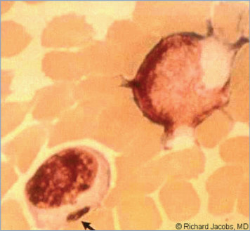
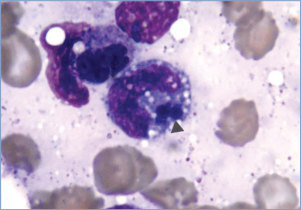
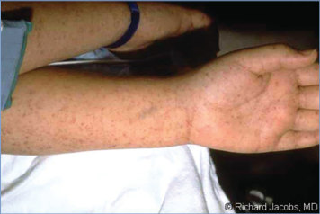
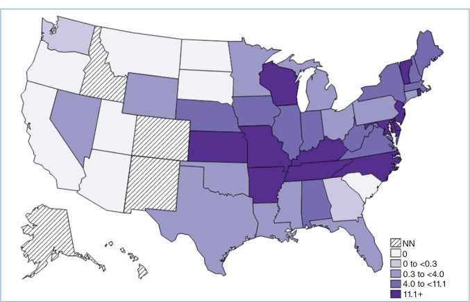
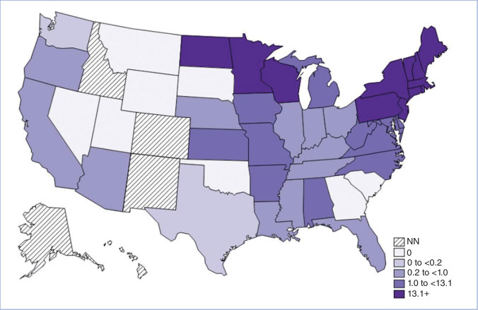
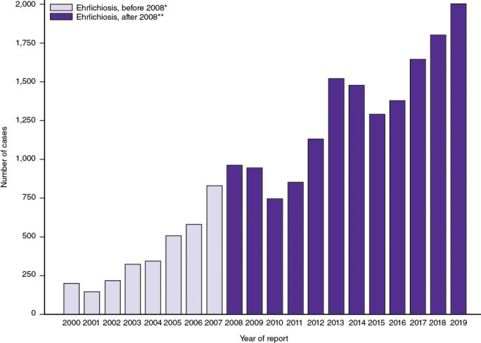
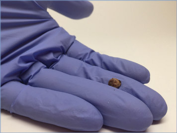
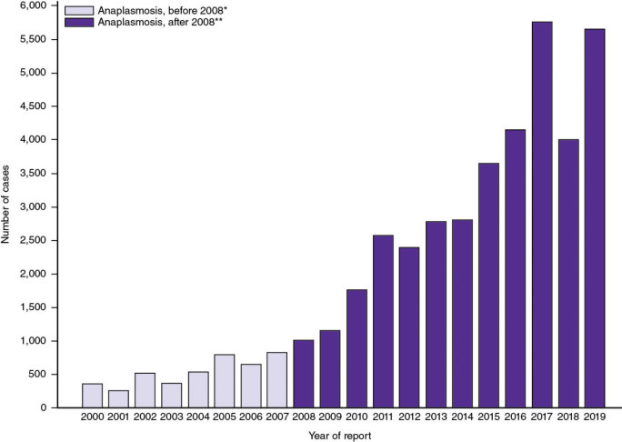

# 46. Ehrlichia, Anaplasma, and Related Infections (Human Ehrlichiosis, Anaplasmosis, and Related Infections Attributable to Bacteria in the Family Anaplasmataceae)
> Private study reference ([source credits](../../SOURCE_CREDITS.md)). PDF pages 240-249; printed pages 226-235.

## PDF page 240 | printed page 226

(Human Ehrlichiosis, Anaplasmosis, and Related Infections Attributable to Bacteria in the Family Anaplasmataceae)

### CLINICAL MANIFESTATIONS

Early signs and symptoms of infections by members of the bacterial family Anaplasmataceae can be nonspecific. All are acute febrile illnesses with common systemic manifestations including fever, headache, chills, rigors, malaise, myalgia, and nausea. More variable symptoms include rash, arthralgia, vomiting, diarrhea, anorexia, cough, and confusion. Severe manifestations of these diseases can include acute respiratory distress syndrome, encephalopathy, meningitis, disseminated intravascular coagulation, toxic shock-like or septic shock-like syndromes, spontaneous hemorrhage, hepatic failure, and renal failure. Symptoms typically last 1 to 2 weeks when untreated, but prompt treatment with doxycycline shortens duration of illness and reduces the risk of serious manifestations and sequelae. Fatigue can last several weeks, and neurologic sequelae have been reported in some children after severe disease, more commonly with Ehrlichia infections.

A maculopapular rash is seen in up to 60% of Ehrlichia chaffeensis infections in children but in less than 30% of adults. The rash typically begins 5 days after symptom onset (notably fever). In adults, skin rash is reported more often for Ehrlichia infections than for Anaplasma infections. Rash occurs in less than 10% of cases of anaplasmosis and may suggest coinfection with another pathogen. Severe disease and fatal outcome are more common in E chaffeensis infections (approximately 1%–3% case fatality) than in Anaplasma phagocytophilum infections.

Coinfections of Anaplasma with other tick-borne diseases, including babesiosis, Powassan virus, Lyme disease, and other Borrelia infections, can cause illness that is more severe or of longer duration than a single infection. Case fatality is uncommon (<1%).

Significant laboratory findings in both Anaplasma and Ehrlichia infections may

include leukopenia with neutropenia (anaplasmosis) or lymphopenia (ehrlichiosis), thrombocytopenia, hyponatremia, and elevated serum hepatic aminotransferase concentrations. Cerebrospinal fluid abnormalities (eg, pleocytosis with a predominance of lymphocytes and increased total protein concentration) are common. Hemophagocytic lymphohistiocytosis occurs in 10% to 15% of children hospitalized with ehrlichiosis. People with underlying immunosuppressive conditions are at greater risk of severe disease. Severe disease has been reported in people who initially received trimethoprim-sulfamethoxazole before a correct diagnosis was made.

Because of the nonspecific presenting symptoms, Rocky Mountain spotted fever should be considered in the differential diagnosis in the United States. Heartland and Bourbon virus infections also manifest with similar clinical features and should be considered in patients without a more likely explanation who have tested negative for Ehrlichia and Anaplasma infection or have not responded to doxycycline therapy.

### ETIOLOGY

Ehrlichia and Anaplasma species are obligate intracellular bacteria, which appear as gram-negative cocci that measure 0.5 to 1.5 μm in diameter. Although genetically distinct, Anaplasma and Ehrlichia infections often are grouped with rickettsia because of overlapping clinical presentation and their vector-borne spread (Table 46.1). Ehrlichiosis is the manifestation of (predominantly) E chaffeensis, although Ehrlichia ewingii and Ehrlichia muris eauclairensis also are found in the United States (Table 46.2). Anaplasmosis is predominantly caused by A phagocytophilum in the United States.

### EPIDEMIOLOGY

Reported and suspected cases of ehrlichiosis and anaplasmosis are confined to geographic regions where their vectors are prevalent, although climate change is impacting the geographic range of these vectors. Increased incidence is observed with heightened tick activity (mostly warm summer months) as well as with human activities involving exposure to ticks. Infections can occur yearround in endemic areas. As in other tick-borne diseases, patients with Ehrlichia or Anaplasma

## PDF page 241 | printed page 227

Table 46.1 Taxonomy of Rickettsiales Predominant in the United States

Order Rickettsiales Family Rickettsiaceae Genera Rickettsiae Species Spotted fever group (SFG): Rocky Mountain spotted fever, Mediterranean spotted fever, Japanese spotted fever, etc

Typhus group: endemic, epidemic

Table 46.2 Human Ehrlichiosis, Anaplasmosis, and Related Infections in the United States

Disease Causal Agent Major Target Cell Ehrlichiosis caused by Ehrlichia chaffeensis

E chaffeensis Usually monocytes

Anaplasmosis Anaplasma phagocytophilum Usually granulocytes

Ehrlichiosis caused by Ehrlichia ewingii E ewingii Usually granulocytes Ehrlichiosis caused by Ehrlichia muris eauclairensis

E muris eauclairensis Unknown, suspected in monocytes

infection often have no recollection of being bitten by a tick.

The reported incidence of E chaffeensis infection in the United States in 2019 was 6.4 cases per million population. Reported incidence of E ewingii infection in 2017 was 0.1 cases per million population, but the incidence is believed to be underreported because of nonspecific illness similar to E chaffeensis infections. Ehrlichiosis caused by E chaffeensis and E ewingii is reported most commonly from the south-central and southeastern United States, from the East Coast extending westward to Texas. E chaffeensis and E ewingii are transmitted by the bite of the Lone Star tick

Anaplasmataceae Anaplasma Ehrlichia

Anaplasma phagocytophilum Ehrlichia chaffeensis, Ehrlichia ewingii, Ehrlichia muris eauclairensis

Tick Vector Geographic Distribution

Lone Star tick (U.S.) (Amblyomma americanum)

Predominantly southeast, south-central, from the East Coast extending westward to Texas; has been reported outside USA Black-legged tick (Ixodes scapularis) or western blacklegged tick (Ixodes pacificus) (U.S.)

Northeastern and upper Midwestern states and northern California; Europe and Asia

Lone Star tick (U.S.) (A americanum) Southeastern, southcentral, and Midwestern states; Africa, Asia

Black-legged tick (I scapularis) Minnesota, Wisconsin

(Amblyomma americanum) and are reported from states within its geographic range. Cases attributable to E muris eauclairensis have been reported only from Minnesota and Wisconsin and are transmitted by the black-legged tick (Ixodes scapularis). Cases of ehrlichiosis have occurred after blood transfusion or solid organ donation from asymptomatic donors.

There were 6,617 provisional cases of Anaplasma infections reported in the United States in 2021. Cases of human anaplasmosis are reported most frequently from the northeastern and upper midwestern United States. Cases of anaplasmosis also have been reported in northern California. In most

### Geometry-detected table

|Order|Rickettsiales|Col3|Col4|Col5|
|---|---|---|---|---|
|Family|_Rickettsiaceae_|_Rickettsiaceae_|_Anaplasmataceae_|_Anaplasmataceae_|
|Genera|_Rickettsiae_|_Rickettsiae_|_Anaplasma_|_Ehrlichia_|
|Species|Spotted fever group (SFG): Rocky Mountain spotted fever, Mediterranean spotted fever, Japanese spotted fever, etc|Typhus group: endemic, epidemic|_Anaplasma_ _phagocytophilum_|_Ehrlichia chaffeensis_,  _Ehrlichia ewingii_, _Ehrlichia_ _muris eauclairensis_|

[View original table](../../tables/ch046_p0241_1.jpg)

### Geometry-detected table

|Disease|Causal Agent|Major Target Cell|Tick Vector|Geographic Distribution|
|---|---|---|---|---|
|Ehrlichiosis caused by_Ehrlichia_ _chaffeensis_|_E chaffeensis_|Usually monocytes|Lone Star tick (U.S.) _(Amblyomma_ _americanum)_|Predominantly southeast, south-central, from the East Coast extending westward to Texas; has been reported outside USA|
|Anaplasmosis|_Anaplasma_ _phagocytophilum_|Usually granulocytes|Black-legged tick _(Ixodes scapularis)_ or western black- legged tick_(Ixodes_ _pacificus)_ (U.S.)|Northeastern and upper Midwestern states and northern California; Europe and Asia|
|Ehrlichiosis caused by_Ehrlichia ewingii_|_E ewingii_|Usually granulocytes|Lone Star tick (U.S.) _(A americanum)_|Southeastern, south- central, and Midwestern states; Africa, Asia|
|Ehrlichiosis caused by_Ehrlichia muris_ _eauclairensis_|_E muris_ _eauclairensis_|Unknown, suspected in monocytes|Black-legged tick _(I scapularis)_|Minnesota, Wisconsin|

[View original table](../../tables/ch046_p0241_2.jpg)

## PDF page 242 | printed page 228

of the United States, A phagocytophilum is transmitted by I scapularis, which also is the vector for ehrlichiosis caused by E muris eauclairensis, Lyme disease (Borrelia burgdorferi and Borrelia mayoni), tick-borne relapsing fever (Borrelia miyamotoi), Powassan virus, and babesiosis (Babesia microti). In the western United States, the western black-legged tick (Ixodes pacificus) is the main vector for A phagocytophilum. Cases of Anaplasma infection have occurred after blood transfusion or solid organ donation from asymptomatic donors. Possible perinatal transmission of A phagocytophilum has been reported.

The incubation period is 5 to 14 days for both E chaffeensis and A phagocytophilum.

### DIAGNOSTIC TESTS

Treatment of suspected ehrlichiosis or anaplasmosis with doxycycline should not be delayed while awaiting confirmation of the diagnosis. Nucleic acid amplification tests (NAATs) of whole blood for the organism are most sensitive for anaplasmosis and ehrlichiosis in the first week of illness. A negative result does not rule out the diagnosis. Sensitivity of NAATs decreases rapidly following administration of doxycycline.

Tissue biopsies may be analyzed by NAAT or immunohistochemistry. Because of the hazardous nature of these organisms, tissues should be fixed in paraffin or formalin before testing. Tissue analysis is available at specialized laboratories.

Serologic testing may be used to demonstrate a fourfold change in specific immunoglobulin (Ig) G antibody titer by indirect immunofluorescent antibody assay between paired acute and convalescent specimens taken 2 to 4 weeks apart. A single mildly elevated IgG titer may not be diagnostic, particularly in regions with higher prevalence. IgM serologic assays are prone to false-positive reactions, and specific IgM can remain elevated for lengthy periods of time, reducing its diagnostic utility. Serologic tests for E chaffeensis and A phagocytophilum infections are available, but cross-reactivity between species can make interpretation of results difficult in areas where geographic distributions overlap.

Occasionally, Anaplasma and Ehrlichia bacteria can be identified in Giemsa or Wright-stained peripheral blood smears or buffy coat leukocyte

preparations in the first week of illness. Bacteria enter the host cell via phagocytosis, and these compartments provide a protective environment for bacterial replication. These bacterial collections appear as morulae observed within granulocytes (targeted by Anaplasma) or monocytes (targeted by Ehrlichia). Culture for isolation of these pathogens is not performed routinely given requirement for biosafety level 3 facilities to prevent accidental inoculation or aerosolization.

### TREATMENT

Doxycycline is the treatment of choice for all tickborne rickettsial diseases, including ehrlichiosis and anaplasmosis. Early initiation of therapy can minimize complications and should not be delayed awaiting laboratory confirmation. Treatment with doxycycline is recommended in patients of all ages when rickettsial diseases are being considered. After doxycycline is initiated, fever generally subsides within 24 to 48 hours.

Patients with suspected ehrlichiosis should be treated with doxycycline until at least 3 days after defervescence and until evidence of clinical improvement, typically 5 to 7 days. Patients with suspected anaplasmosis should be treated with doxycycline for 10 to 14 days to provide appropriate length of therapy for possible concurrent B burgdorferi infection (Lyme disease).

Rifampin may provide an alternative to doxycycline in patients with anaplasmosis who demonstrate hypersensitivity to doxycycline. Rifampin has been used successfully in several pregnant people with anaplasmosis, and studies suggest that this drug appears effective against A phagocytophilum. Small numbers of young children have also been treated successfully for anaplasmosis with rifampin for 7 to 10 days. Rifampin is not an effective treatment when coinfection with Lyme disease is present, nor is it effective treatment for Rocky Mountain spotted fever, a disease with similar clinical manifestations. Rifampin has been shown to be effective against E chaffeensis in a laboratory setting but has not been evaluated as an alternative therapy in a clinical setting.

Administration of trimethoprim-sulfamethoxazole has been linked to more severe outcomes in ehrlichiosis and is contraindicated.

## PDF page 243 | printed page 229

### INFECTION PREVENTION AND CONTROL MEASURES IN HEALTH CARE SETTINGS

Standard precautions are recommended. Humanto-human transmission via direct contact has not been documented.

### CONTROL MEASURES

Limiting exposures to ticks and tick bites is the primary means of prevention. Risk of transmission through blood transfusion or organ transplantation should be considered in areas with endemic infection. Prophylactic administration of doxycycline after a tick bite is not indicated because of the low risk of infection and lack of proven effectiveness. Instead, persons bitten by ticks should be counseled to watch for symptoms, including fever and rash, within 2 weeks of a tick bite.

Image 46.1 The intracytoplasmic inclusion, or morula, of human monocytic ehrlichiosis in a cytocentrifuge preparation of cerebrospinal fluid from a patient with central nervous system involvement. Copyright Richard Jacobs, MD.

Additional information is available on the Centers for Disease Control and Prevention website (www.cdc.gov/ehrlichiosis, www.cdc.gov/ anaplasmosis, and www.cdc.gov/ticks), including a collaborative report providing recommendations for the diagnosis and management of tick-borne rickettsial diseases.1

Public Health Reporting

Ehrlichiosis and anaplasmosis are nationally notifiable diseases in the United States and should be reported to the state or local health department.

1 Biggs HM, Behravesh CB, Bradley KK, et al. Diagnosis and management of tickborne rickettsial diseases: Rocky Mountain spotted fever and other spotted fever group rickettsioses, ehrlichioses, and anaplasmosis-United States. MMWR Recomm Rep. 2016;65(RR-2):1–44. Available at: www.cdc. gov/mmwr/volumes/65/rr/rr6502a1.htm

Image 46.2 Bone marrow examination (Wright stain, magnification 31,000). Intraleukocytic morulae of Ehrlichia can be observed (arrowhead) within monocytoid cells. Courtesy of Emerging Infectious Diseases.

## PDF page 244 | printed page 230

Image 46.3 Human monocytic ehrlichiosis (HME). A semicomatose 16-year-old with leukopenia, lymphopenia, thrombocytopenia, and elevated transaminase levels. The HME polymerase chain reaction and serological test results were positive for HME. Copyright Richard Jacobs, MD.

Image 46.5 The same characteristic rash of human monocytic ehrlichiosis in the patient in Images 46.3 and 46.4. The differential diagnosis of this rash includes Rocky Mountain spotted fever, meningococcemia, and Stevens- Johnson syndrome. Other tick-borne diseases, such as Lyme disease, babesiosis, Colorado tick fever, relapsing fever, and tularemia, may need to be considered. Kawasaki disease has also caused some diagnostic confusion. Copyright Richard Jacobs, MD.

Image 46.4 The petechial and vasculitic rash of human monocytic ehrlichiosis in the patient in Image 46.3. Copyright Richard Jacobs, MD.

Image 46.6 Peripheral blood smears (buffy coat preparation) showing variable-sized basophilic inclusions (arrows) in mononuclear cells from a 9-year-old with human monocytic ehrlichiosis in Carabobo, Venezuela (Dip Quick [Jorgensen Laboratories Inc, Loveland, CO] staining, magnification 31,000). Courtesy of Centers for Disease Control and Prevention/ Emerging Infectious Diseases and Maria C. Martinez.

## PDF page 245 | printed page 231

Image 46.7 Etiologic agents of ehrlichiosis. Photomicrographs of human white blood cells infected with the agent of human granulocytic ehrlichiosis (1, Anaplasma phagocytophilum) and the agent of human monocytic ehrlichiosis (2, Ehrlichia chaffeensis). Courtesy of Centers for Disease Control and Prevention.

Image 46.8 Annual incidence (per million population) of reported Ehrlichia chaffeensis ehrlichiosis—United States, 2019. NN indicates not notifiable. Courtesy of Centers for Disease Control and Prevention.

NN 0 0 to <0.3 0.3 to <4.0 4.0 to <11.1 11.1+

## PDF page 246 | printed page 232

Image 46.9 Number of reported cases of Ehrlichia chaffeensis ehrlichiosis—United States, 2000–2019. Courtesy of Centers for Disease Control and Prevention.

Image 46.10 Annual incidence (per million population) of reported anaplasmosis—United States, 2019. NN indicates not notifiable. Courtesy of Centers for Disease Control and Prevention.

NN 0 0 to <0.2 0.2 to <1.0 1.0 to <13.1 13.1+

## PDF page 247 | printed page 233

Image 46.11 Number of reported cases of anaplasmosis—United States, 2000–2019. Courtesy of Centers for Disease Control and Prevention.

Image 46.12 Engorged adult Lone Star tick. Lone Star ticks can transmit the pathogen that causes tick-borne diseases such ehrlichiosis and Southern tick-associated rash illness, or STARI. Courtesy of National Institute of Allergy and Infectious Diseases.

Image 46.13 This female Lone Star tick, or Amblyomma americanum, was collected in Maryland. Lone Star ticks can transmit the pathogens that cause diseases such as ehrlichiosis and Southern tick-associated rash illness, or STARI. Bites from juvenile Lone Star ticks have been associated with alpha-gal syndrome, which causes a rare allergy to a component of red meat. Courtesy of National Institute of Allergy and Infectious Diseases.

## PDF page 248 | printed page 234

Image 46.14 A Maryland woman finds an adult Lone Star tick, or Amblyomma americanum, on her skin. Lone Star ticks can transmit the pathogens that cause diseases such as ehrlichiosis and Southern tick-associated rash illness, or STARI. Bites from juvenile Lone Star ticks have been associated with alpha-gal syndrome, which causes a rare allergy to a component of red meat. Courtesy of National Institute of Allergy and Infectious Diseases.

Image 46.15 This is a female Lone Star tick, Amblyomma americanum, and is found in the southeastern and mid-Atlantic United States. This tick is a vector of several zoonotic diseases, including human monocytic ehrlichiosis, Southern tick-associated rash illness, tularemia, and Rocky Mountain spotted fever. Courtesy of Centers for Disease Control and Prevention.

## PDF page 249 | printed page 235

Image 46.16 Dorsal view of an adult female western black-legged tick, Ixodes pacificus, which has been shown to transmit Borrelia burgdorferi, the agent of Lyme disease, and Anaplasma phagocytophilum, the agent of human granulocytic anaplasmosis (previously known as human granulocytic ehrlichiosis), in the western United States. The small scutum, or tough, chitinous dorsal abdominal plate, does not cover its entire abdomen, thereby allowing the abdomen to expand many times when this tick ingests its blood meal (and helping identify this specimen as a female). The 4 pairs of jointed legs place these ticks in the phylum Arthropoda and the class Arachnida. Courtesy of Centers for Disease Control and Prevention/Amanda Loftis, MD; William Nicholson, MD; Will Reeves, MD; and Chris Paddock, MD.

![Image 46.16 Dorsal view of an adult female western black-legged tick, Ixodes pacificus, which has been shown to transmit Borrelia burgdorferi, the agent of Lyme disease, and Anaplasma phagocytophilum, the agent of human granulocytic anaplasmosis (previously known as human granulocytic ehrlichiosis), in the western United States. The small scutum, or tough, chitinous dorsal abdominal plate, does not cover its entire abdomen, thereby allowing the abdomen to expand many times when this tick ingests its blood meal (and helping identify this specimen as a female). The 4 pairs of jointed legs place these ticks in the phylum Arthropoda and the class Arachnida. Courtesy of Centers for Disease Control and Prevention/Amanda Loftis, MD; William Nicholson, MD; Will Reeves, MD; and Chris Paddock, MD.](../../figures/ch046_p0249_01.jpg)
