# 48. Enterovirus (Nonpoliovirus) (Group A and B Coxsackieviruses, Echoviruses, Numbered Enteroviruses)
> Private study reference ([source credits](../../SOURCE_CREDITS.md)). PDF pages 257-262; printed pages 243-248.

## PDF page 257 | printed page 243

(Group A and B Coxsackieviruses, Echoviruses, Numbered Enteroviruses)

### CLINICAL MANIFESTATIONS

Nonpolio enteroviruses are responsible for significant and frequent illnesses in infants and children and result in a variety of clinical manifestations. The most common manifestation is nonspecific febrile illness, which in young infants may lead to evaluation for bacterial sepsis. Other manifestations can include: (1) respiratory: coryza, pharyngitis, herpangina, stomatitis, parotitis, croup, bronchiolitis, pneumonia, pleurodynia, and bronchospasm; (2) skin: hand, foot, and mouth disease (HFMD), onychomadesis (shedding of nails), and nonspecific exanthems (particularly associated with echoviruses); (3) neurologic: aseptic meningitis (with or without pleocytosis), encephalitis, and acute flaccid myelitis (AFM); (4) gastrointestinal/genitourinary: vomiting, diarrhea, abdominal pain, hepatitis, pancreatitis, and orchitis; (5) eye: acute hemorrhagic conjunctivitis and uveitis; (6) heart: myopericarditis; and (7) muscle: pleurodynia and other skeletal myositis. Neonates, especially those who acquire infection in the absence of type-specific transplacentally acquired antibody, are at risk of severe and life-threatening disease, including viral sepsis, meningoencephalitis, myocarditis, hepatitis, coagulopathy, and pneumonitis. AFM is an uncommon but serious neurologic illness caused by some enteroviruses that presents with acute onset of flaccid limb weakness and/or cranial nerve dysfunction, most often accompanied by CSF pleocytosis and nonenhancing lesions predominantly affecting the gray matter of the spinal cord and/or brainstem on magnetic resonance imaging.

Infection with enterovirus A71 (EV-A71) is associated with HFMD, herpangina, and in a small proportion of cases, severe neurologic disease, including AFM and brainstem encephalitis associated with myoclonus, ataxia, and autonomic instability. Noncardiogenic pulmonary edema secondary to brainstem encephalitis can result in fatal cardiopulmonary collapse and sequelae among survivors.

Enterovirus D68 (EV-D68) is associated with mild to severe respiratory illness in infants, children, and teenagers and has been responsible for localized and large multinational outbreaks of respiratory disease. Disease is often characterized by exacerbation of preexisting asthma or new-onset wheezing in children without history of asthma, often requiring hospitalization and, in some patients, intensive supportive care. EV-D68 is also associated with AFM and is believed to have been a major contributor to the biennial AFM outbreaks in the United States between 2014 and 2018.

Other noteworthy but not exclusive clinical associations include coxsackieviruses (CVs) A6, A10, and A16 with HFMD (including severe HFMD, “eczema coxsackium,” and atypical cutaneous involvement with CVA6); coxsackievirus A24 variant and enterovirus D70 (EV-D70) with acute hemorrhagic conjunctivitis; and coxsackieviruses B1 through B5 with pleurodynia and myopericarditis.

Patients with humoral and combined immune deficiencies can develop persistent central nervous system infections, a dermatomyositis-like syndrome, arthritis, hepatitis, and/or disseminated infection. Severe and/or chronic neurologic or multisystem disease is reported in hematopoietic cell and solid organ transplant recipients, children with malignancies, and patients treated with anti- CD20 monoclonal antibody (eg, rituximab).

### ETIOLOGY

The enteroviruses, along with the rhinoviruses, comprise a genus of small, nonenveloped, singlestranded, positive-sense RNA viruses in the Picornaviridae family. The nonpolio enteroviruses include more than 110 distinct types formerly subclassified as group A coxsackieviruses, group B coxsackieviruses, echoviruses, and newer numbered enteroviruses. A more recent classification system groups the human enteroviruses into 4 species (enterovirus A, B, C, and D) on the basis of genetic similarity in the viral protein 1, which corresponds well with serotype.

### EPIDEMIOLOGY

Humans are the principal reservoir for enteroviruses, although some primates can become infected. Enterovirus infections are common and

## PDF page 258 | printed page 244

are distributed worldwide; the majority of infections are asymptomatic. Enteroviruses are spread by fecal-oral and respiratory routes and from mother to infant prenatally, in the peripartum period, and rarely via breastfeeding. EV-D68 is believed to be spread primarily by respiratory transmission; EV-D70 and CVA24 are shed in tears and spread via fingers and fomites. Enteroviruses may survive on environmental surfaces for periods long enough to allow transmission from fomites, and transmission via contaminated water, including swimming pools, and food can occur. Hospital nursery and other institutional outbreaks may occur. Infection incidence, clinical attack rates, and disease severity typically are greatest in infants and young children, and infections occur more frequently in tropical areas and where poor sanitation, poor hygiene, and high population density are present.

Although circulation can occur year-round, most enterovirus infections in temperate climates occur in the summer and fall (approximately June through October in the northern hemisphere); seasonal patterns are less evident in the tropics. Fecal shedding of most enteroviruses can persist for several weeks or months (generally 2–8 weeks) after onset of infection, but respiratory tract shedding usually is limited to 1 to 3 weeks or fewer. Enterovirus transmission can occur in the absence of signs of clinical illness.

The usual incubation period for enterovirus infections is 3 to 6 days, except for acute hemorrhagic conjunctivitis, in which the incubation period is 24 to 72 hours. Onset of neurologic disease, such as AFM, can lag several days or even weeks after illness onset, following improvement or resolution of prodromal symptoms.

### DIAGNOSTIC TESTS

Enteroviruses generally can be detected by nucleic acid amplification tests (NAATs) and culture from a variety of specimens, including stool, rectal swab, throat swab, nasopharyngeal aspirates, conjunctival swab, tracheal aspirates, vesicle fluid, blood, urine, tissue biopsy specimens, and cerebrospinal fluid (CSF). Prolonged viral shedding after illness occurs, particularly from the pharynx and gastrointestinal tract, so a positive test result may not indicate an etiologic role in an illness. NAATs are rapid and more sensitive than isolation

of enteroviruses in cell culture and can detect all enteroviruses, including types that are difficult or impossible to cultivate in cell cultures. Commercial enterovirus NAATs will not detect parechoviruses (and vice versa), and many cannot reliably distinguish enteroviruses from rhinoviruses. Multiplex NAATs designed to detect a number of bacterial and viral agents of meningitis and encephalitis, including enteroviruses, in CSF are available.

Enterovirus type is determined through partial genomic sequencing. Typing may be indicated in cases of special clinical interest or for epidemiologic purposes (eg, for investigation of disease clusters or outbreaks) and is available at some local or state public health laboratories and at the Centers for Disease Control and Prevention (CDC) Picornavirus Laboratory.

Patients with EV-A71 and EV-D68 neurologic disease often have negative results of a NAAT and culture of CSF (even in the presence of CSF pleocytosis) and blood. For EV-A71, NAAT and culture of throat or stool/rectal swab and/or vesicle fluid specimens (in cases of HFMD) are more frequently positive. EV-D68 is demonstrated primarily in respiratory tract specimens obtained early in the course of disease. Most commercial multiplex respiratory NAATs can detect enteroviruses, including EV-D68, but do not distinguish enteroviruses from rhinoviruses. Definitive identification of EV-D68 requires partial genomic sequencing or amplification with an EV-D68specific NAAT.

### TREATMENT

No specific therapy is available for enterovirus infections. Immunoglobulin intravenous (IGIV), administered intravenously or via intraventricular administration, may be beneficial for chronic enterovirus meningoencephalitis in immunodeficient patients. IGIV is not approved for intraventricular administration. IGIV also has been used for life-threatening neonatal enterovirus infections (convalescent plasma from the birthing parent also has been used), severe enterovirus infections in transplant recipients and people with malignancies, suspected viral myocarditis, EV-A71 neurologic disease, and AFM, but without proven clinical effectiveness. The CDC has provided interim guidance on the clinical management of

## PDF page 259 | printed page 245

children with AFM (www.cdc.gov/acuteflaccid-myelitis/hcp/clinical-management. html). Interferons occasionally have been used for treatment of enterovirus-associated myocarditis and chronic enterovirus meningoencephalitis, without definitive proof of effectiveness.

The antiviral drug pleconaril has in vitro activity against many enteroviruses but is not available commercially. Pocapavir, an antiviral drug that is being developed for the treatment of chronic poliovirus infection in immunodeficient patients, also has activity in vitro against some nonpolio enteroviruses. It is not commercially available but may be accessible under a compassionate use mechanism. Fluoxetine has in vitro activity against enterovirus species B and D (including EV-D68), but studies have not demonstrated clinical benefit.

### INFECTION PREVENTION AND CONTROL MEASURES IN HEALTH CARE SETTINGS

In addition to standard precautions, contact precautions are indicated for infants and young children for the duration of enterovirus illness. Droplet precautions also are indicated if the patient has respiratory symptoms. Cohorting of infected neonates has been effective in controlling hospital nursery enterovirus outbreaks.

### CONTROL MEASURES

Hand hygiene, especially after diaper changing, and respiratory hygiene are important in decreasing spread of enteroviruses within families, child care facilities, and other institutions. Other measures include avoidance of contaminated utensils and fomites, and disinfection of surfaces. Because HFMD is normally mild, children can continue in to go to child care and schools as long as they have no fever, they have no uncontrolled drooling with mouth sores, and they are able to participate normally in classroom activities. In some cases, the local health department may require children with HFMD to stay home to control an outbreak. Recommended chlorination treatment of drinking water and swimming pools may help prevent transmission.

Maintenance administration of IGIV in patients with severe deficits of B-lymphocyte function (eg, severe combined immunodeficiency syndrome, X-linked agammaglobulinemia) may prevent chronic enterovirus infection of the central nervous system. Prophylactic use of immunoglobulin has been used to help abort nursery epidemics. EV-A71 vaccines have been licensed in China and are being evaluated in other Asian countries where disease is prevalent; vaccines for other enterovirus serotypes associated with more severe disease also are under investigation.

## PDF page 260 | printed page 246

A

B

C D

Image 48.1 Vesicular eruptions in the hand (A), knee (B), and mouth (C) of a 6-year-old with coxsackievirus A6 infection. Several of his fingernails shed (D) 2 months after the pictures were obtained. Courtesy of Centers for Disease Control and Prevention/Emerging Infectious Diseases.

Image 48.3 Enterovirus infection (hand-foot-and-mouth disease) affecting the hands.

Image 48.2 Enterovirus infection in a preschool-aged child. Hand, foot, and, mouth disease lesions are caused by coxsackievirus A16 and enterovirus 71.

Image 48.4 Enterovirus infection (hand-foot-and-mouth disease) affecting the feet.

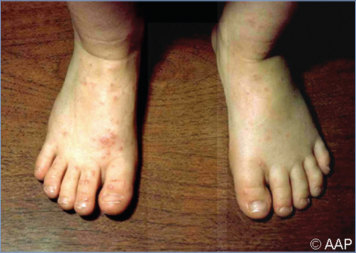

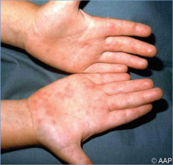

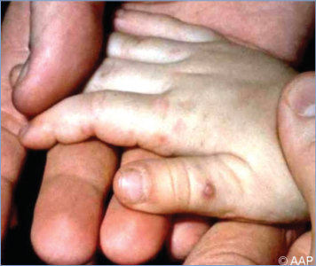

## PDF page 261 | printed page 247

Image 48.5 Enterovirus infection (hand-foot-and-mouth disease) affecting the anterior buccal mucosa. These lesions are generally less painful than herpes simplex lesions.

Image 48.7 Characteristic papulovesicular lesions of hand-foot-andmouth disease in a 2-year-old. Courtesy of George Nankervis, MD.

Image 48.9 Herpangina (coxsackievirus) lesions on the posterior palate of a young man. Coxsackievirus lesions are usually found in the posterior aspect of the oropharynx and may progress rapidly to painful ulceration.

Image 48.6 A papulovesicular lesion on the medial aspect of the foot of a 6-year-old with hand-foot-and-mouth disease. Courtesy of George Nankervis, MD.

Image 48.8 Enterovirus 71 acute hemorrhagic conjunctivitis, on the second or third day. No neurological sequelae were present. Courtesy of Jerri Ann Jenista, MD.

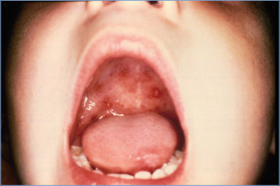

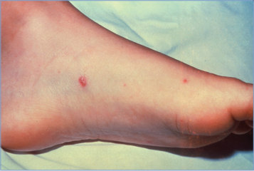

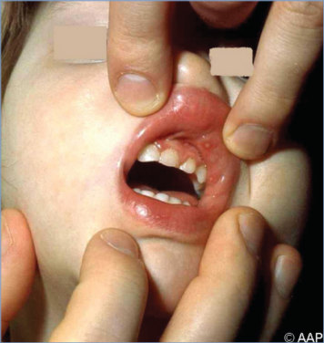

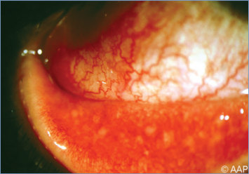

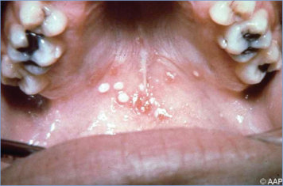

## PDF page 262 | printed page 248

Image 48.10 Enterovirus encephalitis. Microglial nodule. Courtesy of Dimitris P. Agamanolis, MD.

Image 48.12 A 4-year-old with pharyngeal inflammation and palatal lesions of hand-foot-and-mouth disease, a coxsackievirus A infection. Courtesy of Larry Frenkel, MD.

Image 48.11 Extensive hepatic necrosis caused by an enterovirus infection. Courtesy of Dimitris P. Agamanolis, MD.

Image 48.13 This 7-year-old presented with low-grade fever, malaise, sore throat, and these interesting, slightly raised oral lesions opposite the first molar. She also had approximately 10 maculopapular lesions on each buttock and a few on each foot. She had classic hand-foot-andmouth disease. Coxsackievirus A16 was grown from throat and rectal swabs. Courtesy of Neal Halsey, MD.

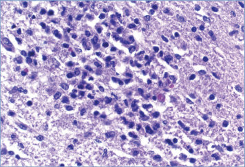

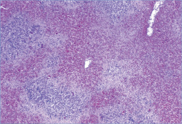

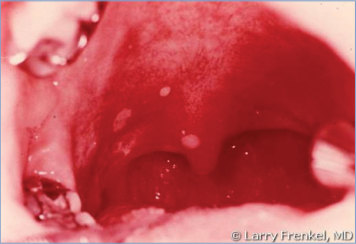

