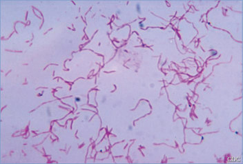

# 52. Fusobacterium Infections (Including Lemierre Syndrome)
> Private study reference ([source credits](../../SOURCE_CREDITS.md)). PDF pages 285-287; printed pages 271-273.

## PDF page 285 | printed page 271

(Including Lemierre Syndrome)

### CLINICAL MANIFESTATIONS

Fusobacterium species, including Fusobacterium necrophorum and Fusobacterium nucleatum, can be isolated from oropharyngeal specimens in healthy people and are frequent components of human dental plaque with the potential to lead to periodontal disease. Invasive disease attributable to Fusobacterium species has been associated with otitis media, tonsillitis, gingivitis, and oropharyngeal trauma including dental and oropharyngeal surgery such as tonsillectomy. Ten percent of cases of invasive Fusobacterium infections are associated with concomitant Epstein-Barr virus infection.

Preceding oropharyngeal infection is the most frequent primary source for invasive infection. Invasive infections can be characterized by peritonsillar abscess, deep neck space infection, mastoiditis, and sinusitis that can be complicated by meningitis, cerebral abscess, dural sinus venous thrombosis, endocarditis, and pleural empyema. Otogenic and gynecologic sources of infection have also been reported.

Invasive infection following tonsillitis was described early in the 20th century and was referred to as postanginal sepsis or Lemierre syndrome. The classic syndrome starts with fever and sore throat that progresses to severe neck pain (anginal pain) that can be accompanied by unilateral neck swelling, trismus, dysphagia, and rigors associated with development of suppurative jugular venous thrombosis (JVT). Patients with classic Lemierre syndrome have a sepsis syndrome with metastatic complications from septic embolic phenomena associated with JVT. Patients with Lemierre syndrome may develop complications including multiple pulmonary septic emboli, pleural empyema, pyogenic arthritis, osteomyelitis, or disseminated intravascular coagulation. Laboratory abnormalities associated with Lemierre syndrome can include significantly elevated inflammatory markers, thrombocytopenia, elevated aminotransferases, hyperbilirubinemia, and elevated creatinine. Persistent headache or other neurologic signs may indicate the presence of cerebral venous sinus thrombosis (eg, cavernous sinus thrombosis),

meningitis, or brain abscess. Fusobacterium species (most commonly F necrophorum) can be isolated from blood or other normally sterile sites and account for at least 60% to 80% of Lemierre syndrome cases. Lemierre-like syndromes have also been reported following infection with Arcanobacterium haemolyticum, Bacteroides species, Klebsiella species, anaerobic Streptococcus species, other anaerobic bacteria, and methicillinsusceptible and -resistant strains of Staphylococcus aureus.

With respect to thrombosis, the JVT can be completely vaso-occlusive. Some children with JVT associated with Lemierre syndrome have evidence of thrombophilia at diagnosis. These findings often resolve over several months and can indicate response to the inflammatory, prothrombotic process associated with infection, rather than an underlying hypercoagulable state.

Fusobacterium species have also been associated with intra-abdominal and pelvic infections including acute appendicitis, suppurative portomesenteric vein thrombosis, and suppurative thrombosis of the pelvic vasculature.

### ETIOLOGY

Fusobacterium species are filamentous, anaerobic, non–spore-forming, gram-negative bacilli. Human infection usually results from F necrophorum subspecies funduliforme, but infections with other species including F nucleatum, Fusobacterium gonidiaformans, Fusobacterium naviforme, Fusobacterium mortiferum, and Fusobacterium varium have been reported. Infection with Fusobacterium species, alone or in combination with other oral anaerobic bacteria, may result in Lemierre syndrome, but unlike other anaerobic infections, Fusobacterium species are frequently the only organisms identified in these infections.

### EPIDEMIOLOGY

Fusobacterium species are commonly found in soil and in the respiratory tracts of animals, including cattle, dogs, fowl, goats, sheep, and horses, and can be isolated from the oropharynx of healthy people. Fusobacterium infections are most common in adolescents and young adults, but infections, including fatal cases of Lemierre syndrome, have been reported in infants and young children.

## PDF page 286 | printed page 272

### DIAGNOSTIC TESTS

Fusobacterium species can be isolated using conventional liquid anaerobic blood culture media. However, the organism grows best on semisolid media for fastidious anaerobic organisms or blood agar supplemented with vitamin K, hemin, menadione, and a reducing agent. Colonies generally are cream to yellow colored, smooth, and round and may show a narrow zone of alpha- or betahemolysis on blood agar, depending on the species of blood used in the medium; F nucleatum may appear as bread crumb-like colonies. Many strains fluoresce chartreuse green under ultraviolet light. Most Fusobacterium organisms are indole positive. On Gram stain, F nucleatum usually exhibits spindle-shaped cells with tapered ends, while F necrophorum and other species may be highly pleomorphic with swollen areas. The accurate identification of anaerobes to the species level has become important with the increasing incidence of microorganisms that are resistant to multiple drugs. Conventional and commercial culture-based biochemical test systems are reasonably accurate, at least to the genus level. Sequencing of the 16S rRNA gene and phylogenetic analysis or the use of mass spectrometry of bacterial cell components can accurately identify Fusobacterium species to the species level.

Currently, there are no commercially available tests for rapidly diagnosing Fusobacterium pharyngitis, although nucleic acid amplification tests (NAATs) have been used in dental settings to monitor bacterial species in saliva, including Fusobacterium species, in patients with periodontal disease. Routine throat cultures for betahemolytic streptococci do not generally include screening for the presence of Fusobacterium species. Researchers have used special media to grow F necrophorum from throat swab specimens or have used NAAT techniques to document and describe F necrophorum tonsillitis/pharyngitis and the frequency of Fusobacterium species colonization in pharyngeal specimens obtained from asymptomatic adolescents and young adults. A number of experimental multiplex NAAT panels and metagenomic sequencing platforms for the identification of pathogens in blood and other sterile sites are under development and may allow rapid identification of Fusobacterium infections in the future.

One should consider Lemierre syndrome in illappearing febrile children and especially adolescents having a sore throat with exquisite neck pain and swelling over the angle of the jaw, accompanied by rigors. Aerobic and anaerobic blood cultures should be performed to detect invasive Fusobacterium species and other possible pathogens. Imaging studies of the internal jugular veins should be obtained, but it is important to note that a significant proportion of patients with a diagnosis of Lemierre syndrome will not have a thrombus detected by imaging (thromboses may be missed or embolized prior to imaging). Computed tomography and magnetic resonance imaging are more sensitive than ultrasonography to document thrombosis and thrombophlebitis of the internal jugular vein early in the course of illness and to better identify thrombus extension beyond the areas visible by ultrasonography, including under the mandible and clavicle.

### TREATMENT

Aggressive and prompt antimicrobial therapy is the mainstay of treatment. Fusobacterium species generally are susceptible to metronidazole, clindamycin, chloramphenicol, penicillin with beta-lactamase inhibitor combinations (ampicillinsulbactam or piperacillin-tazobactam), carbapenems, cefoxitin, and ceftriaxone. Antimicrobial resistance has increased in anaerobic bacteria, and susceptibilities to particular antibiotic classes are less predictable. Therefore, susceptibility testing is indicated for all clinically significant anaerobic isolates, including Fusobacterium species. Combination therapy with metronidazole or clindamycin, in addition to a beta-lactam agent active against aerobic oral and respiratory tract pathogens (eg, cefotaxime, ceftriaxone, or cefuroxime), is recommended for patients with invasive infection caused by Fusobacterium species. Alternatively, some experts recommend monotherapy with a penicillin-beta-lactamase inhibitor combination (ampicillin-sulbactam or piperacillintazobactam) or a carbapenem (meropenem, imipenem, or ertapenem). Up to 50% of F nucleatum and 20% of F necrophorum isolates produce beta-lactamases, rendering them resistant to penicillin, ampicillin, and some cephalosporins. Fusobacterium species intrinsically are resistant to gentamicin, fluoroquinolone agents, and typically, macrolides. Tetracyclines have limited activity.

## PDF page 287 | printed page 273

The duration of antimicrobial therapy depends on the anatomic location and severity of infection but usually is at least 6 weeks. Surgical intervention involving débridement or incision and drainage of abscesses may be necessary. Anticoagulation therapy has been used in both adults and children with JVT or cavernous sinus thrombosis. However, there is limited evidence for the impact of anticoagulation on patient outcomes.

### INFECTION PREVENTION AND CONTROL MEASURES IN HEALTH CARE SETTINGS

Standard precautions are recommended. Person-to-person transmission of Fusobacterium species has not been documented.

Image 52.1 Vincent stomatitis has been confused with diphtheria, although this infection is usually a mixed infection, including fusiform and spirochetal anaerobic bacteria such as Fusobacterium, and is associated with severe pain and halitosis. Note ulceration of the soft palate with surrounding erythema. Courtesy of Edgar O. Ledbetter, MD, FAAP.

Image 52.3 This photomicrograph shows Fusobacterium nucleatum after being cultured in a thioglycolate medium for 48 hours. Courtesy of Centers for Disease Control and Prevention.

### CONTROL MEASURES

Proper oral hygiene and routine dental cleanings may reduce density of oral colonization with Fusobacterium species, prevent gingivitis and dental caries, and reduce the risk of invasive disease.

Image 52.2 This 15-year-old with obesity had a dental cleaning 7 days before presentation. The patient was found to have monomicrobial liver abscess with Fusobacterium nucleatum. The patient responded well to combined therapy with percutaneous drainage and antimicrobials for 6 weeks. Copyright Shom Dasgupta-Tsinikas, MD, FAAP.

Image 52.4 This photograph demonstrates the morphological features of 4 colonies of Fusobacterium fusiforme bacteria that were grown on blood agar medium for 48 hours. F fusiforme is a spindle-shaped, gram-negative bacterium that colonizes the gingival sulcus of the human oral cavity and has also been isolated from infections of the upper respiratory tract. Courtesy of Centers for Disease Control and Prevention/V. R. Dowell Jr, MD.

