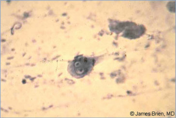
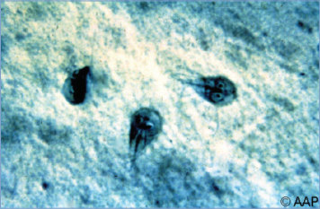

# 53. Giardia duodenalis (Formerly Giardia lamblia and Giardia intestinalis) Infections (Giardiasis)
> Private study reference ([source credits](../../SOURCE_CREDITS.md)). PDF pages 288-293; printed pages 274-279.

## PDF page 288 | printed page 274

(Giardiasis)

### CLINICAL MANIFESTATIONS

Symptoms of Giardia infection are attributable to dysfunction of the small bowel caused by residing trophozoites and range from asymptomatic carriage to fulminant diarrhea and dehydration. Most infections are asymptomatic, but children are more often symptomatic than adults. Symptomatic patients are mildly to moderately ill and complain frequently of intermittent abdominal cramping, bloating, and foul-smelling flatus and stools. Chronic infection, often with weight loss, is common, similar to irritable bowel syndrome. A more fulminant presentation with acute and chronic diarrhea, malabsorption, failure to thrive, and weight loss may occur, but systemic symptoms other than malaise are uncommon and extraintestinal involvement (eg, arthritis, urticaria, retinal changes, and bile or pancreatic duct involvement) is unusual. Symptoms are also caused by lactose intolerance and malabsorption, which result in voluminous diarrhea often described as “greasy or fatty.” Sometimes atypical upper gastrointestinal symptoms of belching, nausea, and vomiting predominate, causing a delay in diagnosis. Fever, mucus, and blood in stool are atypical and suggest infection with another agent(s). Duration of infection can be prolonged and may last years in immunosuppressed individuals. In children, development of immunity is poor and repeated infections are common. Patients with cystic fibrosis have an increased prevalence of Giardia duodenalis infection.

### ETIOLOGY

G duodenalis (formerly called Giardia lamblia or Giardia intestinalis) is a flagellate protozoan that exists in trophozoite and cyst forms; the infective form is the cyst. Giardia organisms undergo a simple life cycle alternating between orally ingested, infectious, acid-resistant cysts and motile trophozoites that reside and multiply in the small intestine. Encystation occurs in the lower

small bowel, and cysts are infectious when excreted. Infection is limited to the small intestine and biliary tract. Giardia cysts are infectious immediately after being excreted in feces and remain viable for 3 months in water at 4°C. A single freeze/thaw cycle kills most Giardia cysts; complete killing occurs after multiple freeze/thaw cycles. Heating, drying, and seawater are microcidal to cysts, depending on specific conditions.

### EPIDEMIOLOGY

Giardiasis has a worldwide distribution and is the most common intestinal parasitic infection of humans identified in the United States and globally. The highest incidence of giardiasis in the United States is reported among children 1 through 9 years of age, adults 25 through 29 years of age, adults 55 through 59 years of age, and residents of northern states. Peak illness onset occurs from early summer through early fall. High infectivity is a result of the combination of enormous numbers of infectious cysts that may be excreted and the low infectious dose (as few as 10 to 100 cysts are able to cause infection). Giardiasis is communicable for as long as the infected person excretes cysts. Duration of cyst excretion is variable but can range from weeks to months. Transmission of G duodenalis is most likely to occur in situations in which exposure to feces with cysts is likely, including: (1) child care centers; (2) areas of the world with endemic disease; (3) close contact, including sexual contact, with infected people; (4) swallowing of contaminated drinking or recreational water; and (5) consumption of unfiltered or untreated water such as when camping or backpacking, including water downstream of beaver dams (leading to giardiasis being known as beaver fever). Although less common, outbreaks associated with food or food handlers have been reported. Among 63 outbreaks of giardiasis with an identified mode of transmission reported from 26 states between 2012 and 2017, waterborne outbreaks were the most common (46%), followed by person-to-person contact (44%) and contaminated food (9.5%). Most of the waterborne outbreaks were associated with drinking water, followed by exposure to recreational water. Surveys conducted in the United States have identified overall prevalence rates of Giardia organisms in stool specimens that range from 5% to 7%, with variations depending on age, geographic location, and season.

## PDF page 289 | printed page 275

The incubation period usually is 1 to 3 weeks.

### DIAGNOSTIC TESTS

Giardia cysts or trophozoites are not detected consistently in the stools of infected patients. Diagnostic sensitivity can be increased by examining up to 3 stool specimens over several days. New molecular enteric panel assays generally include Giardia organisms as a target pathogen. Diagnostic techniques include direct fluorescence antibody assay with microscopy, rapid immunochromatographic cartridge assays, enzyme immunoassay, microscopy with trichrome staining, and molecular assays. If there is a suspicion of falsenegative results, repeat testing should be performed, and use of a different methodology should be considered. Otherwise, retesting is only recommended if symptoms persist after treatment. Invasive testing of the duodenal contents or an intestinal biopsy is required only rarely. Molecular testing to identify the genetic assemblages and subtypes of Giardia is not helpful clinically. Giardiasis is not associated with eosinophilia.

### TREATMENT

Some infections are self-limited, and treatment may not be required. Tinidazole, metronidazole, and nitazoxanide are the drugs of choice. Although not approved by the U.S. Food and Drug Administration (FDA) for treatment of Giardia infection, the use of metronidazole is widely accepted. It is the least expensive of these therapies but generally has poor palatability when compounded into a suspension. A 5- to 7-day course of metronidazole has an effectiveness of 80% to 100% in pediatric patients. Tinidazole, approved by the FDA in 2004 for treatment of giardiasis for children 3 years and older, has high effectiveness (about 90%), good tolerability, and fewer adverse effects than metronidazole and is provided as a single oral dose. A 3-day course of nitazoxanide oral suspension has similar effectiveness as metronidazole and can also treat other intestinal parasites. Nitazoxanide is approved for use in children 1 year and older with Giardia infection. Paromomycin, a poorly absorbed aminoglycoside, is 50% to 70% effective and is the recommended treatment for pregnant persons with giardiasis. Metronidazole has been used in pregnancy, but data regarding safety in the first trimester are conflicting. Tinidazole should not be used during pregnancy.

Symptom recurrence after completing antimicrobial treatment can be attributable to reinfection or recurrence, post-Giardia irritable bowel, residual lactose intolerance (occurs in 20%–40% of patients), or symptoms attributable to another process or infection. Recurrences are associated with immunosuppression or poor immunity, insufficient treatment, drug resistance, or reexposure. Because new or residual symptoms are nonspecific, repeated testing should be performed. Options for retreatment include use of an alternative drug of a different class, a longer course of the first failed drug, or combination therapy with 2 different drug classes. One such combination is tinidazole plus quinacrine for at least 2 weeks, which is almost always curative.

Patients who are immunocompromised because of hypogammaglobulinemia or lymphoproliferative disease are at higher risk of giardiasis, and a cure is more difficult for these people. Among human immunodeficiency virus (HIV)-infected children and adults without acquired immunodeficiency syndrome (AIDS), effective combination antiretroviral therapy and antiparasitic therapy are the major initial treatments for these infections. Patients with AIDS often respond to standard therapy but in some cases additional treatment is required. If giardiasis is refractory to standard treatment among HIV-infected patients with AIDS, longer treatment duration or combination antiparasitic therapy (eg, tinidazole, nitazoxanide, or metronidazole plus one of the following: paromomycin, albendazole, or quinacrine) may be appropriate.

Treatment of asymptomatic carriers is controversial but is recommended in the United States and other areas of low prevalence to prevent infection within families or of other children, which is common. Treatment of children likely to be reinfected, such as those residing in areas of high prevalence, is not recommended unless medically indicated.

### INFECTION PREVENTION AND CONTROL MEASURES IN HEALTH CARE SETTINGS

Standard precautions are recommended for most. Contact precautions for the duration of illness are recommended for diapered and incontinent children.

## PDF page 290 | printed page 276

### CONTROL MEASURES

Safe water, appropriate sanitation, and handwashing are the most important measures to avoid giardiasis. Avoid drinking and recreational water that may be contaminated. If the safety of drinking water is in doubt (eg, during travel to a location with poor sanitation or lack of water treatment systems), the following are recommended:

• Drink commercially bottled water from an unopened factory-sealed container.

• Disinfect tap water by heating it to a rolling boil for 1 minute.

• Use a filter that has been certified for cyst and oocyst reduction.

Boiling is the most reliable method to make water safe for drinking with required boiling time dependent on altitude (1 minute at sea level). Chemical disinfection with iodine is an alternative method of water treatment using either tincture of iodine or tetraglycine hydroperiodide tablets. Chlorine in various forms also has been used for chemical disinfection, but germicidal activity is dependent on several factors, including pH, temperature, and organic content of the water. Chlorination has low to moderate effectiveness in killing Giardia. Additional information about water purification, including a traveler’s guide for buying water filters, can be found at www.cdc.gov/healthywater/ drinking/travel/index.html.

Swallowing water during recreational activities in pools, hot tubs, interactive fountains, lakes, rivers, springs, ponds, streams, or the ocean, or drinking untreated water from lakes, rivers, springs, ponds, streams, or shallow wells, should be avoided.

Infected people and individuals at risk especially should adhere to strict hand-hygiene techniques after contact with feces. Use of gloves before handling infected feces or contaminated diapers is a more stringent approach. For additional prevention guidance, visit the Centers for Disease Control and Prevention Giardia website (www.cdc.gov/ parasites/giardia).

When an outbreak is suspected in a child care center, the local health department should be contacted and an epidemiologic investigation should be undertaken to identify and treat all symptomatic children, child care providers, and family members infected with G duodenalis. A directory of state and territorial, city and county, and tribal health departments can be found at www.cdc. gov/publichealthgateway/healthdirectories/ index.html. Infected children should be excluded from child care until stools are contained in the diaper or the child is continent, stool frequency is no more than 2 stools above that child’s normal frequency, and the health department agrees with the return to child care. Testing of asymptomatic individuals and treatment of asymptomatic carriers in a child care center outbreak are controversial.

People with diarrhea caused by Giardia species should not use recreational water venues (eg, swimming pools, water slides) while symptomatic.

Public Health Reporting

Giardiasis is a nationally notifiable disease. Please refer to the state or local health department for details on reporting cases.

## PDF page 291 | printed page 277

Image 53.1 Giardia is a microscopic organism that causes diarrhea. This organism can be found on surfaces, soil, food, or water that has been contaminated with feces from infected animals or people. Giardia is protected by an outer shell that allows it to survive outside the body for long periods of time. This shell also protects it from chlorine, making it harder to kill. Courtesy of Centers for Disease Control and Prevention.

A B

Image 53.2 Three trophozoites of Giardia intestinalis (A, trichrome stain; B and C, iron hematoxylin stain). Each cell has 2 nuclei with a large, central karyosome. Cell length is 9 to 21 mm. Trophozoites are usually found in fresh diarrheal stool or in duodenal mucus. Courtesy of Centers for Disease Control and Prevention.

Image 53.3 Giardia intestinalis cyst in a stool preparation. Giardiasis is the most common protozoal infection in the United States. Copyright James Brien, MD.

C

## PDF page 292 | printed page 278

Image 53.4 Giardia intestinalis cyst in a stool preparation. The ingested cyst produces trophozoites in the proximal small intestine. As the trophozoites pass through the intestinal tract, they form cysts that are passed in the stool and are the infective form of G intestinalis.

Image 53.6 Incidence of reported giardiasis cases (per 100,000 population) by reporting jurisdiction—National Notifiable Diseases Surveillance System, United States, 2019 (n 5 14,887). Giardiasis is geographically widespread across the United States. Although incidence rates appear to be consistently higher in the northern states, differences in incidence might reflect differences in risk factors or modes of transmission of Giardia; the magnitude of outbreaks; or the capacity or requirements to detect, investigate, and report cases. Nonreporting states included Illinois, Kentucky, Mississippi, North Carolina, Oklahoma, Tennessee, Texas, and Vermont. New York State and New York City data are mutually exclusive. Courtesy of Centers for Disease Control and Prevention.

Image 53.5 Giardia intestinalis cysts (trichrome stain). Person-toperson transmission is the most common mode of giardiasis transmission.

![Image 53.6 Incidence of reported giardiasis cases (per 100,000 population) by reporting jurisdiction—National Notifiable Diseases Surveillance System, United States, 2019 (n 5 14,887). Giardiasis is geographically widespread across the United States. Although incidence rates appear to be consistently higher in the northern states, differences in incidence might reflect differences in risk factors or modes of transmission of Giardia; the magnitude of outbreaks; or the capacity or requirements to detect, investigate, and report cases. Nonreporting states included Illinois, Kentucky, Mississippi, North Carolina, Oklahoma, Tennessee, Texas, and Vermont. New York State and New York City data are mutually exclusive. Courtesy of Centers for Disease Control and Prevention.](../../figures/ch053_p0292_01.jpg)

## PDF page 293 | printed page 279

Image 53.7 Cysts are resistant forms and are responsible for transmission of giardiasis. Cysts and trophozoites can be found in the feces (diagnostic stages) (1). The cysts are hardy and can survive several months in cold water. Infection occurs by the ingestion of cysts in contaminated water or food or by the fecal-oral route (hands or fomites) (2). In the small intestine, excystation releases trophozoites (each cyst produces 2 trophozoites) (3). Trophozoites multiply by longitudinal binary fission, remaining in the lumen of the proximal small bowel, where they can be free or attached to the mucosa by a ventral sucking disk (4). Encystation occurs as the parasites transit toward the colon. The cyst is the stage found most commonly in nondiarrheal feces (5). Because the cysts are infectious when passed in the stool or shortly afterward, person-to-person transmission is possible. Although animals are infected with Giardia, their importance as a reservoir is unclear. Courtesy of Centers for Disease Control and Prevention.

![Image 53.7 Cysts are resistant forms and are responsible for transmission of giardiasis. Cysts and trophozoites can be found in the feces (diagnostic stages) (1). The cysts are hardy and can survive several months in cold water. Infection occurs by the ingestion of cysts in contaminated water or food or by the fecal-oral route (hands or fomites) (2). In the small intestine, excystation releases trophozoites (each cyst produces 2 trophozoites) (3). Trophozoites multiply by longitudinal binary fission, remaining in the lumen of the proximal small bowel, where they can be free or attached to the mucosa by a ventral sucking disk (4). Encystation occurs as the parasites transit toward the colon. The cyst is the stage found most commonly in nondiarrheal feces (5). Because the cysts are infectious when passed in the stool or shortly afterward, person-to-person transmission is possible. Although animals are infected with Giardia, their importance as a reservoir is unclear. Courtesy of Centers for Disease Control and Prevention.](../../figures/ch053_p0293_01.jpg)
