# 56. Haemophilus influenzae Infections
> Private study reference ([source credits](../../SOURCE_CREDITS.md)). PDF pages 306-321; printed pages 292-307.

## PDF page 306 | printed page 292

### CLINICAL MANIFESTATIONS

Haemophilus influenzae type b causes pneumonia, bacteremia, meningitis, epiglottitis, septic arthritis, cellulitis, otitis media, purulent pericarditis, and less commonly, endocarditis, endophthalmitis, osteomyelitis, peritonitis, and gangrene. Infections caused by encapsulated but non-type b H influenzae present in a similar manner to type b infections. Nonencapsulated strains more commonly cause infections of the respiratory tract (eg, otitis media, sinusitis, pneumonia, conjunctivitis), but cases of bacteremia, meningitis, chorioamnionitis, and neonatal septicemia are well described.

### ETIOLOGY

H influenzae is a pleomorphic gram-negative coccobacillus. Encapsulated strains express 1 of 6 antigenically distinct capsular polysaccharides (a through f); nonencapsulated strains lack complete capsule genes and are designated nontypeable.

### EPIDEMIOLOGY1

The mode of transmission is person-to-person by inhalation of respiratory tract droplets or by direct contact with respiratory tract secretions. In neonates, infection is acquired intrapartum by aspiration of amniotic fluid or by contact with genital tract secretions containing the organism. Pharyngeal colonization by H influenzae is relatively common, especially with nontypeable strains. In the era before H influenzae type b (Hib) vaccines, the major reservoir of H influenzae type b was young infants and toddlers, who may asymptomatically carry the organism in their upper respiratory tracts.

Before introduction of effective Hib conjugate vaccines, H influenzae type b was the most common cause of bacterial meningitis in young children in the United States. The peak incidence of most invasive H influenzae type b infections occurred between 6 and 18 months of age, while the peak age for H influenzae type b epiglottitis was 2 to 4 years of age.

Unimmunized children younger than 5 years are at increased risk of invasive H influenzae type b disease. Other predisposing factors include sickle cell disease, asplenia, HIV infection, certain immunodeficiency syndromes, and chemotherapy for malignant neoplasms. Historically, invasive H influenzae type b infection was more common in child care attendees, children living in crowded conditions, and children who were not breastfed.

Since introduction of Hib conjugate vaccines in the United States, the incidence of invasive H influenzae type b disease has decreased by more than 99% in young children. In 2019, 18 cases of invasive H influenzae type b disease were reported in children younger than 5 years (0.09 cases per 100,000). In the United States, invasive H influenzae type b disease occurs primarily in underimmunized children and among infants too young to have completed the primary Hib immunization series; in addition, American Indian/Alaska Native (AI/AN) children continue to experience an elevated burden of disease. H influenzae type b remains an important pathogen in many resource-limited countries where Hib vaccine coverage is suboptimal.

The epidemiology of invasive H influenzae disease in the United States has shifted in the post-Hib vaccination era. Nontypeable H influenzae is now the most common cause of invasive H influenzae disease in all age groups. In 2019, the annual incidence of invasive nontypeable H influenzae disease was 1.7/100,000 in children younger than 5 years, and the rate was highest in children younger than 1 year (5.1/100,000). Among the cases in children younger than 1 year, approximately half were diagnosed within the first 2 weeks of life; many were in preterm neonates who had a positive culture on the day of birth. In addition to invasive disease, nontypeable H influenzae causes about 50% of episodes of acute otitis media and sinusitis in children and is a common cause of recurrent otitis media.

H influenzae type a has emerged as the most common encapsulated serotype causing invasive disease in children <5 years, with a clinical presentation similar to that of H influenzae type b. In some North American Indigenous populations (eg, Alaska Native children, northern Canadian Indigenous children), the rate of

## PDF page 307 | printed page 293

invasive H influenzae type a infection has been increasing and secondary cases have been reported. Although the incidence of invasive H influenzae type a is lower among the general population of U.S. children, it has also been increasing in recent years, with a nearly 300% increase over the last 10 years among children younger than 1 year of age. Invasive disease may also be caused by the 4 other encapsulated non-type b strains (ie, c, d, e, and f).

The incubation period is unknown.

### DIAGNOSTIC TESTS

The diagnosis of invasive disease is established by growth on appropriate media of H influenzae from cerebrospinal fluid (CSF), blood, synovial fluid, pleural fluid, or pericardial fluid. Because occult meningitis is known to occur in young children with invasive H influenzae type b disease, a lumbar puncture should be strongly considered in the presence of invasive disease, even in the absence of central nervous system signs and symptoms. Gram stain of an infected body fluid specimen can facilitate presumptive diagnosis. Antigen detection methods, which have historically been used on CSF, blood, and urine specimens, are not recommended because they lack sensitivity and specificity. Nucleic acid amplification tests (NAATs) available in multiplexed assays to detect H influenzae DNA directly in blood, CSF, or pleural fluid may be particularly useful in patients whose specimens are obtained after the initiation of antibiotics. Most of these assays do not determine the capsular polysaccharide type and, therefore, cannot identify the DNA amplicon as type b, type a, etc, and these tests do not provide antibiotic susceptibilities.

The capsular polysaccharide of H influenzae isolates associated with invasive infection should be determined. Molecular methods, such as NAATs of genes in the cap locus, are preferred over serotyping by slide agglutination for capsule typing. If typing is not available at the clinical laboratory, isolates should be submitted to the state health department or to a reference laboratory to be typed.

### TREATMENT

• Initial therapy for children with H influenzae meningitis is cefotaxime or ceftriaxone at

meningitic doses. Intravenous ampicillin at meningitic doses may be substituted if the isolate is found to be susceptible. Betalactamase–negative, ampicillin-resistant strains of H influenzae have been described, and some experts recommend caution in using ampicillin when minimum inhibitory concentrations of 1 to 2 μg/mL are found, especially in the setting of invasive infection or disease in immunocompromised hosts. Treatment of other invasive H influenzae infections is similar. Therapy is continued for 7 to 10 days by the intravenous route and longer in complicated infections.

• Dexamethasone is beneficial for treatment of infants and children with H influenzae type b meningitis to diminish the risk of hearing loss, if administered before or concurrently with the first dose of antimicrobial agent(s).

• Epiglottitis is a medical emergency. An airway must be established promptly via controlled intubation.

• Infected pleural or pericardial fluid should be drained.

### INFECTION PREVENTION AND CONTROL MEASURES IN HEALTH CARE SETTINGS

In addition to standard precautions, in patients with invasive H influenzae type b disease, droplet precautions are recommended through 24 hours after initiation of effective antimicrobial therapy.

### CONTROL MEASURES (FOR INVASIVE H INFLUENZAE TYPE B DISEASE)

Care of Exposed People

Secondary cases of H influenzae type b disease have occurred in unimmunized or incompletely immunized children exposed to invasive disease in a child care or household setting. Such children should be observed carefully for fever or other signs/symptoms of disease. Exposed young children in whom febrile illness develops should receive prompt medical evaluation.

Chemoprophylaxis2

The risk of invasive H influenzae type b disease is increased among unimmunized household contacts younger than 4 years. Rifampin

## PDF page 308 | printed page 294

eradicates H influenzae type b from the pharynx in approximately 95% of carriers and decreases the risk of secondary invasive illness in exposed household contacts. Child care center contacts also may be at increased risk of secondary disease when unimmunized or incompletely immunized children are attending, but secondary disease in child care contacts is rare when all contacts are older than 2 years. Indications and guidelines for chemoprophylaxis in different circumstances are summarized in Table 56.1.

• Household. See Table 56.1 for details regarding prophylaxis for household members of a person with invasive H influenzae type b disease, when at least 1 household member fits the listed criteria. Given that most secondary cases in households occur during the first week after hospitalization of the index case, prophylaxis should be initiated as soon as possible when it is indicated. Because some secondary

Table 56.1 Indications and Guidelines for Rifampin Chemoprophylaxis for Contacts of Index Cases of Invasive Haemophilus influenzae Type b Diseasea

Chemoprophylaxis Recommended • For all household contactsb in the following circumstances:

o Household with at least 1 child younger than 4 years who is unimmunized or incompletely immunizedc

o Household with a child younger than 12 months who has not completed the primary H influenzae type b (Hib) vaccine series

o Household with an immunocompromised child, regardless of that child’s Hib immunization status or age • For preschool and child care center contacts when 2 or more cases of H influenzae type b invasive disease have occurred within 60 days and unimmunized or incompletely immunized children attend the child care facility or preschool (see text) • For index patient, if younger than 2 years or member of a household with a susceptible contact and treated with a regimen other than cefotaxime or ceftriaxone, chemoprophylaxis at the end of therapy for invasive infection Chemoprophylaxis Not Recommended • For occupants of households with no children younger than 4 years other than the index patient • For occupants of households when all household contacts are immunocompetent, all household contacts 12 through 48 months of age have completed their Hib immunization series, and when household contacts younger than 12 months have completed their primary series of Hib immunizations • For preschool and child care contacts of 1 index case • For index patients over age 2 years or treated with a full course of cefotaxime or ceftriaxone for H influenzae type b invasive disease • For pregnant people

a Similar criteria may be used for H influenzae type a; however, the criteria for Hib immunization are not applicable. b Defined as people residing with the index patient or nonresidents who spent 4 or more hours with the index patient for at least 5 of the 7 days preceding the day of hospital admission of the index case. c Complete immunization is defined as having had at least 1 dose of Hib conjugate vaccine at 15 months of age or older; 2 doses between 12 and 14 months of age; or the 2- or 3-dose primary series when younger than 12 months with a booster dose at 12 months of age or older.

cases occur later, initiation of prophylaxis 7 days or more after hospitalization of the index patient still may be of some benefit.

• Child care and preschool. When 2 or more cases of invasive H influenzae type b disease have occurred within 60 days and unimmunized or incompletely immunized children attend the child care facility or preschool, rifampin prophylaxis for all attendees (irrespective of their age and vaccine status) and child care providers should be considered. In addition to these recommendations for chemoprophylaxis, unimmunized or incompletely immunized children should receive a dose of Hib vaccine and should be scheduled for completion of the recommended age-specific immunization schedule (https://publications.aap.org/ redbook/pages/Immunization-Schedules). Data are insufficient on the risk of secondary transmission to recommend chemoprophylaxis

## PDF page 309 | printed page 295

for child care attendees and providers when a single case of invasive H influenzae type b disease occurs; the decision to provide chemoprophylaxis in this situation is at the discretion of the local or state health department.

• Index case. See Table 56.1.

• Dosage. For prophylaxis, rifampin should be administered orally, once a day for 4 days (20 mg/kg; maximum dose, 600 mg). The dose for infants younger than 1 month is not established; some experts recommend lowering the dose to 10 mg/kg. For adults, each dose is 600 mg. If rifampin is contraindicated, administering a single dose of ceftriaxone can be considered, although the durability of eradication using this approach has not been well established.

• Invasive H influenzae type a disease. Clinicians can consider chemoprophylaxis of household contacts of index cases of invasive H influenzae type a disease in those households with a child younger than 4 years or with an immunocompromised child. For these individuals and contacts, chemoprophylaxis recommendations for H influenzae type b listed in Table 56.1 may be followed; however, because there is not a licensed vaccine for H influenzae type a, the criteria regarding vaccination do not apply. A similar approach as H influenzae type b disease also may be considered for preschool and child care contacts in consultation with the local or state public health department.

Table 56.2 Haemophilus influenzae Type b (Hib) Conjugate Vaccines Licensed and Available for Use in Infants and Children in the United Statesa

Vaccine Trade Name Components PRP-T ActHIB PRP conjugated to tetanus toxoid PRP-T Hiberix PRP conjugated to tetanus toxoid PRP-OMP PedvaxHIB PRP conjugated to OMP DTaP-IPV-Hibb Pentacel DTaP-IPV + PRP-T

DTaP-IPV-Hib-HepB Vaxelis DTaP-IPV + PRP-OMP + HepB

PRP-T indicates polyribosylribotol phosphate-tetanus toxoid; OMP, outer membrane protein complex from Neisseria meningitidis; DTaP, diphtheria and tetanus toxoids and acellular pertussis; IPV, inactivated (non-live) poliovirus vaccine; HepB, hepatitis B vaccine.

a Hib conjugate vaccines may be administered in combination products or as reconstituted products, provided the combination or reconstituted vaccine is licensed by the U.S. Food and Drug Administration for the child’s age and administration of the other vaccine component(s) also is justified. b The DTaP-IPV liquid component is used to reconstitute a lyophilized ActHIB vaccine component to form Pentacel.

Immunization3

Three single-antigen (monovalent) Hib conjugate vaccine products and 2 combination vaccine products that contain Hib conjugate are available in the United States (see Table 56.2). The Hib conjugate vaccine consists of the Hib capsular polysaccharide (polyribosylribotol phosphate [PRP]) covalently linked to a carrier protein. Protective antibodies are directed against PRP.

Depending on the vaccine, the recommended primary series consists of 3 doses administered at 2, 4, and 6 months of age or of 2 doses administered at 2 and 4 months of age (see Table 56.3). The regimens in Table 56.3 likely are to be equivalent in protection after completion of the recommended primary Hib series. For AI/AN children, administration of PRP-OMP (outer membrane protein complex) monovalent Hib vaccine (PedvaxHIB) is preferred, because this formulation elicits a protective immune response after dose 1 and this population historically experienced invasive H influenzae type b disease at a younger age compared with the general U.S. population. Information on immunogenicity after dose 1 of new PRP-OMP–containing Hib vaccines is important for assessing their suitability for use in AI/AN children.

• Combination Vaccines. Two combination vaccines that contain Hib are licensed in the United States. DTaP-IPV-Hib (Pentacel) is administered as a 4-dose series at 2, 4, 6, and 15 through 18 months of age. DTaP-IPV-Hib-HepB

Manufacturer Sanofi Pasteur GlaxoSmithKline Biologicals Merck & Co, Inc Sanofi Pasteur

Sanofi Pasteur and Merck & Co, Inc

### Geometry-detected table

|Vaccine|Trade Name|Components|Manufacturer|
|---|---|---|---|
|PRP-T|ActHIB|PRP conjugated to tetanus toxoid|Sanof Pasteur|
|PRP-T|Hiberix|PRP conjugated to tetanus toxoid|GlaxoSmithKline Biologicals|
|PRP-OMP|PedvaxHIB|PRP conjugated to OMP|Merck & Co, Inc|
|DTaP-IPV-Hibb|Pentacel|DTaP-IPV+ PRP-T|Sanof Pasteur|
|DTaP-IPV-Hib-HepB|Vaxelis|DTaP-IPV+ PRP-OMP+ HepB|Sanof Pasteur and Merck & Co, Inc|

[View original table](../../tables/ch056_p0309_1.jpg)

## PDF page 310 | printed page 296

(Vaxelis) is administered as a 3-dose primary series at 2, 4, and 6 months of age; a Hibcontaining vaccine other than Vaxelis should be administered for the booster dose at 15 to 18 months of age. Until information on the immunogenicity after the first dose of the PRP-OMP–containing combination vaccine (DTaP-IPV-Hib-HepB [Vaxelis]) is available, this vaccine does not have a preferential recommendation for use in AI/AN infants.

• Vaccine Interchangeability. Hib conjugate vaccines licensed within the age range for the primary vaccine series are considered interchangeable as long as recommendations for a total of 3 doses in the first year of life are followed (ie, if 2 doses of monovalent PRP-OMP are not administered, 3 doses of a Hib-containing vaccine are required). Data are not available on safety and effectiveness of interchangeability of some vaccines (see package inserts).

• Dosage and Route of Administration. The dose of each Hib conjugate vaccine is 0.5 mL, administered intramuscularly.

• Children With Immunologic Impairment. Children at increased risk of H influenzae type b disease may have impaired anti-PRP antibody responses to conjugate vaccines. Examples include children with functional or anatomic asplenia, HIV infection, or immunoglobulin deficiency (including an isolated immunoglobulin [Ig] G2 subclass deficiency) or early component complement deficiency; recipients of hematopoietic cell transplants; and children undergoing chemotherapy for a malignant neoplasm. Some children with immunologic impairment may benefit from more doses of conjugate vaccine than usually indicated.

• Adverse Reactions. Adverse reactions to Hib conjugate vaccines are uncommon. Pain, redness, and swelling at the injection site occur in approximately 25% of recipients, but these symptoms typically are mild and last fewer than 24 hours. Refer to the manufacturer package inserts for additional information.

Recommendations for Immunization

Indications and Schedule

• All children should be immunized with a Hib conjugate vaccine beginning at approximately 2 months of age (see Table 56.3). Other general recommendations are as follows:

o Immunization can be initiated as early as 6 weeks of age.

o Vaccine can be administered during visits for other childhood immunizations.

• For routine immunization of children younger than 7 months, the following guidelines are recommended:

o Primary series. Table 56.3 lists the options for the primary vaccination series. Doses are administered at approximately 2-month intervals. When sequential doses of different vaccine products are administered or uncertainty exists about which products previously were used, 3 doses of a conjugate vaccine are considered sufficient to complete the primary series, regardless of the regimen used (see package inserts; data are not available for some vaccines on interchangeability).

o Booster immunization at 12 through 15 months of age. For children who have completed a primary series, an additional dose of conjugate vaccine is recommended at 12 through 15 months of age and at least 2 months after the last dose. Any monovalent or the pentavalent combination (Pentacel) Hib conjugate vaccine is acceptable for this dose. Vaxelis should not be used for the booster dose.

• Children younger than 5 years who did not receive Hib conjugate vaccine during the first 6 months of life should be immunized according to the recommended catch-up immunization schedule (see https://publications.aap.org/ redbook/pages/Immunization-Schedules and Table 56.3). For accelerated immunization in infants younger than 12 months, a minimum of a 4-week interval between doses can be used.

• Children with invasive H influenzae type b infection who are younger than 24 months of

## PDF page 311 | printed page 297

Table 56.3 Recommended Regimens for Routine Haemophilus influenzae Type b (Hib) Conjugate Immunization for Children Immunized at 2 Months Through 4 Years of Agea

Vaccine Product Primary Series

PRP-T (ActHIB, Sanofi Pasteur) 2, 4, 6 mo PRP-T (Hiberix, GlaxoSmithKline) 2, 4, 6 mo PRP-OMP (PedvaxHIB, Merck)c,d 2, 4 mo

Combination vaccine

DTaP-IPV-Hib (Pentacel, Sanofi Pasteur) 2, 4, 6 mo

DTaP-IPV-Hib-HepB (Vaxelis, Sanofi Pasteur, Merck & Co, Inc) 2, 4, 6 mo

PRP-T indicates polyribosylribotol phosphate-tetanus toxoid; OMP, outer membrane protein complex from Neisseria meningitidis; DTaP, diphtheria and tetanus toxoids and acellular pertussis; IPV, inactivated (non-live) poliovirus vaccine; HepB, hepatitis B vaccine.

a See text and Table 56.2 for further information about specific vaccines. b See Catch-up Immunization Schedule (https://publications.aap.org/redbook/pages/Immunization-Schedules) for additional information. c If a PRP-OMP (PedvaxHIB) vaccine is not administered as both doses in the primary series, a third dose of Hib conjugate vaccine is needed to complete the primary series. d Preferred for American Indian/Alaska Native children.

age can remain at risk of developing a second episode of disease. These children should be immunized according to the age-appropriate schedule for unimmunized children as if they had received no previous Hib vaccine doses (see Table 56.3). Immunization should be initiated 1 month after onset of disease or as soon as possible thereafter.

• Immunologic evaluation should be performed in children who experience invasive H influenzae type b disease despite 2 to 3 doses of vaccine and in children with recurrent invasive disease attributable to type b strains.

• See Table 56.4 for special circumstances such as patients undergoing chemotherapy, radiation therapy, hematopoietic cell transplant, or splenectomy. Additional details are as follows:

o Lapsed immunizations. Recommendations for children who have had a lapse in the schedule of immunizations are summarized in the annual immunization schedule (https://publications.aap.org/redbook/ pages/Immunization-Schedules).

o Preterm infants. For preterm infants who are medically stable, immunization should be based on chronologic age and should be

Booster Dose Catch-up Dosesb

12 through 15 mo 16 mo through 4 y 12 through 15 mo 16 mo through 4 y 12 through 15 mo 16 mo through 4 y

12 through 15 mo 16 mo through 4 y

Use other Hib-containing vaccine for booster, at least 6 months after last priming dose

initiated at 2 months following birth according to recommendations in Table 56.3.

o Functional/anatomic asplenia. Children with decreased or absent splenic function who have received a primary series of Hib immunizations and a booster dose at 12 months or older need not be immunized further against H influenzae type b.

o Other high-risk groups. Children with HIV infection, IgG2 subclass deficiency, or early component complement deficiency are at increased risk of invasive H influenzae type b disease. Whether these children will benefit from additional doses after completion of the primary series of immunizations and the booster dose at 12 months or older is unknown.

• Catch-up immunization for high-risk groups (https://publications.aap.org/redbook/ pages/Immunization-Schedules) (Table 56.4):

o For children 12 through 59 months of age with an underlying condition predisposing to H influenzae type b disease (functional or anatomic asplenia, HIV infection, immunoglobulin deficiency, early component

### Geometry-detected table

|Vaccine Product|Primary Series|Booster Dose|Catch-up Dosesb|
|---|---|---|---|
|PRP-T(ActHIB, Sanof Pasteur)|2, 4, 6 mo|12 through 15 mo|16 mo through 4y|
|PRP-T(Hiberix, GlaxoSmithKline)|2, 4, 6 mo|12 through 15 mo|16 mo through 4y|
|PRP-OMP (PedvaxHIB, Merck)c,d|2, 4 mo|12 through 15 mo|16 mo through 4 y|
|**Combination vaccine**|**Combination vaccine**|**Combination vaccine**|**Combination vaccine**|
|DTaP-IPV-Hib (Pentacel, Sanof Pasteur)|2, 4, 6 mo|12 through 15 mo|16 mo through 4 y|
|DTaP-IPV-Hib-HepB (Vaxelis, Sanof Pasteur, Merck & Co, Inc)|2, 4, 6 mo|Use other Hib-containing vaccine for booster, at least 6 months after lastpriming dose||

[View original table](../../tables/ch056_p0311_1.jpg)

## PDF page 312 | printed page 298

Table 56.4 Use of Haemophilus influenzae Type b (Hib) Conjugate Immunization in Special Populations

High-Risk Group

Patient <12 mo

Patients 12 through 59 mo

Patients undergoing chemotherapy or radiation therapy, age <60 mo

Patients undergoing elective splenectomy, age ≥15 mo

Asplenic patients ≥60 mo and adults

HIV-infected children ≥60 mo

HIV-infected adults Recipients of hematopoietic cell transplant, all ages

a Patients who have not received a primary series and booster dose or at least 1 dose of Hib vaccine after 14 months of age are considered unimmunized. b Recommended by the Centers for Disease Control and Prevention Advisory Committee on Immunizations Practices, although Hib vaccines are not licensed for individuals older than 5 years.

complement deficiency, or receipt of hematopoietic cell transplant or chemotherapy for a malignant neoplasm) who are not immunized or have received only 1 dose of conjugate vaccine before 12 months of age, 2 doses of any conjugate vaccine, separated by 2 months, are recommended. For children in this age group who received 2 or more doses before 12 months of age, 1 additional dose of conjugate vaccine is recommended.

Public Health Reporting

All cases of H influenzae invasive disease, including type b, non-type b, and nontypeable, should be reported to the local or state public health department.

Vaccine Recommendations

Follow routine Hib vaccination recommendations

If unimmunized or received 0 or 1 dose before age 12 months: 2 doses 2 months apart

If received 2 or more doses before age 12 months: 1 dose

If completed a primary series and received a booster dose at age 12 months or older: no additional doses If routine Hib doses administered 14 or more days before starting therapy: revaccination not required

If dose administered within 14 days of starting therapy or during therapy: repeat doses starting at least 3 months following therapy completion of therapy

If unimmunizeda: 1 dose, preferably at least 14 days prior to procedure

If unimmunizeda: 1 doseb

If unimmunizeda: 1 doseb

Hib vaccination is not recommended Regardless of Hib vaccination history: 3 doses (at least 1 month apart) beginning 6–12 mo after transplantb

1 Centers for Disease Control and Prevention. Prevention and control of Haemophilus influenzae type b disease: recommendations of the Advisory Committee on Immunization Practices (ACIP). MMWR Recomm Rep. 2014;63(RR-1):1–14 2 Centers for Disease Control and Prevention. Prevention and control of Haemophilus influenzae type b disease: recommendations of the Advisory Committee on Immunization Practices (ACIP). MMWR Recomm Rep. 2014;63(RR-1):1–14 3 Centers for Disease Control and Prevention. Prevention and control of Haemophilus influenzae type b disease: recommendations of the Advisory Committee on Immunization Practices (ACIP). MMWR Recomm Rep. 2014;63(RR-1):1–14

### Geometry-detected table

|High-Risk Group|Vaccine Recommendations|
|---|---|
|Patient<12 mo|Follow routine Hib vaccination recommendations|
|Patients 12 through 59 mo|If unimmunized or received 0 or 1 dose before age 12 months: 2 doses 2 months apart If received 2 or more doses before age 12 months: 1 dose If completed a primary series and received a booster dose at age 12 months or older: no additional doses|
|Patients undergoing chemotherapy or radiation therapy, age<60 mo|If routine Hib doses administered 14 or more days before starting therapy: revaccination not required If dose administered within 14 days of starting therapy or during therapy: repeat doses starting at least 3 months following therapy completion of therapy|
|Patients undergoing elective splenectomy, age≥15 mo|If unimmunizeda: 1 dose, preferably at least 14 days prior toprocedure|
|Asplenicpatients≥60 mo and adults|If unimmunizeda: 1 doseb|
|HIV-infected children≥60 mo|If unimmunizeda: 1 doseb|
|HIV-infected adults|Hib vaccination is not recommended|
|Recipients of hematopoietic cell transplant, all ages|Regardless of Hib vaccination history: 3 doses (at least 1 month apart) beginning 6–12 mo after transplantb|

[View original table](../../tables/ch056_p0312_1.jpg)

## PDF page 313 | printed page 299

Image 56.1 A 12-year-old boy with periorbital cellulitis, conjunctivitis, and ethmoid sinusitis caused by Haemophilus influenzae type b. Copyright Martin G. Myers, MD.

Image 56.3 A 16-month-old girl with periorbital and facial cellulitis caused by Haemophilus influenzae type b. The patient had no history of trauma. Copyright Martin G. Myers, MD.

Image 56.2 A 12-year-old boy with periorbital cellulitis and ethmoid sinusitis caused by Haemophilus influenzae type b. This is the same patient as in Image56.1. Copyright Martin G. Myers, MD.

Image 56.4 A 10-month-old boy with periorbital cellulitis caused by Haemophilus influenzae type b. Copyright Martin G. Myers, MD.

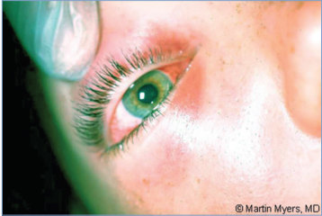

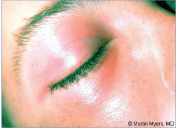

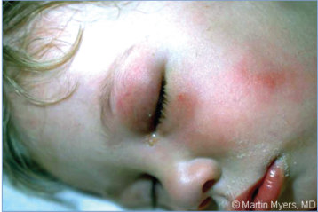

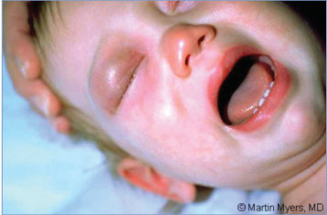

## PDF page 314 | printed page 300

Image 56.5 Haemophilus influenzae type b cellulitis of the face proven by positive results from subcutaneous aspirate cultures and blood cultures. The result from cerebrospinal fluid culture was negative. (This is the first of 3 preschool-aged boys from the same child care center who were examined within a period of 72 hours.)

Image 56.7 The third of 3 preschool-aged boys with Haemophilus influenzae type b (Hib) cellulitis of the face proved by positive results from subcutaneous aspirate cultures and blood cultures. The routine administration of the Hib vaccine prevents most of these invasive infections.

Image 56.6 The second of 3 preschool-aged boys with Haemophilus influenzae type b cellulitis of the face proved by positive results from subcutaneous aspirate cultures and blood cultures.

Image 56.8 A classic manifestation of Haemophilus influenzae type b (Hib) facial cellulitis in a 10-month-old girl. This oncecommon infection has been nearly eliminated in children who have been immunized with the Hib vaccine. Courtesy of George Nankervis, MD.

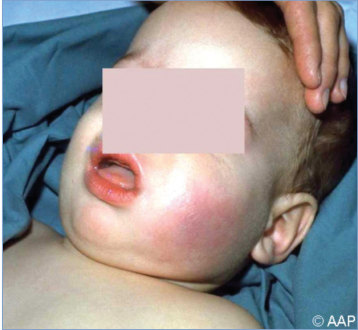

## PDF page 315 | printed page 301

Image 56.9 Haemophilus influenzae type b cellulitis of the arm proved by positive results from blood culture.

Image 56.11 Haemophilus influenzae type b cellulitis of the forehead proved by positive results from blood culture. Courtesy of Neal Halsey, MD.

Image 56.13 Acute Haemophilus influenzae type b epiglottitis with striking erythema and swelling of the epiglottis. Courtesy of Edgar O. Ledbetter, MD, FAAP.

Image 56.10 Haemophilus influenzae type b cellulitis of the foot proved by positive results from blood culture.

Image 56.12 Acute epiglottitis caused by Haemophilus influenzae type b proved by blood culture. The swollen inflamed epiglottis looks like the shadow of a thumb on the lateral neck radiograph.

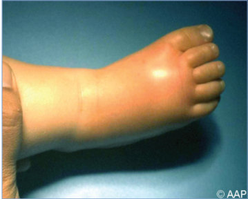

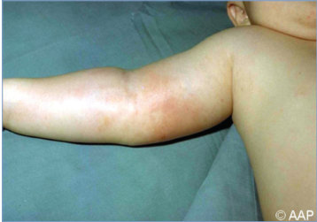

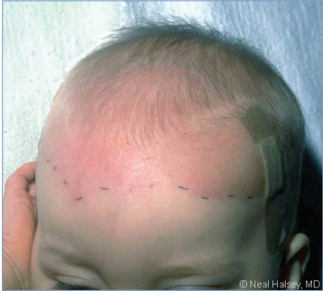

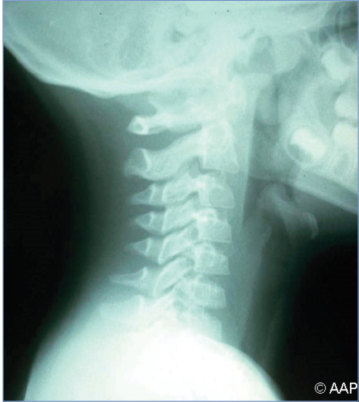

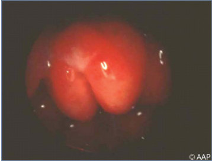

## PDF page 316 | printed page 302

Image 56.14 Haemophilus influenzae type b pneumonia, bilateral, in a patient with acute epiglottitis (proved by blood culture). This is the same patient as in Image 56.13.

Image 56.16 Lateral radiograph of the patient shown in Image 56.15, with fulminant Haemophilus influenzae type b pneumonia. Courtesy of Edgar O. Ledbetter, MD, FAAP.

Image 56.15 Haemophilus influenzae type b (Hib) pneumonia with left pleural effusion. Pleural fluid culture and blood culture were positive for Hib. Courtesy of Edgar O. Ledbetter, MD, FAAP.

Image 56.17 Retrocardiac Haemophilus influenzae type b pneumonia proved by blood culture. Note the air bronchogram.

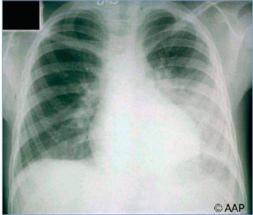

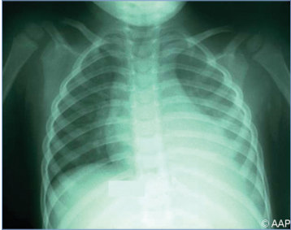

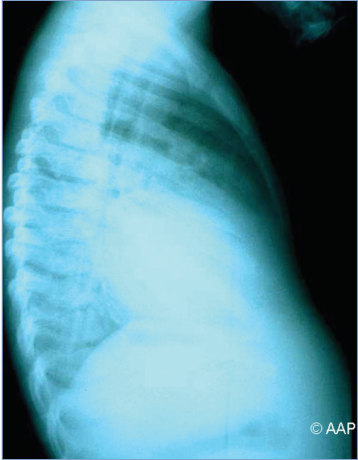

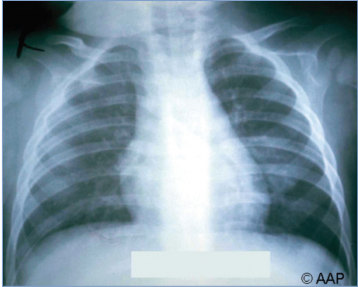

## PDF page 317 | printed page 303

Image 56.18 Haemophilus influenzae type b bilateral pneumonia, empyema, and purulent pericarditis. Pericardiostomy drainage is important in prevention of cardiac restriction.

Image 56.20 A 2-year-old boy with Haemophilus influenzae type b meningitis and subdural empyema. Note the prominent anterior fontanelle secondary to increased intracranial pressure. Copyright Martin G. Myers, MD.

Image 56.19 Haemophilus influenzae type b sepsis with peripheral gangrene. Courtesy of Neal Halsey, MD.

Image 56.21 Magnetic resonance Image showing subdural empyema that developed in a patient with Haemophilus influenzae type b meningitis.

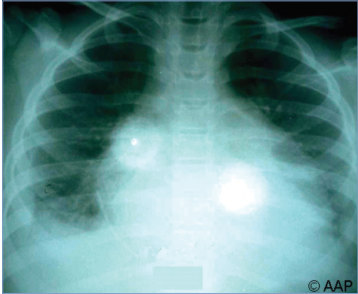

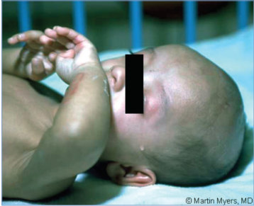

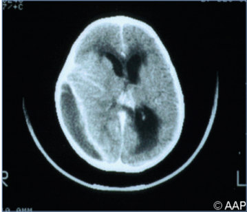

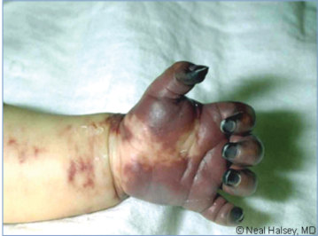

## PDF page 318 | printed page 304

Image 56.22 Magnetic resonance Image showing cerebral infarction in a patient with Haemophilus influenzae type b meningitis.

Image 56.24 Haemophilus influenzae meningitis in a 4-month-old who was evaluated in the morning for a health supervision visit and normal clinical findings. By afternoon, the child had necrosis of the hands and feet and died 12 hours later. This is the brain of the infant 24 hours after the health supervision visit. No immunologic deficit was diagnosed. Copyright Jerri Ann Jenista, MD.

Image 56.23 Magnetic resonance Image showing cerebral infarction in a patient who had Haemophilus influenzae type b (Hib) meningitis. The routine administration of Hib vaccine has virtually eliminated this type of devastating illness in the United States.

Image 56.25 This is an inferior view of a brain from a child who died of Haemophilus influenzae bacteremia and meningitis. Courtesy of Centers for Disease Control and Prevention.

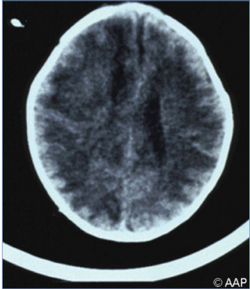

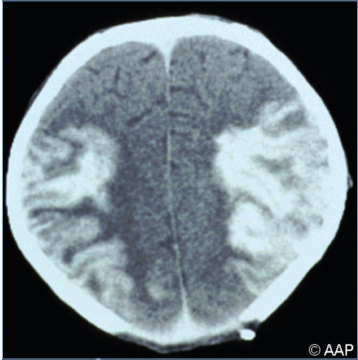

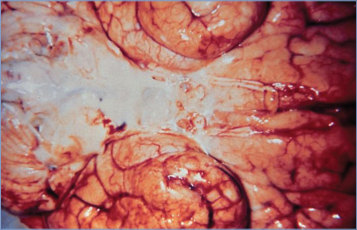

## PDF page 319 | printed page 305

Image 56.26 This girl was hospitalized with Haemophilus influenzae type b infection involving deep tissue of her face. H influenzae disease can also lead to brain damage, seizures, paralysis, hearing loss, and death. Courtesy of the Immunization Action Coalition.

Image 56.28 This photograph depicts the colonial morphological features displayed by gram-negative Haemophilus influenzae bacteria, which was grown on a medium of chocolate agar for a 24-hour period at a temperature of 37°C (98.6°F). Invasive disease caused by H influenzae type b can affect many organ systems. The most common types of invasive disease are pneumonia, occult febrile bacteremia, meningitis, epiglottitis, septic arthritis, cellulitis, otitis media, purulent pericarditis, and other, less common infections such as endocarditis and osteomyelitis. Courtesy of Centers for Disease Control and Prevention.

Image 56.27 Gram stain of cerebrospinal fluid (culture positive for Haemophilus influenzae type b).

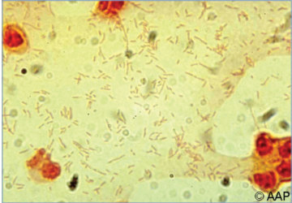

![Image 56.28 This photograph depicts the colonial morphological features displayed by gram-negative Haemophilus influenzae bacteria, which was grown on a medium of chocolate agar for a 24-hour period at a temperature of 37°C (98.6°F). Invasive disease caused by H influenzae type b can affect many organ systems. The most common types of invasive disease are pneumonia, occult febrile bacteremia, meningitis, epiglottitis, septic arthritis, cellulitis, otitis media, purulent pericarditis, and other, less common infections such as endocarditis and osteomyelitis. Courtesy of Centers for Disease Control and Prevention.](../../figures/ch056_p0319_03.jpg)

## PDF page 320 | printed page 306

7

6

5

Incidence per 100,000

4

3

2

1

0 ,1 1–4 5–17 18–34

Age (years)

ABCs cases from 2018–2022 and estimated to the U.S. population *2022 data are preliminary

Image 56.29 Estimated U.S. incidence of invasive Haemophilus influenzae disease by age group and serotype, 2018–2022. Courtesy of Centers for Disease Control and Prevention.

Image 56.30 Haemophilus influenzae on chocolate agar. This organism thrives on chocolate agar because of the supplication of factors X and V required for its growth. Individual colonies appear gray and sometimes mucoid or glistening. Courtesy of Julia Rosebush, DO; Robert Jerris, PhD; and Theresa Stanley, M(ASCP).

Hia Hib Hic Hid Hie Hif non-typeable

35–49 50–64 $65

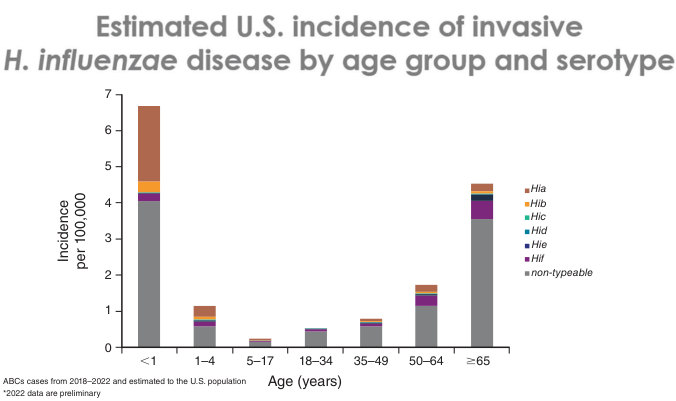

## PDF page 321 | printed page 307

12

Estimated incidence (cases per 100,000)

10

8

6

4

2

0 2002

2003 2004 2005 2006 2007 2008 2009

,1 years

1–4 years

35–49 years 50–64 years

Image 56.31 Trends in estimated incidence of invasive Haemophilus influenzae disease, by age group—United States, 2002–2015. Soeters HM, Blain A, Pondo T, et al. Current epidemiology and trends in invasive Haemophilus influenzae disease— United States, 2009–2015. Clin Infect Dis. 2018;67(6):881–889.

2.5

Estimated incidence (cases per 100,000)

2.0

1.5

1.0

0.5

0.0

2002

2003 2004 2005 2006 2007 2008

a b c

Image 56.32 Trends in estimated incidence of invasive Haemophilus influenzae disease among children younger than 5 years, by serotype—United States, 2002–2015. Soeters HM, Blain A, Pondo T, et al. Current epidemiology and trends in invasive Haemophilus influenzae disease—United States, 2009–2015. Clin Infect Dis. 2018;67(6):881–889.

2010 2011 2012 2013 2014 2015

Year

5–17 years 18–34 years

$65 years

2009 2010 2011 2012 2013 2014 2015

Year

d e f NT

