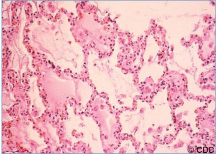

# 57. Hantavirus Pulmonary Syndrome
> Private study reference ([source credits](../../SOURCE_CREDITS.md)). PDF pages 322-326; printed pages 308-312.

## PDF page 322 | printed page 308

### CLINICAL MANIFESTATIONS

Hantaviruses cause 2 distinct clinical syndromes: (1) hantavirus pulmonary syndrome (HPS), also known as hantavirus cardiopulmonary syndrome (HCPS), characterized by noncardiogenic pulmonary edema, which is observed in the Americas; and (2) hemorrhagic fever with renal syndrome, which occurs worldwide. After an incubation period of 1 to 8 weeks, the prodromal illness of HPS lasts 3 to 7 days and is characterized by fever, chills, headache, myalgia, nausea, vomiting, diarrhea, dizziness, and sometimes cough. Respiratory tract symptoms or signs usually do not occur during the first 3 to 7 days, but then pulmonary edema and severe hypoxemia appear abruptly and present as cough and dyspnea. The disease then progresses over hours. In severe cases, myocardial dysfunction causes hypotension, which is why the syndrome sometimes is called HCPS.

Extensive bilateral interstitial and alveolar pulmonary edema with pleural effusions are attributable to diffuse pulmonary capillary leak. Intubation and assisted ventilation usually are required for only 2 to 4 days, with resolution heralded by onset of diuresis and rapid clinical improvement.

The severe myocardial depression is different from that of septic shock, with low cardiac indices and stroke volume index, normal pulmonary wedge pressure, and increased systemic vascular resistance. Poor prognostic indicators include persistent hypotension, marked hemoconcentration, a cardiac index of less than 2, and abrupt onset of lactic acidosis with a serum lactate concentration of >4 mmol/L (36 mg/dL).

The mortality rate for patients with HPS is between 30% and 40%; death usually occurs in the first 1 or 2 days of hospitalization. A disproportionate number of cases occurs in American Indian/Alaska Native populations, and case fatality rates for these populations are higher than for non-Native populations. Milder forms of disease have been reported. Limited information suggests that clinical manifestations and prognosis are

similar in adults and children. Serious sequelae are uncommon. There are typically 20 to 40 cases of HPS reported annually in the United States, with the majority (94%) of cases occurring west of the Mississippi River. Cases in children younger than 10 years are exceedingly rare. Children may be less likely to become infected than adults, because children are less likely to perform tasks that would place them at increased risk.

### ETIOLOGY

Hantaviruses are RNA viruses of the Hantaviridae family. Sin Nombre virus (SNV) is the major cause of HPS in the western and central regions of the United States. Bayou virus, Black Creek Canal virus, Monongahela virus, and New York virus are responsible for sporadic cases in Louisiana, Texas, Florida, New York, and other areas of the eastern United States. Other hantaviruses, including Andes virus, Oran virus, Laguna Negra virus, and Choclo virus, are responsible for cases in South and Central America.

### EPIDEMIOLOGY

Rodents are natural hosts for hantaviruses and acquire lifelong, asymptomatic, chronic infection with prolonged viruria and virus in saliva and feces. Humans acquire infection through direct contact with infected rodents, rodent droppings, or rodent nests or through the inhalation of aerosolized virus particles from rodent urine, droppings, or saliva. Rarely, infection may be acquired from rodent bites or contamination of broken skin with excreta. At-risk activities include handling or trapping rodents, cleaning or entering closed or rarely used rodent-infested structures, cleaning feed storage or animal shelter areas, hand plowing, and living in a home with an increased density of mice. For backpackers or campers, sleeping in a structure inhabited by rodents has been associated with HPS. Exceptionally heavy rainfall improves rodent food supplies, resulting in an increase in the rodent population with more frequent contact between humans and infected rodents, resulting in more human disease. Most cases occur during the spring and summer, with the geographic location determined by the habitat of the rodent carrier.

SNV is transmitted by the deer mouse, Peromyscus maniculatus; Black Creek Canal

## PDF page 323 | printed page 309

virus is transmitted by the cotton rat, Sigmodon hispidus; Bayou virus is transmitted by the rice rat, Oryzomys palustris; and the New York and Monongahela viruses are transmitted by the white-footed mouse, Peromyscus leucopus and P maniculatus. Andes virus is transmitted by the long-tailed rice rat (Oligoryzomys longicaudatus), endemic in most of Argentina and Chile. Unlike all other hantaviruses, Andes virus can also be transmitted person to person.

### DIAGNOSTIC TESTS

HPS should be considered when thrombocytopenia occurs with severe pneumonia clinically resembling acute respiratory distress syndrome in the proper epidemiologic setting. Other characteristic laboratory findings include neutrophilic leukocytosis with immature granulocytes, including more than 10% immunoblasts (basophilic cytoplasm, prominent nucleoli, and an increased nuclear:cytoplasmic ratio), increased hematocrit, and elevated lactate dehydrogenase. Increases in hepatic aminotransferases occur late. In areas where HPS is known to occur, use of a 5-point peripheral blood screen has aided in the early detection of patients with HPS. Elements of the screen are (1) hemoglobin elevated for gender/age, (2) left shift of granulocytic series, (3) absence of toxic changes on the blood smear, (4) thrombocytopenia, and (5) immunoblasts and plasma cells >10% of lymphocytes. For cases fulfilling 4 of 5 criteria, the positive predictive value of the 5-point screen is >90%.

Hantavirus-specific immunoglobulin (Ig) M and IgG antibodies often are present at the onset of clinical disease, and serologic testing remains the method of choice for diagnosis. IgG may be negative in rapidly fatal cases. Although some commercial labs offer hantavirus serologies, any positive IgM test results are referred to state health departments or the Centers for Disease Control and Prevention (CDC) for confirmation. Molecular detection of virus has been described in peripheral blood mononuclear cells and other clinical specimens from the early phase of the disease but not usually in bronchoalveolar lavage fluids. Viral culture is not useful. Immunohistochemical staining of tissues (capillary endothelial cells of the lungs and almost every organ in the body) can establish the diagnosis at autopsy. Clinicians

can contact the CDC Emergency Operations Center at 770-488-7100 for assistance with diagnosis and management.

### TREATMENT

Patients with suspected HPS should be transferred immediately to a tertiary care facility where supportive management of pulmonary edema, severe hypoxemia, and hypotension can occur during the first critical 24 to 48 hours.

In severe forms, early mechanical ventilation and inotropic and pressor support are necessary. Extracorporeal membrane oxygenation should be considered when pulmonary wedge pressure and cardiac indices have deteriorated and may provide short-term support for the severe capillary leak syndrome in the lungs.

There is no specific antiviral treatment for hantavirus infection. Ribavirin is active in vitro against hantaviruses, including SNV. However, 2 clinical studies of intravenous ribavirin (1 open-label study and 1 randomized, placebo-controlled, double-blind study) failed to show benefit in treatment of HPS in the cardiopulmonary stage.

Cytokine-blocking agents for HPS theoretically may have a role, but these agents have not been evaluated in a systematic fashion. Antibacterial agents do not provide benefit in this viral disease, but broad-spectrum antibiotic therapy often is administered until the diagnosis is established because bacterial shock is far more common than shock attributable to hantavirus.

### INFECTION PREVENTION AND CONTROL MEASURES IN HEALTH CARE SETTINGS

Standard precautions are recommended. Health care-associated or person-to-person transmission has not been associated with HPS in the United States but has been rarely reported in Chile and Argentina with Andes virus.

### CONTROL MEASURES

Care of Exposed People

Serial clinical examinations should be used to monitor individuals at high risk of infection after exposure (see Epidemiology).

## PDF page 324 | printed page 310

Environmental Control

Hantavirus infections of humans occur primarily in adults and are associated with domestic, occupational, or leisure activities facilitating contact with infected rodents, usually in a building in a rural setting. Eradicating the host reservoir is not feasible. Risk reduction includes practices that discourage rodents from colonizing the home and work environment and that minimize aerosolization and contact with rodent saliva and excreta. Tactics include eliminating food sources for rodents, reducing nesting sites by sealing holes, and using “snap traps” and rodenticides. Before entering areas with potential rodent infestations, doors and windows should be opened to ventilate the enclosure. Regionally and culturally appropriate educational materials should be used to direct prevention messages.

Hantaviruses, because of their lipid envelope, are susceptible to diluted bleach solutions, detergents, and most general household disinfectants. Dusty areas or articles should be moistened with

10% bleach or other disinfectant solution before being cleaned. Brooms and vacuum cleaners should not be used to clean rodent-infested areas. Use of a 10% bleach solution to disinfect dead rodents and wearing rubber gloves before handling trapped or dead rodents is recommended. Gloves and traps should be disinfected after use. The cleanup of areas potentially infested with hantavirus-infected rodents should be conducted by knowledgeable professionals using appropriate personal protective equipment. Potentially infected material should be handled according to local regulations for infectious waste.

Public Health Reporting

Possible hantavirus cases should be reported to local and state public health authorities. For state health department contact information, see www.cdc.gov/hantavirus/surveillance/ index.html. HPS and nonpulmonary hantavirus infections are nationally notifiable diseases, reportable through the National Notifiable Diseases Surveillance System.

## PDF page 325 | printed page 311

Image 57.1 Hantavirus pulmonary syndrome in a 16-year-old boy with a 36-hour history of fever, myalgia, and shortness of breath. Diffuse interstitial infiltrates with Kerley B lines. Diffuse nodular confluent alveolar opacities with some consolidation are consistent with adult respiratory distress syndrome. Hantavirus serological reaction was confirmatory by immunoglobulin M at 1:6,400. Patient recovered with supportive care including inhaled nitric oxide. Copyright David Waagner, MD.

Image 57.3 This anterolateral chest radiograph reveals the early stages of bilateral pulmonary effusion caused by hantavirus pulmonary syndrome (HPS). The radiological evolution of HPS begins with minimal changes of interstitial pulmonary edema and progresses to alveolar edema with severe bilateral involvement. Pleural effusions are common and are often large enough to be evident radiographically. Courtesy of Centers for Disease Control and Prevention.

Image 57.2 Histopathologic features of lung in hantavirus pulmonary syndrome include interstitial pneumonitis and intraalveolar edema. Courtesy of Centers for Disease Control and Prevention.

Image 57.4 Radiographic findings of hantavirus pulmonary syndrome (HPS). Findings usually include interstitial edema, Kerley B lines, hilar indistinctness, and peribronchial cuffing with normal cardiothoracic ratios. HPS begins with minimal changes of interstitial pulmonary edema and rapidly progresses to alveolar edema with severe bilateral involvement. Pleural effusions are common and are often large enough to be evident radiographically. Courtesy of Centers for Disease Control and Prevention.

## PDF page 326 | printed page 312

Image 57.5 Common laboratory findings. Notable hematologic findings include low platelet count, immunoblasts, left shift on white blood cell (WBC) count differential, elevated WBC count, and elevated hematocrit. The large atypical lymphocyte shown is an example of one of the laboratory findings that, when combined with bandemia and dropping platelet count, are characteristic of hantavirus pulmonary syndrome. Notable blood chemistry findings include low albumin, elevated lactate dehydrogenase (LDH), elevated aspartate aminotransferase (AST), and elevated alanine aminotransferase (ALT; previously serum glutamicpyruvic transaminase) levels. Courtesy of Centers for Disease Control and Prevention.

Image 57.6 Clinical progression of hantavirus pulmonary syndrome (HPS) starts with a febrile prodrome that may ultimately lead to hypotension and end-organ failure. The onset of the immune response precedes severe organ failure, which is thought to be immunopathologic in nature. Hypotension does not result in shock until the onset of respiratory failure, but this may reflect the severe physiological effect of lung edema. AST indicates aspartate aminotransferase; HCT, hematocrit; and LDH, lactate dehydrogenase. Courtesy of Centers for Disease Control and Prevention.

![Image 57.5 Common laboratory findings. Notable hematologic findings include low platelet count, immunoblasts, left shift on white blood cell (WBC) count differential, elevated WBC count, and elevated hematocrit. The large atypical lymphocyte shown is an example of one of the laboratory findings that, when combined with bandemia and dropping platelet count, are characteristic of hantavirus pulmonary syndrome. Notable blood chemistry findings include low albumin, elevated lactate dehydrogenase (LDH), elevated aspartate aminotransferase (AST), and elevated alanine aminotransferase (ALT; previously serum glutamicpyruvic transaminase) levels. Courtesy of Centers for Disease Control and Prevention.](../../figures/ch057_p0326_01.jpg)

![Image 57.6 Clinical progression of hantavirus pulmonary syndrome (HPS) starts with a febrile prodrome that may ultimately lead to hypotension and end-organ failure. The onset of the immune response precedes severe organ failure, which is thought to be immunopathologic in nature. Hypotension does not result in shock until the onset of respiratory failure, but this may reflect the severe physiological effect of lung edema. AST indicates aspartate aminotransferase; HCT, hematocrit; and LDH, lactate dehydrogenase. Courtesy of Centers for Disease Control and Prevention.](../../figures/ch057_p0326_02.jpg)
