# 67. Herpes Simplex
> Private study reference ([source credits](../../SOURCE_CREDITS.md)). PDF pages 391-406; printed pages 377-392.

## PDF page 391 | printed page 377

### CLINICAL MANIFESTATIONS

Neonatal

In newborn infants with herpes simplex virus (HSV), infection can manifest as: (1) disseminated disease involving multiple organs, most prominently liver and lungs, and in 60% to 75% of cases also involving the central nervous system (CNS); (2) localized CNS disease, with or without skin, eye, or mouth involvement (CNS disease); or (3) disease localized to the skin, eyes, and/or mouth (SEM disease). Approximately 25% of cases of neonatal HSV manifest as disseminated disease, 30% manifest as CNS disease, and 45% manifest as SEM disease. Both HSV type 1 (HSV-1) and type 2 (HSV-2) can cause any of these manifestations of neonatal HSV disease. In the absence of characteristic skin lesions, the diagnosis of neonatal HSV infection is challenging and requires a high index of suspicion. More than 80% of neonates with SEM disease have skin vesicles; those without vesicles have infection limited to the eyes and/or oral mucosa. Approximately twothirds of neonates with disseminated or CNS disease have skin vesicles, but these lesions may not be present at the time of onset of symptoms. Disseminated infection should be considered in neonates with sepsis syndrome with negative bacteriologic culture results, severe liver dysfunction, consumptive coagulopathy, or suspected viral pneumonia, especially hemorrhagic pneumonia. HSV should be considered as a causative agent in neonates with fever (especially within the first 3 weeks of life), hypothermia, a vesicular rash, or abnormal cerebrospinal fluid (CSF) findings (especially in the presence of seizures or during a time of year when enteroviruses are not circulating in the community). Although asymptomatic HSV infection is common in older children, it rarely, if ever, occurs in neonates. Recurrent skin lesions are common in surviving infants, occurring in approximately 50% of survivors, often within 1 to 2 weeks of completing the initial treatment course of parenteral acyclovir or the longer-term suppressive course of oral acyclovir.

Initial signs of HSV infection can occur anytime between birth and approximately 6 weeks of age, although almost all infected infants develop

clinical disease within the first month of life. Infants with disseminated disease and SEM disease have an earlier age of onset, typically presenting between the first and second weeks of life; infants with CNS disease usually present with illness between the second and third weeks of life.

Children Beyond the Neonatal Period and Adolescents

Most primary HSV childhood infections beyond the neonatal period are asymptomatic. Gingivostomatitis, which is the most common clinical manifestation of HSV during childhood, is almost exclusively caused by HSV-1 and is characterized by fever, irritability, tender submandibular adenopathy, and an ulcerative enanthem involving the gingiva and mucous membranes of the mouth, often with perioral vesicular lesions.

Genital herpes is characterized by vesicular or ulcerative lesions of the male or female genitalia, perineum, or perianal areas.1 Until the last 2 decades, genital herpes most often was caused by HSV-2, but likely because of oral sexual practices, HSV-1 now accounts for more than half of all genital herpes cases in the United States. Most cases of primary genital herpes infection are asymptomatic, so they are not recognized by the infected person or diagnosed by a health care professional. When present, symptoms and signs of the initial episode may include fever, fatigue, myalgias, and inguinal lymphadenopathy.

In immunocompromised patients, severe local lesions and, less commonly, disseminated HSV infection with generalized vesicular skin lesions and visceral involvement can occur.

After primary infection, HSV persists for life in a latent form. Reactivation of latent virus most commonly is asymptomatic. When symptomatic, recurrent HSV-1 herpes labialis manifests as single or grouped vesicles in the perioral region, usually on the vermilion border of the lips (typically called “cold sores” or “fever blisters”). Symptomatic recurrent genital herpes manifests as vesicular lesions on the penis, scrotum, vulva, cervix, buttocks, perianal areas, thighs, or back. Among immunocompromised patients, genital HSV-2 recurrences are more frequent and of longer duration. Recurrences may be heralded by a prodrome of burning or itching at the site of an incipient recurrence, identification of which can be useful in instituting early antiviral therapy.

## PDF page 392 | printed page 378

Ocular manifestations of HSV include conjunctivitis and keratitis that can result from primary or recurrent HSV infection. In addition, HSV can cause acute retinal necrosis and uveitis.

Eczema herpeticum can develop in patients with atopic dermatitis who are infected with HSV and can be difficult to distinguish from poorly controlled atopic dermatitis. Examination may reveal skin with punched-out erosions, hemorrhagic crusts, and/or vesicular lesions. Pustular lesions attributable to bacterial superinfection also may occur. Herpetic whitlow consists of single or multiple vesicular lesions on the distal parts of fingers. Wrestlers and other contact sports athletes can develop herpes gladiatorum, a cutaneous skin infection that usually is caused by HSV-1 but occasionally by HSV-2. In wrestling, 70% of herpes outbreaks involve the face. HSV infection can be a precipitating factor of other cutaneous manifestations, such as erythema multiforme. Recurrent erythema multiforme often is caused by symptomatic or asymptomatic HSV recurrences.

HSV encephalitis (HSE) occurs in children beyond the neonatal period, in adolescents, and in adults and can result from primary or recurrent HSV-1 infection. One-fifth of HSE cases occur in the pediatric age group. Symptoms and signs usually include fever, alterations in the state of consciousness, personality changes, seizures, and focal neurologic findings. Encephalitis commonly has an acute onset with a fulminant course, leading to coma and death in untreated patients. HSE usually involves the temporal lobe, and magnetic resonance imaging is the most sensitive imaging modality. CSF pleocytosis with a predominance of lymphocytes is typical. Historically, erythrocytes in the CSF were considered suggestive of HSE, but with earlier diagnosis (prior to development of a hemorrhagic encephalitis), this finding is rare today.

HSV infection also can manifest as mild, selflimited aseptic meningitis, usually associated with primary genital HSV-2 infection. Unusual CNS manifestations of HSV include Bell palsy, atypical pain syndromes, trigeminal neuralgia, ascending myelitis, transverse myelitis, postinfectious encephalomyelitis, and recurrent (Mollaret) meningitis.

### ETIOLOGY

HSVs are large, enveloped, double-stranded DNA viruses. They are members of the family Herpesviridae and, along with varicella-zoster virus (human herpesvirus 3), are in the subfamily Alphaherpesvirinae. Two distinct HSV types exist: HSV-1 and HSV-2. Infections with HSV-1 traditionally involve the face and skin above the waist; however, an increasing number of genital herpes cases are attributable to HSV-1. Infections with HSV-2 usually involve the genitalia and skin below the waist in sexually active adolescents and adults. Both HSV-1 and HSV-2 cause herpetic disease in neonates. HSV-1 and HSV-2 establish latency in sensory neurons following primary infection, with periodic reactivation causing recurrent symptomatic disease or asymptomatic viral shedding. Genital HSV-2 infection is more likely to recur than is genital HSV-1 infection.

### EPIDEMIOLOGY

HSV infections can be transmitted from people who are symptomatic or asymptomatic with primary or recurrent infections.

Neonatal

The incidence of neonatal HSV infection in the United States has increased over the past 2 decades to approximately 1 in 2,000 live births. HSV is transmitted to a neonate most often during birth through an infected genital tract but can be caused by an ascending infection through ruptured or apparently intact amniotic membranes. Other less common sources of neonatal infection include postnatal transmission from a parent, sibling, or other caregiver, most often from a nongenital infection (eg, mouth or hands), transmission from the mouth of a religious circumciser (“mohel”) to the infant penis during ritual Jewish circumcisions that include direct orogenital suction (metzitzah b’peh), and intrauterine infection causing congenital malformations.

The risk of transmission to a neonate born to a person who acquires primary genital HSV infection near the time of delivery is estimated to be 25% to 60%. In contrast, the risk to a neonate born to a person shedding HSV as a result of reactivation of infection acquired during the first half of pregnancy or earlier is less than 2%. More than

## PDF page 393 | printed page 379

three-quarters of infants who contract HSV infection are born to a person with no history or clinical findings suggestive of genital HSV infection during or preceding pregnancy. Therefore, a lack of history of genital HSV infection in the birthing parent does not preclude a diagnosis of neonatal HSV disease.

Children Beyond the Neonatal Period and Adolescents

Patients with primary gingivostomatitis or genital herpes usually shed virus for at least 1 week and occasionally for several weeks. Patients with symptomatic recurrences shed virus for a shorter period, typically 3 to 4 days. Intermittent asymptomatic reactivation of oral and genital herpes is common and likely occurs throughout the remainder of a person’s life. The greatest concentration of virus is shed during symptomatic primary infections and the lowest during asymptomatic reactivation.

Several single gene defects have been reported that predispose to HSE. The ones characterized so far are mainly involved in the toll-like receptor 3 (TLR3) pathway, including deficiencies of TLR3 itself or in downstream signal transduction pathways (UNC93B1, TRIF/TICAM1, TRAF, TBK1) or deficiencies in innate/type 1 interferon pathways (IFN-alpha/-beta, IFN-lambda, STAT1, IRF3).

The incubation period for HSV infection occurring beyond the neonatal period ranges from 2 days to 2 weeks, with an average of 4 days.

### DIAGNOSTIC TESTS

A nucleic acid amplification test (NAAT) usually can detect HSV DNA in CSF from neonates with CNS infection (neonatal HSV CNS disease) and from older children and adults with HSE and is the diagnostic method of choice for CNS HSV involvement. A NAAT of CSF can yield negative results in cases of HSE, especially early in the disease course. In difficult cases in which HSV CNS disease is expected but repeated CSF NAAT results are negative, histologic examination and viral culture of a brain tissue biopsy specimen is the most definitive method of confirming the diagnosis of HSE. Detection of intrathecal antibody against HSV also can assist in the diagnosis but may not be specific because of alterations in the blood-brain barrier. Viral cultures of CSF from a patient with HSE usually are negative.

HSV grows readily in traditional cell culture. Special transport media are available that allow transport to local or regional laboratories for culture. Cytopathogenic effects typical of HSV infection usually are observed 1 to 3 days after inoculation. Methods of culture confirmation include fluorescent antibody staining, enzyme immunoassays (EIAs), and monolayer culture with typing. Cultures that are negative on day 5 likely will remain negative. A viral isolate by culture is required if phenotypic antiviral susceptibility studies are to be performed.

For diagnosis of neonatal HSV infection, all of the following specimens should be obtained for each patient: (1) swab specimens from the conjunctivae, mouth, nasopharynx, and anus (“surface specimens”) for HSV culture (if available) or NAAT (can use a separate swab for each site, or a single swab starting with the conjunctivae); (2) specimens of skin vesicles for HSV culture (if available) or NAAT; (3) CSF sample for HSV NAAT; (4) whole blood sample for HSV NAAT; and (5) whole blood sample for measuring alanine aminotransferase. The performance characteristics of NAAT on skin and mucosal specimens from neonates has not been studied. Positive cultures obtained from any of the surface sites more than 12 to 24 hours after birth indicate viral replication and are, therefore, suggestive of infant infection, and therefore risk of progression to neonatal HSV disease, rather than merely contamination after intrapartum exposure. As with any NAAT, falsenegative and false-positive results can occur. Any of the 3 manifestations of neonatal HSV disease (disseminated, CNS, SEM) can have associated viremia, so a positive whole blood NAAT result does not define an infant as having disseminated HSV and, therefore, should not be used to determine extent of disease and duration of treatment. Likewise, no data exist to support use of serial blood NAAT to monitor response to therapy. Rapid diagnostic techniques are available, such as direct fluorescent antibody staining of vesicle scrapings or EIA detection of HSV antigens. These techniques are as specific as but less sensitive than culture.

HSV NAAT is the preferred method for detecting HSV in genital lesions. The sensitivity of viral culture is low, especially for recurrent lesions, and declines rapidly as lesions begin to heal. NAATs

## PDF page 394 | printed page 380

for HSV DNA are more sensitive and are widely available. Failure to detect HSV in genital lesions by culture or NAAT does not rule out HSV infection, because viral shedding is intermittent.

Type-specific antibodies to HSV develop during the first several weeks after infection and persist indefinitely. Approximately 20% of patients with a first episode of HSV-2 seroconvert for type-specific immunoglobulin (Ig) G antibody by 10 days, and the median time to seroconversion is 21 days with a type-specific enzyme-linked immunosorbent assay; more than 95% of people seroconvert by 12 weeks following infection. Although typespecific HSV-2 antibody usually indicates previous anogenital infection, the presence of HSV-1 antibody does not distinguish anogenital from orolabial infection reliably because a substantial proportion of initial genital infections and virtually all initial orolabial infections are caused by HSV-1. Serologic testing is not useful in neonates. IgM testing for HSV-1 or HSV-2 is not useful because of the lack of a reliable commercially available IgM assay.

### TREATMENT

Systemically administered acyclovir, valacyclovir, and famciclovir can be prescribed for different HSV infections. In pediatric patients who cannot swallow large pills, instructions for preparing a compounded liquid suspension of valacyclovir with a 28-day refrigerated shelf life are provided in the drug’s package insert.

Neonatal

Parenteral acyclovir is the treatment for neonatal HSV infections. The dosage of acyclovir is 60 mg/kg per day in 3 divided doses (20 mg/kg/ dose), administered intravenously for 14 days in SEM disease and for a minimum of 21 days in CNS disease or disseminated disease. All infants with CNS involvement should have a repeat lumbar puncture performed near the end of therapy to document that the CSF is negative for HSV DNA on NAAT; in the unlikely event that the NAAT result remains positive near the end of a 21-day treatment course, intravenous acyclovir should be administered for another week, with repeat CSF NAAT performed near the end of the extended treatment period and another week of parenteral therapy if the result remains positive. Parenteral antiviral therapy should not be

stopped until the CSF NAAT result for HSV DNA is negative. Consultation with a pediatric infectious diseases specialist is warranted in these cases.

Infants surviving neonatal HSV disease of any classification (disseminated, CNS, or SEM) should receive oral acyclovir suppression at 300 mg/m2/ dose, administered 3 times daily for 6 months after the completion of parenteral therapy for acute disease; the dose should be adjusted monthly to account for growth. Absolute neutrophil counts should be assessed at 2 and 4 weeks after initiating suppressive acyclovir therapy and then monthly during the treatment period. Longer durations or higher doses of antiviral suppression do not further improve neurodevelopmental outcomes. Valacyclovir has not been studied for longer than 5 days in young infants, so it should not be used routinely for antiviral suppression in this age group.

All infants with neonatal HSV disease, regardless of disease classification, should have an ophthalmologic examination and neuroimaging to establish baseline brain anatomy; magnetic resonance imaging is the most sensitive imaging modality but may require sedation, so computed tomography or ultrasonography of the head are acceptable alternatives. Topical ophthalmic drug (1% trifluridine or 0.15% ganciclovir), in addition to parenteral antiviral therapy, may be indicated in infants with ocular involvement attributable to HSV infection, including a positive virologic test result from a conjunctival swab sample, and an ophthalmologist should be involved in the management and treatment of acute neonatal ocular HSV disease. The older topical antiviral agents vidarabine and iododeoxyuridine are no longer available in the United States.

Genital Infection

Primary

Oral acyclovir therapy shortens the duration of illness and viral shedding. Valacyclovir and famciclovir are not more effective than acyclovir but offer the advantage of less frequent dosing. Intravenous acyclovir is indicated for patients with a severe or complicated primary infection that requires hospitalization. Treatment of primary herpetic lesions does not affect the subsequent frequency or severity of recurrences.

## PDF page 395 | printed page 381

Recurrent

Antiviral therapy for recurrent genital herpes can be administered either episodically to ameliorate or shorten the duration of lesions or continuously as suppressive therapy to decrease the frequency of recurrences. Many patients benefit from antiviral therapy, and treatment options should be discussed with patients with recurrent disease. Acyclovir, valacyclovir, and famciclovir have been approved for suppression of genital herpes in immunocompetent adults. Acyclovir and valacyclovir are most commonly used in pregnant people with first-episode genital herpes or severe recurrent herpes, and acyclovir should be administered intravenously to pregnant people with severe HSV infection.

Mucocutaneous

Immunocompromised Hosts

Intravenous acyclovir is effective for treatment of mucocutaneous HSV infections. Acyclovirresistant strains of HSV have been isolated from immunocompromised people receiving prolonged treatment with acyclovir. Because these strains will also be resistant to valacyclovir, and most are also resistant to famciclovir, foscarnet is the drug of choice for acyclovir-resistant HSV isolates.

Immunocompetent Hosts

Limited data are available on the effects of acyclovir on the course of primary or recurrent nongenital mucocutaneous HSV infections in immunocompetent hosts. Therapeutic benefit has been noted in a limited number of children with primary gingivostomatitis treated with oral acyclovir. A small therapeutic benefit of oral acyclovir therapy has been demonstrated among adults with recurrent herpes labialis. Famciclovir or valacyclovir also can be considered. Topical acyclovir is not therapeutic.

Other HSV Infections

Central Nervous System

Patients with HSE should be treated for 21 days with intravenous acyclovir. Use of concomitant corticosteroids has not been adequately studied in people and is not routinely recommended.

Ocular

Treatment of eye lesions should be undertaken in consultation with an ophthalmologist. Several

topical drugs, such as 1% trifluridine and 0.15% ganciclovir, have proven effectiveness for superficial keratitis. Topical corticosteroids administered without concomitant antiviral therapy are contraindicated in suspected HSV conjunctivitis; however, ophthalmologists may choose to use corticosteroids in conjunction with antiviral drugs to treat locally invasive infections. For children with recurrent ocular lesions, oral suppressive therapy with acyclovir may be of benefit and may be indicated for months or even years.

### INFECTION PREVENTION AND CONTROL MEASURES IN HEALTH CARE SETTINGS

In addition to standard precautions, the following recommendations should be followed.

Neonates With HSV Infection

Neonates with HSV infection should be hospitalized and managed with contact precautions if mucocutaneous lesions are present.

Neonates Exposed to HSV During Delivery

An infant born to a person with active genital HSV lesions should be managed with contact precautions during the incubation period. The risk of HSV infection in an infant born to a person with a history of recurrent genital herpes who has no genital lesions at delivery is low, so special precautions are not necessary. Specific management options for neonates born to people with active genital HSV lesions are detailed in “Prevention of Neonatal Infection.”

Postpartum Persons With HSV Infection

People with active HSV lesions should be instructed about the importance of careful hand hygiene before and after caring for their infants. A parent or caregiver with herpes labialis or stomatitis should wear a disposable surgical mask when touching the newborn infant until the lesions have crusted. The caregiver should not kiss or nuzzle the newborn infant until lesions have resolved. Herpetic lesions on other skin sites should be covered.

Breastfeeding is acceptable if no lesions are present on the breasts and if active lesions elsewhere on the caregiver are covered.

## PDF page 396 | printed page 382

Children With Mucocutaneous HSV Infection

Contact precautions are recommended for patients with severe mucocutaneous HSV infection. Patients with localized recurrent lesions should be managed with standard precautions.

Patients With HSV Infection of the CNS

Standard precautions are recommended for patients with infection limited to the CNS.

### CONTROL MEASURES

Prevention of Neonatal Infection

During Pregnancy

The American College of Obstetricians and Gynecologists recommends that people with a primary or nonprimary first-episode outbreak (defined in Table 67.1) in pregnancy, as well as those with a clinical history of genital herpes, be offered suppressive antiviral therapy at or beyond 36 weeks of gestation. However, cases of neonatal HSV disease have occurred among infants born to people who received such antiviral prophylaxis. First-episode primary and nonprimary genital infections can result in shedding of HSV in the genital tract for several weeks even after lesions resolve.

Table 67.1 Infection Classification by Genital HSV Viral Type and Type-Specific Serologic Test Results From the Birthing Parenta

Classification of Infection in Birthing Parent NAAT/Culture From Genital Lesion Documented first-episode primary infection

Positive, either virus

Documented first-episode nonprimary infection

Positive for HSV-1

Positive for HSV-2

Positive for HSV-1 OR HSV-2

Assumed first-episode (primary or nonprimary) infection

Negative OR not availableb

Recurrent infection Positive for HSV-1

Positive for HSV-2

HSV indicates herpes simplex virus; NAAT, nucleic acid amplification test; IgG, immunoglobulin G. a To be used for people without a clinical history of genital herpes. b When a genital lesion is strongly suspicious for HSV, clinical judgment should supersede the virologic test results for the conservative purposes of this neonatal management algorithm. Conversely, if, in retrospect, the genital lesion was not likely to be caused by HSV and the NAAT result/culture is negative, departure from the evaluation and management in this conservative algorithm may be warranted.

Care of Newborn Infants Whose Birthing Parent Has Active Genital Lesions at Delivery

Neonates exposed to active HSV genital lesions at delivery should not have delayed bathing.2 The risk of transmitting HSV to the newborn infant during delivery is influenced directly by the classification of HSV infection of the birthing individual (Table 67.1); those with primary genital HSV infections who are shedding HSV at delivery are 10 to 30 times more likely to transmit the virus to their newborn infants, compared with those with a recurrent genital infection. With the commercial availability of serologic tests that can reliably distinguish type-specific HSV antibodies, the means to further refine management of asymptomatic neonates delivered to people with active genital HSV lesions now is possible. The American Academy of Pediatrics developed algorithms (Fig 67.1 and 67.2) addressing evaluation and management of asymptomatic neonates following vaginal or cesarean delivery to people with active genital HSV lesions.3 The algorithms are intended to outline one approach to the management of these neonates and may not be feasible in settings with limited access to NAATs for HSV DNA or to type-specific serologic tests. If, at any point during the evaluation outlined in the evaluation algorithm (Fig 67.1), an infant develops symptoms that could

HSV-1 and HSV-2 IgG Type-Specific Antibody Status of Birthing Parent

Both negative

Positive for HSV-2 AND negative for HSV-1

Positive for HSV-1 AND negative for HSV-2

Not available

Negative for HSV-1 and/or HSV-2, OR not available

Positive for HSV-1

Positive for HSV-2

### Geometry-detected table

|Classification of Infection in Birthing Parent|NAAT/Culture From Genital Lesion|HSV-1 and HSV-2 IgG Type-Specific Antibody Status of Birthing Parent|
|---|---|---|
|Documented frst-episode primary infection|Positive, either virus|Both negative|
|Documented frst-episode nonprimary infection|Positive for HSV-1|Positive for HSV-2**AND** negative for HSV-1|
|Documented frst-episode nonprimary infection|Positive for HSV-2|Positive for HSV-1**AND** negative for HSV-2|
|Assumed frst-episode (primary or nonprimary) infection|Positive for HSV-1**OR** HSV-2|Not available|
|Assumed frst-episode (primary or nonprimary) infection|Negative**OR** not availableb|Negative for HSV-1 and/or HSV-2,**OR** not available|
|Recurrent infection|Positive for HSV-1|Positive for HSV-1|
|Recurrent infection|Positive for HSV-2|Positive for HSV-2|

[View original table](../../tables/ch067_p0396_1.jpg)

## PDF page 397 | printed page 383

Figure 67.1 Algorithm for the evaluation of asymptomatic neonates following vaginal or cesarean delivery to people with active genital herpes lesions

Adapted from Kimberlin DW, Baley J; American Academy of Pediatrics, Committee on Infectious Diseases. Guidance on management of asymptomatic neonates born to women with active genital herpes lesions. Pediatrics. 2013;131(2):e635–e646

indicate neonatal HSV disease (eg, fever, hypothermia, lethargy, irritability, vesicular rash, seizures, etc), a full diagnostic evaluation should be undertaken and intravenous acyclovir therapy should be

initiated. In applying this algorithm, obstetric and pediatric providers will need to work closely with their diagnostic laboratories to ensure that serologic and virologic testing is available and

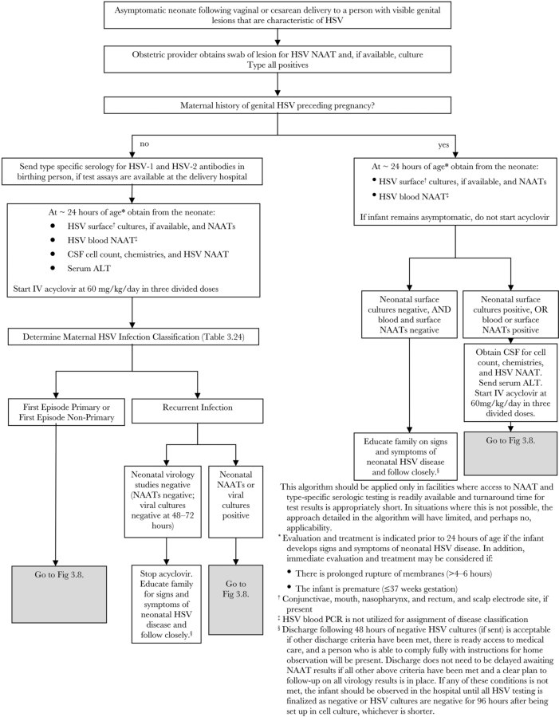

## PDF page 398 | printed page 384

Figure 67.2 Algorithm for the treatment of asymptomatic neonates following vaginal or cesarean delivery to people with active genital herpes lesions

Adapted from Kimberlin DW, Baley J; American Academy of Pediatrics, Committee on Infectious Diseases. Guidance on management of asymptomatic neonates born to women with active genital herpes lesions. Pediatrics. 2013;131(2):e635–e646

turnaround times are acceptable. In situations in which this is not possible, the approach detailed in the algorithm will have limited, and perhaps no, applicability.

Care of Newborn Infants Whose Birthing Parent Has a History of Genital Herpes but No Active Genital Lesions at Delivery

Most infants whose birthing parent has a history of genital herpes but no genital lesions at delivery should be observed for signs of infection (eg, vesicular lesions of the skin, respiratory distress, seizures, or signs of sepsis) but should not have specimens for surface cultures for HSV obtained at 12 to 24 hours of life and should not receive empiric parenteral acyclovir. The exception are infants born to persons with documented first-episode primary or nonprimary infections

(defined in Table 67.1) during the third trimester but who have no genital lesions at delivery. These infants should have HSV surface cultures, if available, and NAATs and HSV blood NAAT obtained at ~24 hours of age, regardless of mode of delivery or birthing parent’s receipt of antiviral suppressive therapy. Results of these tests should be responded to as outlined in the right side of Figure 67.1. The rationale for this recommendation is that the American College of Obstetricians and Gynecologists states that cesarean delivery may be offered to people with documented first-episode infections during the third trimester because of the possibility of prolonged viral shedding.4 Education of parents and caregivers about the signs and symptoms of neonatal HSV infection during the first 6 weeks of life is prudent.

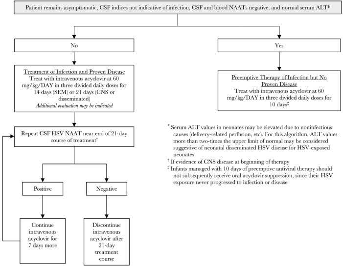

## PDF page 399 | printed page 385

Infected Health Care Professionals

Health care professionals with cold sores who have contact with infants should cover and not touch their lesions and should comply with hand hygiene policies. Transmission of HSV infection from health care professionals with genital lesions is not likely as long as they comply with hand hygiene policies. Health care professionals with an active herpetic whitlow should not have responsibility for direct care of neonates or immunocompromised patients and should wear gloves and use hand hygiene during direct care of other patients.

Infected Household, Family, and Other Close Contacts of Newborn Infants

Household members with herpetic skin or mouth lesions (eg, stomatitis, herpes labialis, or herpetic whitlow) should be counseled about the risk of transmission and should avoid contact of their lesions with neonates by taking the same measures as recommended for infected health care professionals, as well as avoiding kissing and nuzzling the infant while they have active lip/mouth lesions or touching the neonate while they have a herpetic whitlow.

Care of People With Extensive Dermatitis

Patients with dermatitis should not have oral contact with people with cold sores or touched by people with herpetic whitlow.

Care of Children With Mucocutaneous Infections Who Attend Child Care or School

Oral HSV infections are common among children who attend child care or school. Most of these infections are asymptomatic, with shedding of virus in saliva occurring in the absence of clinical disease.

HSV Infections Among Wrestlers and Rugby Players5

HSV-1 has been identified as a cause of outbreak of skin infections among wrestlers (herpes gladiatorum) and rugby players (herpes rugbiorum) on numerous occasions, affecting up to 2.6% of high school and 7.6% of college wrestlers in the United States. During outbreaks, up to 34% of all high school wrestlers have been documented to be infected.

The primary risk factor is direct skin-to-skin exposure to opponents with cutaneous lesions.

Athletes with active herpes gladiatorum or rugbiorum infections should be excluded from competition and contact practice. Prior to return to competition, skin lesions must have a firm adherent crust, athletes must have no evidence of secondary bacterial infection, and any systemic symptoms must have resolved. In addition, the athlete must have developed no new skin lesions for 72 hours and have been on appropriate antiviral therapy for at least 120 hours. When given within 24 hours of symptoms onset, valacyclovir has been shown to shorten the duration of time to HSV NAAT negativity from lesions of adolescent and adult wrestlers with recurrent herpes gladiatorum. Wrestlers receiving valacyclovir should be advised about the importance of good hydration to minimize the likelihood of nephrotoxicity. Efforts to reduce transmission should include (1) examination of wrestlers and rugby players for vesicular or ulcerative lesions on exposed areas of their bodies and around their mouths or eyes before practice or competition by a person familiar with the appearance of mucocutaneous infections (including HSV, herpes zoster, and impetigo); (2) excluding athletes with these lesions from competition until all lesions are fully crusted or production of a physician’s written statement indicating that their condition is noninfectious; and (3) cleaning of wrestling mats with a freshly prepared solution of household bleach (one-quarter cup of bleach in 1 gallon of water), applied for a minimum contact time of 15 seconds at least daily, and preferably, between matches. Athletes with a history of recurrent herpes gladiatorum, herpes rugbiorum, or herpes labialis should be considered for suppressive antiviral therapy, again with cautionary guidance about the importance of maintaining good hydration to avoid the likelihood of nephrotoxicity. There is strong evidence that using prophylactic antiviral therapy can be useful in preventing both primary and secondary herpes outbreaks in high-risk environments, such as large wrestling camps.

1 The terms male and female refer to sex assigned at birth. 2 Nolt D, O’Leary ST, Aucott SW; American Academy of

Pediatrics, Committee on Infectious Diseases, Committee on Fetus and Newborn. Risks of infectious diseases in newborns exposed to alternative perinatal practices. Pediatrics. 2022;149(2):e2021055554

## PDF page 400 | printed page 386

3 Kimberlin DW, Baley J; American Academy of Pediatrics, Committee on Infectious Diseases. Guidance on management of asymptomatic neonates born to women with active genital herpes lesions. Pediatrics. 2013;131(2):e635–e646 4 American College of Obstetricians and Gynecologists.

Management of genital herpes in pregnancy. ACOG Practice Bulletin No. 220. Obstet Gynecol. 2020;135(5):e193–202

Image 67.1 This is a close-up of a herpes simplex lesion on the lower lip on the second day after onset. Also known as a “cold sore,” this lesion is caused by the contagious herpes simplex virus type 1 and should not be confused with a canker sore, which is not contagious. Courtesy of Centers for Disease Control and Prevention.

Image 67.3 Herpes simplex stomatitis, primary infection of the anterior oral mucous membranes. Tongue lesions are also common with primary herpes simplex.

5 Davies HD, Jackson MA; American Academy of Pediatrics, Committee on Infectious Diseases. Infectious diseases associated with organized sports and outbreak control. Pediatrics. 2017;140(4):e20172477

Image 67.2 This 7-year-old with a history of recurrent herpes labialis presented with periocular herpes simplex. Courtesy of Centers for Disease Control and Prevention.

Image 67.4 Herpes simplex stomatitis, primary infection with extension to the face.

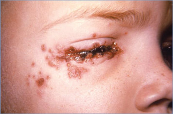

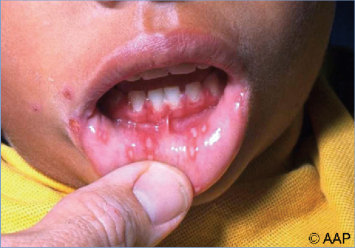

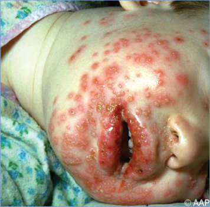

## PDF page 401 | printed page 387

Image 67.5 Herpes simplex in a child with eczema with Kaposi varicelliform eruption and Stevens-Johnson syndrome.

Image 67.7 Patient in Image 67.6, with generalized eczema and primary herpetic gingivostomatitis with extensive eczema herpeticum. Copyright Jerri Ann Jenista, MD.

Image 67.9 The patient shown in Images 67.6, 67.7, and 67.8, with extensive eczema herpeticum and primary herpetic gingivostomatitis. Copyright Jerri Ann Jenista, MD.

Image 67.6 Eczema herpeticum on the face of a boy with eczema and primary herpetic gingivostomatitis, day 3–4 of the onset. The herpetic lesions spread over 2 to 3 days to extensive covering of the skin, and systemic therapy with acyclovir was provided. The patient recovered after a prolonged hospital stay for secondary nosocomial bacterial infections. Copyright Jerri Ann Jenista, MD.

Image 67.8 Hand of the patient in Images 67.6 and 67.7, with eczema and primary herpetic gingivostomatitis that spread over 2 to 3 days to cover the skin extensively. Copyright Jerri Ann Jenista, MD.

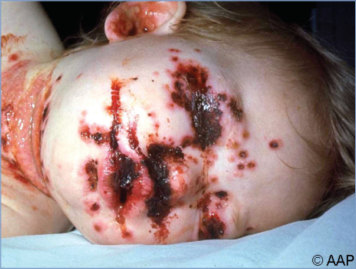

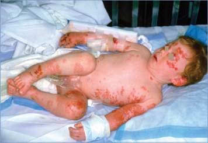

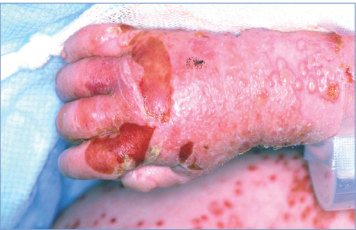

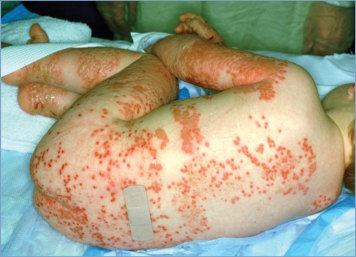

## PDF page 402 | printed page 388

Image 67.10 Herpes simplex virus infection at a diphtheria, tetanus, and pertussis vaccine injection site reflecting self-inoculation. Courtesy of Edgar O. Ledbetter, MD, FAAP.

Image 67.12 An adolescent girl with herpetic whitlow secondary to orolabial lesions with self-inoculation. Copyright Martin G. Myers, MD.

Image 67.14 Neonatal herpes simplex infection with disseminated vesicular lesions.

Image 67.11 Herpetic whitlow in a 10-year-old boy with recurrent herpes simplex infection.

Image 67.13 Disseminated herpes simplex infection in a 17-year-old boy with Hodgkin disease. Courtesy of George Nankervis, MD.

Image 67.15 Neonatal herpes simplex infection. This is the same patient as in Image 67.14.

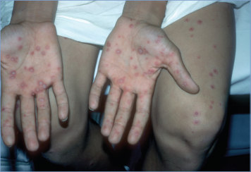

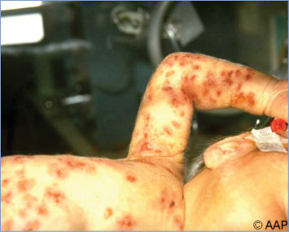

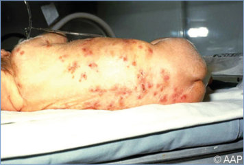

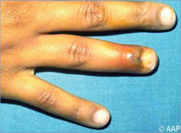

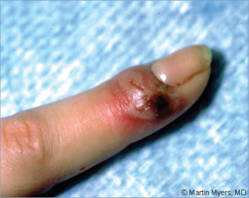

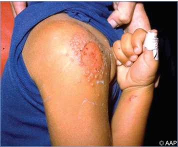

## PDF page 403 | printed page 389

Image 67.16 Neonatal herpes skin lesions of the face. A preterm 14-day-old developed vesicular lesions over the right eye and face on days 11 to 14 after birth. Herpes simplex virus type 2 was recovered from viral culture of the vesicular fluid. Keratoconjunctivitis was diagnosed by means of ophthalmologic examination, and the neonate was treated with topical antiviral eye drops in addition to intravenous acyclovir. The neonate was born via a spontaneous vaginal delivery with a vertex presentation. Membranes had ruptured 8 hours before delivery. There was no history of genital herpes or fever blisters in either parent. The lesions were concentrated on the face and head, the presenting body parts in delivery. Copyright Barbara Jantausch, MD, FAAP.

Image 67.19 Postneonatal herpes simplex encephalitis. Hemorrhagic necrosis of the temporal lobes. Courtesy of Dimitris P. Agamanolis, MD.

Image 67.17 Neonatal herpes skin lesions of the head and face. This is the same patient as shown in Image 67.16. Copyright Barbara Jantausch, MD, FAAP.

Image 67.18 Computed tomographic scan of a patient with herpes simplex encephalitis with temporal lobe changes.

Image 67.20 Herpes simplex encephalitis. Viral particles in an intranuclear inclusion. Courtesy of Dimitris P. Agamanolis, MD.

![Image 67.16 Neonatal herpes skin lesions of the face. A preterm 14-day-old developed vesicular lesions over the right eye and face on days 11 to 14 after birth. Herpes simplex virus type 2 was recovered from viral culture of the vesicular fluid. Keratoconjunctivitis was diagnosed by means of ophthalmologic examination, and the neonate was treated with topical antiviral eye drops in addition to intravenous acyclovir. The neonate was born via a spontaneous vaginal delivery with a vertex presentation. Membranes had ruptured 8 hours before delivery. There was no history of genital herpes or fever blisters in either parent. The lesions were concentrated on the face and head, the presenting body parts in delivery. Copyright Barbara Jantausch, MD, FAAP.](../../figures/ch067_p0403_01.jpg)

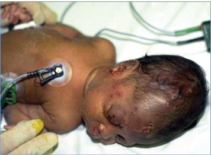

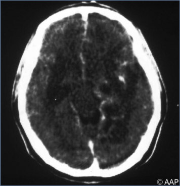

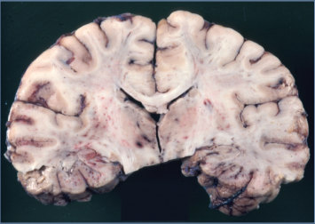

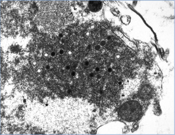

## PDF page 404 | printed page 390

Image 67.21 Burned-out neonatal herpes simplex encephalitis. Severe atrophy and distortion of the cerebral hemispheres. Courtesy of Dimitris P. Agamanolis, MD.

Image 67.23 Herpes simplex esophagitis. Courtesy of Dimitris P. Agamanolis, MD.

Image 67.25 Herpes simplex infection in a 4-year-old boy with eczema (Kaposi varicelliform eruption). Courtesy of Ed Fajardo, MD.

Image 67.22 Histopathologic changes observable in brain tissue, caused by herpes simplex encephalitis (hematoxylin-eosin stain, magnification 3125). Herpes simplex encephalitis is characterized by headaches, fever, and altered mental state caused by inflammation of the brain. Herpes simplex virus, the cause of herpes simplex encephalitis, is one of the main causes of non-epidemic, sporadic encephalitis. Courtesy of Centers for Disease Control and Prevention.

Image 67.24 This male patient presented with primary vesiculopapular herpes genitalis lesions on his glans penis and penile shaft. When signs of herpes genitalis occur, they typically appear as 1 or more blisters on or around the genitals or rectum. The blisters break, leaving tender ulcers (sores) that may take 2 to 4 weeks to heal the first time they occur. Courtesy of Centers for Disease Control and Prevention.

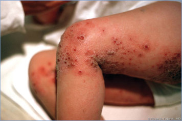

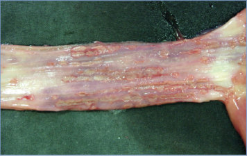

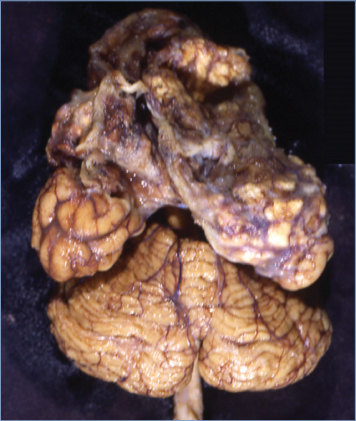

## PDF page 405 | printed page 391

Image 67.26 A 15-year-old girl with recurrent facial and ocular herpes simplex infection. Courtesy of Larry Frenkel, MD.

Image 67.28 A 2-year-old boy with herpes simplex infection of the finger. Courtesy of Larry Frenkel, MD.

Image 67.30 This negatively stained transmission electron micrograph reveals the presence of numerous herpesvirus virions, members of the Herpesviridae virus family. Courtesy of Centers for Disease Control and Prevention.

Image 67.27 A 15-year-old girl with recurrent facial and ocular herpes simplex infection. This is the same patient as in Image 67.26. Courtesy of Larry Frenkel, MD.

Image 67.29 A 15-year-old girl with primary herpes simplex infection of the genital area. Courtesy of Larry Frenkel, MD.

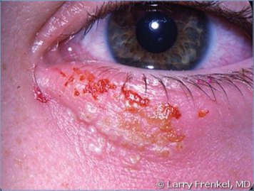

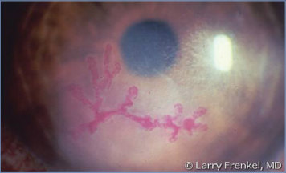

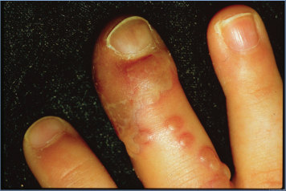

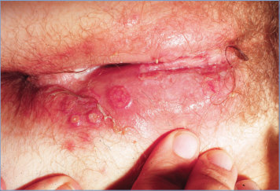

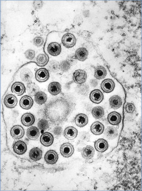

## PDF page 406 | printed page 392

Image 67.31 Electron micrograph image of herpesvirus (negative stain). A viral envelope surrounds the nucleocapsid, which measures approximately 100 nm and is composed of an icosahedron formed by hollow capsomers. Courtesy of Centers for Disease Control and Prevention.

Image 67.32 Herpesvirus, electron micrograph. Copyright Charles Prober, MD.

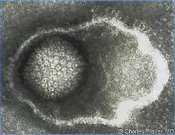
