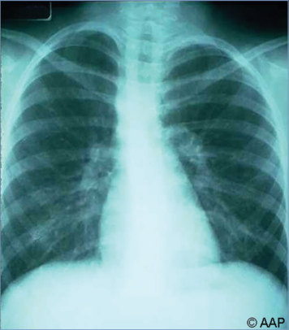
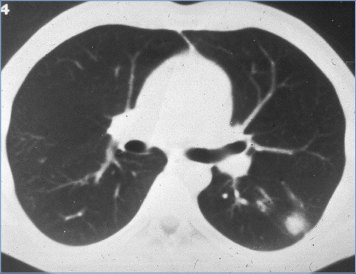
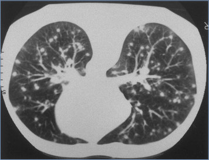
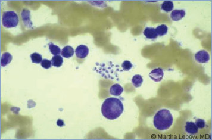
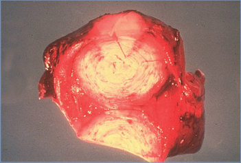
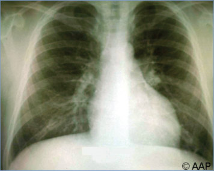
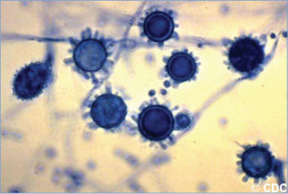

# 68. Histoplasmosis
> Private study reference ([source credits](../../SOURCE_CREDITS.md)). PDF pages 407-411; printed pages 393-397.

## PDF page 407 | printed page 393

### CLINICAL MANIFESTATIONS

Histoplasma capsulatum causes symptoms in fewer than 5% of infected people. Clinical manifestations are classified according to site (pulmonary or disseminated), duration (acute, subacute, or chronic), and pattern (primary or reactivation) of infection. Most symptomatic patients have acute pulmonary histoplasmosis, a brief, selflimited illness characterized by fever, chills, nonproductive cough, and malaise. Radiographic findings may consist of hilar or mediastinal adenopathy, diffuse interstitial or reticulonodular pulmonary infiltrates, or pulmonary nodules. Most patients recover without treatment 2 to 3 weeks after onset of symptoms.

Exposure to a large inoculum of conidia can cause severe pulmonary infection associated with high fevers, hypoxemia, diffuse reticulonodular infiltrates, and acute respiratory distress syndrome. Mediastinal involvement, a rare complication of pulmonary histoplasmosis, includes mediastinal lymphadenitis, which can cause airway encroachment in young children. Inflammatory syndromes (pericarditis and rheumatologic syndromes) can develop; erythema nodosum can occur in adolescents and adults. Primary cutaneous infections after trauma are uncommon. Chronic cavitary pulmonary histoplasmosis is extremely rare in children.

Progressive disseminated histoplasmosis (PDH) may occur in otherwise healthy infants and children younger than 2 years or in older children with primary or acquired cellular immune dysfunction. It can be a rapidly progressive illness following acute infection or can be a more chronic, slowly progressive disease. Early manifestations of PDH in children include prolonged fever, failure to thrive, and hepatosplenomegaly; if untreated, malnutrition, diffuse adenopathy, pneumonitis, mucosal ulceration, pancytopenia, disseminated intravascular coagulopathy, and gastrointestinal tract bleeding can ensue. PDH in older children and adults occurs most often in people with underlying immune deficiency (eg, HIV/AIDS, solid organ transplant, hematologic malignancy, and biologic response modifiers including tumor necrosis factor antagonists). Central nervous

system involvement occurs in 5% to 10% of patients with disseminated disease. Manifestations include chronic meningitis, focal brain or spinal cord lesions, encephalitis, stroke, and hydrocephalus. Chronic PDH generally occurs in adults with immune suppression and is characterized by prolonged fever, night sweats, weight loss, and fatigue; signs include hepatosplenomegaly, mucosal ulcerations, adrenal insufficiency, and pancytopenia. Clinicians should be alert to the risk of disseminated endemic mycoses in patients receiving tumor necrosis factor-a antagonists and disease-modifying antirheumatic drugs.

### ETIOLOGY

Histoplasma strains, which may be classified into at least 8 distinct clades, are thermally dimorphic, endemic fungi that grow in the environment as a spore-bearing mold but convert to the yeast phase at 37°C.

### EPIDEMIOLOGY

H capsulatum is highly endemic in the central and eastern United States, particularly the Mississippi, Ohio, and Missouri River valleys; Central America; the northernmost part of South America; and Argentina, but it can be found in most parts of the world (including Africa, the Americas, Asia, and Europe). H capsulatum case distribution may be affected by a warming climate. H capsulatum var duboisii is found only in central and western Africa.

Infection is acquired following inhalation of conidia that are aerosolized by disturbance of soil, especially when contaminated with bat guano or bird droppings. Infections occur sporadically or rarely in point-source epidemics after exposure to activities that disturb contaminated sites. In regions with endemic disease, recreational activities, such as playing in hollow trees and caving, and occupational activities, such as construction, excavation, demolition, farming, and cleaning of contaminated buildings, have been associated with outbreaks. Person-to-person transmission may occur via transplantation of infected organs, vertical transmission, and possibly through exposure to cutaneous lesions. Prior infection confers partial immunity; reinfection can occur but may require a larger inoculum.

The incubation period is variable but usually is 3 to 17 days.

## PDF page 408 | printed page 394

### DIAGNOSTIC TESTS

Detection of H capsulatum polysaccharide antigen in serum, urine, bronchoalveolar lavage fluid, or cerebrospinal fluid using a quantitative enzyme immunoassay is the preferred method of testing. Antigen detection is most sensitive for progressive disseminated infections. Combining both urine and serum antigen testing increases the likelihood of antigen detection. Results often are transiently positive early in the course of acute, self-limited pulmonary infections. A negative test result does not exclude infection. If the result initially is positive, the antigen test also is useful for monitoring treatment response and, thereafter, identifying relapse or reinfection. Cross-reactions may occur in patients with dimorphic fungal diseases (eg, blastomycosis, coccidioidomycosis, paracoccidioidomycosis, sporotrichosis, Emergomyces africanus disease, and talaromycosis [formerly penicilliosis]); clinical and epidemiologic distinctions aid in differentiating these entities.

Antibody detection testing is available and is most useful in patients with subacute or chronic pulmonary disease and central nervous system involvement. Enzyme immunoassay, complement fixation, and immunodiffusion are available. A fourfold increase in mycelial-phase complement fixation titers or a single titer of ≥1:32 in either test is strong presumptive evidence of active or recent infection in patients exposed to or residing within endemic regions. Cross-reacting antibodies can result most commonly from Blastomyces and Coccidioides species. The immunodiffusion test is a qualitative method that is more specific, but slightly less sensitive than the complement fixation test. It commonly is used in conjunction with the complement fixation test and detects the H and M glycoproteins of H capsulatum found in histoplasmin. The M band develops with acute infection, generally by 6 weeks after infection; is often present in chronic forms of histoplasmosis; and persists for months to years after the infection has resolved. The H band is much less common; is rarely, if ever, found without an M band; and is indicative of chronic or severe acute forms of histoplasmosis.

Culture is the definitive method of diagnosis. H capsulatum organisms from bone marrow, blood, sputum, and tissue specimens grow in the mycelia (mold) phase on standard mycologic media, including Sabouraud dextrose or potato dextrose

agar incubated at 25°C to 30°C in 1 to 6 weeks. The yeast phase of the organism can be recovered on primary culture using enriched media, such as brain-heart infusion agar with blood (BHIB) incubated at 35°C to 37°C. Mycelial-phase organisms in culture can be confirmed as H capsulatum by conversion to yeast-phase organisms by repeated passage on BHIB at 35°C to 37°C. The lysiscentrifugation method is preferred for blood and bone marrow cultures. A DNA probe for H capsulatum permits rapid identification of cultured isolates. Care should be taken in working with the organism in the laboratory, because mold-phase growth may release large numbers of infectious microconidia into the air.

Demonstration of typical intracellular yeast forms by examination with Wright or Giemsa stains of blood, bone marrow, or bronchoalveolar lavage specimens strongly supports the diagnosis of histoplasmosis when clinical, epidemiologic, and other laboratory studies are compatible.

### TREATMENT1

Immunocompetent children with uncomplicated or mild-to-moderate acute pulmonary histoplasmosis may not require antifungal therapy, because infection usually is self-limited. If the patient does not improve within 4 weeks, itraconazole should be given for 6 to 12 weeks.

Treatment is imperative for all forms of disseminated histoplasmosis, which can be either an acute (rapid onset and progression, usually in an immunocompromised patient) or chronic (slower evolution, usually in an immunocompetent patient) illness. Treatment with a lipid formulation of amphotericin B is recommended for severe acute pulmonary infection. Methylprednisolone during the first 1 to 2 weeks of therapy may be considered if severe respiratory complications develop but should be used only in conjunction with antifungals.

After clinical improvement occurs in 1 to 2 weeks, itraconazole is recommended for an additional 12 weeks. Itraconazole is preferred over other mold-active azoles by most experts; when used in adults, itraconazole is more effective, has fewer adverse effects, and is less likely to induce resistance than is fluconazole. Serum trough concentrations of itraconazole should be 1 to 2 mg/mL. A trough level should be checked 10 days or later following initiation to ensure adequate drug

## PDF page 409 | printed page 395

exposure. When measured by high-pressure liquid chromatography, both itraconazole and its bioactive hydroxyitraconazole metabolite are reported, the sum of which should be considered in assessing the trough concentration. The itraconazole oral solution formulation is preferred over the capsule formulation because of improved absorption and should be taken on an empty stomach. However, a super bioavailable itraconazole is now approved by the U.S. Food and Drug Administration for the treatment of pulmonary and extrapulmonary blastomycosis in individuals 18 years or older, with pharmacokinetic studies of this formulation demonstrating less variable absorption than conventional itraconazole capsules and a similar side effect profile; data in children are lacking.

All patients with chronic pulmonary histoplasmosis (eg, progressive cavitation of the lungs) should be treated. Mild to moderate cases should be treated with itraconazole for 1 to 2 years. Severe cases should be treated initially with a lipid formulation amphotericin B followed by itraconazole for the same duration.

Mediastinal and inflammatory manifestations of infection generally do not need to be treated with antifungal agents. Mediastinal adenitis that causes obstruction of a bronchus, the esophagus, or another mediastinal structure may improve with a brief course of corticosteroids. In these instances, itraconazole should be used concurrently and continued for 6 to 12 weeks thereafter. Dense fibrosis of mediastinal structures without an associated granulomatous inflammatory component does not respond to antifungal therapy, and surgical intervention may be necessary for severe cases. Pericarditis and rheumatologic syndromes may respond to treatment with nonsteroidal anti-inflammatory agents (indomethacin).

For treatment of moderately severe to severe PDH in an infant or child, a lipid formulation of amphotericin B is the drug of choice and usually is given for a minimum of 2 weeks. When the child has demonstrated substantial clinical improvement and a decline in the serum concentration of Histoplasma antigen, oral itraconazole is administered for a total of at least 12 months. Lifelong suppressive therapy with itraconazole may be required for patients with primary immunodeficiency syndromes, acquired immunodeficiency that cannot be reversed, or patients who relapse

despite appropriate therapy. For those with mild to moderate PDH, itraconazole for at least 12 months is recommended. After completion of treatment for PDH, urine antigen concentrations should be monitored for 12 months. Stable, low, and decreasing concentrations that are unaccompanied by signs of active infection may not necessarily require prolongation or resumption of treatment.

### INFECTION PREVENTION AND CONTROL MEASURES IN HEALTH CARE SETTINGS

Standard precautions are recommended.

### CONTROL MEASURES

Histoplasmosis is a reportable disease in some states. Investigation for a common source of infection is indicated in outbreaks. Exposure to soil and dust from areas with significant accumulations of bird and bat droppings should be avoided, especially by immunocompromised individuals, including those receiving tumor necrosis factor inhibitors or disease-modifying antirheumatic drugs. If exposure is unavoidable, it should be minimized through use of respiratory protection (eg, N95 or higher respirator), gloves, and disposable clothing. Although an N95 or higher respirator is adequate in most circumstances, in environments with extremely high inoculum, powered air purifying respirators with highefficiency particulate air filters are recommended.

Areas suspected of being contaminated with Histoplasma species should be remediated. Old or abandoned structures likely to have been contaminated with bird or bat droppings should be saturated with water to reduce aerosolization of spores during demolition. Guidelines for preventing histoplasmosis have been designed for health and safety professionals, environmental consultants, and people supervising workers involved in activities in which contaminated materials are disturbed. Additional information about these guidelines is available from the National Institute for Occupational Safety and Health at www.cdc. gov/niosh/topics/histoplasmosis/default.html.

1 Thompson GR III, Le T, Chindamporn A, et al. Global guideline for the diagnosis and management of the endemic mycoses: an initiative of the European Confederation of Medical Mycology in cooperation with the International Society for Human and Animal Mycology [Erratum in: Lancet Infect Dis. 2021;21(11):e341]. Lancet Infect Dis. 2021;21(12):e364–e374

## PDF page 410 | printed page 396

Image 68.1 Acute, primary histoplasmosis in a 13-year-old girl. Progressive disseminated histoplasmosis is unusual in otherwise healthy children.

Image 68.3 Computed tomographic scan of lungs showing classic snowstorm appearance of acute histoplasmosis. Courtesy of Centers for Disease Control and Prevention.

Image 68.2 Computed tomographic scan showing a single pulmonary nodule of histoplasmosis. Courtesy of Centers for Disease Control and Prevention.

Image 68.4 Histoplasma capsulatum in peripheral blood smear. Copyright Martha Lepow, MD.

## PDF page 411 | printed page 397

Image 68.5 Gross pathological specimen of lung showing cut surface of fibrocaseous nodule caused by Histoplasma capsulatum. Courtesy of Centers for Disease Control and Prevention.

Image 68.7 This photomicrograph shows the smooth macroconidia of the Jamaican isolate of Histoplasma capsulatum. H capsulatum is a dimorphic fungus (ie, it morphologically grows in 2 different forms). It takes a mycelial form when grown at a lower temperature (ie, 25°C [77°F]), creating macroconidia, and a yeast form when grown at 35°C (95°F), on enriched media. Courtesy of Centers for Disease Control and Prevention.

Image 68.9 This photomicrograph reveals a conidiophore of the fungus Histoplasma capsulatum. H capsulatum grows in soil and material contaminated with bat or bird droppings. Spores become airborne when contaminated soil is disturbed. Breathing the spores causes pulmonary histoplasmosis. Courtesy of Centers for Disease Control and Prevention.

Image 68.6 A preadolescent with left bilateral calcified hilar lymph nodes secondary to histoplasmosis.

Image 68.8 Asexual spores (conidia). Tuberculate macroconidia of Histoplasma capsulatum (toluidine blue stain). Microconidia are also present. Courtesy of Centers for Disease Control and Prevention.

Image 68.10 Pictured is a Sabhi agar plate culture of the fungus Histoplasma capsulatum grown at 20°C (68°F). Positive results from a histoplasmin skin test occur in as many as 80% of the people living in areas where H capsulatum is common, such as the eastern and central United States. Courtesy of Centers for Disease Control and Prevention.

