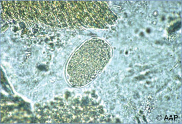
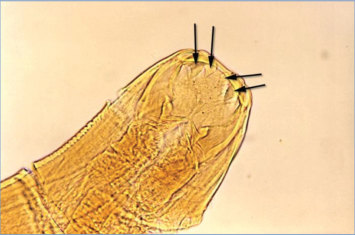

# 69. Hookworm Infections (Necator americanus and Ancylostoma species)
> Private study reference ([source credits](../../SOURCE_CREDITS.md)). PDF pages 412-416; printed pages 398-402.

## PDF page 412 | printed page 398

(Necator americanus and Ancylostoma species)

### CLINICAL MANIFESTATIONS

Early manifestations of hookworm infection may relate to skin penetration (stinging, burning, pruritus [“ground itch”], rash), migration through the lungs (Löffler-like pneumonitis), and early infection in the intestines (colicky abdominal pain, nausea, diarrhea). Wakana syndrome, characterized by pharyngeal itching, hoarseness, nausea, vomiting, cough, and dyspnea, may develop after ingestion of Ancylostoma duodenale larvae. These early features are usually mild. Individuals who are chronically infected may also have mild nonspecific or no symptoms. However, the most common clinical manifestation from chronic infection is iron deficiency anemia resulting from direct blood loss at the site where adult worms attach to the mucosa of the small intestine. Blood loss secondary to hookworm infection begins 5 to 8 weeks after initial infection. Chronic hookworm infection is a common cause of moderate and severe hypochromic, microcytic anemia in people living in resource-limited tropical countries, and heavy infection can also cause hypoproteinemia with edema. Chronic infection in children may lead to physical growth delay, deficits in cognition, and developmental delay.

### ETIOLOGY

Hookworms are intestinal parasites that are included in the group of nematode pathogens infecting millions of people worldwide called soil-transmitted helminths (STHs). The anthropophilic species infecting humans include Necator americanus and A duodenale. A third species, Ancylostoma ceylanicum, is known to infect dogs and cats but is also highly prevalent among humans in focal areas across the globe. Several other zoonotic hookworms that can cause human disease (Ancylostoma braziliense, Ancylostoma caninum, Uncinaria stenocephala) mainly are responsible for causing cutaneous larva migrans when filariform larvae penetrate the skin and migrate in the upper dermis, causing an intensely pruritic track. A caninum rarely can migrate to the intestine and cause eosinophilic enteritis.

### EPIDEMIOLOGY

Hookworm is the third most common human STH infection following ascariasis and trichuriasis. It has worldwide distribution but is most prominent in rural, tropical, and subtropical areas where soil is conducive to organism development and where contamination with human feces is common. N americanus is the most widespread and prevalent human hookworm. Human hookworm infections occur in the Americas, Africa, Asia, Australia, on a number of Pacific islands, and in the Mediterranean region. Hookworm larvae and eggs survive in loose, sandy, moist, shady, well-aerated, warm soil (optimal temperature 23°C–33°C [73°F–91°F]). Hookworm eggs from stool hatch in soil in 1 to 2 days as rhabditiform larvae. These larvae develop into infective filariform larvae in soil within 5 to 10 days and can survive for 3 to 4 weeks. N americanus and Ancylostoma transmission occur via skin penetration. A duodenale infection can also occur via oral ingestion of third-stage larvae, including from human milk. Untreated infected patients can remain colonized with A duodenale for approximately 1 year and can remain colonized with N americanus for approximately 3 to 5 years.

The incubation period from exposure to development of noncutaneous symptoms is 4 to 12 weeks. Eggs appear in feces approximately 5 to 8 weeks from the time of infection.

### DIAGNOSTIC TESTS

Microscopy of stool to identify eggs morphologically is the most common method for diagnosing hookworm infections. Microscopy can be performed on fresh or frozen stool samples, with direct smears or stools preserved with fixatives such as formalin; preserving stool decreases sensitivity. There are several concentrating methods that can improve sensitivity and estimation of burden of disease through egg counting (formalin-ether concentration, Kato-Katz method, McMaster technique, FLOTAC, and mini-FLOTAC). Most commercial laboratories in the United States rely on preserved stool samples and use the formalinether concentration method or a variation thereof. Multiple samples may be needed to detect infection; some experts recommend examining at least 3 consecutive samples using concentration

## PDF page 413 | printed page 399

techniques when index of suspicion of infection is high. Molecular techniques include qualitative or quantitative nucleic acid amplification tests and multiplex polymerase chain reaction assays, but these are only available in the United States through research laboratories.

Nonspecific laboratory tests may include those for peripheral eosinophilia, anemia, and hypoproteinemia. Cutaneous larva migrans attributable to transient cutaneous infection with dog or cat hookworms is diagnosed clinically.

### TREATMENT

Albendazole and mebendazole are recommended, and pyrantel pamoate is an effective alternative in the treatment of hookworm infection; only mebendazole is approved by the U.S. Food and Drug Administration for this indication. Albendazole should be taken with food; a fatty meal increases oral bioavailability. Pyrantel pamoate suspension can be mixed with milk or fruit juice. Studies in children as young as 1 year of age suggest that albendazole can be administered safely to this population. Retreatment is indicated for persistent or recurrent infection. Nutritional supplementation, including iron, is important when addressing associated iron

deficiency anemia. Severely affected children may require blood transfusion.

### INFECTION PREVENTION AND CONTROL MEASURES IN HEALTH CARE SETTINGS

Standard precautions are recommended. Direct person-to-person transmission does not occur.

### CONTROL MEASURES

Sanitary disposal of feces to prevent contamination of soil is necessary in areas with endemic infection. Treatment of all known infected people and screening of high-risk groups (ie, children and agricultural workers) in areas with endemic infection may help decrease environmental contamination. Wearing shoes protects against hookworm infection, although infection risk remains if other body surfaces are in contact with the soil. Periodic deworming treatments targeting preschool-aged and school-aged children have been advocated to prevent morbidity associated with heavy intestinal helminth infections. Certain populations immigrating to the United States (eg, refugees) receive presumptive albendazole treatment for STHs, including hookworm, before departure for the United States.

## PDF page 414 | printed page 400

Image 69.1 This child with hookworm shows visible signs of edema and had a diagnosis of anemia as well. Courtesy of Centers for Disease Control and Prevention.

Image 69.2 This enlargement shows hookworms, Ancylostoma caninum, attached to the intestinal mucosa. Barely visible larvae penetrate the skin (often through bare feet), are carried to the lungs, go through the respiratory tract to the mouth, are swallowed, and eventually reach the small intestine. This journey takes about 1 week. Courtesy of Centers for Disease Control and Prevention.

## PDF page 415 | printed page 401

Image 69.3 This patient presented with a hookworm infection involving the toes of the right foot, which is also known as “ground itch.” Usually the first sign of infection is itching and a rash at the site where skin touched contaminated soil or sand, which occurs when the larvae penetrate the skin, followed by anemia, abdominal pain, diarrhea, loss of appetite, and weight loss. Courtesy of Centers for Disease Control and Prevention.

Image 69.5 Hookworm eggs examined on wet mount (eggs of Ancylostoma duodenale and Necator americanus cannot be morphologically distinguished). Diagnostic characteristics: 57–76 mm 3 35–47 mm, oval or ellipsoidal, thin shell. The embryo (right) has begun cellular division and is at an early developmental stage (gastrula). Courtesy of Centers for Disease Control and Prevention.

Image 69.6 This micrograph reveals the head of the hookworm Necator americanus and its mouth’s cutting plates (magnification 3400). The hookworm uses these sharp cutting teeth to grasp firmly to the intestinal wall and, while remaining fastened in place, ingests the host’s blood, obtaining its nutrients in this fashion. Courtesy of Centers for Disease Control and Prevention.

Image 69.4 Hookworm (Necator americanus) ova in stool preparation.

## PDF page 416 | printed page 402

Image 69.7 This unstained micrograph reveals the Ancylostoma duodenale hookworm’s mouth parts (magnification 3125). Courtesy of Centers for Disease Control and Prevention.

4

Filariform larva penetrates skin

3

Filariform larva

2

Rhabditiform larva hatches

1

Eggs in feces

d

Image 69.8 Eggs are passed in the stool (1), and under favorable conditions (ie, moisture, warmth, shade), larvae hatch in 1 to 2 days. The released rhabditiform larvae grow in the feces and/or the soil (2), and after 5 to 10 days (and 2 molts), they become filariform (third-stage) larvae that are infective (3). These infective larvae can survive 3 to 4 weeks in favorable environmental conditions. On contact with the human host, the larvae penetrate the skin and are carried through the veins to the heart and then to the lungs. They penetrate into the pulmonary alveoli, ascend the bronchial tree to the pharynx, and are swallowed (4). The larvae reach the small intestine, where they reside and mature into adults. Adult worms live in the lumen of the small intestine, where they attach to the intestinal wall with resultant blood loss by the host (5). Most adult worms are eliminated in 1 to 2 years, but longevity records can reach several years. Some Ancylostoma duodenale larvae, following penetration of the host skin, can become dormant (in the intestine or muscle). In addition, infection by A duodenale may also occur by the oral and transmammary route. Necator americanus, however, requires a transpulmonary migration phase. Courtesy of Centers for Disease Control and Prevention.

i

5

Adults in small intestine

= Infective stage

i

= Diagnostic stage

d

![Image 69.8 Eggs are passed in the stool (1), and under favorable conditions (ie, moisture, warmth, shade), larvae hatch in 1 to 2 days. The released rhabditiform larvae grow in the feces and/or the soil (2), and after 5 to 10 days (and 2 molts), they become filariform (third-stage) larvae that are infective (3). These infective larvae can survive 3 to 4 weeks in favorable environmental conditions. On contact with the human host, the larvae penetrate the skin and are carried through the veins to the heart and then to the lungs. They penetrate into the pulmonary alveoli, ascend the bronchial tree to the pharynx, and are swallowed (4). The larvae reach the small intestine, where they reside and mature into adults. Adult worms live in the lumen of the small intestine, where they attach to the intestinal wall with resultant blood loss by the host (5). Most adult worms are eliminated in 1 to 2 years, but longevity records can reach several years. Some Ancylostoma duodenale larvae, following penetration of the host skin, can become dormant (in the intestine or muscle). In addition, infection by A duodenale may also occur by the oral and transmammary route. Necator americanus, however, requires a transpulmonary migration phase. Courtesy of Centers for Disease Control and Prevention.](../../figures/ch069_p0416_01.jpg)

