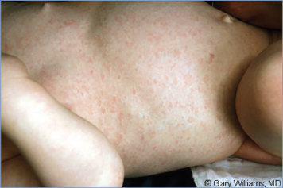
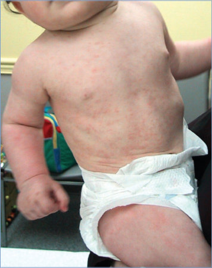
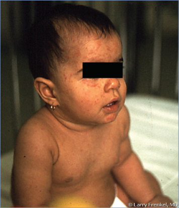

# 70. Human Herpesvirus 6 (Including Roseola) and 7
> Private study reference ([source credits](../../SOURCE_CREDITS.md)). PDF pages 417-421; printed pages 403-407.

## PDF page 417 | printed page 403

### CLINICAL MANIFESTATIONS

Human herpesvirus 6 comprises 2 distinct viral species, HHV-6B and HHV-6A. Clinical manifestations of primary infection with human herpesvirus 6B (HHV-6B) commonly include fever, fussiness, and rhinorrhea; generalized rash occurs in almost one-third of children and roseola (exanthem subitum) occurs in 20% to 25%. Acute HHV-6B infection may also be accompanied by cervical and characteristic postoccipital lymphadenopathy, gastrointestinal tract or respiratory tract signs, and inflamed tympanic membranes. Fever may be high (temperature > 39.5°C [103.0°F]) and persist for 3 to 7 days. Approximately 20% of all emergency department visits for febrile children 6 through 12 months of age are attributable to HHV-6B. Roseola is distinguished by an erythematous maculopapular rash that typically appears once fever resolves and can last hours to days. Febrile seizures, sometimes leading to status epilepticus, are the most common complication and reason for hospitalization among children with primary HHV-6B infection. Primary HHV-6B infection has been shown to account for 20% to 30% of firsttime febrile seizures in young children evaluated in emergency care settings. Other reported neurologic manifestations include a bulging fontanelle and encephalopathy or, rarely, encephalitis, the latter more commonly noted in infants in Japan than in the United States or Europe. Hepatitis has been reported as a rare manifestation of primary HHV-6B infection. In contrast to HHV-6B, primary infection with HHV-6A has not been associated with any recognized disease. Congenital infection with HHV-6B and HHV-6A, which occurs in approximately 1% of newborn infants, has not been linked to any clinical disease, and most cases have been shown to be attributable to inherited chromosomally integrated HHV-6 (iciHHV-6).

The clinical manifestations occurring with human herpesvirus 7 (HHV-7) infection are less clear than with HHV-6B. Most primary infections with HHV-7 presumably are asymptomatic or mild and not distinctive. Some initial infections can present as typical roseola and may account for second or recurrent cases of roseola. Febrile

illnesses associated with seizures also have been documented to occur during primary HHV-7 infection.

Following infection, HHV-6B, HHV-6A, and HHV-7 remain in a latent state and may reactivate. The clinical circumstances and manifestations of reactivation in healthy people are unclear. Illness associated with HHV-6B reactivation has been described primarily among recipients of solid organ and hematopoietic cell transplants. Clinical findings associated with HHV-6B reactivation include fever, rash, hepatitis, bone marrow suppression, acute graft-versus-host disease, graft rejection, pneumonia, delirium, and encephalitis. The best characterized of these is posttransplantation acute limbic encephalitis, a specific syndrome associated with HHV-6B reactivation in the central nervous system characterized by anterograde amnesia, seizures, insomnia, confusion, and the syndrome of inappropriate antidiuretic hormone secretion. It is estimated that approximately 2% of allogeneic hematopoietic cell transplant recipients will experience HHV-6B encephalitis, with cord blood transplant recipients being at highest risk. Significant morbidity and mortality have been attributed to this complication. A few cases of central nervous system symptoms have been reported in association with HHV-7 reactivation in immunocompromised hosts, but clinical findings generally have been reported much less frequently with HHV-7 than with HHV-6B reactivation.

### ETIOLOGY

HHV-6B, HHV-6A, and HHV-7 are lymphotropic viruses that are closely related members of the Herpesviridae family, subfamily Betaherpesvirinae. As betaherpesviruses, HHV-6B, HHV-6A, and HHV-7 are most closely related to cytomegalovirus. As with all human herpesviruses, they establish lifelong latency after initial acquisition. In 2012, HHV-6A and HHV-6B were recognized as distinct species rather than as variants of the same species. This increased the number of known human herpesviruses to 9.

### EPIDEMIOLOGY

HHV-6B and HHV-7 cause ubiquitous infections in children worldwide. Humans are the only known natural host. Nearly all children acquire HHV-6B infection within the first 2 years of life, probably from contact with asymptomatically shed infectious virus from upper respiratory

## PDF page 418 | printed page 404

secretions of a healthy family member or other close contact. Virus-specific antibody in pregnant people, which is present uniformly in the sera of infants at birth, provides transient partial protection. As transplacentally acquired antibody concentration decreases during the first year of life, the infection rate increases rapidly, peaking between 6 and 24 months of age. During the acute phase of primary infection, HHV-6B and HHV-7 can be isolated from peripheral blood mononuclear cells and HHV-7 from saliva of some children. Viral DNA subsequently may be detected throughout life by a nucleic acid amplification test (NAAT) in multiple body sites, including blood mononuclear cells, saliva, and salivary glands. Infections occur throughout the year without a seasonal pattern. Secondary cases rarely are identified. Occasional outbreaks of roseola have been reported.

Several genetic mutations have been associated with severe central nervous system disease during primary HHV-6B infection. These include RandBP2, POLG, and carnitine palmitoyltransferase 2 gene mutations.

Congenital infection occurs in approximately 1% of newborn infants, as determined by the presence of HHV-6A or HHV-6B DNA in cord blood. Most congenital infections appear to result from the germline passage of iciHHV-6 from either parent, a unique mechanism of transmission of human viral congenital infection. Transplacental HHV-6 infection also may occur from reinfection or reactivation of HHV-6 in the pregnant person or possibly from reactivated iciHHV-6 in the pregnant person. HHV-6 has not been identified in human milk. Congenital infection typically is asymptomatic, and the clinical implications of iciHHV-6 are not fully known. However, reactivation of iciHHV-6 in severely immunocompromised hosts is possible and can be associated with disease.

HHV-7 infection usually occurs later in childhood than HHV-6B infection. By adulthood, the seroprevalence of HHV-7 is approximately 85%. Infectious HHV-7 is present in more than 75% of saliva specimens obtained from healthy adults. Acquisition of virus via infected respiratory tract secretions of healthy contacts is the probable mode of transmission of HHV-7 to young children. HHV-7 DNA has been detected in human milk,

peripheral blood mononuclear cells, cervical secretions, and other body sites. Congenital HHV-7 infection has not been demonstrated.

The mean incubation period for HHV-6B is 9 to 10 days. For HHV-7, the incubation period is not known.

### DIAGNOSTIC TESTS

Multiple assays for detection of HHV-6 and HHV-7 DNA have been developed; some are available commercially, but because laboratory diagnosis of HHV-6 or HHV-7 usually does not influence clinical management (infections among the severely immunocompromised are an exception), these tests have limited utility in clinical practice.

Reference laboratories offer diagnostic testing for HHV-6B, HHV-6A, and HHV-7 infections by detection of viral DNA by NAAT in blood, cerebrospinal fluid (CSF), other body fluids, or tissue specimens. However, detection of HHV-6A, HHV-6B, or HHV-7 DNA by NAAT might not differentiate between new infection, persistence or reactivation of virus from past infection, or iciHHV-6. At least 1 multiplexed NAAT diagnostic panel designed to detect agents of meningitis and encephalitis in CSF containing HHV-6 as one of its target pathogens has been cleared by the U.S. Food and Drug Administration; however, given the prevalence of iciHHV-6 (1%), which yields a positive CSF NAAT result, a positive test result should be interpreted with caution in a patient with no underlying risk factors and no findings to suggest encephalitis. Quantitative NAATs have been used for monitoring the effectiveness of antiviral treatment in immunocompromised patients with viral reactivation.

Inherited chromosomal integration of HHV-6 is suggested when NAAT results are consistently positive for HHV-6 DNA in whole blood, tissue, or other fluids, often with high viral loads (eg, 1 3 106 copies in whole blood, which with a normal white blood cell count is approximately 1 copy of HHV-6 DNA per nucleated cell). Droplet digital polymerase chain reaction or quantitative comparison of viral DNA copies to human cell number copies in whole blood samples may also be used to identify iciHHV-6. iciHHV-6 can be suggested by testing whole blood from both parents to see if one of them has a high viral load and can be confirmed by detection of HHV-6 DNA in hair follicles in research settings.

## PDF page 419 | printed page 405

HHV-6 viral loads in acellular fluids, such as plasma and CSF, are variable in people with iciHHV-6 because of unpredictable degrees of contamination with cell contents and cannot be used to infer chromosomal integration.

Serologic tests including immunofluorescent antibody assay, virus neutralization, immunoblot, and enzyme immunoassay are often difficult to interpret. A fourfold increase in serum antibody concentration alone does not necessarily indicate new infection, because an increase in titer may occur with reactivation and in association with other infections, especially other betaherpesvirus infections. However, documented seroconversion is considered evidence of recent primary infection in infants and young children, and serologic tests may be useful for epidemiologic studies. Detection of specific immunoglobulin (Ig) M antibody is not reliable for diagnosing new infection, because IgM antibodies to HHV-6 and HHV-7 are not always detectable in children with primary infection and also may be present in asymptomatic previously infected people. These antibody assays do not differentiate HHV-6A from HHV-6B infections. Detection of low-avidity HHV-6 or HHV-7 antibody with subsequent maturation to high-avidity antibody has been used in such situations to identify recent primary infection.

### TREATMENT

Management is supportive. The use of ganciclovir (and, therefore, valganciclovir) or foscarnet may be beneficial for immunocompromised patients with HHV-6B or HHV-7 disease and is recommended for treatment of HHV-6B encephalitis in hematopoietic cell and solid organ transplant patients. Antiviral resistance may occur. Routine monitoring of HHV-6 and HHV-7 DNA concentrations in blood during transplantation is not recommended. HHV-6 and HHV-7 have been reported as associated with various additional clinical syndromes in immunocompetent hosts, including multiple sclerosis, drug hypersensitivity, and uterine infection leading to infertility. None of these associations are generally accepted as etiologic, and treatment of HHV-6 or HHV-7 in association with these syndromes is not recommended.

### INFECTION PREVENTION AND CONTROL MEASURES IN HEALTH CARE SETTINGS

Standard precautions are recommended.

### CONTROL MEASURES

None.

## PDF page 420 | printed page 406

Image 70.1 A 13-month-old boy developed high fever that persisted for 4 days without recognized cause. The child appeared relatively well, and the fever subsided to be followed by a maculopapular rash that began on the trunk and spread to involve the face and extremities. The course was typical for roseola infantum. Courtesy of George Nankervis, MD.

Image 70.3 An 8-month-old with a temperature between 38.3°C and 39.4°C (101°F and 103°F) for 3 consecutive days. The child appeared well, with no additional symptoms aside from mild irritability and decreased appetite. After cessation of the fever, the patient developed a maculopapular rash heavy on the trunk, but, aside from this, the patient still appeared well. The rash resolved in the next 48 hours. The clinical course and rash are compatible with roseola. Copyright Stan Block, MD, FAAP.

Image 70.2 Roseola rash in a 10-month-old. Seizures are somewhat common during the febrile phase of primary infections. Copyright Gary Williams, MD.

Image 70.4 Clinical course and rash compatible with roseola. This is the same patient as in Image 70.3. Copyright Stan Block, MD, FAAP.

## PDF page 421 | printed page 407

Image 70.5 A toddler with the exanthem of roseola after several days of high fever. Courtesy of Larry Frenkel, MD.

Image 70.7 Thin-section electron micrograph image of human herpesvirus 7, which, like human herpesvirus 6, can cause roseola. Virions consist of a darkly staining core within the capsid that is surrounded by a proteinaceous tegument layer and enclosed within the viral envelope. Courtesy of Centers for Disease Control and Prevention.

Image 70.6 A 3-year-old with 2 days of bounding fever to 39.4°C (103°F). Although the child was febrile, he had still been active between fever spikes. He had a brief tonic-clonic seizure, but anticonvulsants were not started because of his well appearance at the emergency department. A febrile seizure was diagnosed. The fever resolved, but the child was restricted from child care because of a fine rash all over. He did not have symptoms at the time his rash developed, and roseola was diagnosed. Despite reassurance, school admission was refused until the rash faded. Courtesy of Will Sorey, MD.

![Image 70.6 A 3-year-old with 2 days of bounding fever to 39.4°C (103°F). Although the child was febrile, he had still been active between fever spikes. He had a brief tonic-clonic seizure, but anticonvulsants were not started because of his well appearance at the emergency department. A febrile seizure was diagnosed. The fever resolved, but the child was restricted from child care because of a fine rash all over. He did not have symptoms at the time his rash developed, and roseola was diagnosed. Despite reassurance, school admission was refused until the rash faded. Courtesy of Will Sorey, MD.](../../figures/ch070_p0421_02.jpg)

