# 72. Human Immunodeficiency Virus Infection
> Private study reference ([source credits](../../SOURCE_CREDITS.md)). PDF pages 424-445; printed pages 410-431.

## PDF page 424 | printed page 410

### CLINICAL MANIFESTATIONS

HIV infection results in a wide array of clinical manifestations. HIV type 1 (HIV-1) is much more common in the United States than HIV type 2 (HIV-2). Unless otherwise specified, this chapter addresses HIV-1 infection. AIDS is the name given to an advanced stage of HIV infection based on specific criteria for children, adolescents, and adults that are established by the Centers for Disease Control and Prevention (CDC).

Acute retroviral syndrome is estimated to develop in 40% to 90% of adolescents and adults within the first few weeks after they become infected with HIV and is characterized by nonspecific mononucleosis-like symptoms, including fever, malaise, lymphadenopathy, and skin rash.

Clinical manifestations of untreated pediatric HIV infection include unexplained fevers, generalized lymphadenopathy, hepatomegaly, splenomegaly, failure to thrive, persistent oral and diaper candidiasis, recurrent diarrhea, parotitis, hepatitis, central nervous system (CNS) disease (eg, encephalopathy, hyperreflexia, hypertonia, floppiness, developmental delay), lymphoid interstitial pneumonia, recurrent invasive bacterial infections, and viral, parasitic, and fungal opportunistic infections (OIs).2

In the era of antiretroviral therapy (ART), there has been a substantial decrease in frequency of all OIs. In the pre-ART era, the most common OIs observed among children in the United States were infections caused by invasive encapsulated bacteria, Pneumocystis jirovecii (previously called Pneumocystis carinii, hence the still-used acronym PCP for P carinii pneumonia), varicella-zoster virus, cytomegalovirus, herpes simplex virus, Mycobacterium avium complex, Cryptococcus neoformans, and Candida species. Less commonly observed opportunistic pathogens included Epstein-Barr virus, Mycobacterium tuberculosis, Cryptosporidium species, Cystoisospora (formerly Isospora) species, other enteric pathogens, Aspergillus species, and Toxoplasma gondii.

Immune reconstitution inflammatory syndrome (IRIS) is a paradoxical clinical deterioration often

seen in severely immunosuppressed individuals that occurs shortly after the initiation of ART. Local and/or systemic symptoms develop secondary to an inflammatory response as cell-mediated immunity is restored. IRIS is observed in patients with previous infections with mycobacteria (including M tuberculosis), bacille Calmette- Guérin vaccine, herpesviruses, and fungi (including Cryptococcus species).

Malignant neoplasms in children living with HIV infection are relatively uncommon, but leiomyosarcomas and non-Hodgkin B-cell lymphomas of the Burkitt type (including those in the CNS) occur more commonly in children living with HIV infection than in immunocompetent children. Kaposi sarcoma, caused by human herpesvirus 8, is rare in children in the United States but has been documented in children living with HIV who have emigrated from sub-Saharan African countries. The incidence of malignant neoplasms in children living with HIV has decreased during the ART era.

### ETIOLOGY

HIV-1 and HIV-2 are cytopathic lentiviruses (genus Lentivirus) belonging to the family Retroviridae. Four distinct genetic groups of HIV exist: M, N, O, and P. Group M viruses are the most prevalent worldwide and comprise 10 genetic subtypes, or clades, known as A, B, C, D, F, G, H, J, K, and L, each of which has a distinct geographic distribution.

HIV-2, the second AIDS-causing virus, is found predominantly in West Africa. Nine HIV-2 groups (A through I) have been documented, of which groups A and D are presently circulating. HIV-2 has a milder disease course with a longer time to development of AIDS than HIV-1. Accurate diagnosis of HIV-2 is important clinically, because HIV-2 is intrinsically resistant to nonnucleoside reverse transcriptase inhibitors and the fusion inhibitor enfuvirtide.

### EPIDEMIOLOGY

Humans are the only known reservoir for HIV-1 and HIV-2. Latent virus persists in peripheral blood mononuclear cells and in cells of the brain, bone marrow, and genital tract even when plasma viral load is undetectable. Only blood, semen, preseminal fluid, rectal fluids, cervicovaginal

## PDF page 425 | printed page 411

secretions, and human milk have been implicated in transmission of infection.

Established modes of HIV transmission include: (1) sexual contact (vaginal, anal, or orogenital); (2) percutaneous blood exposure (from contaminated needles or other sharp materials); (3) mucous membrane exposure to contaminated blood or other body fluids; (4) perinatal transmission during prepartum, intrapartum, and postpartum periods, including breastfeeding postnatally; and (5) transfusion with contaminated blood products. Cases of HIV transmission from caregivers living with HIV to children through feeding bloodcontaminated premasticated food and from contact of nonintact skin with blood-containing body fluids have been reported in the United States. As a result of highly effective screening assays and protocols, transfusion of blood, blood components, and clotting factors has virtually been eliminated as a cause of HIV transmission in the United States since 1985. Since the mid-1990s, the number of reported pediatric AIDS cases has decreased significantly, primarily because of effective measures to prevent perinatal transmission of HIV and the widespread availability of ART for children living with HIV.

In the absence of breastfeeding, the risk of HIV infection for infants born to untreated people living with HIV (PWH) in the United States is approximately 25%, with most transmission occurring near the time of delivery. Viral load of the birthing person is the most critical determinant of perinatal transmission of HIV, although transmission has been observed across the entire range of viral loads. Current U.S. guidelines recommend cesarean section before labor and before rupture of membranes at 38 completed weeks of gestation for PWH with HIV RNA >1,000 copies/mL (irrespective of antiretroviral [ARV] use in pregnancy) or unknown HIV RNA near time of delivery (within 4 weeks of delivery) to minimize perinatal transmission of HIV. Cesarean delivery is not needed for reduction of HIV perinatal transmission risk in people receiving ART with HIV RNA 1,000 copies/mL near time of delivery and should not be performed unless otherwise indicated (https:// clinicalinfo.hiv.gov/en/guidelines/perinatal/ intrapartum-care-for-people-withhiv?view=full).

The rate of acquisition of HIV infection among infants has decreased significantly in the United States. The rate of new HIV infections among adolescents and young adults aged 13 to 24 years overall also is decreasing but is increasing among young men who have sex with men (MSM) in this age group. HIV infection in adolescents occurs disproportionately among youth from racial or ethnic minority groups and is attributable primarily to sexual exposure.

### INCUBATION PERIOD

The usual age of onset of symptoms is approximately 12 to 18 months of age3 for untreated infants and children in the United States who acquire HIV infection through perinatal transmission. However, some children living with HIV become ill in the first few months of life, whereas others remain relatively asymptomatic for more than 5 years and, rarely, until early adolescence.

Acute retroviral syndrome occurring in adolescents and adults following HIV acquisition occurs 7 to 14 days following viral acquisition and lasts for 5 to 7 days. Only a minority of patients are ill enough to seek medical care for acute retroviral syndrome, although more may recall a prior viral illness when queried later.

### DIAGNOSTIC TESTS

Serologic Assays

Immunoassays are used widely as the initial test for serum HIV antibody or for p24 antigen (see below) and HIV antibody. Serologic assays that are cleared by the U.S. Food and Drug Administration (FDA) for the diagnosis of HIV include:

• Antigen/antibody combination immunoassays (fourth-generation tests) that detect HIV-1/ HIV-2 antibodies as well as HIV-1 p24 antigen (see below): recommended for initial testing

• HIV-1/HIV-2 immunoassays that detect both immunoglobulin (Ig) G and IgM (thirdgeneration antibody tests): alternative for initial testing

• HIV-1/HIV-2 antibody differentiation immunoassay that differentiates HIV-1 antibodies from HIV-2 antibodies (HIV-1/HIV-2 test): recommended for supplemental testing to confirm the results from the initial test

## PDF page 426 | printed page 412

• HIV-1 and HIV-2 antibodies (separate results for each) as well as p24 antigen (fifth-generation test): FDA cleared for initial HIV screening but not as a confirmatory test

The 2018 CDC HIV laboratory testing algorithm (https://stacks.cdc.gov/view/cdc/50872) recommends an initial FDA-approved HIV-1/HIV-2 antigen/antibody combination immunoassay (fourth-generation assay). Specimens with a reactive antigen/antibody immunoassay result should be tested with an FDA-approved HIV-1/HIV-2 antibody differentiation immunoassay. Specimens that are reactive on the initial antigen/antibody immunoassay and nonreactive or indeterminate on the HIV-1/HIV-2 antibody differentiation immunoassay should be tested with an FDA-approved HIV-1 nucleic acid amplification test (NAAT). If acute HIV infection or previously undiagnosed HIV with end-stage AIDS is suspected, virologic testing may be indicated because of false-negative antibody assay results in these populations.

Nucleic Acid Amplification Tests

Plasma HIV DNA or RNA assays have been used to diagnose HIV infection. DNA NAATs can detect 1 to 10 DNA copies of proviral DNA in peripheral blood mononuclear cells and are used qualitatively to diagnose HIV infection. Quantitative RNA NAATs (viral load) cleared by the FDA provide results that serve as a predictor of disease progression and are useful in monitoring changes in plasma HIV RNA levels during treatment with ART.

Table 72.1 Laboratory Diagnosis of HIV Infectiona

Test HIV DNA NAAT or RNA NAAT Preferred tests to diagnose HIV infection in infants and children younger than 18–24 months; highly sensitive and specific by 2 weeks of age and available; DNA test performed on peripheral blood mononuclear cells; RNA test performed on plasma. HIV p24 Ag Less sensitive, false-positive results during first month of life, variable results; not recommended. ICD p24 Ag Negative test result does not rule out infection; not recommended. HIV culture Expensive, not readily available, requires up to 4 weeks for results; not recommended.

Ag indicates antigen; ICD, immune complex dissociated; NAAT, nucleic acid amplification test.

a Adapted from Read JS; American Academy of Pediatrics, Committee on Pediatric AIDS. Diagnosis of HIV-1 infection in children younger than 18 months in the United States. Pediatrics. 2007;120(6):e1547–e1562 (Reaffirmed April 2010, February 2015)

Reprogramming of T lymphocytes using gammaretroviral or lentiviral vectors in chimeric antigen receptor T cell and lentiviral-based gene therapy may interfere with long terminal repeat genomes in HIV NAATs, resulting in false-positive results. Laboratories should have appropriate alternate HIV-1 NAAT testing platforms made available for this emerging patient population.

HIV-2 Detection

Most HIV immunoassays currently approved by the FDA detect but do not routinely differentiate between HIV-1 and HIV-2 antibodies. It is important to notify the laboratory when ordering serologic tests for a patient in whom HIV-2 infection is a possibility so that FDA-approved HIV-1/HIV-2 antibody differentiation immunoassays can be used. There is at least 1 FDA approved qualitative diagnostic RNA test that detects and can confirm HIV-2 infection.

Diagnosis of Perinatally and Postnatally Acquired Infection

Because children born to PWH passively acquire antibodies from the birthing parent, antibody assays are not informative for the diagnosis of infection in children younger than 18 months unless assay results are negative. Therefore, laboratory diagnosis of HIV infection during the first 18 months of life is based on HIV NAATs (Table 72.1). In children 18 to 24 months and older, HIV antibody assays can be used for diagnosis. Most children serorevert by 18 months of age; however, delayed seroreversion beyond 18 months

Comment

### Geometry-detected table

|Test|Comment|
|---|---|
|HIV DNA NAAT or RNA NAAT|Preferred tests to diagnose HIV infection in infants and children younger than 18–24 months; highly sensitive and specifc by 2 weeks of age and available; DNA test performed on peripheral blood mono- nuclear cells; RNA testperformed onplasma.|
|HIV p24 Ag|Less sensitive, false-positive results during frst month of life, variable results; not recommended.|
|ICDp24 Ag|Negative test result does not rule out infection; not recommended.|
|HIV culture|Expensive, not readily available, requires up to 4 weeks for results; not recommended.|

[View original table](../../tables/ch072_p0426_1.jpg)

## PDF page 427 | printed page 413

of age can occur. In one study, seroreversion occurred at a median age of 13.9 months, but 14% of infants remained seropositive after 18 months, 4.3% remained seropositive after 21 months, and 1.2% remained seropositive after 24 months.

HIV-1 RNA or DNA NAATs for diagnosis of infection in infants are equally recommended in current diagnostic guidelines (https://clinicalinfo.hiv. gov/en/guidelines/perinatal/whats-newguidelines). Because DNA NAAT detects proviral DNA in cells while HIV RNA tests measure viral RNA in plasma, there is the potential for DNA testing to be more sensitive in infants with very low viral loads. However, studies have shown that RNA and DNA NAATs for the diagnosis of HIV-1 infection in infants produce comparable results, leading to the current recommendation that either assay can be used in this setting. HIV-1 RNA assays will identify 25% to 58% of infants infected with HIV in the first week of life, 89% by 1 month of age, and 90% to 100% by 2 to 3 months of age. An HIV RNA assay result with only a low HIV RNA copy number in an HIVexposed infant may indicate a false-positive result. Repeat testing is recommended, and consultation with a pediatric HIV expert should be considered in these circumstances.

In HIV-exposed infants, diagnostic testing with HIV DNA or RNA assays is recommended at 14 to

Figure 72.1 Recommended Virologic Testing Schedules for Infants Exposed to HIV by Perinatal HIV Transmission Risk

NAT indicates nucleic acid amplification test (referred to as NAAT in this chapter). Low Risk: Infants born to people who received standard antiretroviral therapy (ART) during pregnancy with sustained viral suppression (usually defined as confirmed HIV RNA level below the lower limits of detection of an ultrasensitive assay) and no concerns related to adherence. Higher Risk: Infants born to people with HIV infection who did not receive prenatal care, did not receive antepartum or intrapartum antiretrovirals (ARVs), received intrapartum ARV drugs only, initiated ART late in pregnancy (late second or third trimester), received a diagnosis of acute HIV infection during pregnancy, or had detectable HIV viral loads close to the time of delivery, including those who received ARV drugs and did not have sustained viral suppression. * For higher-risk infants, additional virologic diagnostic testing should be considered at birth and 2 to 4 weeks after cessation of ARV prophylaxis (ie, at 8–10 weeks of life). Reproduced with permission from Spach DH. Preventing Perinatal HIV Transmission. Seattle, WA: National HIV Curriculum, Infectious Diseases Education and Assessment, University of Washington. Available at: www.hiv.uw.edu/go/prevention/preventingperinatal-transmission/core-concept/all.

21 days of age and, if results are negative, again at 1 to 2 months of age and at 4 to 6 months of age (Fig 72.1). An infant is considered infected if 2 samples from 2 different time points have positive results by DNA or RNA NAAT. For infants at higher risk of perinatal HIV transmission, additional virologic diagnostic testing is recommended at birth and at 8 to 10 weeks of life (which is 2 to 4 weeks after cessation of ARV prophylaxis) (Fig 72.1). If testing is performed shortly after birth, umbilical cord blood should not be used because of possible contamination with the birthing parent’s blood. Infants in whom HIV infection is diagnosed should promptly be transitioned from neonatal ARV prophylaxis to ART if not already on presumptive HIV therapy for high-risk infants as per perinatal guidelines (https://clinicalinfo. hiv.gov/en/guidelines/perinatal/ antiretroviral-management-newbornsperinatal-hiv-exposure-or-hivinfection?view=full).

No additional HIV testing of any kind (HIV RNA, DNA NAAT, HIV antibody, HIV antigen/antibody) is routinely needed for nonbreastfed infants who meet the criteria for definitive exclusion of HIV and who have had no known or suspected HIV exposure after birth. Definitive exclusion of HIV infection in nonbreastfed infants is based on 2 or more negative virologic test results with 1 negative test

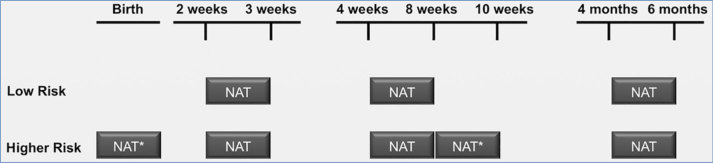

## PDF page 428 | printed page 414

result obtained at age 1 month and 1 at age 4 months, or 2 negative HIV antibody test results from separate specimens that were obtained at age 6 months (https://clinicalinfo. hiv.gov/en/guidelines/perinatal/ diagnosis-hiv-infection-infants-andchildren?view=full).

Adolescents and HIV Testing

The American Academy of Pediatrics (AAP) recommends that routine HIV antibody screening be offered to all youth 15 years or older at least once in health care settings. Following initial screening, youth at increased risk, including those who are sexually active, should be rescreened at least annually, potentially as frequently as every 3 to 6 months if at very high risk (MSM, active injection drug users, transgender youth; having sexual partners with known HIV infection; exchanging sex for drugs or money; or those who have had a diagnosis of or request testing for other sexually transmitted infections [STIs], including mpox).4,5 Use of any FDA-cleared HIV antibody test is appropriate, except in youth with recent or ongoing ARV prophylaxis use, such as HIV-1 preexposure prophylaxis (PrEP) and postexposure prophylaxis (PEP). Recent data have shown that performance of HIV tests in persons who acquire HIV infection while taking ARV medications for such indications may be suboptimal compared with persons not exposed to these medications at or after the time of HIV acquisition because of inhibition of early viral replication that can affect the timing of the antibody development. In youth who have taken oral PrEP or PEP in the past 3 months or have received a long-acting PrEP injection in the past 12 months, an HIV antigen/antibody test and a qualitative or quantitative HIV-1 RNA test should be used. For any positive test result, immediate referral to an HIV specialist is appropriate to confirm diagnosis and initiate management. HIV testing is recommended and should be routine for all patients in STI clinics and those seeking treatment for STIs in other clinical settings.

Suspicion of acute retroviral syndrome should prompt urgent assessment with an antigen/ antibody immunoassay or HIV RNA NAAT in conjunction with an antibody test. If the immunoassay result is negative or indeterminate, then

testing for HIV RNA using a NAAT should follow. Clinicians should not assume that a laboratory report of a negative HIV antibody test result indicates that the necessary RNA screening for acute HIV infection has been conducted. HIV self-testing kits only detect HIV antibodies and, therefore, will not detect acute HIV infection.

### TREATMENT

Antiretroviral Therapy

Consultation with an expert in pediatric HIV infection is recommended in the care of infants, children, and adolescents living with HIV. Current treatment recommendations for HIV-infected infants and children (https://clinicalinfo.hiv. gov/en/guidelines/pediatric-arv/whatsnew-guidelines; https://nccc.ucsf.edu/ clinician-consultation/hiv-aids-management/) as well as adolescents (https:// clinicalinfo.hiv.gov/en/guidelines/adultand-adolescent-arv/whats-new-guidelines) are available online. Whenever possible, enrollment of infants, children, and adolescents living with HIV in clinical trials should be encouraged. Information about clinical trials for infants, children, and adolescents living with HIV can be obtained by contacting the AIDS Clinical Trials Information Service (www.actis.org/).

ART is indicated all for pediatric patients living with HIV and should be initiated as soon as possible after diagnosis of HIV infection is established. Initiation of treatment of adolescents generally follows guidelines for adults and is recommended strongly for all adolescents or adults living with HIV regardless of CD4+ T-lymphocyte count if medication adherence readiness is apparent. In general, ART with at least 3 active drugs is recommended for all individuals requiring ARV therapy. ARV resistance testing (viral genotyping) is recommended before starting treatment, but ART can be initiated prior to results in most cases. Sustained suppression of virus to undetectable levels is the desired goal. A change in ART should be considered if there is evidence of disease progression (virologic, immunologic, or clinical), drug toxicity or intolerance, development of drug resistance, or availability of data suggesting the possibility of a superior or simpler regimen.

## PDF page 429 | printed page 415

Opportunistic Infections

Guidelines for prevention and treatment of OIs in children (https://clinicalinfo.hiv.gov/en/ guidelines/pediatric-opportunisticinfection/whats-new) and adolescents and adults (https://clinicalinfo.hiv.gov/en/ guidelines/adult-and-adolescent-opportunistic-infection/whats-new-guidelines) provide indications for administration of drugs for prevention, as well as treatment, of infection with P jirovecii, M avium complex, cytomegalovirus, T gondii, and other organisms.

Immunization Recommendations6

All recommended childhood immunizations should be administered to HIV-exposed infants. If HIV infection is confirmed, guidelines for children living with HIV should be followed. Children and adolescents living with HIV should be immunized as soon as is age appropriate with all non-live and mRNA vaccines. Inactivated (non-live) influenza vaccine should be administered annually according to the most current recommendations. The 3-dose series of human papillomavirus vaccine is indicated in adolescents living with HIV (https://redbook.solutions.aap.org/SS/ Immunization_Schedules.aspx).

The live-virus measles, mumps, and rubella (MMR) vaccine and monovalent varicella vaccine can be administered to children and adolescents living with HIV without severe immunosuppression. Severely immunocompromised infants, children, adolescents, and young adults living with HIV (for people 5 years of age, defined as a CD4+ T-lymphocyte percentage <15%; for people >5 years of age, defined as a CD4+ T-lymphocyte percentage <15% or a CD4+ T-lymphocyte count <200 lymphocytes/mm3) should not receive measles virus-containing vaccine, because vaccinerelated pneumonia has been reported. The quadrivalent measles, mumps, rubella, and varicella vaccine should not be administered to any infant or child living with HIV, regardless of degree of immunosuppression, because of lack of safety data in this group.

Rotavirus vaccine should be administered to all infants exposed to or infected with HIV irrespective of CD4+ T-lymphocyte percentage or count.

All children living with HIV should receive a dose of 23-valent polysaccharide pneumococcal vaccine

after turning 24 months of age if at least 8 weeks have passed since the last 13-valent or 15-valent pneumococcal conjugate vaccine and they have not previously received at least 1 dose of 20-valent pneumococcal conjugate vaccine.

Children living with HIV who are 5 years and older and have not received Haemophilus influenzae type b (Hib) vaccine should receive 1 dose of Hib vaccine.

Children and adolescents living with HIV should receive COVID-19 vaccine, if authorized or approved by the FDA for their age group. Preliminary data in individuals living with HIV who have received COVID-19 vaccines indicate good humoral responses in those with wellcontrolled infection on ART with normal CD4+ T-lymphocyte counts. However, diminished responses were noted in individuals with advanced or untreated HIV infection.

Infants and children 2 months or older living with HIV infection should receive an age-appropriate series of the meningococcal ACWY conjugate vaccine (MenACWY).7 The same vaccine product should be used for all doses. However, if the product used for previous doses is unknown or unavailable, the vaccination series may be completed with any age- and formulation-appropriate MenACWY. Although no data on interchangeability of meningococcal conjugate vaccines in PWH are available, limited data from a postlicensure study in healthy adolescents suggests safety and immunogenicity of MenACWY-CRM are not adversely affected by prior immunization with MenACWY-D. For children living with HIV 2 through 23 months of age, only MenACWY-CRM (Menveo) should be used, because interference with the immune response to pneumococcal conjugate vaccine occurs with MenACWY-D (Menactra), and MenACWY-TT (MenQuadfi) is not licensed for use in children younger than 2 years.

Children Who Are HIV Uninfected Residing in the Household of a Person Living With HIV

Members of households in which an adult or child has HIV infection can receive MMR vaccine, because these vaccine viruses are not transmitted from person to person. To decrease the risk of

## PDF page 430 | printed page 416

transmission of influenza to patients with symptomatic HIV infection, all household members 6 months or older should receive yearly influenza immunization. Live attenuated influenza vaccine may be administered to healthy household and other close contacts of people with altered immunocompetence. Likewise, all household members should receive a COVID-19 vaccine if authorized or approved by the FDA for their age group. Siblings and susceptible adult caregivers of patients living with HIV should be immunized with varicella vaccine to prevent acquisition of wild-type varicella-zoster virus infection, which can cause severe disease in immunocompromised hosts. Although the risk of transmission is low, immunocompromised patients should avoid contact with people who develop skin lesions after receipt of varicella vaccine until the lesions clear.

Postexposure Passive Immunization of Children Living With HIV

Measles8

Children living with HIV who are exposed to measles require prophylaxis based on immune status and measles vaccine history. Children living with HIV with no to moderate immunosuppression who have evidence of immunity (eg, serologic evidence of immunity to measles or who received 2 doses of measles vaccine after initiation of ART) do not require any additional measures to prevent measles following an exposure. Mildly or moderately immunocompromised PWH without evidence of immunity to measles (eg, no serologic evidence of immunity to measles and who have not received 2 doses of measles vaccine after initiation of ART) should receive immunoglobulin intramuscular (IGIM) at a dose of 0.5 mL/kg (maximum 15 mL). Severely immunocompromised hosts (for people 5 years of age, defined as a CD4+ T-lymphocyte percentage <15%; for people >5 years of age, defined as a CD4+ T-lymphocyte percentage <15% or a CD4+ T-lymphocyte count <200 lymphocytes/mm3) who are exposed to measles should receive immunoglobulin intravenous (IGIV) prophylaxis, 400 mg/kg, after exposure to measles, regardless of prior vaccination status, because they may not be protected by the vaccine. Children living with HIV who have received IGIV within 3 weeks of exposure do not require additional passive immunization.

Tetanus

Children living with HIV with severe immunosuppression (for people 5 years of age, defined as a CD4+ T-lymphocyte percentage <15%; for people >5 years of age, defined as a CD4+ T-lymphocyte percentage <15% or a CD4+ T-lymphocyte count <200 lymphocytes/mm3) who sustain wounds classified as tetanus prone should receive tetanus immunoglobulin regardless of immunization status.

Varicella

Children living with HIV who lack evidence of immunity to varicella (eg, serologic evidence of immunity to varicella, or documentation of receipt of 2 doses of varicella vaccine after initiation of ART, or health care provider-confirmed clinical diagnosis of varicella), or who have severe immunosuppression (for people 5 years of age, defined as a CD4+ T-lymphocyte percentage <15%; for people >5 years of age, defined as a CD4+ T-lymphocyte percentage <15% or a CD4+ T-lymphocyte count <200 lymphocytes/mm3) should receive varicella-zoster immunoglobulin, if available, ideally within 96 hours but potentially beneficial up to 10 days, after close contact with a person who has chickenpox or shingles. An alternative to varicella-zoster immunoglobulin for passive immunization is oral valacyclovir or acyclovir beginning 7 days after exposure, and if this is not available then IGIV, 400 mg/kg, administered once within 10 days after exposure. Children who have received IGIV for other reasons within 3 weeks of exposure do not require additional passive immunization.

Hepatitis A9

All people with HIV who experience high-risk exposure to a person with hepatitis A infection, regardless of the exposed person’s hepatitis A vaccination history or current degree of HIVassociated immunosuppression, should receive IGIM at a dose of 0.1 mL/kg.

### INFECTION PREVENTION AND CONTROL MEASURES IN HEALTH CARE SETTINGS

Standard precautions should be followed by all health care professionals regardless of suspected or confirmed HIV infection status of the patient.

## PDF page 431 | printed page 417

### CONTROL MEASURES

Perinatal Transmission Prophylaxis

Management of Infected Pregnant Person

Pregnant PWH should receive ART regimens, both for treatment of HIV infection and for prevention of perinatal transmission of HIV. Sustained virologic suppression is the goal both during pregnancy and following delivery. Detailed recommendations for use of ARVs in pregnant PWH can be found online (https://clinicalinfo. hiv.gov/en/guidelines/perinatal/whats-newguidelines). Ideally, PWH initiating such a regimen during pregnancy should be tested for the presence of ARV resistance. However, initiation of ART should not be delayed pending results of resistance testing, especially if decisions are being made late in pregnancy. Intrapartum intravenous (IV) zidovudine should be given to PWH who present in labor or at least 3 hours prior to scheduled cesarean delivery with HIV RNA >1,000 copies/mL near the time of delivery, unknown HIV RNA, known or suspected ART nonadherence since last HIV RNA result, or positive rapid antigen/antibody HIV result obtained around time of delivery in a person without a previous diagnosis of HIV. Intrapartum IV zidovudine may be considered on a case-by-case basis for PWH with HIV RNA 50 copies/mL and 1,000 copies/mL within 4 weeks of delivery, but data are insufficient to determine whether IV zidovudine provides any additional protection against perinatal transmission in such cases (https:// clinicalinfo.hiv.gov/en/guidelines/perinatal/ intrapartum-care-for-people-withhiv?view=full). In situations in which IV administration is not possible, oral administration can be considered.

Management of Exposed Infant

The newborn infant should be bathed and cleaned of secretions (especially bloody secretions) immediately after birth10 and should begin ARV prophylaxis as soon as possible to the time of birth, preferably within 6 hours. Management options for evaluation and prophylactic therapy of newborn infants in the United States at low risk are presented in Figure 72.2. Presumptive therapy recommendations for newborn infants at higher risk of perinatal transmission are presented in Figure 72.3. Duration of ARV prophylaxis in the neonate is 2 to 6 weeks for low-risk perinatal

HIV exposure (Fig 72.2), and the duration of presumptive therapy for high-risk perinatal HIV exposure is 6 weeks (Fig 72.3).

The newborn infant’s physician should obtain the birthing parent’s HIV infection status so appropriate care and follow-up of the infant can be accomplished. Infants born to people who (1) did not have HIV testing during pregnancy; (2) did not have third trimester HIV testing in areas where third trimester testing is recommended by the CDC; or (3) were diagnosed with other STIs during pregnancy (particularly syphilis) but were not tested for HIV should be tested with a rapid HIV antibody test as soon as possible after delivery. A positive antibody test would not be diagnostic for the infant, but would identify an undiagnosed HIV infection in the parent which in turn would necessitate presumptive HIV treatment and an HIV NAAT at birth in the infant. Whenever possible, PWH and their infants should be referred to a facility that provides HIV-related services for both the birthing parent and the baby.

Breastfeeding11

Transmission of HIV by breastfeeding accounted for one-third to one-half of perinatal transmission of HIV worldwide in the pre-ART era. Transmission is more likely among pregnant people who acquire HIV infection late in pregnancy or during the postpartum period. In resource-limited settings, the World Health Organization recommends that PWH breastfeed their infants exclusively for the first 6 months of life, because infant morbidity associated with formula feeding is unacceptably high and safe alternatives to human milk may not be readily available.

Replacement (formula) feeding is recommended for all infants born to PWH infection in the United States, since this is the option that eliminates risk of transmission of HIV to the infant.12 Replacement feeding should be recommended if the birth parent is not receiving ART, or is not adherent and has a detectable viral load. Parents with HIV infection with fully suppressed viral load and who are adherent with ART who wish to breastfeed should be supported in their decision to do so. If a parent chooses to breastfeed, an appropriate plan of management can be developed, including encouraging adherence with ART during breastfeeding, use of ARVs in the infant as

## PDF page 432 | printed page 418

Figure 72.2 Newborn testing and prophylaxis recommendations following low-risk perinatal HIV exposure*

ART indicates antiretroviral therapy. * Low-risk criteria: (1) person with HIV who received ART throughout pregnancy or from the early 1st/2nd trimester; AND (2) confirmed HIV RNA <50 copies/mL near delivery (within 4 weeks); AND (3) no concerns regarding ART adherence; AND (4) person did not have primary or acute HIV infection during pregnancy. # Birthing people with previous negative HIV test at risk for seroconversion in late pregnancy are those with: documented STI, unprotected sex, partner with HIV, multiple partners, or IV drug use. † If birthing parent has been on ART for at least 10 consecutive weeks during pregnancy and has maintained viral suppression (defined as at least 2 consecutive viral load measurements of <50 copies/mL at least 4 weeks apart), the infant can receive 2 weeks of ZDV. All other infants, and all infants <37 weeks’ gestational age, should receive 4–6 weeks of ZDV. Algorithm adapted by Paul Spearman, Rana Chakraborty, and Athena Kourtis from Management of Infants Born to Women With HIV Infection, in Recommendations for the Use of Antiretroviral Drugs in Pregnant Women With HIV Infection and Interventions to Reduce Perinatal HIV Transmission in the United States, clinicalinfo.hiv.gov.

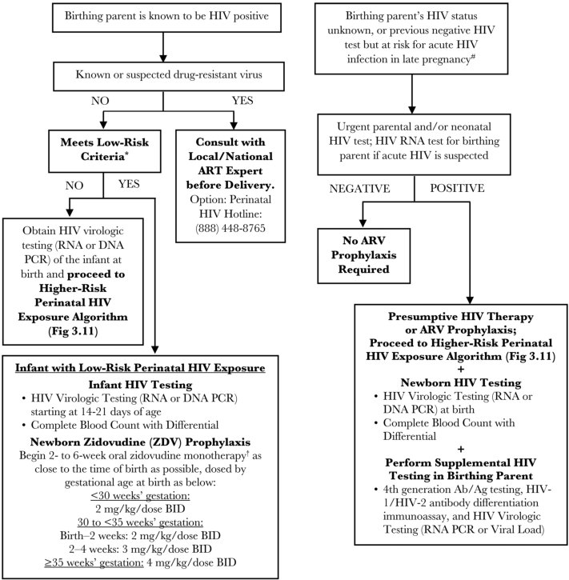

## PDF page 433 | printed page 419

Figure 72.3 Newborn Testing and Prophylaxis Recommendations Following Higher-Risk Perinatal HIV Exposure*

* Higher-risk criteria: birthing parents (1) who received neither antepartum nor intrapartum ARVs; OR (2) who received only intrapartum ARVs; OR (3) who received ante- and intrapartum ARVs but who do not have viral suppression (HIV RNA ,50 copies/mL) near delivery, particularly if delivery was vaginal; OR (4) with acute or primary HIV infection during pregnancy or breastfeeding, in which case, the person should discontinue breastfeeding. # For newborns who are unable to tolerate oral agents, the IV dose of zidovudine is 75% of the oral dose, while maintaining the same dosing interval. † All infants at higher risk of perinatal HIV exposure should be tested by HIV RNA or DNA PCR at birth. If birth HIV virologic testing in newborn is negative, some experts would discontinue lamivudine and nevirapine after 2 weeks and complete 6 weeks of prophylaxis with zidovudine alone. ^ ARV doses (such as ZDV and nevirapine) may need to be changed and the ARV regimen may need to be optimized if the infant has confirmed HIV infection. See clinicalinfo.hiv.gov for full dosing guidelines for infants with confirmed HIV infection. § If the birthing person has taken raltegravir 2–24 hours prior to delivery, the neonate’s first dose of raltegravir should be delayed until 24–48 hours after birth; additional ARV drugs should be started as soon as possible. Do not use raltegravir if gestational age <37 weeks. Algorithm adapted by Paul Spearman, Rana Chakraborty, and Athena Kourtis from Management of Infants Born to Women With HIV Infection, in Recommendations for the Use of Antiretroviral Drugs in Pregnant Women With HIV Infection and Interventions to Reduce Perinatal HIV Transmission in the United States, clinicalinfo.hiv.gov.

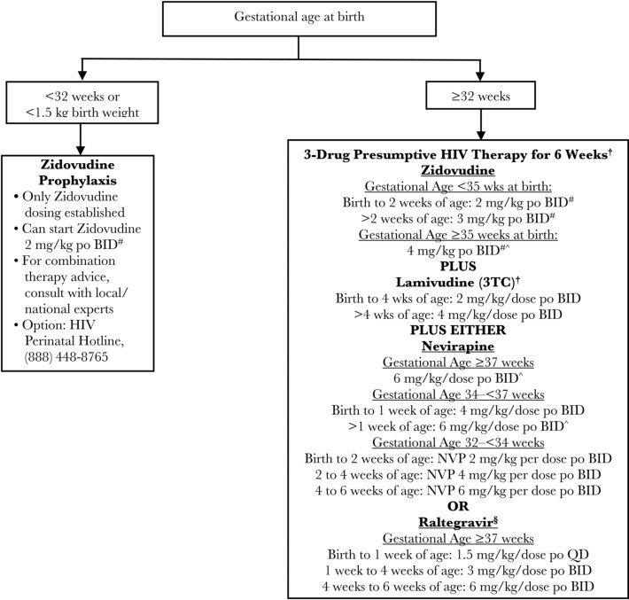

## PDF page 434 | printed page 420

prophylaxis while breastfeeding, exclusive breastfeeding for 6 months followed by weaning and introduction of complementary foods, lactation counseling, frequent viral load monitoring in the breastfeeding parent, and frequent infant testing for HIV infection (https://clinicalinfo. hiv.gov/en/guidelines/perinatal/ counseling-and-managing-women-livinghiv-united-states-who-desire-breastfeed).

Prewarming or Premastication

Probable transmission of HIV by caregivers who prewarmed in their mouth or premasticated food for infants has been described in the United States. The CDC recommends that caregivers living with HIV be asked about whether they practice premastication and counseled not to prewarm or premasticate food for infants.

HIV in the Athletic Setting

Athletes and staff of athletic programs can be exposed to blood during certain athletic activities. Recommendations have been developed by the AAP for prevention of transmission of HIV and other bloodborne pathogens in the athletic setting.

Sexual Abuse

In cases of proven or suspected sexual abuse, the child should be tested with an HIV antibody test at the original assessment, with testing repeated at approximately 6 weeks and <3 months. Serologic evaluation for HIV infection of the perpetrator should be attempted as soon after the incident as possible. Counseling of the child and family needs to be provided (https://stacks.cdc. gov/view/cdc/38856).

Prevention of HIV Transmission Through Sexual Activity

Abstinence from sexual activity is the only certain way to prevent sexual transmission of HIV. Safer sex practices, including use of condoms for all sexual encounters (vaginal, anal, and oral sex) can reduce HIV transmission significantly by reducing exposure to body fluids containing HIV. Sustained HIV RNA to blood levels <200 copies/mL with ART eliminates the risk of HIV sexual transmission in discordant couples.

PrEP with ARVs (eg, tenofovir plus emtricitabine; cabotegravir) reduces the risk of HIV acquisition

from sex by 99% when taken consistently. Among people who inject drugs, PrEP reduces the risk of acquiring HIV infection by at least 74% when taken consistently. PrEP is much less effective if it is not taken consistently. PrEP is FDA approved for adolescents and adults weighing at least 35 kg (77 lb). The AAP recommends that youth at substantial risk for HIV acquisition be routinely offered HIV PrEP.13 Detailed guidance is available from CDC at www.cdc.gov/hiv/risk/prep/ index.html and www.cdc.gov/hiv/pdf/risk/ prep/cdc-hiv-prep-guidelines-2021.pdf. If advice is needed, clinicians may consult the National Clinician Consultation Center PrEP Line at 1-855-448-7737 (9:00 am–8:00 pm Eastern Time).

ARV-based vaginal microbicides and ARV-coated vaginal rings have reduced HIV acquisition in uninfected women. Data from clinical trials conducted in African countries also provide evidence that medical penile circumcision can reduce HIV acquisition in heterosexual male individuals by 38% to 66% over 24 months.

Postexposure Prophylaxis for Possible Sexual or Other Nonoccupational Exposure to HIV

Decisions to provide ARVs after possible nonoccupational (ie, community) exposure to HIV must balance the potential benefits and risks. Decisions regarding the need for ARV prophylaxis in such instances are predicated on the probability that the source is infected or contaminated with HIV, the likelihood of transmission by the particular exposure, and the interval between exposure and initiation of therapy, balanced against expected adverse effects associated with the regimen.

The risk of transmission of HIV from a puncture wound attributable to a needle found in the community likely is much lower than 0.3%, which is the estimated probability of HIV transmission from a puncture wound involving a known HIVcontaminated needle in a health care setting. The actual risks of HIV infection in an infant or child after a needlestick injury or sexual abuse are unknown, but to date there are no confirmed transmissions of HIV from accidental nonoccupational needlestick injuries (needles found in the community). The estimated risk of HIV transmission from receptive penile-anal sexual exposure is

## PDF page 435 | printed page 421

138 per 10,000 exposures. The estimated risk per episode of receptive vaginal exposure is 8 per 10,000 exposures.

ARVs generally should not be used if the risk of transmission is low (eg, trivial needlestick injury with a drug needle from an unknown nonoccupational source) or if care is sought more than 72 hours after the reported exposure. The benefits of PEP are greatest when risk of infection is high, intervention is prompt, and adherence is likely. Consultation with an experienced pediatric HIV health care professional is essential. Detailed guidelines for PEP for children can be found at https://stacks.cdc.gov/view/cdc/38856 and https://nccc.ucsf.edu/clinician-consultation/pep-post-exposure-prophylaxis/. The AAP recommends that youth be offered HIV PEP following high-risk sexual exposures.14

Postexposure Prophylaxis for Occupational Exposure to HIV

Guidelines for use of occupational PEP have been published by CDC and should be started as soon as possible after the exposure but within 72 hours for maximal effectiveness (https://stacks.cdc. gov/view/cdc/38856). In addition, the National Clinician Consultation Center at 1-888-448-4911 provides guidance seven days a week between 9 am and 9 pm Eastern Time and can provide valuable support to providers.

Public Health Reporting

HIV infection is a nationally notifiable disease in the United States.

1 For a complete listing of current policy statements from the American Academy of Pediatrics regarding HIV and AIDS, see https://publications.aap.org/pediatrics/collection/537/ Committee-on-Pediatric-and-Adolescent-HIV 2 Panel on Opportunistic Infections in Children With and Exposed to HIV. Guidelines for the Prevention and Treatment of Opportunistic Infections in Children With and Exposed to HIV. Department of Health and Human Services. Available at: https://clinicalinfo.hiv.gov/en/guidelines/hiv-clinicalguidelines-pediatric-opportunistic-infections/ whats-new

3 Centers for Disease Control and Prevention. HIV Surveillance Report, 2017. Vol 29. Centers for Disease Control and Prevention; November 2018. Available at: www.cdc.gov/hiv/pdf/ library/reports/surveillance/cdc-hiv-surveillancereport-2017-vol-29.pdf 4 Hsu KK, Rakhmanina NY; American Academy of Pediatrics, Committee on Pediatric AIDS. Clinical report. Adolescents and young adults: the pediatrician’s role in HIV testing and pre- and post-exposure HIV prophylaxis. Pediatrics. 2022;149(1):e2021055207 5 Curran KG, Eberly K, Russell OO, et al. HIV and sexually transmitted infections among persons with monkeypox-eight U.S. jurisdictions, May 17-July 22, 2022. MMWR Morb Mortal Wkly Rep. 2022;71(36):1141–1147 6 Rubin LG, Levin MJ, Ljungman P, et al. 2013 IDSA clinical practice guideline for vaccination of the immunocompromised host. Clin Infect Dis. 2014;58(3):309–318 7 Centers for Disease Control and Prevention. Recommendations for use of meningococcal conjugate vaccines in HIVinfected persons-Advisory Committee on Immunization Practices, 2016. MMWR Morb Mortal Wkly Rep. 2016;65(43):1189–1194 8 Centers for Disease Control and Prevention. Prevention of measles, rubella, congenital rubella syndrome, and mumps, 2013 summary: recommendations of the Advisory Committee on Immunization Practices (ACIP). MMWR Recomm Rep. 2013;62(RR-4):1–34 9 Brennan J, Moore K, Sizemore L, et al. Notes from the field: acute hepatitis A virus infection among previously vaccinated persons with HIV infection-Tennessee, 2018. MMWR Morb Mortal Wkly Rep. 2019;68(14):328–329 10 Nolt D, O’Leary ST, Aucott SW; American Academy of Pediatrics, Committee on Infectious Diseases, Committee on Fetus and Newborn. Risks of infectious diseases in newborns exposed to alternative perinatal practices. Pediatrics. 2022;149(2):e2021055554 11 American Academy of Pediatrics, Committee on Pediatrics AIDS, Section on Breastfeeding. Policy statement: infant feeding for persons living with HIV in the United States. Pediatrics. 2023. 12 Meek JY, Noble L; American Academy of Pediatrics, Section on Breastfeeding. Technical report. Breastfeeding and the use of human milk. Pediatrics. 2022;150(1):e2022057989 13 Hsu KK, Rakhmanina NY; American Academy of Pediatrics, Committee on Pediatric AIDS. Clinical report. Adolescents and young adults: the pediatrician’s role in HIV testing and pre- and post-exposure HIV prophylaxis. Pediatrics. 2022;149(1):e2021055207 14 Hsu KK, Rakhmanina NY; American Academy of Pediatrics, Committee on Pediatric AIDS. Clinical report. Adolescents and young adults: the pediatrician’s role in HIV testing and pre- and post-exposure HIV prophylaxis. Pediatrics. 2022;149(1):e2021055207

## PDF page 436 | printed page 422

Image 72.1 Transmission electron micrograph of HIV type 1 virus particles (colorized pink/yellow) replicating from an HIVinfected H9 T cell (brown). Image captured at the National Institute of Allergy and Infectious Diseases Integrated Research Facility in Fort Detrick in Frederick, Maryland.

Image 72.3 Lung biopsy specimen showing mononuclear interstitial infiltration in a child with HIV infection and lymphoid interstitial pneumonitis/pulmonary lymphoid hyperplasia (LIP/PLH). The pathogenesis of LIP/PLH is poorly understood, but Epstein-Barr virus has been implicated as a cofactor in its development. Copyright Baylor International Pediatric AIDS Initiative/Mark Kline, MD, FAAP.

Image 72.2 Pneumocystis jirovecii (formerly Pneumocystis carinii) pneumonia lung biopsy specimen from a child with HIV infection and pneumonia. Numerous dark-staining cysts of P jirovecii (Grocott-Gomori methenamine silver nitrate stain). Copyright Baylor International Pediatric AIDS Initiative/Mark Kline, MD, FAAP.

Image 72.4 Biopsy specimen showing a nodular aggregate of mononuclear cells in the lung of a child with HIV infection and lymphoid interstitial pneumonitis/ pulmonary lymphoid hyperplasia. Copyright Baylor International Pediatric AIDS Initiative/Mark Kline, D, FAAP.

## PDF page 437 | printed page 423

Image 72.5 Digital clubbing in a child with HIV infection and lymphoid interstitial pneumonitis/pulmonary lymphoid hyperplasia (LIP/PLH). Marked lymphadenopathy, hepatosplenomegaly, and salivary gland enlargement are also observed in many children with LIP/PLH. The clinical course of LIP/PLH is variable. Exacerbation of respiratory distress and hypoxemia can occur in association with intercurrent viral respiratory illnesses. Spontaneous clinical remission is sometimes observed. Copyright Baylor International Pediatric AIDS Initiative/Mark Kline, MD, FAAP.

Image 72.7 Severe molluscum contagiosum in a boy with HIV infection. Some children with HIV infection develop molluscum contagiosum lesions that are unusually large or widespread. They are often seated more deeply in the epidermis. (See also Molluscum Contagiosum.) Copyright Baylor International Pediatric AIDS Initiative/Mark Kline, MD, FAAP.

Image 72.6 Bilateral parotid gland enlargement in a male child with HIV infection and lymphoid interstitial pneumonitis/pulmonary lymphoid hyperplasia. Note the presence of multiple lesions of molluscum contagiosum, which are commonly found in patients with HIV infection, particularly those with a low CD4 lymphocyte count. (See also Molluscum Contagiosum.) Copyright Baylor International Pediatric AIDS Initiative/Mark Kline, MD, FAAP.

![Image 72.5 Digital clubbing in a child with HIV infection and lymphoid interstitial pneumonitis/pulmonary lymphoid hyperplasia (LIP/PLH). Marked lymphadenopathy, hepatosplenomegaly, and salivary gland enlargement are also observed in many children with LIP/PLH. The clinical course of LIP/PLH is variable. Exacerbation of respiratory distress and hypoxemia can occur in association with intercurrent viral respiratory illnesses. Spontaneous clinical remission is sometimes observed. Copyright Baylor International Pediatric AIDS Initiative/Mark Kline, MD, FAAP.](../../figures/ch072_p0437_01.jpg)

## PDF page 438 | printed page 424

Image 72.8 Suppurative parotitis in a girl with HIV infection. Note the marked swelling and redness overlying the left parotid gland. On palpation of the gland, pus could be observed exuding from the Stensen duct. Copyright Baylor International Pediatric AIDS Initiative/Mark Kline, MD, FAAP.

Image 72.10 Herpes simplex infection in a girl with HIV infection. Chronic or progressive herpetic skin lesions are observed occasionally in children infected with HIV, although unlike varicella-zoster virus infections in these patients, herpes simplex infections much less commonly cause disseminated disease. (See also Herpes Simplex.) Copyright Baylor International Pediatric AIDS Initiative/ Mark Kline, MD, FAAP.

Image 72.9 An 8-year-old boy with HIV and tuberculous lymphadenitis (scrofula). Copious amounts of pus spontaneously drained from this lesion. In a child with immunocompromise, other causes of lymphadenitis include infections with gram-positive bacteria, atypical mycobacterium, and Bartonella henselae (cat-scratch disease); malignant neoplasms such as lymphoma; masses such as branchial cleft cysts or cystic hygromas masquerading as lymph nodes; and adenitis caused by HIV itself. (See also Nontuberculous Mycobacteria.) Copyright Baylor International Pediatric AIDS Initiative/ Mark Kline, MD, FAAP.

Image 72.11 Herpes zoster (shingles) in a boy with HIV infection. These cases can be complicated by chronicity or dissemination. (See also Varicella-Zoster Virus Infections.) Copyright Baylor International Pediatric AIDS Initiative/ Mark Kline, MD, FAAP.

![Image 72.9 An 8-year-old boy with HIV and tuberculous lymphadenitis (scrofula). Copious amounts of pus spontaneously drained from this lesion. In a child with immunocompromise, other causes of lymphadenitis include infections with gram-positive bacteria, atypical mycobacterium, and Bartonella henselae (cat-scratch disease); malignant neoplasms such as lymphoma; masses such as branchial cleft cysts or cystic hygromas masquerading as lymph nodes; and adenitis caused by HIV itself. (See also Nontuberculous Mycobacteria.) Copyright Baylor International Pediatric AIDS Initiative/ Mark Kline, MD, FAAP.](../../figures/ch072_p0438_02.jpg)

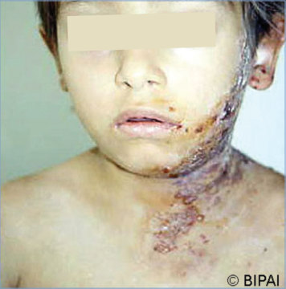

## PDF page 439 | printed page 425

Image 72.12 Funduscopic examination of a 16-year-old girl with HIV infection and cytomegalovirus retinitis. There are extensive areas of hemorrhage, with white retinal exudates. Children with cytomegalovirus retinitis usually present with painless visual impairment. (See also Cytomegalovirus Infection.) Copyright Baylor International Pediatric AIDS Initiative/Mark Kline, MD, FAAP.

Image 72.14 This patient with HIV/AIDS presented with secondary oral pseudomembranous candidiasis. The immune system weakens when HIV therapy undergoes a dramatic reduction in its effectiveness, resulting in the greater possibility of secondary infections, as in this patient. This infection responded to fluconazole, 100 mg daily, for 1 week. Courtesy of Centers for Disease Control and Prevention.

Image 72.16 Toxoplasmosis of the heart in a patient with AIDS. Courtesy of Centers for Disease Control and Prevention.

Image 72.13 Severe cutaneous warts (human papillomavirus infection) in a boy with HIV infection. Copyright Baylor International Pediatric AIDS Initiative/Mark Kline, MD, FAAP.

Image 72.15 Histopathologic features of toxoplasmosis of the heart in a fatal case of AIDS. Courtesy of Centers for Disease Control and Prevention.

Image 72.17 Histopathologic features of toxoplasmosis of the brain in a fatal case of AIDS. Courtesy of Centers for Disease Control and Prevention.

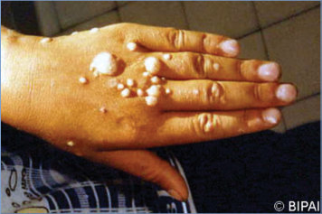

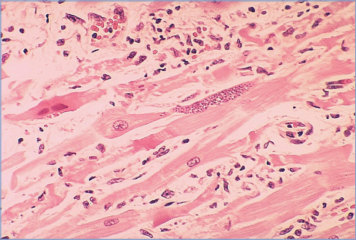

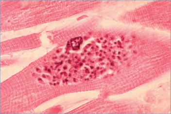

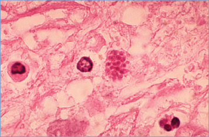

## PDF page 440 | printed page 426

Image 72.18 Severe wasting in a patient with HIV infection. Copyright Baylor International Pediatric AIDS Initiative/Mark Kline, MD, FAAP.

Image 72.20 Chest radiograph showing cardiomegaly in a 5-year-old with HIV infection, cardiomyopathy, and congestive heart failure. Many children with HIV infection with congestive heart failure respond well to medical management. Copyright Baylor International Pediatric AIDS Initiative/ Mark Kline, MD, FAAP.

Image 72.19 Computed tomographic scan of the brain of an 8-year-old with HIV infection and generalized brain atrophy. Cerebral atrophy is observed commonly in children with HIV-associated encephalopathy, but it may also be observed in children with typical neurological function and development. Copyright Baylor International Pediatric AIDS Initiative/Mark Kline, MD, FAAP.

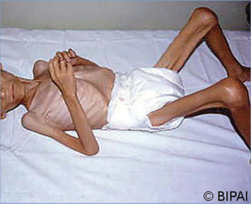

## PDF page 441 | printed page 427

Image 72.21 A 7-year-old with HIV infection and a Kaposi sarcoma lesion. This tumor is rarely diagnosed in U.S. children, with the occasional exceptions of children of Haitian descent with vertical HIV infection or older adolescents. Kaposi sarcoma is observed more commonly in children infected with HIV in some other geographic locales, including parts of Africa (eg, Zambia, Uganda) and Romania. Kaposi sarcoma has been linked to infection with a novel herpesvirus, now known as human herpesvirus 8 or Kaposi sarcoma–associated virus. Copyright Baylor International Pediatric AIDS Initiative/ Mark Kline, MD, FAAP.

Image 72.23 This HIV-positive patient was exhibiting signs of a secondary condyloma acuminata infection (ie, venereal warts). This intraoral eruption of condyloma acuminata, or venereal warts, was caused by human papillomavirus (HPV). Although oral HPV is a rare occurrence, HIV reduces the body’s immune response; therefore, such secondary infections can manifest themselves. Courtesy of Centers for Disease Control and Prevention.

Image 72.22 This patient with HIV infection presented with intraoral Kaposi sarcoma of the hard palate secondary to AIDS infection. Approximately 7.5% to 10% of patients with AIDS display signs of oral Kaposi sarcoma, which can range in appearance from small asymptomatic growths that are flat purple-red to larger nodular growths. Courtesy of Centers for Disease Control and Prevention.

Image 72.24 A 12-month-old with HIV infection with a chronic Trichophyton infection (tinea corporis) mostly marked over the buttocks and lower extremities. Courtesy of Larry Frenkel, MD.

![Image 72.21 A 7-year-old with HIV infection and a Kaposi sarcoma lesion. This tumor is rarely diagnosed in U.S. children, with the occasional exceptions of children of Haitian descent with vertical HIV infection or older adolescents. Kaposi sarcoma is observed more commonly in children infected with HIV in some other geographic locales, including parts of Africa (eg, Zambia, Uganda) and Romania. Kaposi sarcoma has been linked to infection with a novel herpesvirus, now known as human herpesvirus 8 or Kaposi sarcoma–associated virus. Copyright Baylor International Pediatric AIDS Initiative/ Mark Kline, MD, FAAP.](../../figures/ch072_p0441_01.jpg)

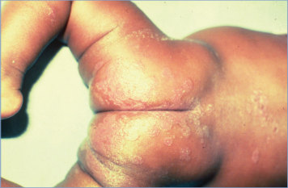

## PDF page 442 | printed page 428

Image 72.25 A 17-year-old with HIV infection with an ulcerative lesion on the plantar surface of the right foot of several months’ duration. A viral culture result was positive for human herpesvirus, which led to the diagnosis of HIV. Courtesy of Larry Frenkel, MD.

Image 72.27 Mothers’ exposure category, by year of diagnosis, for perinatally acquired AIDS, 1981–2000, United States. Changes have occurred in the distribution of exposure categories for the mothers of children who were infected perinatally and in whom AIDS developed. In the 1980s, most of the women who transmitted HIV vertically were exposed to HIV through injection drug use, and a smaller proportion through heterosexual contact. In the 1990s, a smaller proportion of women who transmitted HIV vertically were exposed to HIV through injection drug use; a larger proportion, through heterosexual contact. Courtesy of Centers for Disease Control and Prevention.

Image 72.26 HIV type 1 transmission electron micrograph. Coneshaped cores are sectioned in various orientations. Viral genomic RNA is located in the electron-dense wide end of the core. Courtesy of Centers for Disease Control and Prevention.

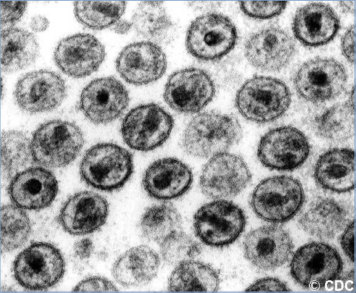

![Image 72.27 Mothers’ exposure category, by year of diagnosis, for perinatally acquired AIDS, 1981–2000, United States. Changes have occurred in the distribution of exposure categories for the mothers of children who were infected perinatally and in whom AIDS developed. In the 1980s, most of the women who transmitted HIV vertically were exposed to HIV through injection drug use, and a smaller proportion through heterosexual contact. In the 1990s, a smaller proportion of women who transmitted HIV vertically were exposed to HIV through injection drug use; a larger proportion, through heterosexual contact. Courtesy of Centers for Disease Control and Prevention.](../../figures/ch072_p0442_03.jpg)

## PDF page 443 | printed page 429

50

40

Rate per 100,000 Births

30

20

10

0

1975 1980 1985 1990

Image 72.28 The estimated incidence of perinatally acquired HIV infections per 100,000 live births (points) with a smoothed curve (solid line) and 95% confidence bands (dashed lines). The timing of important advances in recommendations for prevention of mother-to-child transmission of HIV is noted on the figure. The arrows indicate the year in which the interventions (eg, “Zidovudine prophylaxis”) occurred. From Nesheim SR, Wiener J, Fitz Harris LF, et al. Brief report: estimated incidence of perinatally acquired HIV infection in the United States, 1978–2013. JAIDS J Acquir Immune Defic Syndr. 2017;76(5):461–464.

Zidovudine prophylaxis

Combination antiretroviral therapy Scheduled cesarean delivery

Integrase inhibitors

1995

2000 2005 2010 2015

Year

![Image 72.28 The estimated incidence of perinatally acquired HIV infections per 100,000 live births (points) with a smoothed curve (solid line) and 95% confidence bands (dashed lines). The timing of important advances in recommendations for prevention of mother-to-child transmission of HIV is noted on the figure. The arrows indicate the year in which the interventions (eg, “Zidovudine prophylaxis”) occurred. From Nesheim SR, Wiener J, Fitz Harris LF, et al. Brief report: estimated incidence of perinatally acquired HIV infection in the United States, 1978–2013. JAIDS J Acquir Immune Defic Syndr. 2017;76(5):461–464.](../../figures/ch072_p0443_01.jpg)

## PDF page 444 | printed page 430

Image 72.29 Zidovudine (ZDV) use for pregnant women with HIV infection or for children who were born from 1993 to 2000 and perinatally exposed or infected, 39 states. In April 1994, the U.S. Public Health Service released guidelines for the use of ZDV to reduce perinatal HIV transmission; in 1995, recommendations for HIV counseling and voluntary testing for pregnant women were published; and in 2002, recommendations on the use of antiretroviral drugs in pregnant women with HIV infection were updated. Since then, the proportion of children who were perinatally exposed to or infected with HIV who received ZDV has increased markedly. This increase in ZDV use, including receipt by the mother during the prenatal or intrapartum period and receipt by the neonate, has been accompanied by a decrease in the number of children perinatally infected with HIV and is responsible for the dramatic decline in cases of AIDS acquired perinatally. The data presented are from the 30 states with name-based HIV infection surveillance and may not represent all states in the United States. Courtesy of Centers for Disease Control and Prevention.

![Image 72.29 Zidovudine (ZDV) use for pregnant women with HIV infection or for children who were born from 1993 to 2000 and perinatally exposed or infected, 39 states. In April 1994, the U.S. Public Health Service released guidelines for the use of ZDV to reduce perinatal HIV transmission; in 1995, recommendations for HIV counseling and voluntary testing for pregnant women were published; and in 2002, recommendations on the use of antiretroviral drugs in pregnant women with HIV infection were updated. Since then, the proportion of children who were perinatally exposed to or infected with HIV who received ZDV has increased markedly. This increase in ZDV use, including receipt by the mother during the prenatal or intrapartum period and receipt by the neonate, has been accompanied by a decrease in the number of children perinatally infected with HIV and is responsible for the dramatic decline in cases of AIDS acquired perinatally. The data presented are from the 30 states with name-based HIV infection surveillance and may not represent all states in the United States. Courtesy of Centers for Disease Control and Prevention.](../../figures/ch072_p0444_01.jpg)

## PDF page 445 | printed page 431

Image 72.30 People living with diagnosed perinatally acquired HIV infection, year-end 2018—United States and 6 dependent areas. Data for the year 2018 are preliminary and based on deaths reported to the Centers for Disease Control and Prevention through December 2019. Data are based on address of residence as of December 31, 2018 (ie, most recent known address). * indicates incomplete reporting.

