# 75. Kawasaki Disease
> Private study reference ([source credits](../../SOURCE_CREDITS.md)). PDF pages 472-479; printed pages 458-465.

## PDF page 472 | printed page 458

### CLINICAL MANIFESTATIONS

Kawasaki disease is a vasculitis of medium-sized arteries. The diagnosis is made in patients with fever in addition to the presence of the following clinical criteria:

1. Bilateral injection of the bulbar conjunctivae with limbic sparing and without exudate;

2. Erythematous mouth and pharynx, strawberry tongue, and/or red, cracked lips;

3. A polymorphous, generalized, erythematous rash, often with accentuation in the groin, which can be morbilliform, maculopapular, scarlatiniform, or erythema multiforme-like;

4. Changes in the peripheral extremities consisting of erythema of the palms and soles and firm, sometimes painful, induration of the hands and feet, often followed by periungual desquamation;

5. Acute, nonsuppurative, usually unilateral, anterior cervical lymphadenopathy with at least 1 node 1.5 cm in diameter.

The diagnosis of classic (or complete) Kawasaki disease is based on the presence of 5 days of fever and 4 of the 5 principal features above. The diagnosis may be made with only 4 days of fever if 4 principal clinical findings are present without alternative explanation. Individual clinical manifestations may appear and self-resolve rather than all being present simultaneously. It is important to inquire about previous presence of relevant manifestations when evaluating for persistent fever.

The correct diagnosis may be delayed in patients who present with fever and unilateral neck swelling, which mistakenly is believed to be attributable to bacterial lymph node or para- or retropharyngeal infection. A distinguishing clinical and imaging feature in these cases is that suppuration is not observed in Kawasaki disease. Concurrent viral upper respiratory infection sometimes is present in patients with Kawasaki disease and, even if confirmed by virus detection, should not delay treatment of Kawasaki disease. (An exception is the patient with fever, exudative conjunctivitis, and

exudative pharyngitis, in whom adenovirus is detected. In such cases, Kawasaki disease is considered unlikely.)

The following mucocutaneous or laboratory findings should prompt a search for an alternative diagnosis to Kawasaki disease: bullous, vesicular, or petechial rash; oral ulcers; pharyngeal or conjunctival exudates; generalized lymphadenopathy or splenomegaly; or leukopenia or relative lymphocyte predominance. Prior infection with SARS- CoV-2, the virus that causes COVID-19, increases the likelihood of multisystem inflammatory syndrome in children (MIS-C) as the cause in a child presenting with symptoms suggestive of Kawasaki disease. Although features of MIS-C overlap with those of Kawasaki disease, MIS-C has a wider spectrum of manifestations and a more severe illness course, with more than half of the patients developing hypotension or shock requiring admission to an intensive care unit. Patients with MIS-C have a median age of 9 years (compared with 2 years in Kawasaki disease), are more commonly Black or Hispanic (compared with being more likely of Asian ancestry in Kawasaki disease), and show greater elevation of inflammatory markers. More than 80% of patients with MIS-C also present with cardiac injury with high concentrations of troponin and brain natriuretic peptide, and some develop arrhythmia or left ventricle dysfunction. Although evidence of recent SARS-CoV-2 infection is necessary to diagnose MIS-C, such evidence does not rule out a diagnosis of Kawasaki disease because of the widespread occurrence of SARS-CoV-2 infection.

The diagnosis of incomplete Kawasaki disease should be considered in children with unexplained fever who have only 2 or 3 principal clinical criteria. Supportive laboratory and echocardiography data should be obtained when considering the diagnosis of incomplete Kawasaki disease. In 2017, the American Heart Association (AHA) published updated guidelines for the diagnosis, treatment, and long-term management of Kawasaki disease,1 which provide an algorithm for diagnosis and treatment of suspected incomplete Kawasaki disease (reproduced in Fig 75.1). A high index of suspicion for Kawasaki disease should be maintained for infants, particularly those younger than 6 months, because compared with older children, infants have heightened risk of incomplete

## PDF page 473 | printed page 459

Figure 75.1 Evaluation of suspected incomplete Kawasaki diseasea

CRP indicates C-reactive protein; ESR, erythrocyte sedimentation rate; ALT, alanine aminotransferase; WBC, white blood cell; HPF, high-powered field.

a In the absence of a “gold standard” for diagnosis, this algorithm cannot be evidence based but rather represents the informed opinion of the expert committee. Consultation with an expert should be sought anytime assistance is needed. b See text for clinical findings of Kawasaki disease. c Infants 6 months of age are the most likely to develop prolonged fever without other clinical criteria for Kawasaki disease; these infants are at particularly high risk of developing coronary artery abnormalities. d Echocardiography is considered positive for purposes of this algorithm if any of 3 conditions are met: z score of left anterior descending coronary artery or right coronary artery 2.5; coronary artery aneurysm is observed; or 3 other suggestive features exist, including decreased left ventricular function, mitral regurgitation, pericardial effusion, or z scores in left anterior descending coronary artery or right coronary artery of 2 to 2.5. e Treatment should be given within 10 days of fever onset. See text for indications for treatment after the tenth day of fever. f Typical peeling begins under the nail beds of fingers and toes.

Source: McCrindle BW, Rowley AH, Newburger JW, et al; American Heart Association Rheumatic Fever, Endocarditis, and Kawasaki Disease Committee of the Council on Cardiovascular Disease in the Young; Council on Cardiovascular and Stroke Nursing; Council on Cardiovascular Surgery and Anesthesia; and Council on Epidemiology and Prevention. Diagnosis, treatment, and long-term management of Kawasaki disease: a scientific statement for health professionals from the American Heart Association. Circulation. Published online March 29, 2017; www.ahajournals.org/doi/full/10.1161/CIR.0000000000000484

manifestations, delayed diagnosis, and development of coronary artery abnormalities. Kawasaki disease should be considered in infants younger than 12 months with prolonged unexplained fever, with or without aseptic meningitis, with evidence of systemic inflammation, even with fewer than 2 of the principal clinical features of Kawasaki disease; the AHA recommends echocardiography

in all infants with 7 days of fever without another source. Other presentations of Kawasaki disease include infants and children with a shock-like syndrome in whom an inciting infection is not confirmed and those with presumed bacterial cervical lymphadenitis or para- or retropharyngeal phlegmon that fails to respond to appropriate antibiotic therapy.

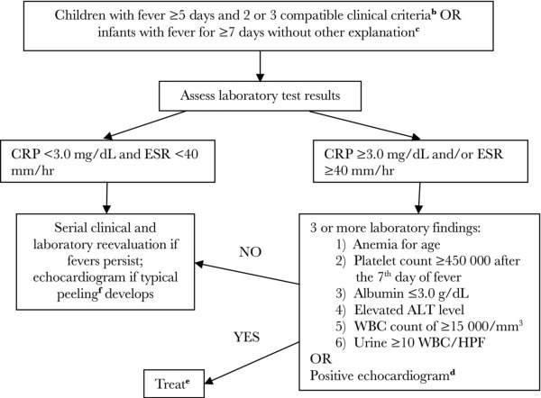

## PDF page 474 | printed page 460

If coronary artery aneurysm or dilatation is evident (z score 2.0 for the left anterior descending or right coronary arteries) in any patient evaluated for fever, a presumptive diagnosis of Kawasaki disease should be made. A normal early echocardiographic study is typical and does not exclude the diagnosis but may be useful in evaluation of patients with suspected incomplete Kawasaki disease. In one study, 80% of patients with Kawasaki disease who ultimately developed coronary artery disease had abnormalities (defined as a z score 2.5) on an echocardiogram obtained during the first 10 days of illness.

Other clinical features of Kawasaki disease include irritability, abdominal pain, diarrhea, and vomiting. Other examination and laboratory findings include urethritis with sterile pyuria (70% of cases), mild anterior uveitis, mild elevation of serum hepatobiliary enzyme concentrations (50%), arthralgia or arthritis (10%–20%), marked irritability with cerebrospinal fluid pleocytosis (40%), hydrops of the gallbladder (<10%), pericardial effusion of at least 1 mm (<5%), myocarditis manifesting as congestive heart failure (<5%), and cranial nerve palsy (<1%). Patients typically have multiple elevated acute phase reactants, such as C-reactive protein (CRP), erythrocyte sedimentation rate (ESR), platelets (after the first week of illness), and white blood cells (with left shift). They commonly have a normocytic, normochromic anemia. Persistent resting tachycardia and a hyperdynamic precordium are common findings, and an S3 gallop can be present. Fine desquamation in the groin area can occur in the acute phase of disease (Fink sign). Inflammation or ulceration may be observed at the inoculation scar of previous bacille Calmette-Guérin immunization. Rarely, Kawasaki disease can present with acute shock; these children often have significant thrombocytopenia attributable to consumption coagulopathy, which also causes a low ESR. Group A streptococcal or Staphylococcus aureus toxic shock syndrome should be excluded in such cases.

The average duration of fever in untreated Kawasaki disease is 10 days; however, fever can last 2 weeks or longer. After fever resolves, untreated patients can remain anorexic and/or irritable with decreased activity for 2 to 3 weeks. During this phase, periungual desquamation of the fingers and toes and fine peeling of the hands

and feet may occur. Transverse lines across the nails (Beau lines) sometimes are noted month(s) later. Recurrent disease develops in approximately 1% to 2% of patients in the United States a median of 1.5 years after the index episode. The recurrence rate is 3.5% in Asian and Pacific Islander populations, and up to 9% in children of Filipino ancestry.

Coronary artery abnormalities are serious sequelae of Kawasaki disease, occurring in 20% to 25% of untreated children. Increased risk of developing coronary artery abnormalities is associated with male sex; age <12 months or >8 years; fever for more than 10 days; white blood cell count >15,000/mm3; high relative neutrophil (>80%) and band count; low hemoglobin concentration (<10 g/dL); hypoalbuminemia, hyponatremia, or thrombocytopenia; and fever persisting or recurring >36 hours after completion of immunoglobulin intravenous (IGIV) administration.2 Aneurysms of the coronary arteries most typically occur between 1 and 4 weeks after onset of illness; onset later than 6 weeks is extremely uncommon. Giant coronary artery aneurysms (internal diameter 8 mm or z score 10) are highly predictive of long-term complications. Aneurysms occurring in other medium-sized arteries (eg, iliac, femoral, renal, and axillary vessels) are uncommon and do not occur in the absence of significant coronary abnormalities. In addition to coronary artery disease, carditis can involve the pericardium, myocardium, or endocardium, and mitral or aortic regurgitation or both can develop.

In children with only mild coronary artery dilation, coronary artery dimensions often return to baseline within 6 to 8 weeks after onset of disease. Approximately 50% of coronary aneurysms (but only a small proportion of giant aneurysms) regress by echocardiography to normal luminal size within 1 to 2 years, although this process can result in luminal stenosis or a poorly compliant, fibrotic vessel wall or both.

The current case fatality rate for acute Kawasaki disease in the United States and Japan is less than 0.2%. The principal cause of death is myocardial infarction resulting from coronary artery occlusion attributable to thrombosis or progressive stenosis. The relative risk of mortality is highest within 6 weeks of onset of acute symptoms, but

## PDF page 475 | printed page 461

myocardial infarction and sudden death can occur months to years after the acute episode. There is no current evidence that the vasculitis of Kawasaki disease predisposes to premature atherosclerotic coronary artery disease.

### ETIOLOGY

The etiology is unknown. Epidemiologic and clinical features suggest an infectious and/or an environmental cause or trigger in genetically susceptible individuals. The disease was first described in 1967 by Dr. Tomisaku Kawasaki in a landmark paper titled “Acute Febrile Mucocutaneous Syndrome With Lymphoid Involvement With Specific Desquamation of the Fingers and Toes in Children” in the Japanese journal Arerugi (“Allergy”). This is now known universally as Kawasaki disease, although he did not use that term himself. Dr. Kawasaki died on June 5, 2020, at age 95.

### EPIDEMIOLOGY

Peak age of occurrence in the United States is 6 to 24 months. Fifty percent of patients are younger than 2 years, and 80% are younger than 5 years; cases are uncommon in children older than 8 years, but rare cases have occurred even in young adults. The prevalence of coronary artery abnormalities is higher if treatment (IGIV) is delayed. The male-tofemale ratio is approximately 1.5:1. In the United States, 4,000 to 5,500 cases are estimated to occur each year; the incidence is highest in children of Asian ancestry. More cases, including clusters, occur during winter and spring. Little evidence indicates person-to-person or common-source spread.

The incubation period is unknown.

### DIAGNOSTIC TESTS

No specific diagnostic test is available. The diagnosis is made based on the presence of established clinical criteria after consideration of other possible illnesses, such as staphylococcal or streptococcal toxin-mediated disease; drug reactions (eg, Stevens-Johnson syndrome); MIS-C; measles, adenovirus, Epstein-Barr virus, parvovirus B19, or enterovirus infections; rickettsial disease; leptospirosis; rat bite fever; systemic-onset juvenile idiopathic arthritis; and reactive arthritis. The identification of a respiratory virus by molecular testing does not exclude the diagnosis of Kawasaki disease in infants and children who otherwise have met diagnostic criteria. A markedly

increased ESR and/or serum CRP concentration during the first 2 weeks of illness and an increased platelet count (>450,000/mm3) on days 10 to 21 of illness are almost universal laboratory features. ESR and platelet count usually are normal within 6 to 8 weeks; CRP concentration returns to normal much sooner.

### TREATMENT

Management during the acute phase is directed at decreasing inflammation of the myocardium and coronary artery wall and providing supportive care. Therapy should be initiated as soon as the diagnosis is established or strongly suspected. Once the acute phase has subsided, therapy is directed at prevention of thrombosis for patients with coronary artery abnormalities.

Primary Treatment

Intravenous Immunoglobulin

A single dose of IGIV, 2 g/kg, administered over 10 to 12 hours, results in rapid resolution of fever and other clinical and laboratory indicators of acute inflammation in approximately 85% of patients and has been proven to reduce the risk of coronary artery aneurysms from 17% to 4%. IGIV plus aspirin (see below) is the treatment of choice and should be initiated as soon as the diagnosis is established or strongly suspected and alternative diagnoses are unlikely, whether or not coronary artery abnormalities are detected. Despite prompt treatment with IGIV and aspirin, approximately 2% to 4% of patients develop coronary artery aneurysms even when treatment is initiated before the onset of coronary artery abnormalities.

Effectiveness of therapy initiated later than the 10th day of illness or after detection of coronary artery aneurysms has not been evaluated fully. However, therapy with IGIV and aspirin should be provided for patients in whom the diagnosis is made more than 10 days after the onset of fever who have manifestations of continuing inflammation (ie, elevated ESR or CRP 3.0 mg/dL) plus either fever or coronary artery luminal dimension z score >2.5.

IGIV infusion reactions (chills and hypotension) are not uncommon. Occasionally, Coombspositive hemolytic anemia can complicate IGIV therapy. The risk of hemolysis is increased in patients receiving high/repeated IGIV doses

## PDF page 476 | printed page 462

(usually 2 g/kg) and those with blood groups A, B, or AB, and usually occurs within 5 to 10 days of infusion. Aseptic meningitis can result from IGIV therapy and resolves quickly without neurologic sequelae. IGIV infusion results in elevation of the ESR; therefore, ESR is not a useful test to monitor disease activity after infusion; CRP is not affected by IGIV administration and can be used.

Aspirin

Aspirin is used for its anti-inflammatory (highdose) and antithrombotic (low-dose) activity, although aspirin alone does not decrease the risk of coronary artery abnormalities. Guidelines vary with regard to dose. High-dose aspirin (ranging from 30 to 100 mg/kg per day, depending on country) therapy usually is given until the patient has been afebrile for 48 to 72 hours. This is followed by low-dose aspirin (3 to 5 mg/kg/day, in a single daily dose) until a follow-up echocardiogram 2 to 8 weeks after onset of illness is normal or is continued indefinitely for children in whom coronary artery abnormalities are present. In general, ibuprofen should be avoided in children with coronary aneurysms taking aspirin, because ibuprofen and other nonsteroidal anti-inflammatory drugs with known or potential effects on the cyclooxygenase pathway interfere with the antiplatelet effect of aspirin to prevent thrombosis. Because of the potential risk of Reye syndrome in patients with influenza or varicella receiving salicylates, parents of children receiving aspirin should be instructed to contact their child’s physician promptly if the child develops symptoms of or is exposed to either of these diseases. The child and all household contacts older than 6 months should receive influenza vaccine according to seasonal recommendations. Inactivated (non-live) influenza vaccine (not live attenuated influenza vaccine) should be used in the child receiving aspirin. Family members can receive either inactivated influenza vaccine or live attenuated influenza vaccine.

Adjunctive Therapies for Primary Treatment

The following are 2017 consensus recommendations of the AHA3: (1) single-dose pulse methylprednisolone should not be administered with IGIV as routine primary therapy for patients with Kawasaki disease; and (2) patients believed to be at high risk for development of coronary artery

aneurysms may benefit from primary adjunctive therapy. Risk factors for development of aneurysms include baseline z score 2, age <12 months, Asian ancestry, and high inflammation at baseline. Additional anti-inflammatories to be considered in high-risk patients include administration of a longer course of corticosteroids (eg, prednisolone, 2 mg/kg/day IV, divided every 8 hours until afebrile, then an oral corticosteroid until CRP normalizes, with subsequent tapering over 2–3 weeks) or anticytokine biologics such as infliximab together with IGIV and aspirin. Any consideration of aditional anti-inflammatory adjunctive therapy (eg, anticytokine biologics) in a patient believed to be at high risk should be discussed in consultation with an expert in Kawasaki disease.

Management of IGIV Resistance and Retreatment

Patients should be monitored daily for fever for a week after IGIV infusion. Approximately 30% of patients who receive IGIV, 2 g/kg, plus aspirin have fever within the first 36 hours after completing the IGIV infusion, which is not an indication of therapeutic failure. However, 10% to 20% of treated patients have recrudescent or persistent fever beyond 36 hours and less than 7 days after completion of their IGIV infusion and are termed IGIV resistant. In these situations, the diagnosis of Kawasaki disease should be reevaluated. If Kawasaki disease still is considered to be most likely, treatment for Kawasaki disease should be intensified as these children have an increased risk of developing coronary artery aneurysms as compared to children with Kawasaki disease who respond to the initial dose of IGIV. In such cases, retreatment with IGIV (2 g/kg) or infliximab (10 mg/kg) may be given and high-dose aspirin should be continued. As an alternative, corticosteroids may be given. In one large randomized, controlled study, infliximab as a single infusion was safer (less risk of hemolytic anemia) and more effective (reduced need for additional therapy and shorter hospitalization) when compared with a second infusion of IGIV. Evidence of alteration of coronary artery outcomes associated with different therapies is limited.

Management of patients with Kawasaki disease refractory to a second dose of IGIV, infliximab, or a course of corticosteroids has included use of

## PDF page 477 | printed page 463

cyclosporine, other immune modulating therapies, or plasma exchange but should be undertaken in consultation with an expert in Kawasaki disease.4

Cardiac Care5

Echocardiography should be performed at the time of suspected diagnosis and repeated at 2 weeks, and in most patients, 6 to 8 weeks after diagnosis in children with normal coronary arteries on initial evaluation. Coronary abnormalities warrant closer follow-up with echocardiography. Children at higher risk—for example, children with persistent or recrudescent fever after initial IGIV, baseline coronary artery abnormalities, or very young patients—may require more frequent echocardiograms to guide the need for additional therapies. Children should be assessed during this time for conduction abnormalities, systolic and diastolic dysfunction, and valvular regurgitation. The care of patients with significant cardiac abnormalities should involve a pediatric cardiologist experienced in management of patients with Kawasaki disease and in assessing echocardiographic studies of coronary arteries in children.

Long-term management of Kawasaki disease should be based on the extent of coronary artery involvement. In patients with persistent moderately large coronary artery aneurysms that are not large enough to warrant anticoagulation, clopidogrel (0.2–1 mg/kg/day) to antagonize adenosine diphosphate-mediated platelet activation in combination with prolonged low-dose aspirin is recommended.

Development of giant coronary artery aneurysms (eg, luminal diameter 8 mm, z score 10) usually requires addition of anticoagulant therapy, such as warfarin or low-molecular-weight heparin, to prevent thrombosis. The AHA has provided recommendations regarding criteria for systemic anticoagulation and frequency of echocardiography in those with coronary aneurysms.6 The use of non-vitamin K oral anticoagulants (eg, apixaban) is under evaluation and being used in some centers.

Subsequent Immunization

Measles- and varicella-containing vaccines should be deferred until 11 months after receipt of IGIV, 2 g/kg, for treatment of Kawasaki disease because of possible interference with development of an

adequate immune response. If the child’s risk of exposure to measles or varicella within this period is high, the child should be immunized and then reimmunized at least 11 months after administration of IGIV. Live attenuated varicella-containing vaccines should be avoided during high-dose aspirin therapy because of a theoretical concern of Reye syndrome. The schedule for administration of non-live childhood vaccines should not be interrupted.

### INFECTION PREVENTION AND CONTROL MEASURES IN HEALTH CARE SETTINGS

Standard precautions are indicated.

### CONTROL MEASURES

None.

1 McCrindle BW, Rowley AH, Newburger JW, et al; American Heart Association Rheumatic Fever, Endocarditis, and Kawasaki Disease Committee of the Council on Cardiovascular Disease in the Young; Council on Cardiovascular and Stroke Nursing; Council on Cardiovascular Surgery and Anesthesia; and Council on Epidemiology and Prevention. Diagnosis, treatment, and long-term management of Kawasaki disease: a scientific statement for health professionals from the American Heart Association. Circulation. Published online March 29, 2017; www. ahajournals.org/doi/full/10.1161/ CIR.0000000000000484 2 The terms male and female refer to sex assigned at birth. 3 For further information on the diagnosis and management of Kawasaki disease, see McCrindle BW, Rowley AH, Newburger JW, et al; American Heart Association Rheumatic Fever, Endocarditis, and Kawasaki Disease Committee of the Council on Cardiovascular Disease in the Young; Council on Cardiovascular and Stroke Nursing; Council on Cardiovascular Surgery and Anesthesia; and Council on Epidemiology and Prevention. Diagnosis, treatment, and long-term management of Kawasaki disease: a scientific statement for health professionals from the American Heart Association. Circulation. Published online March 29, 2017. Available at: www.ahajournals.org/doi/ full/10.1161/CIR.0000000000000484 4 For further information on the diagnosis and management of Kawasaki disease, see McCrindle BW, Rowley AH, Newburger JW, et al; American Heart Association Rheumatic Fever, Endocarditis, and Kawasaki Disease Committee of the Council on Cardiovascular Disease in the Young; Council on Cardiovascular and Stroke Nursing; Council on Cardiovascular Surgery and Anesthesia; and Council on Epidemiology and Prevention. Diagnosis, treatment, and long-term management of Kawasaki disease: a scientific statement for health professionals from the American Heart Association. Circulation. Published online March 29, 2017; www.ahajournals.org/doi/full/10.1161/ CIR.0000000000000484 5 For further information on the diagnosis and management of Kawasaki disease, see McCrindle BW, Rowley AH, Newburger JW, et al; American Heart Association Rheumatic Fever, Endocarditis, and Kawasaki Disease Committee of the Council on

## PDF page 478 | printed page 464

Cardiovascular Disease in the Young; Council on Cardiovascular and Stroke Nursing; Council on Cardiovascular Surgery and Anesthesia; and Council on Epidemiology and Prevention. Diagnosis, treatment, and long-term management of Kawasaki disease: a scientific statement for health professionals from the American Heart Association. Circulation. Published online March 29, 2017; www.ahajournals.org/doi/full/10.1161/ CIR.0000000000000484

Image 75.1 A child with Kawasaki disease with striking facial rash and erythema of the oral mucous membrane.

Image 75.3 Characteristic distribution of erythroderma of Kawasaki disease. The rash is accentuated in the perineal area in approximately two-thirds of patients.

Image 75.5 Characteristic desquamation of the skin over the abdomen in a patient with Kawasaki disease. This is the same patient as in Images 75.3 and 75.4.

6 Giglia TM, Massicotte MP, Tweddell JS, et al. Prevention and treatment of thrombosis in pediatric and congenital heart disease: a scientific statement from the American Heart Association. American Heart Association Congenital Heart Defects Committee of the Council on Cardiovascular Disease in the Young, Council on Cardiovascular and Stroke Nursing, Council on Epidemiology and Prevention, and Stroke Council. Circulation. 2013;128(24):2622–2703

Image 75.2 A child with Kawasaki disease with conjunctivitis. Note the absence of conjunctival discharge.

Image 75.4 Generalized erythema and early perianal and palmar desquamation. This is the same patient as in Image 75.3.

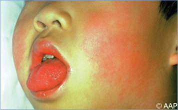

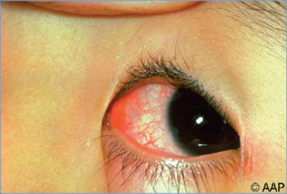

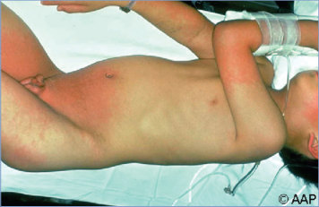

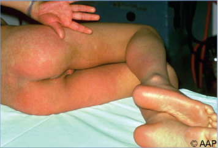

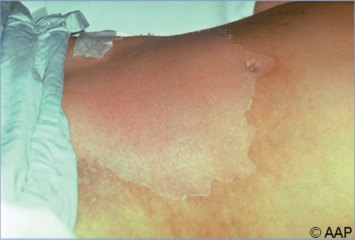

## PDF page 479 | printed page 465

Image 75.6 Periungual desquamation of a patient with Kawasaki disease. This is the same patient as in images 75.3–75.5.

Image 75.8 Erythematous lips and injection of the oropharyngeal membranes in a patient with Kawasaki disease. Scarlet fever, toxic shock syndrome, staphylococcal scalded skin syndrome, and measles may be confused with this disease.

Image 75.10 Bulbar conjunctivitis in a 3-year-old boy with Kawasaki disease. Courtesy of Benjamin Estrada, MD.

Image 75.7 Bulbar conjunctivitis in a patient is generally absent.

Image 75.9 A child with the characteristic desquamation of the hands in a later stage of Kawasaki disease. Copyright Charles Prober, MD.

Image 75.11 Mucositis in a 3-year-old boy with Kawasaki disease. Courtesy of Benjamin Estrada, MD.

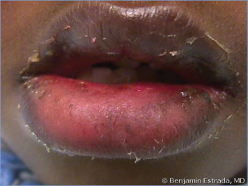

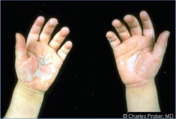

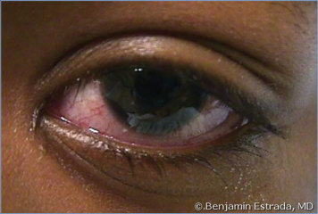

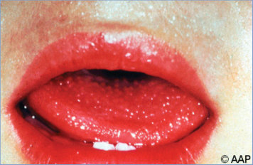

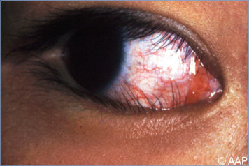

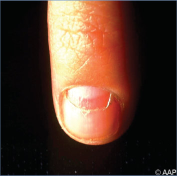
