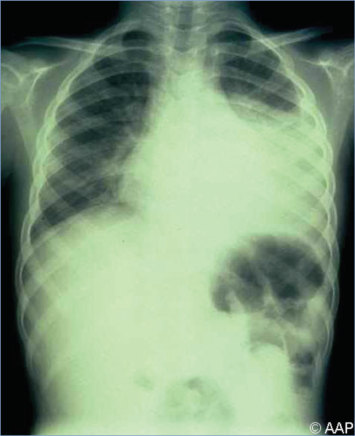
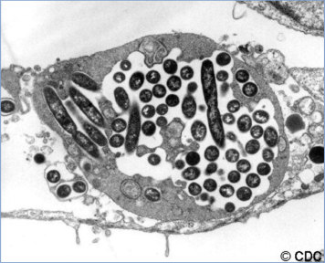
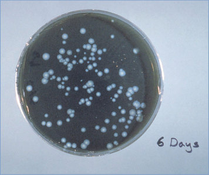
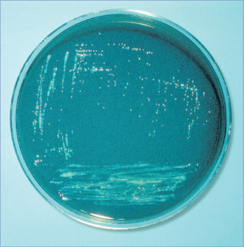
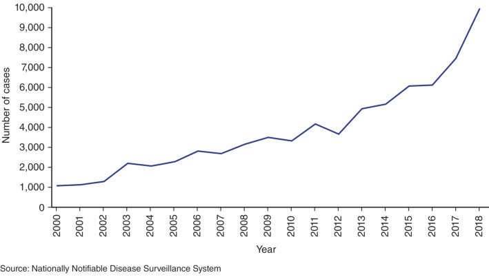

# 77. Legionella Infections
> Private study reference ([source credits](../../SOURCE_CREDITS.md)). PDF pages 483-488; printed pages 469-474.

## PDF page 483 | printed page 469

### CLINICAL MANIFESTATIONS

Legionellosis is primarily associated with 2 clinically and epidemiologically distinct illnesses: Legionnaires’ disease and Pontiac fever; extrapulmonary legionellosis occurs much less frequently. Legionnaires’ disease presents as pneumonia characterized by fever, chills, cough with or without chest pain, and progressive respiratory distress. Legionnaires’ disease can be associated with headache, myalgia, and gastrointestinal tract, central nervous system, and renal manifestations. Overall case fatality rate for Legionnaires’ disease (including adults) is approximately 10%. Sites of extrapulmonary legionellosis in children can include liver, spleen, and brain. In addition, persistent cervical lymphadenitis caused by Legionella species has been reported. In adults, extrapulmonary legionellosis includes endocarditis, graft infections, joint infections, and cutaneous manifestations including wound infections. Pontiac fever is a milder, self-limited febrile illness without pneumonia that is characterized by an abrupt onset of an influenza-like illness (fever, myalgia, headache, weakness).

### ETIOLOGY

Legionella species are fastidious, small, gram-negative, aerobic bacilli that grow on buffered charcoal yeast extract (BCYE) media. They constitute a single genus in the family Legionellaceae. At least 30 of the more than 60 known Legionella species have been implicated in human disease, but the most common species causing infections in the United States is Legionella pneumophila, with most isolates belonging to serogroup 1.

### EPIDEMIOLOGY

Legionnaires’ disease is usually acquired through inhalation of aerosolized water containing Legionella species. Rarely, transmission occurs via microaspiration of Legionella-containing water. Legionella longbeachae, common in some geographic areas such as Australia and New Zealand, is generally acquired through exposure to contaminated soil or compost. In general, Legionnaires’ disease and Pontiac fever are not spread person to person. Outbreaks of Legionnaires’ disease are

commonly associated with buildings or structures that have complex water systems, such as hotels and resorts, long-term care facilities, hospitals, and cruise ships. Sources of infection include Legionella-containing water aerosolized from potable water systems (eg, through showerheads or faucets), cooling towers (parts of centralized air-conditioning systems for large buildings), hot tubs, decorative fountains, and other aerosolizing devices (eg, and humidifiers and respiratory therapy equipment). Multiplication of Legionella organisms in water sources occurs optimally in temperatures between 25oC (77oF) and 45oC (113oF), although Legionella organisms have been recovered from water outside this temperature range.

According to the Centers for Disease Control and Prevention’s National Notifiable Disease Surveillance System data, Legionnaires’ disease cases have increased by almost ninefold since 2000; almost 10,000 cases were reported in 2018. Most cases of Legionnaires’ disease are sporadic, although they may be associated with unidentified outbreaks or clusters. Health care-associated infections most commonly are related to contamination of the hot water supply. Legionnaires’ disease should be considered in the differential diagnosis of patients who develop pneumonia during or after their hospitalization. Legionnaires’ disease is more common among older individuals (>50 years), males, smokers, and people with weakened immune systems, malignancy, or chronic disease.1 Infection in children is rare. Severe disease has occurred in children with malignancy, severe combined immunodeficiency, chronic granulomatous disease, organ transplantation, end-stage renal disease, underlying pulmonary disease, and those treated with systemic corticosteroids or other immunosuppressive agents. Health care-associated cases of Legionella infection in newborn infants, including severe and sometimes fatal cases, have been associated with a Legionellacontaining water source. Severe and fatal infections in neonates have occurred after birth in water (eg, use of a birthing pool or hot tub).2

The incubation period for Legionnaires’ disease is generally 5 to 6 days but can range from 2 to 14 days. For Pontiac fever, the incubation period generally is 1 to 3 days but can be as short as 4 hours.

## PDF page 484 | printed page 470

### DIAGNOSTIC TESTS

When a patient is suspected of having Legionnaires’ disease, testing should include both culture of a lower respiratory tract specimen and urine antigen testing. Detection of Legionella infection from clinical specimens using validated nucleic acid amplification tests (NAATs) is becoming more widely available.

Genus and species-specific NAAT-based assays, including multiplex assays, have been developed that detect Legionella DNA in lower respiratory tract specimens, isolates, and blood. NAATs can detect species and serogroups other than L pneumophila serogroup 1 and can be performed with quick turnaround. Additionally, the results are less likely to be affected by antibiotic use, because the assay detects genetic material as opposed to a viable organism.

Detection of Legionella lipopolysaccharide antigen in urine by commercially available immunoassays is highly specific. This test detects only L pneumophila serogroup 1, and thus other testing methods are needed to detect other L pneumophila serogroups and other Legionella species. Urinary antigen test sensitivity may be increased with increased disease severity.

Culture remains an important diagnostic tool, because it can detect all Legionella species and L pneumophila serogroups and can generate isolates for further investigation, including whole genome sequencing, which can be helpful in outbreak investigations. Recovery of Legionella organisms from lower respiratory tract secretions, lung tissue, pleural fluid, or other normally sterile fluid specimens using BCYE media provides definitive evidence of infection, but the sensitivity of culture is laboratory dependent. Specimens should be plated onto both nonselective BCYE and selective BCYE media containing appropriate antimicrobial agents and incubated at 35°C to 37°C for up to 14 days. Suspicious colonies are commonly identified by demonstrating growth dependence on L-cysteine followed by further confirmation and characterization by serological or molecular tests.

Direct detection of the bacterium in lower respiratory tract specimens by direct immunofluorescent assay is rarely performed, because the specificity is technician dependent and the sensitivity is lower than that for culture or urine immunoassay.

Detection of serum immunoglobulin (Ig) M antibodies is not useful for diagnosis. The positive predictive value of a single elevated IgG titer is low and does not provide definitive evidence of acute infection. A fourfold increase in L pneumophilaspecific IgG antibody titer, as measured by indirect immunofluorescent antibody (IFA), confirms a recent infection. However, this serologic result is not useful for treatment decisions, because convalescent titers take 3 to 4 weeks to increase (and may be delayed for 8 to 12 weeks). Antibodies to several gram-negative organisms, including Pseudomonas species, Bacteroides fragilis, and Campylobacter jejuni, can cause false-positive IFA test results.

### TREATMENT

Patients with Legionnaires’ disease should receive antimicrobial agents. Intravenously administered azithromycin or levofloxacin (or another fluoroquinolone for respiratory tract infection) is recommended. Once the patient is improved clinically, oral therapy can be substituted. Doxycycline is an alternative agent; however, L longbeachae often is resistant. Duration of therapy is generally 5 to 10 days with azithromycin and 7 to 14 days with other drugs, with the longer courses of therapy for patients who are immunocompromised or who have severe disease. Some patients who are immunocompromised or have complicated infections may require extended therapy.

Antimicrobial treatment for patients with Pontiac fever is not recommended, because the disease is self-limiting.

### INFECTION PREVENTION AND CONTROL MEASURES IN HEALTH CARE SETTINGS

Standard precautions are recommended.

### CONTROL MEASURES

The development and implementation of water management programs is the most effective strategy for prevention of Legionnaires’ disease infections associated with buildings that have large or complex water systems or with high-risk devices such as cooling towers, hot tubs, decorative fountains, or other centrally installed aerosolizing devices. In 2017, the Centers for Medicare and Medicaid Services released a survey and

## PDF page 485 | printed page 471

certification memo stating that health care facilities should develop and adhere to the American Society of Heating, Refrigerating and Air- Conditioning Engineers (ASHRAE)-compliant water management programs.3 The Centers for Disease Control and Prevention Toolkit for Controlling Legionella in Common Sources of Exposure4 and ASHRAE Guideline 12-20205 are resources that can help facilities develop water management programs to identify hazardous conditions and implement steps to minimize the risk associated with Legionella organisms and other waterborne pathogens in building water systems. Adequate levels of disinfectant should be maintained in all building water systems. Hospitals should maintain hot water at the highest temperature allowable by state regulations or codes, preferably stored at 60°C (140°F) or greater with a minimum return temperature of 49°C (120°F); precautions should be taken to avoid scalding. Facilities should store and circulate cold water at temperatures below the favorable range for Legionella (25°C–45°C, 77°F–113°F) to minimize waterborne Legionella growth. Legionella may grow at temperatures as low as 20°C (68°F). Some hospitals may choose to perform periodic testing of water samples from the hospital’s potable water system to detect Legionella bacteria.

When 1 presumptive health care-associated case of Legionella infection is identified or when 2 or more possible health care-associated cases occur within 12 months, a full epidemiologic and environmental investigation for the source of Legionella organisms in the health care facility is recommended. A presumptive health careassociated case is a patient with 10 or more days of continuous stay at a health care facility during the 14 days before onset of symptoms. A possible health care-associated case is a patient who spent a portion of the 14 days at a health care facility before onset of symptoms.

Hospitals with solid organ or hematopoietic cell transplantation programs should maintain a high index of suspicion for legionellosis, use sterile

water for the filling and terminal rinsing of nebulization devices, and consider performing routine testing for Legionella species in the potable water supply of the transplant unit. For remedial disinfection, shock chlorination can be used. In addition, targeted application of point-of-use water filters and water restrictions can be immediately implemented and can prevent exposure while remediation is performed and its effectiveness verified. Optional supplemental measures for long-term control of Legionella in potable water to prevent health care-associated infections include copper-silver ionization; addition of chlorine, monochloramine, or chlorine dioxide; and ultraviolet light when implemented as part of a comprehensive water management program.

Public Health Reporting

Infection with Legionella species is a nationally notifiable disease in the United States. Health care providers should promptly report legionellosis cases to the local or state health department.

1 The terms male and female refer to sex assigned at birth. 2 Nolt D, O’Leary ST, Aucott SW; American Academy of Pediatrics, Committee on Infectious Diseases, Committee on Fetus and Newborn. Risks of infectious diseases in newborns exposed to alternative perinatal practices. Pediatrics. 2022;149(2):e2021055554 3 Centers for Medicare and Medicaid Services. Requirement to Reduce Legionella Risk in Healthcare Facility Water Systems to Prevent Cases and Outbreaks of Legionnaires Disease (LD). Memo No. 17-30-Hospitals/CAHs/NHs. Centers for Medicare and Medicaid Services; 2018. Available at: www.cms.gov/ Medicare/Provider-Enrollment-and-Certification/ SurveyCertificationGenInfo/Policy-and-Memos-to- States-and-Regions-Items/Survey-And-Cert- Letter-17-30- 4 Centers for Disease Control and Prevention. Toolkit for Controlling Legionella in Common Sources of Exposure. Available at: www.cdc.gov/legionella/wmp/control-toolkit/ index.html 5 American Society of Heating, Refrigerating and Air-Conditioning Engineers. Managing the Risk of Legionellosis Associated with Building Water Systems. ASHRAE Guideline 12-2020. ASHRAE; 2020. Available at: www.techstreet.com/ ashrae/standards/guideline-12-2020-managing-therisk-of-legionellosis-associated-with-building-watersystems?product_id52111422

## PDF page 486 | printed page 472

Image 77.1 An adult with pneumonia caused by Legionella pneumophila. Legionella infections are rare in otherwise healthy children. Although nosocomial infections and hospital outbreaks are reported, this infection is not transmitted from person to person.

Image 77.3 This anteroposterior radiograph revealed bilateral pulmonary infiltrates in a patient with Legionnaires’ disease. Legionnaires’ disease is an acute and sometimes fatal respiratory illness caused by Legionella pneumophila bacteria, whereby headache, high fever, cough, and flu-like symptoms accompany the condition. Courtesy of Centers for Disease Control and Prevention.

Image 77.2 This hematoxylin-eosin–stained micrograph of lung tissue biopsied from a patient with Legionnaires’ disease revealed the presence of an intra-alveolar exudate consisting of macrophages and polymorphonuclear leukocytes. The Legionella pneumophila bacteria are not stained in this preparation (magnification 3500). Courtesy of Centers for Disease Control and Prevention.

Image 77.4 This Gram-stained micrograph reveals chains and solitary gram-negative Legionella pneumophila bacteria found within a sample taken from an individual in the 1976 Legionnaires’ disease outbreak in Philadelphia, PA. Legionnaires’ disease is the more severe form of legionellosis and is characterized by pneumonia, commencing 2 to 10 days after exposure. Pontiac fever is an acute-onset, flu-like, non-pneumonic illness, occurring within 1 to 2 days of exposure. Courtesy of Centers for Disease Control and Prevention.

![Image 77.4 This Gram-stained micrograph reveals chains and solitary gram-negative Legionella pneumophila bacteria found within a sample taken from an individual in the 1976 Legionnaires’ disease outbreak in Philadelphia, PA. Legionnaires’ disease is the more severe form of legionellosis and is characterized by pneumonia, commencing 2 to 10 days after exposure. Pontiac fever is an acute-onset, flu-like, non-pneumonic illness, occurring within 1 to 2 days of exposure. Courtesy of Centers for Disease Control and Prevention.](../../figures/ch077_p0486_04.jpg)

## PDF page 487 | printed page 473

Image 77.5 Legionella pneumophila multiplying inside a cultured human lung fibroblast. Courtesy of Centers for Disease Control and Prevention.

Image 77.7 Charcoal yeast extract agar plate culture of Legionella pneumophila. Courtesy of Centers for Disease Control and Prevention.

Image 77.6 Charcoal yeast extract agar plate culture of Legionella pneumophila. Courtesy of Centers for Disease Control and Prevention.

Image 77.8 This photograph shows numbers of Legionella species colonies that had been cultivated on an agar-cultured plate and illuminated with ultraviolet light. At least 46 Legionella species and 70 serogroups have been identified. Legionella pneumophila, a ubiquitous aquatic bacterial organism that thrives in warm environments, primarily at temperatures ranging from 32°C to 45°C (89.6°F–113.0°F), causes >90% of cases of Legionnaires’ disease in the United States. Courtesy of Centers for Disease Control and Prevention.

![Image 77.8 This photograph shows numbers of Legionella species colonies that had been cultivated on an agar-cultured plate and illuminated with ultraviolet light. At least 46 Legionella species and 70 serogroups have been identified. Legionella pneumophila, a ubiquitous aquatic bacterial organism that thrives in warm environments, primarily at temperatures ranging from 32°C to 45°C (89.6°F–113.0°F), causes .90% of cases of Legionnaires’ disease in the United States. Courtesy of Centers for Disease Control and Prevention.](../../figures/ch077_p0487_04.jpg)

## PDF page 488 | printed page 474

Image 77.9 Legionnaires’ disease is increasing in the United States, 2000–2018. Courtesy of Centers for Disease Control and Prevention.

A

C

Image 77.10 Imaging studies obtained in a 42-year-old man with severe pneumonia caused by Legionella pneumophila serogroup 11, showing lobar consolidation of the left lower lung lobe, with an air bronchogram within the homogeneous airspace consolidation. Consensual mild pleural effusion was documented by a chest radiograph (A) and high-resolution computed tomographic scan (B). A week after hospital admission, repeated high-resolution computed tomography of the chest showed extensive and homogeneous consolidation of the left upper and lower lobes, accompanied by bilateral ground-glass opacities (C, D). Courtesy of Emerging Infectious Diseases.

B

D

![Image 77.10 Imaging studies obtained in a 42-year-old man with severe pneumonia caused by Legionella pneumophila serogroup 11, showing lobar consolidation of the left lower lung lobe, with an air bronchogram within the homogeneous airspace consolidation. Consensual mild pleural effusion was documented by a chest radiograph (A) and high-resolution computed tomographic scan (B). A week after hospital admission, repeated high-resolution computed tomography of the chest showed extensive and homogeneous consolidation of the left upper and lower lobes, accompanied by bilateral ground-glass opacities (C, D). Courtesy of Emerging Infectious Diseases.](../../figures/ch077_p0488_01.jpg)

