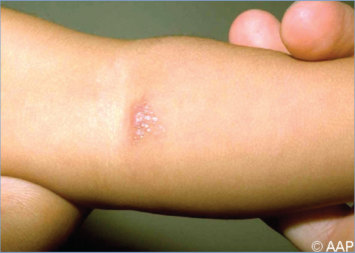
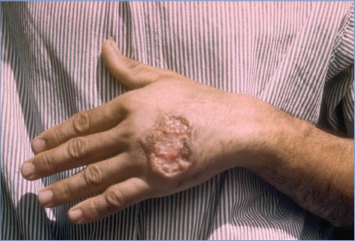
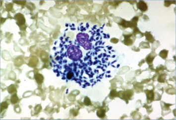
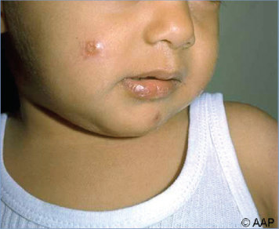
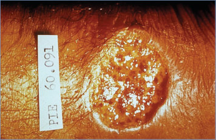
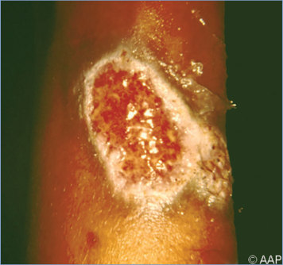
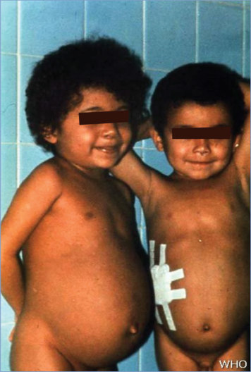
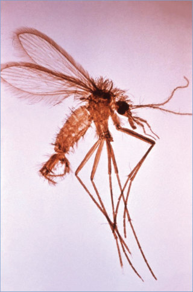
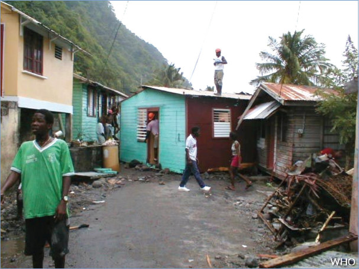
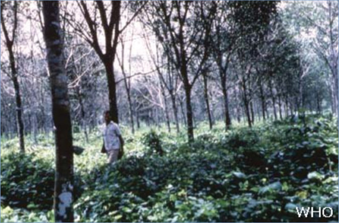

# 78. Leishmaniasis
> Private study reference ([source credits](../../SOURCE_CREDITS.md)). PDF pages 489-496; printed pages 475-482.

## PDF page 489 | printed page 475

### CLINICAL MANIFESTATIONS

Cutaneous Leishmaniasis

After inoculation by the bite of an infected female phlebotomine sand fly (approximately 2–3 mm long), parasites proliferate locally in mononuclear phagocytes, leading to an erythematous papule that typically enlarges slowly to become a nodule and then an ulcerative lesion with raised, indurated borders. Ulcerative lesions may become dry and crusted or may develop a moist granulating base with overlying exudate. Lesions can persist as nodules, papules, or plaques and may be single or multiple. Lesions commonly appear on exposed areas of the body (eg, face and extremities) and may be accompanied by satellite lesions, sporotrichoid-like nodules, and regional adenopathy. Spontaneous resolution of lesions may take weeks to years, depending, in part, on the Leishmania species/strain, and usually results in a flat, atrophic scar.

Mucosal Leishmaniasis (Espundia)

Mucosal leishmaniasis traditionally refers to a metastatic sequela of New World cutaneous infection resulting from dissemination of the parasite from the skin to the naso-oropharyngeal/laryngeal mucosa. This form of leishmaniasis typically is caused by species in the Viannia subgenus. Mucosal involvement attributable to local extension of cutaneous facial lesions has a different pathophysiology. Mucosal disease usually becomes evident clinically months to years after the original cutaneous lesions have healed, although mucosal and cutaneous lesions may be noted simultaneously, and some affected people have had subclinical cutaneous infection. Untreated mucosal leishmaniasis can progress to cause ulcerative destruction of the mucosa (eg, perforation of the nasal septum) and facial disfigurement.

Visceral Leishmaniasis (Kala-Azar)

After cutaneous inoculation by an infected sand fly, the parasite spreads throughout the reticuloendothelial system (ie, within macrophages in spleen, liver, and bone marrow) leaving no or a minimal skin lesion at the bite site. Clinical

manifestations include fever, weight loss, hepatosplenomegaly, pancytopenia (anemia, leukopenia, and thrombocytopenia), hypoalbuminemia, and hypergammaglobulinemia. Hemophagocytic lymphohistiocytosis has been reported as a complication of visceral leishmaniasis. Peripheral lymphadenopathy is common in East Africa (eg, South Sudan). Some patients in South Asia (the Indian subcontinent) develop grayish discoloration of their skin; this manifestation gave rise to the Hindi term kala-azar (“black sickness”). Untreated, advanced cases of visceral leishmaniasis almost always are fatal, either directly from the disease or from complications, such as secondary bacterial infections or hemorrhage. Visceral infection can, alternatively, be asymptomatic or have few symptoms. Latent visceral infection can reactivate years to decades after exposure in people who become immunocompromised (eg, because of coinfection with HIV or immunosuppressive/immunomodulatory therapy). Some patients develop post-kala-azar dermal leishmaniasis (PKDL) during or after treatment of visceral leishmaniasis.

Post-Kala-Azar Dermal Leishmaniasis

PKDL is a dermatosis that generally develops as a sequela after apparent successful cure from visceral leishmaniasis. In the Indian subcontinent variant, polymorphic lesions (coexistence of macules/patches along with papulonodules) are prevalent, whereas the Sudanese variant has papular or nodular lesions.

### ETIOLOGY

In the human host, Leishmania species are obligate intracellular protozoan parasites of mononuclear phagocytes. Together with Trypanosoma species, they constitute the family Trypanosomatidae. Approximately 20 Leishmania species (in the Leishmania and Viannia subgenera) are known to infect humans. Cutaneous leishmaniasis typically is caused by Old World species Leishmania tropica, Leishmania major, and Leishmania aethiopica and by New World species Leishmania mexicana, Leishmania amazonensis, Leishmania (Viannia) braziliensis, Leishmania (V) panamensis, Leishmania (V) guyanensis, and Leishmania (V) peruviana. Mucosal leishmaniasis typically is caused by species in the Viannia subgenus, especially L (V) braziliensis but also L (V) panamensis and L (V) guyanensis. Most cases of visceral

## PDF page 490 | printed page 476

leishmaniasis are caused by Leishmania donovani or Leishmania infantum (Leishmania chagasi is synonymous). L donovani and L infantum also can cause cutaneous and mucosal leishmaniasis, although people with typical cutaneous leishmaniasis caused by these organisms rarely develop visceral leishmaniasis. Recently, emerging foci of both cutaneous and visceral infection with Leishmania (Mundinia) species have been reported from the Caribbean, Ghana, and Southeast Asia. PKDL has been reported to be caused primarily by L donovani, both in the Indian subcontinent and Sudan.

### EPIDEMIOLOGY

Leishmaniasis is a zoonosis in most settings, with mammalian reservoir hosts, such as rodents or dogs. Some transmission cycles are anthroponotic: infected humans are the primary or only reservoir hosts of L donovani in South Asia (potentially also in East Africa) and of L tropica. Congenital and parenteral (ie, shared needles, blood transfusion) transmission also have been reported.

Leishmaniasis has been endemic in more than 90 countries in the tropics, subtropics, and southern Europe. Visceral leishmaniasis (50,000– 90,000 new cases annually) is found in focal areas in the Old World; in parts of Asia (particularly South, Southeast, Southwest, and Central Asia), Africa (East and Central Africa, including a recent outbreak in Chad), the Middle East, and southern Europe; and in the New World, particularly in Brazil. In 2020, most (>90%) of the world’s reported cases of visceral leishmaniasis occurred in 10 countries: Brazil, China, Eritrea, Ethiopia, India, Kenya, Somalia, South Sudan, Sudan, and Yemen.

Cutaneous leishmaniasis is more common (0.6 to 1 million new cases annually). Approximately 90% of cutaneous leishmaniasis occurs in the Americas, the Mediterranean basin, parts of the Middle East, and Central Asia. Ten countries, Afghanistan, Algeria, Brazil, Colombia, Iraq, Libya, Pakistan, Peru, the Syrian Arab Republic, and Tunisia, accounted for over 85% of new cases of cutaneous leishmaniasis in 2020. In general, the geographic distribution of leishmaniasis cases identified in the United States reflects immigration from and travel patterns to regions with endemic disease. Autochthonous human cases of

cutaneous leishmaniasis, mostly associated with L mexicana, have been reported in several southwest states including Texas, Oklahoma, and Arizona.

PKDL is confined mainly to 2 regions with endemic kala-azar: the Indian subcontinent (India, Nepal, Sri Lanka, and Bangladesh) and East Africa, mainly Sudan, although case reports have emanated from China, Iraq, and Iran. In the Indian subcontinent, transmission of visceral leishmaniasis is anthroponotic, whereas in Sudan it is zoonotic and anthroponotic; therefore, patients with PKDL are the proposed disease reservoir of visceral leishmaniasis in the Indian subcontinent. Young adults are affected more commonly in the Indian subcontinent and children are affected more commonly in Sudan.

Incubation periods for the various forms of leishmaniasis range from weeks to years. The primary skin lesions of cutaneous leishmaniasis typically appear within several weeks of exposure. The incubation period of visceral infection usually ranges from approximately 2 to 6 months. PKDL in Sudan develops within 6 months of treatment but in India can develop decades after cure of visceral leishmaniasis.

### DIAGNOSTIC TESTS

Definitive diagnosis is made by detecting the parasite (amastigote stages) in infected tissue (eg, of aspirates, scrapings, touch preparations, or histologic sections) by light-microscopic examination of slides stained with Giemsa, hematoxylin and eosin, or other stains, by in vitro culture (available at reference laboratories), or increasingly by molecular methods (detection of parasite DNA by nucleic acid amplification tests [NAATs]). The latter are reported to be more sensitive than microscopy or culture. The SMART-Leish NAAT used by the U.S. military leishmaniasis diagnostic laboratory is cleared by the U.S. Food and Drug Administration (FDA). In cutaneous and mucosal disease, tissue can be obtained by a 3-mm punch biopsy, lesion scrapings, or needle aspiration of the raised nonnecrotic edge (biopsy) or the ulcer base of the lesion. In visceral leishmaniasis, although the sensitivity is highest (approximately 95%) for splenic aspiration, the procedure can be associated with life-threatening hemorrhage; bone marrow aspiration is safer and generally preferred.

## PDF page 491 | printed page 477

Other potential sources of specimens include liver, lymph node, and, in some patients (eg, those coinfected with HIV), whole blood or buffy coat. Identification of Leishmania species (eg, via isoenzyme analysis of cultured parasites or molecular approaches) may affect prognosis and influence treatment decisions. The Centers for Disease Control and Prevention (CDC) (www.cdc.gov/ parasites/leishmaniasis) can assist in all aspects of diagnostic testing. Serologic testing usually is not helpful in the evaluation of potential cases of cutaneous leishmaniasis but can provide supportive evidence for diagnosis of visceral or mucosal leishmaniasis, particularly if the patient is immunocompetent. The rK39 immunochromatographic assay is FDA cleared for presumptive diagnosis of visceral leishmaniasis and is commercially available.

### TREATMENT

Guidelines published in 2016 from the Infectious Diseases Society of America and the American Society of Tropical Medicine and Hygiene provide a detailed approach to diagnosis and treatment.1 Systemic antileishmanial treatment always is indicated for patients with symptomatic visceral or mucosal leishmaniasis, whereas not all patients with cutaneous leishmaniasis need to be treated or require systemic therapy. Consultation with infectious disease or tropical medicine specialists and with staff of the CDC Division of Parasitic Diseases and Malaria is recommended (telephone: 404-718-4745; email: parasites@cdc. gov; CDC Emergency Operations Center [after business hours and on weekends]: 770-488-7100). The relative merits of various treatment approaches/regimens for an individual patient should be considered, taking into account that the therapeutic response may vary, not only for different Leishmania species but also for the same species in different geographic regions. Special considerations apply in the United States regarding availability of particular medications. For example, currently the pentavalent antimonial compounds (eg, sodium stibogluconate) are not available except under an investigator-initiated investigational new drug application.

Liposomal amphotericin B is approved by the FDA for treatment of visceral leishmaniasis. The oral agent miltefosine is approved for treatment of cutaneous, mucosal, and visceral leishmaniasis;

the FDA-approved indications are limited to infections caused by particular Leishmania species and to patients who are at least 12 years of age, weigh at least 30 kg (66 lb), and are not pregnant or breastfeeding during and for 5 months after the treatment course.

### INFECTION PREVENTION AND CONTROL MEASURES IN HEALTH CARE SETTINGS

Standard precautions are recommended.

### CONTROL MEASURES

The best way for travelers to prevent leishmaniasis is by protecting themselves from sand fly bites. Vaccines and drugs for preventing infection are not available. To decrease the risk of being bitten, travelers should take the following measures:

• Stay in well-screened or air-conditioned areas when feasible. Avoid outdoor activities, especially from dusk to dawn, when sand flies generally are most active.

• When outside, wear long-sleeved shirts, long pants, and socks.

• Apply insect repellent on uncovered skin and under the ends of sleeves and pant legs. Follow instructions on the label of the repellent. The most effective repellents generally are those that contain the chemical N,N-diethylmeta-toluamide (DEET).

• Spray clothing items with a pyrethroidcontaining insecticide several days before travel, and allow them to dry. The insecticide should be reapplied after every 5 washings. Permethrin should never be applied to skin.

• Spray living and sleeping areas with an insecticide.

• Use a bed net tucked under the mattress if not sleeping in an area that is well screened or air conditioned. If at all possible, a bed net that has been soaked in or sprayed with a pyrethroidcontaining insecticide should be used; the insecticide will be effective for several months if the bed net is not washed. Because sand flies are much smaller than mosquitoes and can penetrate through smaller holes, fine-mesh netting, which may be uncomfortable in hot weather, is needed for an effective physical

## PDF page 492 | printed page 478

barrier against sand flies if the bed net is not impregnated.

• Purchase bed nets, repellents containing DEET, and permethrin before traveling.

Other considerations for prevention of leishmaniasis include early, effective treatment of infected persons, particularly those infected with anthroponotically transmitted parasites for which competent vectors exist; and treatment (to prevent

Image 78.1 Leishmania organisms in a peripheral blood smear from a young man with HIV infection who had visited a jungle in Central America. (See also Human Immunodeficiency Virus Infection.)

Image 78.3 Cutaneous leishmaniasis. Infected sand fly inoculation site with satellite lesions. The organism may be demonstrated by means of punch biopsy of the margin of a cutaneous lesion. This is the same child as in Image 78.2.

potential congenital transmission) of pregnant people with visceral leishmaniasis. Leukoreduction filtering of blood products may decrease risk of acquiring visceral leishmaniasis through transfusion.

1 Aronson N, Herwaldt BL, Libman M, et al. Diagnosis and treatment of leishmaniasis: clinical practice guidelines by the Infectious Diseases Society of America (IDSA) and the American Society of Tropical Medicine and Hygiene (ASTMH). Clin Infect Dis. 2016;63(12):e202–e264

Image 78.2 Cutaneous leishmaniasis, as in this boy from India, seldom disseminates in people with immunocompetence. Multiple organisms can usually be found at biopsy of the border of a lesion.

Image 78.4 Skin ulcer caused by leishmaniasis; hand of Central American adult. Courtesy of Centers for Disease Control and Prevention.

## PDF page 493 | printed page 479

Image 78.5 Crater lesion of leishmaniasis, skin. Courtesy of Centers for Disease Control and Prevention.

Image 78.7 Two young boys with visceral leishmaniasis, with distended abdomens caused by hepatosplenomegaly. Courtesy of World Health Organization/TDR/Lainson/Wellcome Trust.

Image 78.6 Leishmaniasis of the forearm with severe cutaneous involvement. Courtesy of Hugh Moffet, MD.

## PDF page 494 | printed page 480

A

Image 78.8 Leishmania tropica amastigotes from a skin touch preparation. A, Still intact macrophage is practically filled with amastigotes, several of which have a clearly visible nucleus and a kinetoplast (arrows). B, Amastigotes are being freed from a rupturing macrophage. The patient has a history of travel to Egypt, Africa, and the Middle East. Culture in Novy-MacNeal-Nicolle medium followed by isoenzyme analysis helped identify the species as L tropica minor. Courtesy of Centers for Disease Control and Prevention.

Sand fly injects promastigotes into the skin during a blood meal. *infective stage

Promastigotes divide and migrate to the anterior midgut and foregut.

Sand fly stages

Amastigotes transform into promastigotes in midgut.

Ingestion of parasitized cell. Sand fly ingests infected macrophages when it takes a blood meal.

Image 78.9 Leishmaniasis is transmitted by the bite of female Phlebotomine sand flies. The sand flies inject the infective stage, promastigotes, during blood meals. Promastigotes that reach the puncture wound are phagocytized by macrophages and transform into amastigotes. Amastigotes multiply in infected cells and affect different tissues, depending, in part, on the Leishmania species. This originates the clinical manifestations of leishmaniasis. Sand flies become infected during blood meals on an infected host when they ingest macrophages infected with amastigotes. In the sand fly’s midgut, the parasites differentiate into promastigotes, which multiply and migrate to the proboscis. Courtesy of National Institute of Allergy and Infectious Diseases.

B

Promastigotes are phagocytized by neutrophils that are rapidly recruited to the bite site.

Infected neutrophils release the parasites, which are then consumed by macrophages.

Human stages

Promastigotes transform into amastigotes inside macrophages. *diagnostic stage

Amastigotes multiply in cells (including macrophages) of various tissues. *diagnostic stage

![Image 78.9 Leishmaniasis is transmitted by the bite of female Phlebotomine sand flies. The sand flies inject the infective stage, promastigotes, during blood meals. Promastigotes that reach the puncture wound are phagocytized by macrophages and transform into amastigotes. Amastigotes multiply in infected cells and affect different tissues, depending, in part, on the Leishmania species. This originates the clinical manifestations of leishmaniasis. Sand flies become infected during blood meals on an infected host when they ingest macrophages infected with amastigotes. In the sand fly’s midgut, the parasites differentiate into promastigotes, which multiply and migrate to the proboscis. Courtesy of National Institute of Allergy and Infectious Diseases.](../../figures/ch078_p0494_01.jpg)

![Image 78.8 Leishmania tropica amastigotes from a skin touch preparation. A, Still intact macrophage is practically filled with amastigotes, several of which have a clearly visible nucleus and a kinetoplast (arrows). B, Amastigotes are being freed from a rupturing macrophage. The patient has a history of travel to Egypt, Africa, and the Middle East. Culture in Novy-MacNeal-Nicolle medium followed by isoenzyme analysis helped identify the species as L tropica minor. Courtesy of Centers for Disease Control and Prevention.](../../figures/ch078_p0494_02.jpg)

## PDF page 495 | printed page 481

Image 78.10 This image depicts a mounted male Phlebotomus species fly, which, because of its resemblance, may be mistaken for a mosquito. Phlebotomus species sand flies are bloodsucking insects that are very small and sometimes act as the vectors for various diseases, such as leishmaniasis and bartonellosis (also known as Carrión disease). Courtesy of Centers for Disease Control and Prevention.

Image 78.11 A shantytown, another environment where Leishmania infection proliferates because of inadequate housing and lack of sanitation. Courtesy of World Health Organization.

## PDF page 496 | printed page 482

Image 78.12 Natural uncut forests are transmission sites for leishmaniasis. People who collect rubber or clear these areas for agriculture are prone to infection. Courtesy of World Health Organization/TDR/Lainson/Wellcome Trust.

