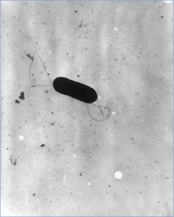
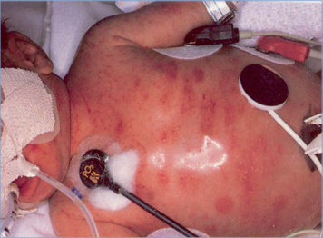
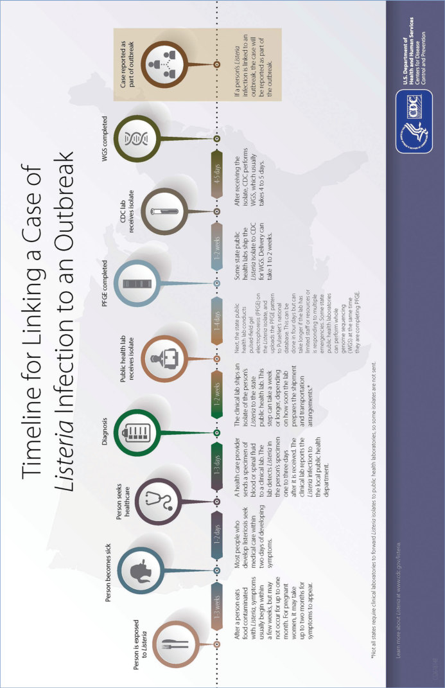

# 81. Listeria monocytogenes Infections (Listeriosis)
> Private study reference ([source credits](../../SOURCE_CREDITS.md)). PDF pages 507-512; printed pages 493-498.

## PDF page 507 | printed page 493

(Listeriosis)

### CLINICAL MANIFESTATIONS

Listeriosis is an uncommon infection caused by Listeria monocytogenes that manifests as invasive disease or as self-limited gastroenteritis. Transmission predominantly is foodborne. Invasive disease can occur in previously well children but occurs most frequently among pregnant people and their fetuses or newborns, older adults, and people of all ages with impaired cellmediated immunity. Infection during pregnancy can be asymptomatic or associated with a nonspecific febrile illness with myalgia, back pain, and occasionally gastrointestinal tract symptoms. Common adverse outcomes include spontaneous abortion, fetal death, preterm delivery, and neonatal infection or death. Fetal infection generally results from transplacental transmission following bacteremia in the pregnant person, although other mechanisms include inhalation of infected amniotic fluid and infection ascending from vaginal colonization of the birthing parent. When listeriosis is diagnosed in a neonate, a history of recent illness in the birthing parent compatible with Listeria infection is obtained in approximately 65% of cases. Amnionitis during labor, brown staining of amniotic fluid, or asymptomatic perinatal infection can occur.

Neonates can present with early- or late-onset disease. Preterm birth, pneumonia, and septicemia are common when infection occurs within the first week of life. An erythematous rash with small, pale papules characterized histologically by granulomas, termed “granulomatosis infantisepticum,” can occur in severe newborn infection. Late-onset infections typically occur between 7 to 30 days of age and usually result in meningitis. Late-onset infection may result from acquisition of the organism during passage through the birth canal or, rarely, from environmental sources. Health care-associated nursery outbreaks have been reported.

Beyond the neonatal period, invasive listeriosis usually presents as bacteremia, meningitis with or without parenchymal brain involvement, and less

commonly brain abscess or endocarditis. L monocytogenes also can cause rhombencephalitis (brainstem encephalitis) in otherwise healthy adolescents and young adults. Outbreaks of gastroenteritis caused by food contaminated with a very large inoculum of L monocytogenes have been reported.

### ETIOLOGY

L monocytogenes is a facultatively anaerobic, nonspore-forming, nonbranching, motile, gram-positive rod that multiplies intracellularly. It has been assigned to the family Listeriaceae along with 5 other traditional and several more recently named species. The organism grows readily on blood agar and produces beta hemolysis. L monocytogenes serotypes 1/2a, 4b, and 1/2b grow well at refrigerator temperatures (4°C–10°C).

### EPIDEMIOLOGY

L monocytogenes causes approximately 1,000 cases of invasive disease annually in the United States, and approximately 15% of cases are associated with pregnancy. Pregnant people have a 10 to 20 times higher risk of infection compared with other healthy adults. The mortality rate is highest among older adults and immunocompromised people, including neonates. The saprophytic organism is distributed widely in the environment and is an important cause of illness in ruminants. Foodborne transmission causes outbreaks and sporadic infections in humans. Common food sources include deli-style, ready-to-eat meats, particularly poultry; unpasteurized milk1; and soft cheeses, including Mexican-style cheese. Approximately 25% of global outbreaks are attributable to foods not traditionally associated as sources of L monocytogenes, such as ice cream and fresh and frozen fruits and vegetables. Listeriosis is a relatively rare foodborne illness (<1% of reported foodborne illness in the United States) but has the highest case fatality rate (20%) among all foodborne pathogens tracked by the Centers for Disease Control and Prevention (www.cdc.gov/foodnet/index.html). The incidence of listeriosis decreased substantially in the United States during the 1990s, when regulatory agencies began enforcing rigorous screening guidelines for L monocytogenes in processed foods and better detection methods became available to identify contaminated foods. The

## PDF page 508 | printed page 494

prevalence of stool carriage of L monocytogenes among healthy, asymptomatic adults is estimated to be 1% to 5%.

The incubation period for invasive disease is longer for pregnancy-associated cases (2–4 weeks or occasionally longer) than for nonpregnancyassociated cases (1 to 14 days). The incubation period for gastroenteritis following ingestion of a large inoculum is 24 hours; illness typically lasts 2 to 3 days.

### DIAGNOSTIC TESTS

L monocytogenes can be recovered readily on blood agar from cultures of blood, cerebrospinal fluid (CSF), meconium, placental or fetal tissue specimens, amniotic fluid, and other infected tissue specimens, including joint, pleural, or peritoneal fluid. Attempts to recover the organism from clinical specimens from nonsterile body sites, including stool, should include the use of selective medium such as Oxford agar or PALCM, as well as enrichment in a Listeria-selective broth. Gram stain of meconium, placental tissue, biopsy specimens of the rash of early-onset infection, or CSF from an infected patient may demonstrate the organism. Although gram-positive rods, the organisms can be gram-variable and can resemble diphtheroids, cocci, or diplococci.

A multiplex polymerase chain reaction diagnostic panel designed to detect agents of meningitis and encephalitis in CSF is cleared by the U.S. Food and Drug Administration and contains L monocytogenes as one of its target organisms; however, its clinical sensitivity is unknown, and parallel culture of CSF should be performed to allow for molecular characterization, especially for outbreak detection.

Another method for identification of Listeria isolates is matrix-assisted laser desorption/ ionization–time-of-flight mass spectrometry.

### TREATMENT

No controlled trials have established the drug(s) of choice or duration of therapy for invasive listeriosis. Combination therapy using ampicillin and a second agent (typically gentamicin) in doses appropriate for meningitis is recommended for severe infections. Use of an alternative second agent that is active intracellularly (eg, trimethoprim-sulfamethoxazole [contraindicated in

infants younger than 2 months], fluoroquinolones, linezolid, or rifampin) is supported by case reports in adults. If these alternatives are used, susceptibility should be confirmed, because resistance to these agents has been reported. In the penicillinallergic patient, options include penicillin desensitization or use of either trimethoprimsulfamethoxazole or a fluoroquinolone, both of which have been used successfully as monotherapy for Listeria meningitis and in the setting of brain abscess. Treatment failures with vancomycin have been reported. Cephalosporins are not active against L monocytogenes.

For bacteremia without associated central nervous system infection, 10 to 14 days of treatment is recommended. For L monocytogenes meningitis, most experts recommend a minimum of 3 weeks of treatment. Longer courses are necessary for patients with endocarditis or parenchymal brain infection (cerebritis, rhombencephalitis, brain abscess). Iron may enhance the pathogenicity of L monocytogenes; iron supplements should be withheld until treatment for listeriosis is complete. Brain imaging near the end of the anticipated duration of therapy allows diagnosis of parenchymal involvement of the brain, which may require prolonged therapy.

### INFECTION PREVENTION AND CONTROL MEASURES IN HEALTH CARE SETTINGS

Standard precautions are recommended.

### CONTROL MEASURES

• Antimicrobial therapy for Listeria infection diagnosed during pregnancy may prevent fetal or perinatal infection and its consequences.

• Neonatal listeriosis complicating successive pregnancies is virtually unknown, so intrapartum antimicrobial therapy is not recommended for people with a history of perinatal listeriosis.

• General and specific guidelines for preventing listeriosis from foodborne sources are provided in Table 81.1.

• Trimethoprim-sulfamethoxazole, given as pneumocystis prophylaxis for those with AIDS, transplant recipients, or others on long-term, high-dose corticosteroids, effectively prevents listeriosis.

## PDF page 509 | printed page 495

Table 81.1 Recommendations for Preventing Foodborne Listeriosis (www.cdc.gov/listeria/prevention.html)

General recommendations:

Washing and handling food

• Rinse raw fruits and vegetables thoroughly under running tap water before eating, cutting, or cooking. Even if the produce will be peeled, it should still be washed first. • Scrub firm produce, such as melons and cucumbers, with a clean produce brush. • Dry the produce with a clean cloth or paper towel. • Separate uncooked meats and poultry from vegetables, cooked foods, and ready-to-eat foods.

Keep your kitchen and environment cleaner and safer

• Wash hands, knives, countertops, and cutting boards after handling and preparing uncooked foods. • Be aware that Listeria monocytogenes can grow in foods in the refrigerator. Use an appliance thermometer, such as a refrigerator thermometer, to check the temperature inside your refrigerator. The refrigerator temperature should be 40°F or colder and the freezer temperature should be 0°F or colder. • Clean up all spills in your refrigerator right away, especially juices from hot dog and lunch meat packages, raw meat, and raw poultry. • Clean the inside walls and shelves of your refrigerator with hot water and liquid soap, then rinse.

Cook meat and poultry thoroughly

• Thoroughly cook raw food from animal sources, such as beef, pork, or poultry to a safe internal temperature. For a list of recommended temperatures for meat and poultry, visit the safe minimum cooking temperatures chart at FoodSafety.gov (www.foodsafety.gov/keep/charts/mintemp.html).

Safety tips for eating melons

• Consumers and food preparers should wash their hands with warm water and soap for at least 20 seconds before and after handling any whole melon such as cantaloupe, watermelon, or honeydew. • Scrub the surface of melons, such as cantaloupes, with a clean produce brush under running water and dry them with a clean cloth or paper towel before cutting. Be sure that your scrub brush is sanitized after each use to avoid transferring bacteria between melons. • Eat cut melon right away or refrigerate it. • Keep cut melon refrigerated at 41°F or colder and for no more than 7 days. • Throw away cut melons left at room temperature for more than 4 hours.

Store foods safely

• Use precooked or ready-to-eat food as soon as you can. Do not store the product in the refrigerator beyond the use-by date; follow USDA refrigerator storage time guidelines, especially for hot dogs and luncheon and deli meats. • Cover leftovers with airtight lids or enclose in plastic wrap or aluminum foil. Use leftovers within 3 to 4 days.

Choose safer foods

• Do not drink raw (unpasteurized) milka (www.cdc.gov/foodsafety/rawmilk/raw-milk-index.html and http://pediatrics.aappublications.org/content/pediatrics/early/2013/12/10/peds.2013-3502.full. pdf) and do not eat foods that have unpasteurized milk in them. • Find more specific information about this topic on the CDC Listeriosis Prevention website (www.cdc.gov/ listeria/prevention.html).

(continues)

## PDF page 510 | printed page 496

Table 81.1 (continued)

Recommendations for people at higher risk, such as pregnant people, people with weakened immune systems, and older adults, in addition to the recommendations listed above:

Meats

• Avoid eating hot dogs, lunch meats, cold cuts, other deli meats (such as bologna), or fermented or dry sausages unless they are heated to an internal temperature of 165°F or until steaming hot just before serving. • Pay attention to labels. Do not eat refrigerated pâté or meat spreads from a deli or meat counter or from the refrigerated section of a store. • Do not eat soft cheese, such as feta, queso blanco, queso fresco, brie, Camembert, blue-veined, or panela (queso panela) unless it is labeled as “MADE WITH PASTEURIZED MILK.” • Be aware that Mexican-style cheeses made from pasteurized milk, such as queso fresco, have caused Listeria infections, most likely because they were contaminated during cheese-making.

Seafood

• Do not eat cold smoked fish unless it is canned or shelf-stable or it is in a cooked dish, such as a casserole. • Do not eat refrigerated smoked fish, such as salmon, trout, whitefish, cod, tuna, and mackerel. Raw sprouts

• Do not eat raw or lightly cooked sprouts of any kind (including alfalfa, clover, radish, and mung bean sprouts) (www.cdc.gov/foodsafety/foods-linked-illness.html#sprouts).

a American Academy of Pediatrics, Committee on Infectious Diseases, Committee on Nutrition. Consumption of raw or unpasteurized milk and milk products by pregnant women and children. Pediatrics. 2014;133(1):175–179 (Reaffirmed November 2019).

Public Health Reporting

Listeriosis is a nationally notifiable disease in the United States. Cases should be reported promptly to the state or local health department to facilitate early recognition and control of common-source outbreaks. Clinical isolates should be forwarded to a public health laboratory for genetic sequencing.

Image 81.1 Cerebrospinal fluid showing characteristic gram-positive rods (Gram stain). Listeriosis is a severe but relatively uncommon infection. Listeriosis occurs most frequently in pregnant women and their fetuses or newborns, people of advanced age, or people with immunocompromise. Copyright Martha Lepow, MD.

1 American Academy of Pediatrics, Committee on Infectious Diseases, Committee on Nutrition. Consumption of raw or unpasteurized milk and milk products by pregnant women and children. Pediatrics. 2014;133(1):175–179 (Reaffirmed November 2019)

Image 81.2 Electron micrograph of a flagellated Listeria monocytogenes bacterium (magnification 341,250). Courtesy of Centers for Disease Control and Prevention.

## PDF page 511 | printed page 497

Image 81.3 Listeria monocytogenes on blood agar. Courtesy of Julia Rosebush, DO; Robert Jerris, PhD; and Theresa Stanley, M(ASCP).

Image 81.5 Number* and rate† of reported foodborne disease outbreaks—Foodborne Disease Outbreak Surveillance System, United States and Puerto Rico 2009–2015. *Total number of reported outbreaks in each area (N 5 5,760), includes 177 multistate outbreaks (ie, outbreaks in which exposure occurred in more than one state) assigned as an outbreak to each state involved. Multistate outbreaks involved a median of 7 states (range, 2–45). †Per 1 million population according to U.S. Census Bureau estimates of the midyear populations for 2009 to 2015. Source: U.S. Census Bureau. Population and housing unit estimates. U.S. Department of Commerce; 2016.

Image 81.4 Skin lesions present at birth in a neonate with congenital pneumonia. Listeria monocytogenes was isolated from blood and skin lesion cultures.

![Image 81.5 Number* and rate† of reported foodborne disease outbreaks—Foodborne Disease Outbreak Surveillance System, United States and Puerto Rico 2009–2015. *Total number of reported outbreaks in each area (N 5 5,760), includes 177 multistate outbreaks (ie, outbreaks in which exposure occurred in more than one state) assigned as an outbreak to each state involved. Multistate outbreaks involved a median of 7 states (range, 2–45). †Per 1 million population according to U.S. Census Bureau estimates of the midyear populations for 2009 to 2015. Source: U.S. Census Bureau. Population and housing unit estimates. U.S. Department of Commerce; 2016.](../../figures/ch081_p0511_03.jpg)

## PDF page 512 | printed page 498

The timeline for linking a case of Listeria infection to an outbreak. CDC indicates Centers for Disease Control and Prevention. Courtesy of Centers for Disease Control and Prevention.

Image 81.6

