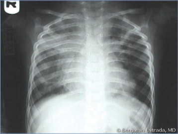
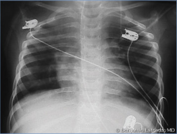

# 88. Human Metapneumovirus
> Private study reference ([source credits](../../SOURCE_CREDITS.md)). PDF pages 587-589; printed pages 573-575.

## PDF page 587 | printed page 573

### CLINICAL MANIFESTATIONS

Human metapneumovirus (hMPV) causes acute respiratory tract illness in people of all ages but is most common in children, especially those younger than 5 years. In infants, hMPV is a common cause of bronchiolitis. In children, hMPV also causes asthma exacerbations, croup, pneumonia, upper respiratory tract infections, and acute otitis media; these may be accompanied by fever. Healthy, young children generally have mild or moderate symptoms when infected with hMPV, but some can develop severe disease requiring hospitalization. Encephalitis has been reported rarely. As with other respiratory viral infections, secondary bacterial pneumonia can occur. Children with underlying cardiopulmonary disease and those born preterm, especially at a gestational age <32 weeks, are at higher risk for hospitalization, have more severe disease, and require longer stays and supplementary oxygen administration. hMPV infection in immunocompromised patients can result in severe disease, and fatalities have been reported in hematopoietic cell or lung transplant recipients. Among adults, hMPV is associated with acute exacerbations of chronic obstructive pulmonary disease and pneumonia. Recurrent infections can occur throughout life and, in people without medical conditions, are usually mild or asymptomatic.

### ETIOLOGY

hMPV is an enveloped single-stranded nonsegmented negative-sense RNA virus in the genus Metapneumovirus of the family Pneumoviridae. Phylogenetic analyses, based on sequence differences in the fusion (F) and attachment (G) surface glycoproteins, have identified 2 major hMPV antigenic lineages further subdivided into 2 clades within each lineage for a total of 5 genotypes (designated A1, A2a, A2b, B1, and B2). Viruses from these different clades cocirculate each year in varying proportions.

### EPIDEMIOLOGY

Humans are the only host. Transmission occurs by direct or close contact with contaminated

secretions via large particle aerosols, droplets, or fomites. Health care-associated infections have been reported.

In temperate climates, hMPV circulation usually occurs during late winter and early spring, overlapping with the latter part of the respiratory syncytial virus (RSV) season, but typically peaks 1 to 2 months later than RSV. Sporadic infections may occur throughout the year, and summer outbreaks have occasionally been described in closed settings. In otherwise healthy infants, the duration of viral shedding is 1 to 2 weeks. Prolonged shedding (weeks to months) has been reported in severely immunocompromised individuals.

Serologic studies suggest that nearly all children are infected at least once by 5 years of age. The incidence of hospitalizations attributed to hMPV is lower than that attributed to RSV but comparable to influenza and parainfluenza 3 in children younger than 5 years. Large studies have shown that hMPV is detected among 5% to 15% of children with medically attended lower respiratory tract illnesses. Worldwide, models have estimated >14 million annual cases of lower respiratory tract infections secondary to hMPV in children younger than 5 years. Overall annual rates of hospitalization associated with hMPV infection are highest in the first year of life but occur throughout childhood. In infants, the peak age of hospitalization is 6 to 12 months (compared with 2 to 3 months for RSV). Coinfection with other respiratory viruses occurs.

The incubation period is 3 to 9 days.

### DIAGNOSTIC TESTS

Nucleic acid amplification tests (NAATs) are the diagnostic method of choice for hMPV. Several NAATs for hMPV are available commercially and have been approved for use by the U.S. Food and Drug Administration. These include reverse transcriptase polymerase chain reaction (RT-PCR) tests for hMPV alone or in multiplex RT-PCR respiratory pathogen panels. hMPV is difficult to isolate in cell culture. Direct fluorescent antibody testing for hMPV detection in respiratory specimens is available in some reference laboratories, with reported sensitivity of 85%. Serologic testing is only used in research settings.

## PDF page 588 | printed page 574

### TREATMENT

Treatment is supportive. In vitro studies and animal models have shown that ribavirin and some preparations of immunoglobulin intravenous have activity against hMPV. There are anecdotal reports using these therapies in humans, but there are no controlled clinical data available to assess whether these have therapeutic benefit, and their use is not routinely recommended. Antimicrobial agents are not indicated in the treatment of infants hospitalized with uncomplicated hMPV bronchiolitis or pneumonia unless evidence exists for the presence of a concurrent bacterial infection. Additional management recommendations for infants with bronchiolitis can be found in the bronchiolitis guidelines from the American Academy of Pediatrics.1

### INFECTION PREVENTION AND CONTROL MEASURES IN HEALTH CARE SETTINGS

In addition to standard precautions, contact and droplet precautions are recommended for the

Image 88.1 Bilateral human metapneumovirus pneumonia in a 3-yearold boy. Courtesy of Benjamin Estrada, MD.

duration of hMPV-associated illness. In immunocompromised patients, the duration of precautions should be extended because of possible prolonged shedding.

### CONTROL MEASURES

Appropriate respiratory and hand hygiene and cough etiquette should be followed. Control of health care-associated hMPV infection depends on adherence to contact and droplet precautions, and routine cleaning and sanitizing of potentially contaminated surfaces. Exposure to hMPVinfected people, including other patients, staff, and family members, may not be recognized because illness may be mild.

Preventive measures outside the health care setting include emphasizing hand and respiratory hygiene in all settings. Commonly used surfaces should be cleaned and sanitized routinely.

1 American Academy of Pediatrics, Subcommittee on Diagnosis and Management of Bronchiolitis. Clinical practice guideline: the diagnosis, management, and prevention of bronchiolitis. Pediatrics. 2014;134(5):e1474–e1502

Image 88.2 Human metapneumovirus bronchiolitis in a 12-month-old boy. Courtesy of Benjamin Estrada, MD.

## PDF page 589 | printed page 575

Image 88.3 Late cytopathic effect of human metapneumovirus in rhesus monkey kidney cell monolayers. Infected cells progressed slowly from focal rounding to detachment from cell monolayer (arrow) (magnification 3100). Courtesy of Emerging Infectious Diseases.

