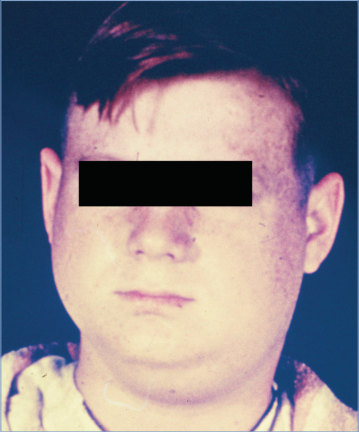
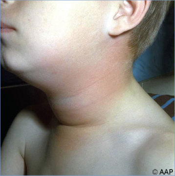
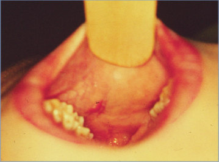
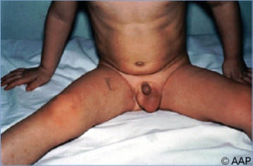
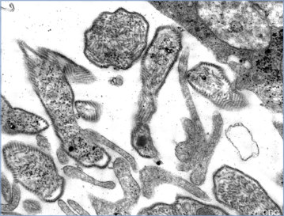
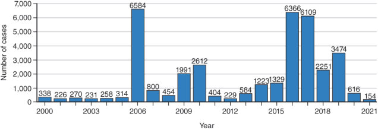

# 93. Mumps
> Private study reference ([source credits](../../SOURCE_CREDITS.md)). PDF pages 607-613; printed pages 593-599.

## PDF page 607 | printed page 593

### CLINICAL MANIFESTATIONS

Mumps is a systemic disease typically characterized by pain and swelling of one or more of the salivary glands, usually the parotid glands. Nonspecific symptoms may precede parotitis, including fever, myalgia, anorexia, malaise, and headache. Approximately one-fifth of infections in unvaccinated people may be asymptomatic. The frequency of asymptomatic infection in vaccinated persons is unknown, but mumps symptoms are usually milder and complications less common among vaccinated people. Parotitis occurs in 95% of symptomatic individuals and may be unilateral initially with involvement of the contralateral parotid gland in 70% of cases. Emergence of contralateral parotitis within weeks to months after apparent recovery has been described. Orchitis is the most frequently reported postpubertal complication and occurs in approximately 30% of those who are unvaccinated and 6% of those who are vaccinated. Unilateral testicular involvement is common. Approximately half of patients with mumps orchitis develop testicular atrophy of affected testicles. More than 50% of people with mumps have cerebrospinal fluid pleocytosis, but fewer than 1% have symptoms of viral meningitis. Uncommon complications include oophoritis, pancreatitis, encephalitis, hearing loss (either transient or permanent), arthritis, thyroiditis, mastitis, glomerulonephritis, myocarditis, endocardial fibroelastosis, thrombocytopenia, cerebellar ataxia, and transverse myelitis. In the absence of an immunization program, mumps typically occurs during childhood. Infection in adults is more likely to result in complications. Although mumps virus can cross the placenta, no evidence exists that this transmission results in congenital malformation.

### ETIOLOGY

Mumps is an enveloped RNA virus with 12 genotypes in the genus Rubulavirus in the family Paramyxoviridae. The genus also includes human parainfluenza virus types 2 and 4. Other common infectious causes of parotitis include Epstein-Barr virus, adenovirus, human herpes virus 6, parainfluenza virus types 1 and 3, influenza A virus, enteroviruses, HIV, nontuberculous mycobacterium, and

gram-positive (eg, Staphylococcus aureus) and gram-negative bacteria.

### EPIDEMIOLOGY

Mumps occurs worldwide, and humans are the only known natural hosts. The virus is spread by contact with infectious respiratory tract secretions and saliva. Mumps virus is the only known cause of epidemic parotitis. Historically, the peak incidence of mumps was between January and May and among children younger than 10 years. Mumps vaccine was licensed in the United States in 1967 and recommended for routine childhood immunization in 1977. After implementation of the 2-dose measles, mumps, and rubella (MMR) vaccine recommendation in 1989 for measles control in the United States, mumps declined by 99%. From 2000 to 2005, there were fewer than 300 reported cases per year. However, there has been an increase in the number of reported mumps cases with peak years in 2006, 2016 and 2017 (more than 6,000 cases each year), and 2019 (more than 3,500 cases). Most cases during these peak years occurred in high-density, closecontact settings (eg, university campuses, military barracks) among young adults and persons who previously received 2 doses of MMR. Complications (eg, orchitis) have occurred following mumps outbreaks in college populations. Transmission of mumps has been reported to occur from asymptomatic, fully vaccinated individuals in closecontact social settings, leading to widespread outbreaks. Although secondary vaccine failure attributable to waning vaccine-derived immunity is believed to be an important contributing factor for mumps outbreaks among vaccinated individuals, antigenic differences between currently circulating wild-type strains and the vaccine strain, or lower incidence of subclinical immunologic boosting because of lack of exposure to wild-type virus may also play a role.

The incubation period usually is 16 to 18 days, but cases may occur from 12 to 25 days after exposure. The period of maximum communicability begins 2 days before parotitis onset. The recommended isolation period is 5 days after onset of parotid swelling. However, virus has been detected in patients’ saliva as early as 7 days before and until 9 days after onset of swelling. Mumps virus has been isolated from

## PDF page 608 | printed page 594

urine and seminal fluids up to 14 days after onset of parotitis.

### DIAGNOSTIC TESTS

Unvaccinated and vaccinated people with parotitis, orchitis, or oophoritis without other apparent cause should undergo diagnostic testing for mumps virus. Mumps can be confirmed by detection of mumps virus nucleic acid by nucleic acid amplification tests (NAATs) in buccal swab specimens (Stensen duct exudates), throat or oral swab specimens, urine, or cerebrospinal fluid. The parotid gland should be massaged for 30 seconds prior to buccal swab specimen collection. The mumps NAAT, developed by the Centers for Disease Control and Prevention (CDC) and available at the CDC, many state public health departments, and the Vaccine Preventable Diseases Reference Centers, is highly sensitive and specific. Other NAATs for mumps may be available at clinical or commercial laboratories, but the performance measures of these tests are not well characterized. Mumps virus may be isolated in cell culture using a variety of cell types, using either standard or rapid isolation and identification techniques. However, molecular detection of viral RNA by NAAT is the preferred test for confirmation of mumps infection.

Samples for mumps virus detection should be obtained soon after clinical diagnosis of mumps, preferably within 1 to 3 days after symptom onset. Vaccinated individuals may shed virus for a shorter period (less than 1 week) and may shed smaller amounts of virus. Failure to detect mumps virus RNA by NAAT in samples from a person with clinically compatible mumps symptoms does not rule out mumps as a diagnosis.

Testing for mumps-specific immunoglobulin (Ig) M antibody, IgG seroconversion, or a significant increase between acute and convalescent IgG antibody titers can also aid in the diagnosis of mumps, but these serologic assays do not confirm a diagnosis of mumps. In previously vaccinated patients who acquire mumps, IgM response may be transient, delayed, or not detected. Collection of serum 3 to 10 days after parotitis onset improves the ability to detect IgM. A negative IgM in a person with clinically compatible mumps symptoms does not rule out mumps as a diagnosis. In vaccinated patients, collection of acute and

convalescent phase serum samples to demonstrate a fourfold increase in IgG titer is not recommended, because by the time of onset of symptoms, IgG titers may already be elevated such that detection of a fourfold increase in titer is not possible.

To distinguish wild-type mumps virus from vaccine virus in a person with clinically compatible mumps symptoms who was recently vaccinated, it is necessary to obtain a buccal/oral swab specimen for genotyping. Serologic tests cannot differentiate between an exposure to vaccine and an exposure to wild-type mumps virus.

### TREATMENT

Management is supportive.

### INFECTION PREVENTION AND CONTROL MEASURES IN HEALTH CARE SETTINGS

In addition to standard precautions, droplet precautions are recommended until 5 days after onset of parotid swelling.

### CONTROL MEASURES

Evidence of Immunity to Mumps

Presumptive evidence of immunity to mumps includes any of the following:

1. Documentation of age-appropriate vaccination with a live mumps virus-containing vaccine:

• Preschool-aged children: 1 dose after their first birthday;

• School-aged children (grades K–12) and adults at high risk (ie, health care personnel, international travelers, and students at postsecondary educational institutions): 2 doses after their first birthday, with the second dose administered at least 28 days after the first dose;

• Adults not at high risk: 1 dose;

2. Laboratory evidence of immunity (Note: although the presence of mumps-specific IgG is considered evidence of prior exposure to mumps vaccine or mumps virus and is considered evidence of immunity for most situations [eg, employment], it does not necessarily predict protection against mumps disease, and equivocal tests should be considered negative);

## PDF page 609 | printed page 595

3. Laboratory confirmation of disease; or

4. Born before 1957 (note: health care workers of any age are not considered immune unless they have had 2 immunizations separated by at least 28 days or have serologic evidence of immunity).

School and Child Care

Children and young adults should be excluded for 5 days from onset of parotid gland swelling. When determining means to control outbreaks, exclusion of students without evidence of immunity from affected schools and schools judged by local public health authorities to be at risk of transmission should be considered. If implemented, unimmunized students should be excluded until at least 26 days after onset of parotitis in the last person with mumps. Excluded students can be readmitted after receipt of a dose of MMR vaccine at the discretion of the local or state health department.

Care of Exposed People

Mumps vaccine has not been demonstrated to be effective in preventing infection or decreasing the severity of infection if administered after exposure.

However, people without evidence of immunity who are exposed to mumps still should receive MMR vaccine (or measles, mumps, rubella, and varicella [MMRV] vaccine), because immunization will provide protection against subsequent exposures. Immunization during the incubation period presents no increased risk of adverse events. Immunoglobulin (IG) preparations are not effective as postexposure prophylaxis for mumps.

During an outbreak, all people should be brought up-to-date on age-appropriate vaccinations (1 dose or 2 doses, depending on age; see below).

Mumps Vaccine

The only mumps vaccines licensed in the United States are live attenuated strains. Mumps vaccine is only available in the United States as combination formulations, which include MMR (M-M-R II, manufactured by Merck; and Priorix, manufactured by GSK) and MMRV vaccines. Vaccine is administered by subcutaneous injection of 0.5 mL of MMR vaccine (licensed for people 12 months or older) or MMRV vaccine (licensed for children 12 months through 12 years of age). Monovalent mumps vaccine is no longer is available in the United States.

Vaccine Recommendations

• The first dose of MMR or MMRV should be administered routinely to children at 12 through 15 months of age, with a second dose of MMR or MMRV administered at 4 through 6 years of age. The second dose of MMR or MMRV may be administered before 4 years of age, provided at least 28 days have elapsed since the first dose. MMR or MMRV is not harmful if administered to a person already immune to one or more of the viruses from previous infection or immunization.

• People should be immunized unless they have evidence of mumps immunity. Adequate immunization is 2 doses of mumps-containing vaccine (≥28 days apart) for school-aged children and adults at high risk (ie, health care personnel, students at postsecondary educational institutions, and international travelers). Because mumps is endemic throughout most of the world, unless they have evidence of immunity, people 12 months or older should be offered 2 doses of MMR before beginning travel. Children younger than 12 months need not receive mumps vaccine before travel, but they may receive it as MMR starting at 6 months of age if measles immunization is indicated. If a child receives a dose of mumps vaccine before 12 months of age, this dose is not counted toward the recommended number of doses, and 2 additional doses are recommended beginning at 12 through 15 months of age and separated by at least 28 days.

• During a mumps outbreak, people previously vaccinated with 2 doses who are identified by public health authorities as being part of a group or population at increased risk for acquiring mumps should receive a third dose of MMR (or MMRV if age appropriate). Active and passive surveillance have not identified any new or unexpected short-term safety concerns following receipt of a third dose of mumps-containing vaccine. People who have evidence of presumptive immunity for mumps other than receipt of 2 doses also should receive a dose of MMR (or MMRV if age appropriate) if they are part of the group at increased risk. No additional dose is recommended for people who already received 3 or more doses before the outbreak.

## PDF page 610 | printed page 596

• Health care personnel born before 1957 should receive 2 doses of MMR unless they have laboratory evidence of immunity or disease.

• A mumps-containing vaccine may be administered with other vaccines at different injection sites and with separate syringes.

• Vaccine documentation is required in multiple states for attendance in lower and higher educational institutions and is an effective public health tool to maximize immunization rates.

Adverse Reactions

Adverse reactions associated with the mumps component of U.S.-licensed MMR or MMRV vaccines are rare. Orchitis, parotitis, and low-grade fever may occur. Causality has not been established for nerve deafness, aseptic meningitis, encephalitis, rash, pruritus, and purpura. Allergic reactions also are rare. Other reactions that occur after immunization with MMR or MMRV may be attributable to other components of the vaccines.

A second dose of MMR or MMRV is not associated with an increased incidence of reactions relative to the first dose.

Precautions and Contraindications

Febrile Illness

Children with minor illnesses, such as upper respiratory tract infections, should be immunized. Fever is not a contraindication to immunization. However, if other manifestations suggest a more serious illness, the child should not be immunized until recovered.

Allergies

Hypersensitivity reactions occur rarely and usually are minor, consisting of wheal-and-flare reactions or urticaria at the injection site. Reactions have been attributed to trace amounts of neomycin or gelatin or some other component in the vaccine formulation.

Anaphylaxis is rare. MMR and MMRV are produced in chicken embryo cell culture and do not contain significant amounts of egg white (ovalbumin) cross-reacting proteins, so children with egg allergy are at low risk of anaphylactic reactions. Skin testing of children for egg allergy is not predictive of reactions to MMR or MMRV and,

therefore, is not required before administering vaccine. People with allergies to chickens or feathers are not at increased risk of reaction to the vaccine. People who have experienced anaphylactic reactions to gelatin or topically or systemically administered neomycin should receive mumps vaccine only in settings where such reactions could be managed and after consultation with an allergist or immunologist. Most often, however, neomycin allergy manifests as contact dermatitis, which is not a contraindication to receiving mumps vaccine.

Recent Administration of IG

Administration of MMR or MMRV should be delayed from 3 to 11 months following receipt of specific blood products or IG. When possible, MMR should be administered at least 2 weeks before planned administration of IG, blood transfusion, or other blood products because of the theoretical possibility that antibody will neutralize vaccine virus and interfere with successful immunization.

Altered Immunity

Patients with immunodeficiency diseases and those receiving immunosuppressive therapy or expected to receive such therapy within 4 weeks, including high doses of systemically administered corticosteroids, alkylating agents, antimetabolites, or radiation, or people who are otherwise immunocompromised should not receive live attenuated vaccines including MMR or MMRV.

Exceptions are patients with HIV infection who are not severely immunocompromised. MMR vaccine is recommended for all people ≥12 months of age with HIV who do not have evidence of severe immunosuppression. For vaccination purposes, severe immunosuppression for people ≤5 years of age is defined as a CD4+ T-lymphocyte percentage <15%, and for people >5 years of age is defined as a CD4+ T-lymphocyte percentage <15% or a CD4+ T-lymphocyte count <200 lymphocytes/ mm3. Severely immunocompromised HIV-infected infants, children, adolescents, and young adults should not receive MMR. MMRV vaccine should not be administered to any infant or child with HIV, regardless of degree of immunosuppression, because of lack of safety data in this population.

The risk of mumps exposure for patients with altered immunity can be decreased by immunizing

## PDF page 611 | printed page 597

their close susceptible (ie, household) contacts. Vaccine recipients cannot transmit mumps vaccine virus.

After cessation of immunosuppressive therapy, MMR immunization should be deferred for at least 3 months (except for corticosteroid recipients [see next paragraph]). This interval is based on the assumptions that immunologic responsiveness will have been restored in 3 months and the underlying disease for which immunosuppressive therapy was given is in remission or under control. However, because the interval can vary with the intensity and type of immunosuppressive therapy, radiation therapy, underlying disease, and other factors, a definitive recommendation for an interval after cessation of immunosuppressive therapy when mumps vaccine (as MMR) can be administered safely and effectively often is not possible.

Corticosteroids

Children receiving ≥2 mg/kg per day of prednisone or its equivalent, or ≥20 mg/day if they weigh 10 kg or more, for 14 days or more and who otherwise are not immunocompromised should not receive live virus vaccines until 4 weeks after discontinuation.

Image 93.1 A 10-year-old boy with bilateral mumps parotitis and submandibular edema. Courtesy of Paul Wehrle, MD.

Pregnancy

Conception should be avoided for 4 weeks after mumps immunization because of the theoretical risk associated with live virus vaccine. Susceptible postpubertal people should not be immunized if they are known to be pregnant. However, mumps immunization during pregnancy has not been associated with congenital malformations.

Tuberculosis

Tuberculin skin testing or interferon gamma release assay (IGRA) testing is not a prerequisite for MMR immunization. Antituberculosis therapy should be initiated before administering MMR vaccine to people with untreated tuberculosis infection or disease. Tuberculin skin or IGRA testing, if otherwise indicated, can be performed on the day of immunization with MMR vaccine. Otherwise, tuberculin skin or IGRA testing should be postponed for 4 to 6 weeks, because measles immunization temporarily may suppress tuberculin skin test reactivity and possibly affect IGRA testing.

Public Health Reporting

Mumps is a nationally notifiable disease in the United States.

Image 93.2 Mumps with bilateral parotid and submandibular involvement. The differential diagnosis for acute infectious parotitis includes cytomegalovirus, parainfluenza viruses, lymphocytic choriomeningitis virus, coxsackieviruses and other enteroviruses, HIV, nontuberculous mycobacterium, and certain bacteria. Copyright Martha Lepow, MD.

## PDF page 612 | printed page 598

Image 93.3 This is a photograph of a patient with bilateral swelling in the submaxillary regions caused by mumps. Before vaccine licensure in 1967, 100,000 to 200,000 mumps cases were estimated to have occurred in the United States each year. Courtesy of Centers for Disease Control and Prevention.

Image 93.5 Swelling and erythema of the Stensen duct in a 10-year-old boy with mumps parotitis. Courtesy of Paul Wehrle, MD.

Image 93.4 Mumps parotitis with cervical and presternal edema and erythema that resolved spontaneously.

Image 93.6 Mumps orchitis in a 6-year-old boy. This complication is unusual in prepubertal boys. The highest risk for orchitis is in boys and men between 15 and 29 years of age.

## PDF page 613 | printed page 599

Image 93.7 Electron micrograph of the mumps virus. The mumps virus is a member of the Paramyxoviridae family and is enveloped by a helical ribonucleic-protein capsid, which has a Herring body–like appearance. Courtesy of Centers for Disease Control and Prevention.

Image 93.9 Reported mumps cases by year, United States—2000–2021. Jurisdictions refer to any of the 50 states, New York City, and the District of Columbia. Courtesy of Centers for Disease Control and Prevention.

Image 93.8 Thin-section electron micrograph of mumps virus. Filamentous nucleocapsids can be observed within viral particles and juxtaposed along the viral envelope. Courtesy of Centers for Disease Control and Prevention.

