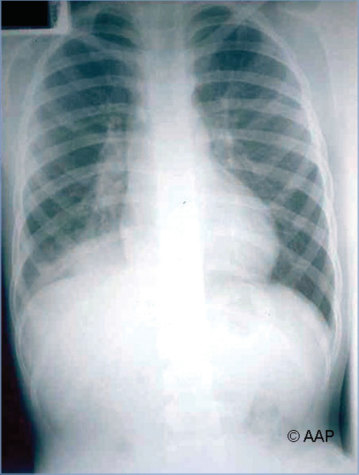
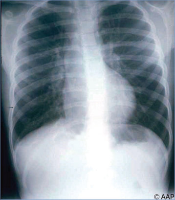
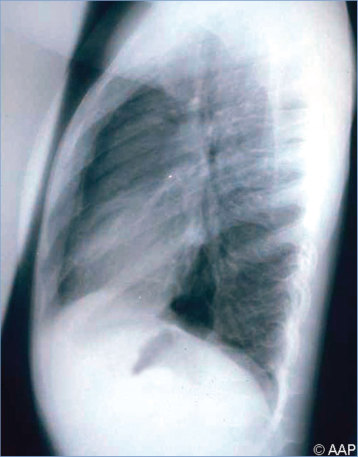
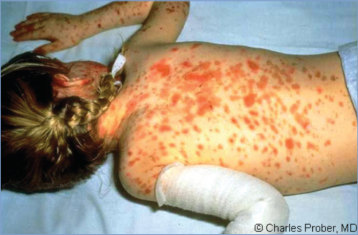

# 94. Mycoplasma pneumoniae and Other Mycoplasma Species Infections
> Private study reference ([source credits](../../SOURCE_CREDITS.md)). PDF pages 614-619; printed pages 600-605.

## PDF page 614 | printed page 600

### CLINICAL MANIFESTATIONS

Mycoplasma pneumoniae is a frequent cause of upper and lower respiratory tract infections in children, including pharyngitis, acute bronchitis, and pneumonia. Acute otitis media is uncommon. Bullous myringitis, once considered pathognomonic for mycoplasma, now is known to occur with other pathogens as well. Sinusitis and croup are rare. Symptoms are variable and include cough, malaise, fever, and occasionally headache. Acute bronchitis and upper respiratory tract illness caused by M pneumoniae generally are mild and self-limited. Approximately 25% of infected school-aged children will develop pneumonia with cough and rales on physical examination within days after onset of constitutional symptoms. Cough, initially nonproductive, can become productive, persist for 3 to 4 weeks, and be accompanied by wheezing. Approximately 10% of children with M pneumoniae infection will exhibit a rash, which most often is maculopapular. Radiographic abnormalities are variable; bilateral diffuse infiltrates or focal abnormalities, such as consolidation, pleural effusion, or hilar adenopathy, can occur.

Unusual manifestations include nervous system disease (eg, aseptic meningitis, encephalitis, acute disseminated encephalomyelitis, cerebellar ataxia, transverse myelitis, and peripheral neuropathy) as well as myocarditis, pericarditis, arthritis (particularly in immunocompromised hosts), erythema nodosum, polymorphous mucocutaneous eruptions (eg, Stevens-Johnson syndrome or reactive infectious mucocutaneous eruption, formerly referred to as Mycoplasma-induced rash and mucositis syndrome), hemolytic anemia, thrombocytopenic purpura, hemophagocytic syndromes, and postinfectious glomerulonephritis. Severe pneumonia with pleural effusion can occur, particularly in patients with sickle cell disease, Down syndrome, immunodeficiencies, and chronic cardiorespiratory disease. Acute chest syndrome and pneumonia have been associated with M pneumoniae in patients with sickle cell

disease. Infection also has been associated with exacerbations of asthma.

Several other Mycoplasma species colonize mucosal surfaces of humans and can produce disease in children. Mycoplasma hominis infection has been reported in neonates and children (both immunocompetent and immunocompromised). Intra-abdominal abscess, septic arthritis, endocarditis, pneumonia, meningoencephalitis, brain abscess, and surgical wound infection have been attributed to M hominis. Mycoplasma genitalium causes urethritis among male individuals and is the etiology of approximately 15% to 20% of nongonococcal urethritis (NGU), 20% to 25% of nonchlamydial NGU, and 40% of persistent or recurrent urethritis.1 Among female individuals, M genitalium has been associated with cervicitis, pelvic inflammatory disease, preterm delivery, spontaneous abortion, and infertility, with an approximately twofold increase in the risk for these outcomes among women with M genitalium. Female individuals with M genitalium are also frequently asymptomatic, and the consequences associated with asymptomatic M genitalium infection are unknown.

### ETIOLOGY

Mycoplasmas are pleomorphic bacteria that lack a cell wall. They are classified in the family Mycoplasmataceae, which includes the Mycoplasma and Ureaplasma genera.

### EPIDEMIOLOGY

Mycoplasmas are ubiquitous in animals and plants, but M pneumoniae causes disease only in humans. M pneumoniae is transmissible by respiratory droplets during close contact. Outbreaks have been described in hospitals, military bases, colleges, and summer camps. Occasionally, M pneumoniae causes ventilator-associated pneumonia. M pneumoniae is a leading cause of pneumonia in school-aged children and young adults but is an infrequent cause of communityacquired pneumonia (CAP) in children younger than 5 years. In the United States, an estimated 2 million infections are caused by M pneumoniae each year. Overall, approximately 10% to 20% of cases of CAP in hospitalized patients are believed to be caused by M pneumoniae. Infections occur throughout the world, in any season, and in all

## PDF page 615 | printed page 601

geographic settings. In family studies, approximately 30% of household contacts develop pneumonia. Asymptomatic carriage after infection may occur for weeks to months. Immunity after infection is not long-lasting.

The incubation period usually is 2 to 3 weeks (range, 1–4 weeks), which can contribute to lengthy outbreaks.

### DIAGNOSTIC TESTS

Nucleic acid amplification tests (NAATs) for M pneumoniae are available commercially and increasingly are replacing other tests, because NAATs performed on respiratory tract specimens (nasal wash, nasopharyngeal swab, oropharyngeal swab, sputum, and bronchoalveolar lavage fluid) are rapid, have sensitivity and specificity between 80% and 100%, and yield positive results earlier in the course of illness. Several assays are cleared by the U.S. Food and Drug Administration (FDA) for diagnostic use, including an assay targeting M pneumoniae alone and multiplex assays that simultaneously target other respiratory pathogens as well. Identification of M pneumoniae by NAAT or culture in a patient with compatible clinical manifestations suggests causation. However, attributing a nonclassic clinical disorder to M pneumoniae is problematic, because the organism can colonize the respiratory tract for several weeks after acute infection (even after appropriate antimicrobial therapy) and has been detected by NAAT in 17% to 25% of asymptomatic children 3 months to 16 years of age. NAAT of body fluids for M hominis is available at reference laboratories and may be helpful diagnostically.

Serologic tests using immunofluorescence and enzyme immunoassays that detect M pneumoniaespecific immunoglobulin (Ig) M, IgA, and IgG antibodies are available commercially. IgM antibodies generally are not detectable within the first 7 days after onset of symptoms. Although the presence of IgM antibodies may indicate recent M pneumoniae infection, false-positive test results occur, and antibodies may persist in serum for several months or even years and, thus, may not indicate acute infection. IgM antibodies may not be elevated in older children and adults who have had recurrent M pneumoniae infection. Serologic diagnosis is best accomplished by demonstrating a fourfold or greater increase in IgG antibody titer

between acute and convalescent serum specimens. Complement-fixation assay results should be interpreted cautiously, because the assay is both less sensitive and less specific than is immunofluorescent assay or enzyme immunoassay. Measurement of serum cold hemagglutinin titer has limited value, because titers of ≥1:64 are present in only 50% to 75% of patients with pneumonia caused by M pneumoniae, and lower titers are nonspecifically present during respiratory viral infections.

Mycoplasma organisms lack cell walls and so are not visible by cell-wall specific stains (eg, Gram stain) using light microscopy. M pneumoniae and M hominis can be grown in special enriched broth and agar media such as SP4 or on commercially available mixed liquid broth/agar slant media. However, most clinical laboratories lack the capacity to perform culture isolation, and culture and identification may take longer than 21 days. M genitalium culture can take up to several months, and technical laboratory capacity is limited to research settings. A NAAT for M genitalium is FDA cleared for use with urine and urethral, penile meatal, endocervical, and vaginal swab samples.

Molecular tests for macrolide (ie, azithromycin) or quinolone (ie, moxifloxacin) resistance markers are limited in the United States. However, molecular assays that incorporate detection of mutations associated with macrolide resistance are under evaluation.

The diagnosis of mycoplasma-associated central nervous system disease is challenging, both because disease may not be the result of direct invasion and because there is no reliable single test for cerebrospinal fluid to establish a diagnosis.

### TREATMENT

Evidence of benefit of antimicrobial therapy for nonhospitalized children with lower respiratory tract disease attributable to M pneumoniae is limited. Most children with CAP attributable to M pneumoniae have a relatively mild, self-limited illness, but effective antibiotic therapy may be more important with more severe infections. The usual course of antimicrobial therapy for pneumonia is 7 to 10 days, except for azithromycin, for which it usually is 5 days.

## PDF page 616 | printed page 602

Antimicrobial therapy is not routinely recommended for preschool-aged children with CAP, because viral pathogens are responsible for the great majority of cases.2 There is no evidence that treatment of other possible manifestations of M pneumoniae infection (eg, upper respiratory tract infection) with antimicrobial agents alters the course of illness. However, despite limited data, it is reasonable to treat severe extrapulmonary infections such as central nervous system disease or septic arthritis in an immunocompromised patient with an expectation that it may shorten the duration and severity of illness.

Because mycoplasmas lack a cell wall, they inherently are resistant to b-lactam agents. Macrolides, including azithromycin, clarithromycin, and erythromycin, are the preferred antimicrobial agents for treatment of Mycoplasma pneumonia in schoolaged children who have moderate to severe infection and those with underlying conditions, such as sickle cell disease.3 Fluoroquinolones, tetracyclines (doxycycline), and pleuromutilins (the latter only approved in people 18 years and older) are 3 other classes of antibiotics to which M pneumoniae is susceptible.

Although macrolide-resistant strains of M pneumoniae have been identified, the majority of strains are susceptible, and the clinical implications of resistance are unclear. Treatment of hospitalized children with CAP attributable to a macrolideresistant M pneumoniae using a fluoroquinolone has been shown in some studies to shorten the duration of fever and the length of hospitalization, but other studies have found no difference. M hominis usually is resistant to erythromycin and azithromycin but is variably susceptible to clindamycin, tetracyclines, and fluoroquinolones.

M genitalium is susceptible in vitro to macrolides, tetracyclines, and fluoroquinolones; however, resistance to macrolides has been rapidly increasing and has been confirmed in multiple studies. Prevalence of molecular markers for macrolide resistance, which highly correlates with treatment failure, range from 44% to 90% in the United States, Canada, Western Europe, and Australia. Although the majority of M genitalium strains are sensitive to moxifloxacin, resistance has been reported. Resistance-guided therapy has

demonstrated cure rates of >90% and should be used whenever possible. As part of this approach, doxycycline is provided as initial empiric therapy, which reduces the organism load and facilitates organism clearance, followed by either azithromycin for macrolide-sensitive strains or moxifloxacin for macrolide-resistant strains. If resistance testing is not available, doxycycline 100 mg twice daily for 7 days is provided followed by moxifloxacin 400 mg once daily for 7 days. Data are limited regarding use of minocycline in instances of treatment failure.

### INFECTION PREVENTION AND CONTROL MEASURES IN HEALTH CARE SETTINGS

In addition to standard precautions, droplet precautions are recommended for the duration of symptomatic illness with M pneumoniae.

### CONTROL MEASURES FOR M PNEUMONIAE INFECTIONS

Hand hygiene decreases household transmission of respiratory pathogens and should be encouraged.

Tetracycline or azithromycin prophylaxis for close contacts has been shown to limit transmission in family and institutional outbreaks. However, antimicrobial prophylaxis for asymptomatic exposed contacts is not recommended routinely, because most secondary illnesses are generally mild and self-limited. Prophylaxis with a macrolide or a tetracycline (doxycycline) can be considered for people at increased risk of severe illness with M pneumoniae, such as children with sickle cell disease who are close contacts of a person who is acutely ill with M pneumoniae infection.

1 The terms male, female, men, and women refer to sex assigned at birth. 2 Bradley JS, Byington CL, Shah SS, et al. The management of community-acquired pneumonia in infants and children older than 3 months of age: clinical practice guidelines by the Pediatric Infectious Diseases Society and the Infectious Diseases Society of America. Clin Infect Dis. 2011;53(1): e25–e76 3 Bradley JS, Byington CL, Shah SS, et al. The management of community-acquired pneumonia in infants and children older than 3 months of age: clinical practice guidelines by the Pediatric Infectious Diseases Society and the Infectious Diseases Society of America. Clin Infect Dis. 2011;53(1):e25–e76

## PDF page 617 | printed page 603

Image 94.1 Radiograph obtained in a preadolescent boy with bilateral perihilar infiltration and right lower lobe pneumonia and pleural effusion caused by Mycoplasma pneumoniae. Courtesy of Edgar O. Ledbetter, MD, FAAP.

Image 94.3 Radiograph obtained in a preadolescent boy with bilateral perihilar infiltrates caused by Mycoplasma pneumoniae.

Image 94.2 Right lateral radiograph of the same patient as in Image 94.1, with pneumonia and pleural effusion. Pleural effusions associated with Mycoplasma pneumoniae infections generally resolve spontaneously without drainage. Courtesy of Edgar O. Ledbetter, MD, FAAP.

Image 94.4 Lateral radiograph of the same patient as in Image 94.3, with pneumonia caused by Mycoplasma pneumoniae.

## PDF page 618 | printed page 604

Image 94.5 Histopathologic study of Mycoplasma pneumoniae– infected lung tissue. The respiratory bronchiole is surrounded by an inflammatory mononuclear cell response. The intraluminal site is approximately 30% occluded by mucus and white blood cells. M pneumoniae is a common cause of pneumonia and tracheobronchitis in school-aged children and adolescents.

Image 94.7 Erythema multiforme rash (Stevens-Johnson syndrome) associated with Mycoplasma pneumoniae infection in a preadolescent girl. Copyright Charles Prober, MD.

Image 94.6 Erythema multiforme associated with mycoplasma infection. This 10-year-old boy presented with fever and macular lesions on the face, chest, arms, and back, as well as facial swelling. He had a 4-day period of increasing cough and low-grade fever before the onset of the skin lesions and facial swelling. Chest radiograph revealed mild increased infiltrates in the right lung. Levels of cold agglutinins were markedly elevated, and he had a more than fourfold increase in complement fixation antibody to Mycoplasma pneumoniae. Courtesy of Neal Halsey, MD.

![Image 94.6 Erythema multiforme associated with mycoplasma infection. This 10-year-old boy presented with fever and macular lesions on the face, chest, arms, and back, as well as facial swelling. He had a 4-day period of increasing cough and low-grade fever before the onset of the skin lesions and facial swelling. Chest radiograph revealed mild increased infiltrates in the right lung. Levels of cold agglutinins were markedly elevated, and he had a more than fourfold increase in complement fixation antibody to Mycoplasma pneumoniae. Courtesy of Neal Halsey, MD.](../../figures/ch094_p0618_02.jpg)

## PDF page 619 | printed page 605

A

B

Image 94.8 A, Typical structure of a common gram-negative bacterium (Pseudomonas aeruginosa) and its flagellum, as observed at electron microscopy. B, Pleomorphic structure of Mycoplasma pneumoniae, as observed at electron microscopy. The bacterium is indicated by the black pointer. Mycoplasmas, including M pneumoniae, lack a cell wall.

