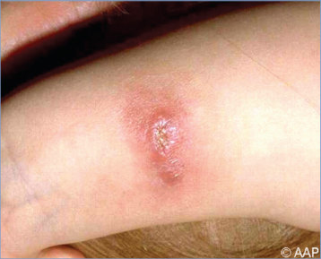
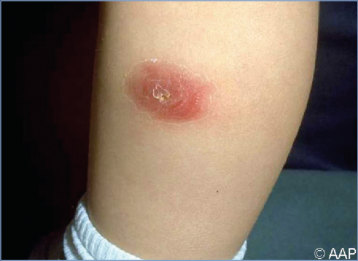
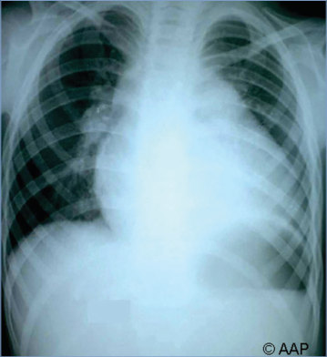
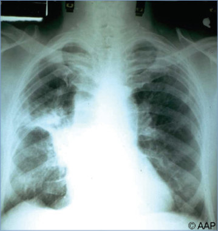
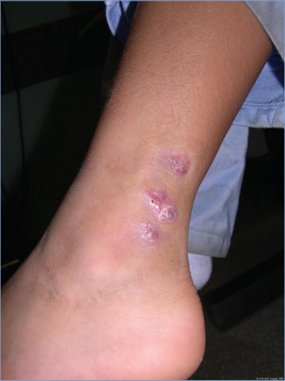
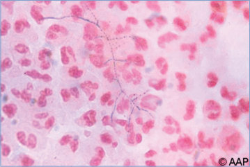
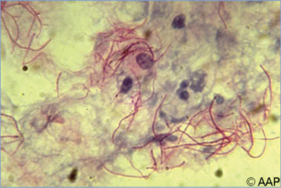
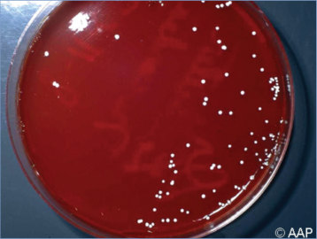

# 95. Nocardiosis
> Private study reference ([source credits](../../SOURCE_CREDITS.md)). PDF pages 620-623; printed pages 606-609.

## PDF page 620 | printed page 606

### CLINICAL MANIFESTATIONS

Immunocompetent children typically develop cutaneous or lymphocutaneous disease with pustular or ulcerative lesions following soil contamination of a skin injury. Deep-seated tissue infection may follow traumatic soil-contaminated wounds. Immunocompromised people may develop invasive disease (pulmonary disease, which may disseminate, in particular to the central nervous system). At-risk people include those with chronic granulomatous disease, chronic obstructive pulmonary disease, impaired cellmediated immunity including HIV infection, diseases requiring long-term systemic corticosteroid/ immunosuppressive therapy, and autoimmune disease; people having received tumor necrosis factor inhibitors; and solid organ or hematopoietic cell transplant recipients, especially if calcineurin inhibitor levels are high. Pulmonary disease commonly manifests as rounded nodular infiltrates that can undergo cavitation; the infection may be acute, subacute, or chronic suppurative. The most common clinical symptoms include fever, cough, pleuritic chest pain, chills, and headache. Nocardia has a propensity to spread hematogenously to the brain (single or multiple abscesses) from the lungs. The organism also may spread to the skin (pustules, pyoderma, abscesses, mycetoma), or occasionally to other organs. Nocardia organisms can be recovered from respiratory specimens of patients with cystic fibrosis, but the clinical significance of this pathogen in these patients is unclear.

### ETIOLOGY

Nocardia are gram-positive, aerobic, intracellular, nonmotile, filamentous bacteria in the order Actinomycetales. Cell walls of Nocardia organisms contain mycolic acid and thus may be described as “acid-fast” or “partially acid-fast” using the modified Kinyoun or Fite Faraco acid-fast staining and light microscopy.

### EPIDEMIOLOGY

Nocardia species are ubiquitous environmental saprophytes, living in soil, organic matter, and fresh water or seawater. Infections caused by

Nocardia species typically are the result of environmental exposure through inhalation of soil or dust particles or through traumatic inoculation with a soil-contaminated object. The most prevalent species reported from human clinical sources in the United States are Nocardia nova complex, Nocardia farcinica, Nocardia cyriacigeorgica, and Nocardia abscessus complex; there is geographic variation by infecting species. Primary cutaneous infection and mycetoma most often are associated with Nocardia brasiliensis. Other less common pathogenic species include Nocardia brevicatena complex, Nocardia otitidiscaviarum complex, Nocardia pseudobrasiliensis, and Nocardia transvalensis complex.

Health care-associated or person-to-person transmission has been reported rarely. Animalto-human transmission is not known to occur.

The incubation period is unknown.

### DIAGNOSTIC TESTS

Isolation of Nocardia species from clinical specimens can require extended incubation periods, often 2 to 3 weeks. Specimens from sterile sites can be inoculated directly onto enriched solid media such as trypticase soy agar supplemented with 5% sheep blood, chocolate, brain-heart infusion, Sabouraud dextrose agars, and buffered charcoal yeast extract (BCYE) agar. Colonies look like white snowballs because of aerial hyphae. Specimens from nonsterile or contaminated sites, such as tissue or sputum, should be inoculated onto selective media, such as Thayer-Martin or BCYE supplemented with vancomycin, with a minimum incubation of 3 weeks. Recovery of Nocardia species from tissue can be improved if the laboratory is requested to observe cultures for up to 4 weeks in an appropriate liquid medium at optimal growth temperature (between 25°C and 35°C for most species). Stained smears of sputum, body fluids, or pus demonstrating beaded, branching rods that stain weakly gram positive and partially acid-fast by the modified Kinyoun method suggest the diagnosis. The Brown-Brenn tissue Gram stain method and Grocott-Gomori methenamine–silver stains are recommended to demonstrate microorganisms in tissue specimens.

Accurate identification of Nocardia isolates paired with antimicrobial susceptibility testing greatly

## PDF page 621 | printed page 607

enhances selection of appropriate antimicrobial therapy. Because of variability of phenotypic traits and difficulty growing organisms on commercial biochemical testing media, accurate identification is accomplished through molecular methods. Matrix-assisted laser desorption/ionization–timeof-flight mass spectrometry is often the first method used to identify the Nocardia isolate down to the species level, with other complementary methods used as necessary, such as 16S rRNA gene sequence analysis of full length or nearly full-length (~1,440 bp) sequences, or whole genome analysis. Serologic tests for Nocardia species are not useful except for an enzyme-linked immunosorbent assay used to determine the presence of antibodies to N brasiliensis mycetoma.

Most experts recommend neuroimaging with or without cerebrospinal fluid examination in patients with pulmonary disease, even with a nonfocal neurologic examination, given the propensity of these organisms to infect the central nervous system.

### TREATMENT

Rapid and accurate identification of Nocardia isolates and antimicrobial susceptibility testing are essential tools for successful treatment of nocardiosis. Nocardia species possess intrinsic resistance to multiple drugs. Antimicrobial susceptibility testing recommended by the Clinical and Laboratory Standards Institute is complex and generally requires a specialty or reference laboratory. Such testing should guide therapy and is recommended for all strains from patients with invasive disease, when patients are unable to tolerate a sulfonamide, or for patients in whom sulfonamide therapy fails.

Trimethoprim-sulfamethoxazole (TMP/SMX) is the drug of choice for mild infections. Certain Nocardia species including N farcinica, N nova, and N otitidiscaviarum may demonstrate intrinsic resistance to TMP/SMX. If infection does not respond to TMP/SMX, a fluoroquinolone or a carbapenem may be considered, although most Nocardia species are resistant to ertapenem. Linezolid has excellent activity against all

Nocardia species but is not recommended for long-term administration because of hematologic and possible neurologic toxicity. Other agents with specific Nocardia coverage include clarithromycin (N nova) and amoxicillin-clavulanate (N brasiliensis and N abscessus complex). Pediatric data are lacking for many of these agents in the treatment of nocardiosis. Immunocompetent patients with lymphocutaneous disease usually respond after 6 to 12 weeks of monotherapy.

Combination drug therapy is recommended for patients with serious disease (pulmonary infection, disseminated disease, central nervous system involvement) and for infection in immunocompromised hosts. Initial combination treatment should include TMP/SMX, amikacin, and either linezolid, imipenem, or meropenem (resistance noted for some strains of N brasiliensis) until susceptibilities are available. Ceftriaxone is an alternative agent, but resistance is noted for many strains of N farcinica, N transvalensis complex, and N otitidiscaviarum complex. Immunocompromised patients and patients with serious disease should be treated for 6 to 12 months and for at least 3 months after apparent cure because of the propensity for relapse. Patients living with HIV may need even longer therapy, and suppressive therapy should be considered for life in the absence of immune reconstitution. Patients with central nervous system disease should be monitored with serial neuroimaging studies.

Drainage of abscesses is beneficial, and removal of infected foreign bodies (eg, central venous catheters) is recommended.

### INFECTION PREVENTION AND CONTROL MEASURES IN HEALTH CARE SETTINGS

Standard precautions are recommended.

### CONTROL MEASURES

People with weakened immune systems should be advised to cover their skin when working with soil. TMP/SMX administered 3 times per week for prophylaxis against Pneumocystis jirovecii generally is ineffective in preventing nocardiosis.

## PDF page 622 | printed page 608

Image 95.1 Cutaneous nocardiosis of forearm in a preschool-aged boy with immunocompetence.

Image 95.3 Nocardia mediastinitis following surgical repair of ventricular septal defect (nosocomial infection). Courtesy of Edgar O. Ledbetter, MD, FAAP.

Image 95.2 Cutaneous nocardiosis of the leg of a preschool-aged girl with immunocompetence.

Image 95.4 Nocardia pneumonia, bilateral, in a child with immunocompromise. Invasive nocardiosis is unusual in children with immunocompetence.

## PDF page 623 | printed page 609

Image 95.5 This radiograph of a patient’s right arm reveals the effects of actinomycotic mycetoma caused by Nocardia asteroides, which is among the most common actinomycetes that cause mycetoma worldwide. Mycetoma is a slowly progressive, destructive infection of the cutaneous and subcutaneous tissues and fascia, and, as shown, it affects bone as well. Courtesy of Centers for Disease Control and Prevention.

Image 95.7 Nocardia asteroides (Gram stain). Courtesy of Edgar O. Ledbetter, MD, FAAP.

Image 95.9 Nocardia asteroides colonies (white, chalklike colonies on blood agar plate).

Image 95.6 A school-aged child with chronic rash on the lower left ankle. Histopathologic findings confirmed Nocardia brasiliensis. Courtesy of Preeti Jaggi, MD.

Image 95.8 Nocardia asteroides colony (tissue acid-fast stain).

