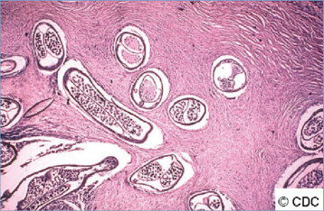
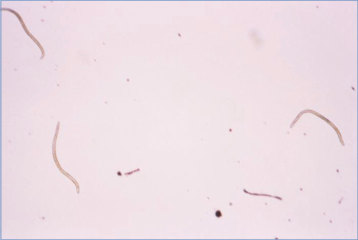
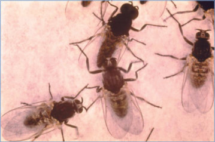

# 97. Onchocerciasis (River Blindness, Filariasis)
> Private study reference ([source credits](../../SOURCE_CREDITS.md)). PDF pages 628-631; printed pages 614-617.

## PDF page 628 | printed page 614

(River Blindness, Filariasis)

### CLINICAL MANIFESTATIONS

Onchocerciasis primarily affects skin, subcutaneous tissues, and eyes. Subcutaneous, nontender nodules containing male and female adult worms can be up to several centimeters in diameter and are more common over bony prominences. Nodules tend to be found on the lower torso, pelvis, and lower extremities in patients infected in Africa, whereas in patients infected in South America, nodules are located more often on the upper body (the head and trunk). After the worms mature, fertilized female worms produce prelarval stages called microfilariae that migrate to the dermis and may cause a papular dermatitis. Pruritus often is intense, resulting in patient-inflicted excoriations over the affected areas. After years, skin can become lichenified and hypo- or hyperpigmented. Microfilariae may invade ocular structures, leading to inflammation of the cornea, iris, ciliary body, retina, choroid, and optic nerve. Loss of visual acuity and blindness can result over time if the disease is left untreated. Infection has also been associated with development of epilepsy.

### ETIOLOGY

Onchocerca volvulus is a filarial nematode.

### EPIDEMIOLOGY

O volvulus has no significant animal or environmental reservoir. Humans are infected when infectious larvae are transmitted through the bites of Simulium species flies (black flies). Black flies breed in fast-flowing streams and rivers (hence, the colloquial name for the disease, “river blindness”). Transmission of the parasite occurs primarily in equatorial Africa, but small foci are found in Venezuela, Brazil, and Yemen. Prevalence is greatest among people who live near vector breeding sites. The infection is not transmissible by person-to-person contact, blood transfusion, or breastfeeding; congenital transmission does not occur. Infection in travelers to areas with endemic infection who stay less than 6 to 12 months is uncommon.

The incubation period from infective bite to adult worm nodules is 6 to 12 months, and to

microfilariae in the skin usually is 12 to 18 months but can be as long as 3 years.

### DIAGNOSTIC TESTS

Direct microscopic examination of a 1- to 2-mm biopsy specimen of the epidermis and upper dermis (taken from the posterior iliac crest or other areas with highest suspicion for local microfilariae), incubated in saline, can reveal emerging microfilariae. Multiple skin snips may be needed to make a diagnosis, and in children in whom clinical suspicion of onchocerciasis is high, use of a nucleic acid amplification test (NAAT) may increase diagnostic yield if microscopic examination is negative. Microfilariae are not found in blood. Adult worms may be demonstrated in excised nodules that have been sectioned and stained. A slit-lamp examination of an involved eye may reveal motile microfilariae in the anterior chamber or “snowflake” corneal lesions. Eosinophilia is common. Specific serologic tests and detection of microfilariae in skin by NAAT are available in the United States in research and public health laboratories, including those of the National Institutes of Health and Centers for Disease Control and Prevention. Ultrasonography of nodules may visualize adult worms.

### TREATMENT

Ivermectin and moxidectin are approved in the United States for treatment of onchocerciasis, although moxidectin is not yet available commercially. Patients from areas with endemic Loa loa infection should be screened for L loa and should be referred to an expert if coinfected with O volvulus and L loa, as treatment of patients with high levels of circulating L loa microfilaremia with ivermectin rarely can result in fatal encephalopathy. Ivermectin can be used in younger children weighing more than 15 kg. Treatment decreases pruritus and dermatitis as well as the risk of developing severe ocular disease but does not kill the adult worms (which can live for more than a decade) and, thus, is not curative. Treatment with ivermectin is administered every 6 months until asymptomatic. Moxidectin, as a single oral dose for patients 12 years and older, has superior and more durable effectiveness in reducing microfilariae in skin compared with a single dose of ivermectin. Safety and effectiveness of repeated doses of moxidectin have not been studied, but on the basis of

## PDF page 629 | printed page 615

the duration of microfilarial suppression observed in the available studies, yearly dosing of moxidectin until asymptomatic is reasonable. Adverse reactions to treatment are caused by death of microfilariae and can include rash, edema, fever, myalgia, and rarely, asthma exacerbation and hypotension. Such reactions are more common in people with higher skin loads of microfilariae and decrease with repeated treatment in the absence of reexposure. Precautions to ivermectin/moxidectin treatment include pregnancy (class C drug), central nervous system disorders, and coinfection with L loa. Ivermectin usually is compatible with breastfeeding, but because low levels of drug are found in human milk after treatment of the lactating person, most experts recommend delaying treatment of a breastfeeding person until the infant is >7 days of age.

A 6-week course of doxycycline can be used in addition to ivermectin or moxidectin to kill adult worms through depletion of their endosymbiotic rickettsia-like bacteria Wolbachia, which appear to be required for survival of O volvulus. Doxycycline may be used regardless of age in nonpregnant patients to obviate the need for years of ivermectin treatment. Doxycycline treatment may be initiated 1 week after treatment with ivermectin/ moxidectin; for patients without symptoms, a 4- to 6-week course of doxycycline may be given, followed by a dose of ivermectin/moxidectin. There are no studies of the safety of simultaneous treatment.

Image 97.1 Histopathologic features of Onchocerca nodule in onchocerciasis. Courtesy of Centers for Disease Control and Prevention.

The microfilaricide diethylcarbamazine is contraindicated for the treatment of onchocerciasis, because it may cause adverse ocular reactions. Nodules can be removed surgically, but medical treatment still should be offered, because not all nodules may be detectable clinically or accessible surgically.

### INFECTION PREVENTION AND CONTROL MEASURES IN HEALTH CARE SETTINGS

Standard precautions are recommended.

### CONTROL MEASURES

Repellents and protective clothing (long sleeves and pants) can decrease exposure to bites from black flies, which bite by day. Treatment of vector breeding sites with larvicides is effective for controlling black fly populations. Vector control, however, largely has been supplanted by community-wide mass ivermectin administration programs. A highly successful global initiative being led by the World Health Organization has distributed hundreds of millions of ivermectin treatments (donated by the drug manufacturer for this purpose) in communities with endemic onchocerciasis. As a result of these programs, morbidity and transmission largely have been eliminated from the Americas (where most mass treatment programs now have halted) and markedly curtailed throughout Africa.

Image 97.2 This is a glycerin mount photomicrograph of the microfilarial pathogen Onchocerca volvulus in its larval form. Courtesy of Centers for Disease Control and Prevention.

## PDF page 630 | printed page 616

Image 97.3 As an adult, this Simulium species larva, or black fly, is a vector of the disease onchocerciasis, or “river blindness.” The black fly larva is usually a filter feeder, feeding on nutrients extracted from passing currents. Before entering the pupal stage, a Simulium species larva passes through 6 larval stages and then encases itself in a silken, submerged cocoon. Courtesy of Centers for Disease Control and Prevention.

Image 97.4 These are Simulium species of flies, or black flies, a vector of the disease onchocerciasis, or “river blindness.” Courtesy of Centers for Disease Control and Prevention.

## PDF page 631 | printed page 617

Image 97.5 During a blood meal, an infected mosquito (typically Mansonia species and Aedes species) introduces third-stage filarial larvae onto the skin of the human host, where they penetrate into the bite wound (1). They develop into adults that commonly reside in the lymphatics (2). The adult worms outwardly resemble those of Wuchereria bancrofti but are smaller. Female worms are 43 to 55 mm long and 130 to 170 mm wide, and males are 13 to 23 mm long and 70 to 80 mm wide. Adults produce microfilariae that are 177 to 230 mm long and 5 to 7 mm wide and that are sheathed and have nocturnal periodicity (in some regions, Brugia malayi may be sub-periodic, and microfilariae are usually not produced in Brugia pahangi infections). The microfilariae migrate into lymph and enter the bloodstream, reaching the peripheral blood (3). A mosquito ingests the microfilariae during a blood meal (4). After ingestion, the microfilariae lose their sheaths and work their way through the wall of the proventriculus and cardiac portion of the midgut to reach the thoracic muscles (5). There the microfilariae develop into first-stage larvae (6) and subsequently into third-stage larvae (7). The third-stage larvae migrate through the hemocoel to the mosquito’s proboscis (8) and can infect another human when the mosquito takes a blood meal (1). Courtesy of Centers for Disease Control and Prevention.

![Image 97.5 During a blood meal, an infected mosquito (typically Mansonia species and Aedes species) introduces third-stage filarial larvae onto the skin of the human host, where they penetrate into the bite wound (1). They develop into adults that commonly reside in the lymphatics (2). The adult worms outwardly resemble those of Wuchereria bancrofti but are smaller. Female worms are 43 to 55 mm long and 130 to 170 mm wide, and males are 13 to 23 mm long and 70 to 80 mm wide. Adults produce microfilariae that are 177 to 230 mm long and 5 to 7 mm wide and that are sheathed and have nocturnal periodicity (in some regions, Brugia malayi may be sub-periodic, and microfilariae are usually not produced in Brugia pahangi infections). The microfilariae migrate into lymph and enter the bloodstream, reaching the peripheral blood (3). A mosquito ingests the microfilariae during a blood meal (4). After ingestion, the microfilariae lose their sheaths and work their way through the wall of the proventriculus and cardiac portion of the midgut to reach the thoracic muscles (5). There the microfilariae develop into first-stage larvae (6) and subsequently into third-stage larvae (7). The third-stage larvae migrate through the hemocoel to the mosquito’s proboscis (8) and can infect another human when the mosquito takes a blood meal (1). Courtesy of Centers for Disease Control and Prevention.](../../figures/ch097_p0631_01.jpg)
