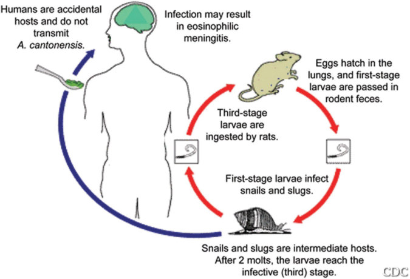

# 101. Parasitic Diseases
> Private study reference ([source credits](../../SOURCE_CREDITS.md)). PDF pages 643-652; printed pages 629-638.

## PDF page 643 | printed page 629

Parasites are among the most common causes of morbidity and mortality in children worldwide. Outside the tropics and subtropics, parasitic diseases occur among travelers and immigrants. Toxocariasis occurs in the United States, most commonly in the South. Malaria infections in the United States occur among people who have traveled to regions with ongoing malaria transmission, and the diagnosis should be considered when evaluating fever in a returned traveler. Local transmission of malaria has recently been detected as well in the United States (https://emergency. cdc.gov/han/2023/han00494.asp). Certain parasitic infections have long latency periods, and the diseases they cause, such as Chagas disease, neurocysticercosis, schistosomiasis, and strongyloidiasis, are encountered in immigrants from or travelers to regions with endemic infection. Clinicians need to be aware of where these infections may be acquired, their clinical presentations, methods of diagnosis, and how to prevent infection. A number of human parasitic infections are discussed in individual chapters throughout this book; diseases are arranged alphabetically. Table 101.1 provides details on some infrequently encountered parasitic diseases not discussed elsewhere.

Consultation and assistance in diagnosis and management of parasitic diseases are available from the Centers for Disease Control and Prevention (CDC), state health departments, and university departments or hospitals that have divisions of travel medicine, tropical medicine, infectious diseases, international or global health, and public health.

Treatment recommendations may vary based on expert opinion and because some commonly used drugs do not have approved indications for a specific parasitic infection or a particular age group. Specific expertise or multiple sources should be consulted especially when there is a lack of familiarity with the parasite or the drugs recommended for treatment. The CDC distributes several drugs that are not available commercially in the United States for treatment of parasitic diseases. To request these drugs, a physician must contact the CDC Parasitic Diseases Inquiries office (Monday–Friday 8 am–4 pm: 404-718-4745, and outside these hours 24/7: 770-488-7100; email: parasites@cdc.gov). Consultation with a medical officer from the CDC is required before a drug is released for a patient. For drugs and consultation regarding malaria, a separate CDC hotline is available Monday–Friday 9 am–5 pm (770-488-7788) and outside these hours 24/7 (770-488-7100).

## PDF page 644 | printed page 630

Larval worms Eosinophilic meningitis with severe headache, neck stiffness, nausea, vomiting, paresthesias or hyperesthesias, peripheral eosinophilia

Larval worms Eosinophilic enterocoli-

Common Manifestations in Humans

Parasitic Form Causing Human Disease

Identification of larvae

Eosinophils in CSF; rarely, identification of larvae in CSF; serologic testing and CSF NAAT not commercially available

Diagnostic Laboratory Tests in Humans

Selected Parasitic Diseases Not Covered Elsewhere

Rodents Snails and slugs Eating raw or improperly

Rats Snails and slugs Eating raw or improperly cooked infected mollusks, including inadvertent ingestion on raw produce; possibly other modes

Disease and/ or Agent Where Infection May Be Acquired Definitive Host Intermediate Host Modes of Human Infection

Table 101.1

Caribbean, Africa, and the United States

Southeast Asia; also in Central and

South America, the

Widespread in the tropics, particularly Pacific Islands and

Central and South

Angiostrongylus

Angiostrongylus cantonensis (neurotropic disease)

tis with abdominal pain, fever, nausea, vomiting, diarrhea (may mimic appendicitis), peripheral eosinophilia

Larvae and mature worms Abdominal pain, diarrhea, vomiting, weight loss

Larval worms Abdominal pain, nausea, vomiting, diarrhea, allergic reactions

and eggs in tissue (not stool); NAAT and serologic testing not commercially available

Identification of recovered larvae on endoscopy or within tissue biopsies; serologic testing and NAAT not available in the United

Eggs and parasite in feces or biopsies of small intestine

States

cooked infected mollusks, including inadvertent ingestion on raw produce; possibly other modes

Eating raw, pickled, or undercooked infected marine fish or squid or octopus

Philippines, Thailand Humans, fisheating birds Freshwater fish Ingestion of raw or undercooked infected fish

Marine mammals Certain saltwater fish, squid, and octopus

Cosmopolitan, most common where eating raw fish is practiced

America, the

Caribbean

Capillariasis–intestinal disease (Capillaria philippinensis)

Anisakiasis (Anisakis and Pseudoterranova species)

costaricensis (gastrointestinal tract disease)

### Geometry-detected table

|Disease and/ or Agent|Where Infection May Be Acquired|Definitive Host|Intermediate Host|Modes of Human Infection|Diagnostic Laboratory Tests in Humans|Parasitic Form Causing Human Disease|Common Manifestations in Humans|
|---|---|---|---|---|---|---|---|
|_Angiostrongylus_ _cantonensis_ (neurotropic disease)|Widespread in the tropics, particularly Pacifc Islands and Southeast Asia; also in Central and South America, the Caribbean, Africa, and the United States|Rats|Snails and slugs|Eating raw or improperly cooked infected mol- lusks, including inadver- tent ingestion on raw produce; possibly other modes|Eosinophils in CSF; rarely, identifcation of larvae in CSF; sero- logic testing and CSF NAAT not commer- cially available|Larval worms|Eosinophilic meningitis with severe headache, neck stiffness, nausea, vomiting, paresthesias or hyperesthesias, peripheral eosinophilia|
|_Angiostrongylus_ _costaricensis_ (gastrointestinal tract disease)|Central and South America, the Caribbean|Rodents|Snails and slugs|Eating raw or improperly cooked infected mol- lusks, including inadver- tent ingestion on raw produce; possibly other modes|Identifcation of larvae and eggs in tissue (not stool); NAAT and serologic testing not commercially available|Larval worms|Eosinophilic enterocoli- tis with abdominal pain, fever, nausea, vomiting, diarrhea (may mimic appendici- tis), peripheral eosinophilia|
|Anisakiasis (_Anisakis_ and_Pseudoterranova_ species)|Cosmopolitan, most common where eating raw fsh is practiced|Marine mammals|Certain saltwa- ter fsh, squid, and octopus|Eating raw, pickled, or undercooked infected marine fsh or squid or octopus|Identifcation of recov- ered larvae on endos- copy or within tissue biopsies; serologic testing and NAAT not available in the United States|Larval worms|Abdominal pain, nausea, vomiting, diarrhea, allergic reactions|
|Capillariasis–intestinal disease_(Capillaria_ _philippinensis)_|Philippines, Thailand|Humans, fsh- eating birds|Freshwater fsh|Ingestion of raw or undercooked infected fsh|Eggs and parasite in feces or biopsies of small intestine|Larvae and mature worms|Abdominal pain, diarrhea, vomiting, weight loss|

[View original table](../../tables/ch101_p0644_1.jpg)

## PDF page 645 | printed page 631

Larvae and mature flukes Abdominal pain; nausea, vomiting, diarrhea, hepatobiliary disease; cholangiocarcinoma

Adult female worms Emerging roundworm; inflammatory response; systemic and local blister or ulcer in skin

Larvae and mature flukes Abdominal pain nausea, vomiting; hepatobiliary disease

Identifying eggs in stool, duodenal fluid, or bile; serologic testing; examination of surgical specimens

Humans, dogs Crustacea (copepods) Drinking water infested with infected copepods Identification of emerging or adult worm in subcutaneous tissues; serology available but not necessary

Serologic testing, antigen tests, and NAAT not commercially available

Eggs in stool, bile, or duodenal fluid

Eating raw freshwater plants (eg, watercress) or drinking water contaminated with larvae

Eating raw or undercooked infected freshwater fish, crabs, crayfish

Certain freshwater snails

Certain freshwater snails

Sheep and cattle most important; other ruminants

Humans, cats, dogs, other mammals

Foci in Africa; global eradication nearly achieved, 13 human cases worldwide in 2022; 2 during the first half of 2023a

East Asia, Southeast

Russian Federation

Asia, Central and

Eastern Europe,

Worldwide; predominantly in the tropics

Clonorchis sinensis, Opisthorchis viverrini, Opisthorchis felineus (liver flukes)

Dracunculiasis (Dracunculus medinensis) (guinea worm)

Fascioliasis (liver flukes; Fasciola hepatica)

Larvae and mature flukes Diarrhea, constipation, vomiting, anorexia, edema of face and legs, ascites

Eggs or worms in feces or duodenal fluid; serologic testing not commercially available

a For progress toward global eradication (which will be the second human disease eradicated, after smallpox), see www.cartercenter.org/health/guinea_worm/index.html.

Eating raw plants (eg, bamboo shoots, watercress, water chestnuts) contaminated with larvae

Asia Humans, pigs, dogs Certain freshwater snails

CSF indicates cerebrospinal fluid; NAAT, nucleic acid amplification test.

East Asia, Southeast

Fasciolopsiasis (intestinal flukes; Fasciolopsis buski)

## PDF page 646 | printed page 632

A

Image 101.1 Dracunculiasis. The female Dracunculus medinensis (guinea worm) induces a painful blister (A); after rupture of the blister, the worm emerges as a whitish filament (B) in the center of a painful ulcer, which is often secondarily infected. Courtesy of Centers for Disease Control and Prevention.

Image 101.2 Sagittal and axial T2-weighted magnetic resonance images of a focal lesion of the cervical spine in an 18-year-old patient with spinal cord involvement of infection with Gnathostoma spinigerum, a nematode found throughout Asia that can be acquired by humans through consumption of undercooked shellfish or meat. Courtesy of James Sejvar, MD.

Image 101.3 Eggs and larva of Angiostrongylus costaricensis. In humans, eggs and larvae are not normally excreted but remain sequestered in tissues. Eggs and larvae (and, occasionally, adult worms) of A costaricensis can be identified in biopsy or surgical specimens of intestinal tissue. The larvae need to be distinguished from the larvae of Strongyloides stercoralis; however, the presence of granulomas containing thin-shelled eggs and/or larvae serves to distinguish A costaricensis infections. The larval infection can cause mesenteric arteritis and abdominal pain, occurring primarily in people in Central and South America. Courtesy of Centers for Disease Control and Prevention.

B

![Image 101.3 Eggs and larva of Angiostrongylus costaricensis. In humans, eggs and larvae are not normally excreted but remain sequestered in tissues. Eggs and larvae (and, occasionally, adult worms) of A costaricensis can be identified in biopsy or surgical specimens of intestinal tissue. The larvae need to be distinguished from the larvae of Strongyloides stercoralis; however, the presence of granulomas containing thin-shelled eggs and/or larvae serves to distinguish A costaricensis infections. The larval infection can cause mesenteric arteritis and abdominal pain, occurring primarily in people in Central and South America. Courtesy of Centers for Disease Control and Prevention.](../../figures/ch101_p0646_01.jpg)

## PDF page 647 | printed page 633

Image 101.4 Opisthorchis (formerly Clonorchis) sinensis (Chinese liver fluke) egg. These are small, operculated eggs, 27 to 35 μm by 11 to 20 μm. The operculum, at the smaller end of the egg, is convex and rests on a visible “shoulder.” At the opposite (larger, abopercular) end, a small knob or hooklike protrusion is often visible (as is shown). The miracidium is visible inside the egg. The disease is also referred to as opisthorchiasis. Courtesy of Centers for Disease Control and Prevention.

A B

Image 101.5 Fasciola hepatica eggs (wet mounts with iodine). The eggs are ellipsoidal. They have a small, barely distinct operculum (A and B, upper end of the eggs). The operculum can be opened (egg C), for example, when a slight pressure is applied to the coverslip. The eggs have a thin shell that is slightly thicker at the abopercular end. They are passed unembryonated. The size ranges from 120 to 150 μm by 63 to 90 μm. Fascioliasis is caused by the sheep liver fluke infecting the liver and biliary system. Courtesy of Centers for Disease Control and Prevention.

C

![Image 101.5 Fasciola hepatica eggs (wet mounts with iodine). The eggs are ellipsoidal. They have a small, barely distinct operculum (A and B, upper end of the eggs). The operculum can be opened (egg C), for example, when a slight pressure is applied to the coverslip. The eggs have a thin shell that is slightly thicker at the abopercular end. They are passed unembryonated. The size ranges from 120 to 150 μm by 63 to 90 μm. Fascioliasis is caused by the sheep liver fluke infecting the liver and biliary system. Courtesy of Centers for Disease Control and Prevention.](../../figures/ch101_p0647_02.jpg)

## PDF page 648 | printed page 634

Image 101.6 Fasciola hepatica (life cycle). Immature eggs are discharged in the biliary ducts and in the stool (1). Eggs become embryonated in water (2) and release miracidia (3), which invade a suitable snail intermediate host (4), including many species of the genus Lymnaea. In the snail, the parasites undergo several developmental stages (sporocysts [4a], rediae [4b], and cercariae [4c]). The cercariae are released from the snail (5) and encyst as metacercariae on aquatic vegetation or other surfaces. Mammals acquire the infection by eating vegetation containing metacercariae. Humans can become infected by ingesting metacercariae-containing freshwater plants, especially watercress (6). After ingestion, the metacercariae excyst in the duodenum (7) and migrate through the intestinal wall, the peritoneal cavity, and the liver parenchyma into the biliary ducts, where they develop into adults (8). In humans, maturation from metacercariae into adult flukes takes approximately 3 to 4 months. The adult flukes (F hepatica, up to 30  13 mm; Fasciola gigantica, up to 75 mm) reside in the large biliary ducts of the mammalian host. F hepatica infects various animal species, mostly herbivores. Courtesy of Centers for Disease Control and Prevention.

![Image 101.6 Fasciola hepatica (life cycle). Immature eggs are discharged in the biliary ducts and in the stool (1). Eggs become embryonated in water (2) and release miracidia (3), which invade a suitable snail intermediate host (4), including many species of the genus Lymnaea. In the snail, the parasites undergo several developmental stages (sporocysts (4a), rediae (4b), and cercariae (4c)). The cercariae are released from the snail (5) and encyst as metacercariae on aquatic vegetation or other surfaces. Mammals acquire the infection by eating vegetation containing metacercariae. Humans can become infected by ingesting metacercariae-containing freshwater plants, especially watercress (6). After ingestion, the metacercariae excyst in the duodenum (7) and migrate through the intestinal wall, the peritoneal cavity, and the liver parenchyma into the biliary ducts, where they develop into adults (8). In humans, maturation from metacercariae into adult flukes takes approximately 3 to 4 months. The adult flukes (F hepatica, up to 30  13 mm; Fasciola gigantica, up to 75 mm) reside in the large biliary ducts of the mammalian host. F hepatica infects various animal species, mostly herbivores. Courtesy of Centers for Disease Control and Prevention.](../../figures/ch101_p0648_01.jpg)

## PDF page 649 | printed page 635

Image 101.7 Dracunculus medinensis. Humans become infected by drinking unfiltered water containing copepods (small crustaceans) that are infected with larvae of D medinensis (1). Following ingestion, the copepods die and release the larvae, which penetrate the host stomach and intestinal wall and enter the abdominal cavity and retroperitoneal space (2). After maturation into adults and copulation, the male worms die and the females (length, 70–120 cm) migrate in the subcutaneous tissues toward the skin surface (3). Approximately 1 year after infection, the female worm induces a blister on the skin, generally on the distal lower extremity, which ruptures. When this lesion comes into contact with water, a contact that the patient seeks to relieve the local discomfort, the female worm emerges and releases larvae (4). The larvae are ingested by a copepod (5) and after 2 weeks (and 2 molts) have developed into infective larvae (6). Ingestion of the copepods closes the cycle. Courtesy of Centers for Disease Control and Prevention.

![Image 101.7 Dracunculus medinensis. Humans become infected by drinking unfiltered water containing copepods (small crustaceans) that are infected with larvae of D medinensis (1). Following ingestion, the copepods die and release the larvae, which penetrate the host stomach and intestinal wall and enter the abdominal cavity and retroperitoneal space (2). After maturation into adults and copulation, the male worms die and the females (length, 70–120 cm) migrate in the subcutaneous tissues toward the skin surface (3). Approximately 1 year after infection, the female worm induces a blister on the skin, generally on the distal lower extremity, which ruptures. When this lesion comes into contact with water, a contact that the patient seeks to relieve the local discomfort, the female worm emerges and releases larvae (4). The larvae are ingested by a copepod (5) and after 2 weeks (and 2 molts) have developed into infective larvae (6). Ingestion of the copepods closes the cycle. Courtesy of Centers for Disease Control and Prevention.](../../figures/ch101_p0649_01.jpg)

## PDF page 650 | printed page 636

Image 101.8 Heterophyes heterophyes. Adults release embryonated eggs, each with a fully developed miracidium, and eggs are passed in the host’s feces (1). After ingestion by a suitable snail (first intermediate host), the eggs hatch and release miracidia, which penetrate the snail’s intestine (2). Genus Cerithidea is an important snail host in Asia; Pironella, in the Middle East. The miracidia undergo several developmental stages in the snail (sporocysts [2a], rediae [2b], and cercariae [2c]). Many cercariae are produced from each redia. The cercariae are released from the snail (3) and encyst as metacercariae in the tissues of a suitable freshwater or brackish water fish (second intermediate host) (4). The definitive host becomes infected by ingesting undercooked or salted fish containing metacercariae (5). After ingestion, the metacercariae excyst, attach to the mucosa of the small intestine (6), and mature into adults (1.0–1.7 mm  0.3–0.4 mm) (7). In addition to humans, various fish-eating mammals (eg, cats, dogs) and birds can be infected by H heterophyes (8). Geographic distribution: Egypt, the Middle East, and the Far East. Courtesy of Centers for Disease Control and Prevention.

![Image 101.8 Heterophyes heterophyes. Adults release embryonated eggs, each with a fully developed miracidium, and eggs are passed in the host’s feces (1). After ingestion by a suitable snail (first intermediate host), the eggs hatch and release miracidia, which penetrate the snail’s intestine (2). Genus Cerithidea is an important snail host in Asia; Pironella, in the Middle East. The miracidia undergo several developmental stages in the snail (sporocysts (2a), rediae (2b), and cercariae (2c)). Many cercariae are produced from each redia. The cercariae are released from the snail (3) and encyst as metacercariae in the tissues of a suitable freshwater or brackish water fish (second intermediate host) (4). The definitive host becomes infected by ingesting undercooked or salted fish containing metacercariae (5). After ingestion, the metacercariae excyst, attach to the mucosa of the small intestine (6), and mature into adults (1.0–1.7 mm  0.3–0.4 mm) (7). In addition to humans, various fish-eating mammals (eg, cats, dogs) and birds can be infected by H heterophyes (8). Geographic distribution: Egypt, the Middle East, and the Far East. Courtesy of Centers for Disease Control and Prevention.](../../figures/ch101_p0650_01.jpg)

## PDF page 651 | printed page 637

Image 101.9 Anisakiasis is caused by the unintentional ingestion of larvae of the nematodes (roundworms) Anisakis simplex or Pseudoterranova decipiens. Adult stages of A simplex or P decipiens reside in the stomach of marine mammals, where they are embedded in the mucosa, in clusters. Unembryonated eggs produced by adult females are passed in the feces of marine mammals (1). The eggs become embryonated in water, and first-stage larvae are formed in the eggs. The larvae molt, becoming second-stage larvae (2a), and after the larvae hatch from the eggs, they become free-swimming (2b). Larvae released from the eggs are ingested by crustaceans (3). The ingested larvae develop into third-stage larvae that are infective to fish and squid (4). The larvae migrate from the intestine to the tissues in the peritoneal cavity and grow up to 3 cm long. On the host’s death, larvae migrate to the muscle tissues and, through predation, are transferred from fish to fish. Fish and squid maintain third-stage larvae that are infective to humans and marine mammals (5). When fish or squid containing third-stage larvae are ingested by marine mammals, the larvae molt twice and develop into adult worms. The adult females produce eggs that are shed by marine mammals (6). Humans become infected by eating raw or undercooked infected marine fish (7). After ingestion, the Anisakis larvae penetrate the gastric and intestinal mucosa, causing the symptoms of anisakiasis. Courtesy of Centers for Disease Control and Prevention.

![Image 101.9 Anisakiasis is caused by the unintentional ingestion of larvae of the nematodes (roundworms) Anisakis simplex or Pseudoterranova decipiens. Adult stages of A simplex or P decipiens reside in the stomach of marine mammals, where they are embedded in the mucosa, in clusters. Unembryonated eggs produced by adult females are passed in the feces of marine mammals (1). The eggs become embryonated in water, and first-stage larvae are formed in the eggs. The larvae molt, becoming second-stage larvae (2a), and after the larvae hatch from the eggs, they become free-swimming (2b). Larvae released from the eggs are ingested by crustaceans (3). The ingested larvae develop into third-stage larvae that are infective to fish and squid (4). The larvae migrate from the intestine to the tissues in the peritoneal cavity and grow up to 3 cm long. On the host’s death, larvae migrate to the muscle tissues and, through predation, are transferred from fish to fish. Fish and squid maintain third-stage larvae that are infective to humans and marine mammals (5). When fish or squid containing third-stage larvae are ingested by marine mammals, the larvae molt twice and develop into adult worms. The adult females produce eggs that are shed by marine mammals (6). Humans become infected by eating raw or undercooked infected marine fish (7). After ingestion, the Anisakis larvae penetrate the gastric and intestinal mucosa, causing the symptoms of anisakiasis. Courtesy of Centers for Disease Control and Prevention.](../../figures/ch101_p0651_01.jpg)

## PDF page 652 | printed page 638

Image 101.10 Life cycle of Angiostrongylus cantonensis. Courtesy of Centers for Disease Control and Prevention/Emerging Infectious Diseases.

