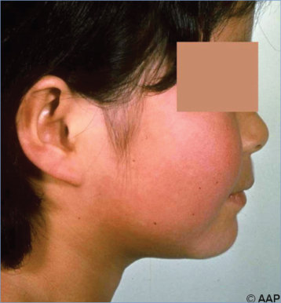
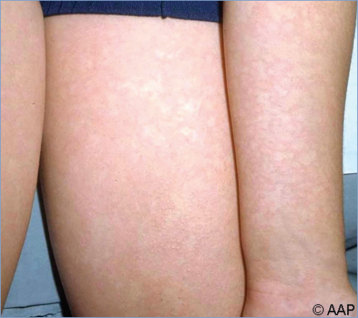
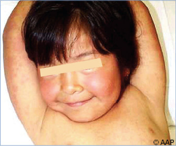
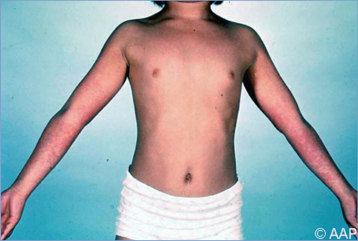
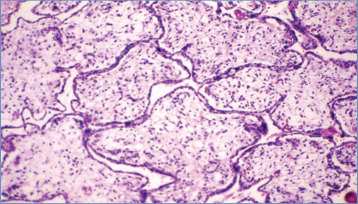
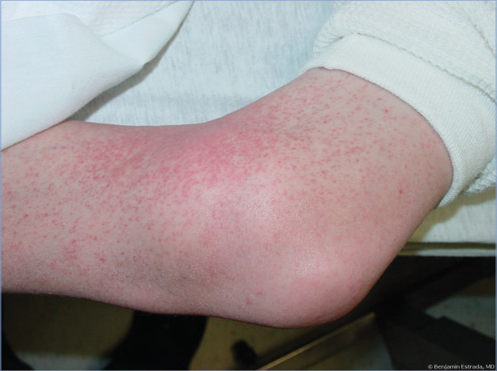
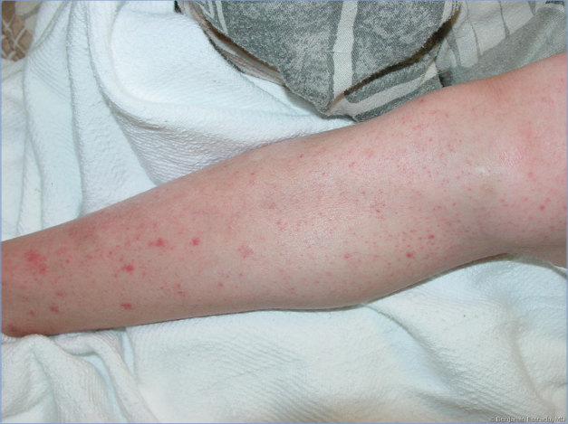
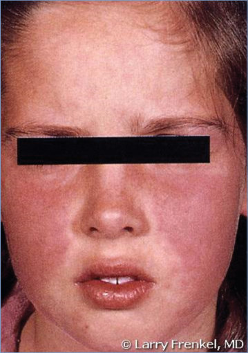

# 103. Parvovirus B19 (Erythema Infectiosum, Fifth Disease)
> Private study reference ([source credits](../../SOURCE_CREDITS.md)). PDF pages 656-661; printed pages 642-647.

## PDF page 656 | printed page 642

(Erythema Infectiosum, Fifth Disease)

### CLINICAL MANIFESTATIONS

Infection with parvovirus B19 is clinically recognized most often as erythema infectiosum (EI), or fifth disease, which is characterized by a distinctive rash that may be preceded by mild systemic symptoms, including fever in 15% to 30% of patients. Fifth disease is so named because it was fifth in a list of historical classifications of common skin rash illnesses in children. The facial rash can be intensely red with a “slapped cheek” appearance that often is accompanied by circumoral pallor. A symmetric, macular, lacelike, and often pruritic rash occurs on the trunk, moving peripherally to involve the arms, buttocks, and thighs. The rash can fluctuate in intensity and can recur with environmental changes, such as temperature and exposure to sunlight, for weeks to months. A brief, mild, nonspecific illness consisting of fever, malaise, myalgia, and headache often precedes the characteristic exanthem by approximately 7 to 10 days. Arthralgia and arthritis occur in fewer than 10% of infected children but commonly occur among adults, especially women. Knees are involved most commonly in children, but a symmetric polyarthropathy of knees, fingers, and other joints is common in adults.

Parvovirus B19 can cause asymptomatic or subclinical infections. Other manifestations (Table 103.1) include a mild respiratory tract illness with no rash, a rash atypical for EI that may be rubelliform or petechial, papular-purpuric gloves-and-socks syndrome (PPGSS; painful and

Table 103.1 Clinical Manifestations of Parvovirus B19 Infection

Conditions Erythema infectiosum (EI, fifth disease) Polyarthropathy syndrome Chronic anemia/pure red cell aplasia Transient aplastic crisis Hydrops fetalis/congenital anemia Petechial, papular-purpuric gloves-and-socks syndrome (PPGSS)

pruritic papules, petechiae, and purpura of hands and feet, often with fever and an enanthem), polyarthropathy syndrome (arthralgia and arthritis in adults in the absence of other manifestations of EI), chronic erythroid hypoplasia with severe anemia in immunodeficient patients, and transient aplastic crisis lasting 7 to 10 days in patients with hemolytic anemias (eg, sickle cell disease and autoimmune hemolytic anemia). Patients with transient aplastic crisis may have a prodromal illness with fever, malaise, and myalgia, but rash usually is absent. In addition, parvovirus B19 infection sometimes has been associated with decreases in numbers of platelets, lymphocytes, and neutrophils. In rare cases, parvovirus B19 infection has been associated with acute hepatitis, myocarditis, encephalopathies, hemophagocytic lymphohistiocytosis, and nephrotic syndrome in children and young adults. Parvovirus B19 infection occurring during pregnancy can cause fetal hydrops, intrauterine growth restriction, isolated pleural and pericardial effusions, and fetal death, but the virus is not a proven cause of congenital anomalies. The risk of fetal death is between 2% and 6% when infection occurs during pregnancy. The greatest risk appears to occur during the first half of pregnancy.

### ETIOLOGY

Parvovirus B19 is a small, nonenveloped, singlestranded DNA virus in the family Parvoviridae, genus Erythroparvovirus. Three distinct genotypes of the virus have been described that appear to have variable geographic distribution, but there is no evidence of differences of virologic or disease characteristics among the genotypes. Parvovirus

Usual Hosts Immunocompetent children Immunocompetent adults (more common in women) Immunocompromised hosts People with hemolytic anemia (ie, sickle cell disease) Fetus (first 20 weeks of pregnancy)

Immunocompetent children and young adults

### Geometry-detected table

|Conditions|Usual Hosts|
|---|---|
|Erythema infectiosum(EI, ffth disease)|Immunocompetent children|
|Polyarthropathy syndrome|Immunocompetent adults(more common in women)|
|Chronic anemia/pure red cell aplasia|Immunocompromised hosts|
|Transient aplastic crisis|People with hemolytic anemia(ie, sickle cell disease)|
|Hydrops fetalis/congenital anemia|Fetus(frst 20 weeks ofpregnancy)|
|Petechial, papular-purpuric gloves-and-socks syndrome (PPGSS)|Immunocompetent children and young adults|

[View original table](../../tables/ch103_p0656_1.jpg)

## PDF page 657 | printed page 643

B19 replicates in human erythrocyte precursors, which accounts for some of the clinical manifestations following infection. Parvovirus B19-associated red blood cell aplasia is related to cell death of erythrocyte precursors. Other findings are believed to be associated with the immunologic response.

### EPIDEMIOLOGY

Parvovirus B19 is distributed worldwide; humans are the only known hosts. Modes of transmission include contact with respiratory tract secretions, percutaneous exposure to blood or blood products, and vertical transmission. The virus is quite resistant and can survive in the environment at least for days (or longer). Parvovirus B19 infections are ubiquitous, and cases of EI can occur sporadically or in outbreaks in schools, particularly during late winter and early spring. Secondary spread among susceptible household members is common, with infection occurring in approximately 50% of susceptible contacts in some studies. The transmission rate in schools is lower, but infection can be an occupational risk for school and child care personnel, with approximately 20% of susceptible contacts becoming infected. In young children, antibody seroprevalence generally is 5% to 10%. In most communities, approximately 50% of young adults and often more than 90% of elderly people are seropositive.

The incubation period from acquisition of parvovirus B19 to onset of initial symptoms (fever, runny nose, fatigue, myalgia) is between 4 and 14 days but can be as long as 21 days. Rash and arthralgias tend to occur at least a few days after initial viral symptoms. Timing of the presence of high levels of parvovirus B19 DNA in serum and respiratory tract secretions indicates that people with EI are likely infectious before rash onset and are unlikely to be infectious after onset of the rash and/or joint symptoms. In contrast, patients with aplastic crises are contagious from before the onset of symptoms through at least the week after onset. Symptoms of PPGSS can occur in association with viremia and before development of antibody response, and affected patients should be considered infectious.

### DIAGNOSTIC TESTS

In an immunocompetent host, detection of serum parvovirus B19-specific immunoglobulin (Ig) M

antibodies is the preferred diagnostic test for an acute or recent parvovirus B19-associated rash illness. A positive IgM test result indicates that infection probably occurred within the previous 2 to 3 months. IgM antibodies can be detected in 90% or more of patients at the time of the EI rash and by the third day of illness in patients with transient aplastic crisis. Serum IgG antibodies appear by approximately day 2 of EI and persist for life; therefore, presence of parvovirus B19 IgG is not necessarily indicative of acute infection. These assays are available through commercial laboratories and some state public health department laboratories.

Serum IgM and IgG assays are not reliable in immunocompromised patients. The optimal method for detecting transient aplastic crisis or chronic infection in the immunocompromised patient is demonstration of high titer of viral DNA by a quantitative nucleic acid amplification test (NAAT). Such patients generally have >106 parvovirus B19 DNA copies/mL of plasma. Currently, there are no NAATs cleared by the U.S. Food and Drug Administration for the qualitative or quantitative detection of parvovirus B19 DNA, but such assays are available through select commercial and reference laboratories and sometimes in larger hospital-based laboratories. With the availability of a World Health Organization nucleic acid standard for parvovirus B19 DNA, assay results can be reported in international units per milliliter to allow for comparison across assays. False-negative results can occur with NAATs that do not detect all 3 genotypes. Because parvovirus B19 DNA can be detected at low levels by NAAT in serum for months and even years after the acute viremic phase when infectious virus no longer appears to be present, detection of low levels of DNA does not necessarily indicate acute infection. Low levels of parvovirus B19 DNA also can be detected by NAAT in tissues (skin, heart, liver, bone marrow), independent of active disease. A qualitative NAAT may be used on amniotic fluid as an aid to diagnosis of hydrops fetalis. Parvovirus B19 cannot be propagated in standard cell culture.

### TREATMENT

For most patients, only supportive care is indicated. Patients with aplastic crisis may require transfusions of blood products. Immunoglobulin

## PDF page 658 | printed page 644

intravenous therapy often is effective and should be used for the treatment of parvovirus B19 infection-induced anemia in immunodeficient patients. The optimal dosing regimen and duration of treatment have not been established. Reduction of immune suppression also should be attempted, if possible. There are no approved specific antivirals for the treatment of parvovirus B19. Some cases of parvovirus B19 infection in pregnancy concurrent with hydrops fetalis have been treated successfully with intrauterine blood transfusions of the fetus.

### INFECTION PREVENTION AND CONTROL MEASURES IN HEALTH CARE SETTINGS

In addition to standard precautions, droplet precautions are recommended for hospitalized children with aplastic crises, children with PPGSS, or immunosuppressed patients with chronic infection and anemia for the duration of hospitalization. For patients with transient aplastic or erythrocyte crisis, these precautions should be maintained for 7 days or until the reticulocyte count has recovered from suppression to at least 2%. Neonates who had hydrops attributable to parvovirus B19 in utero do not require isolation if the hydrops is resolved at the time of birth. Pregnant health care workers should be informed of the potential risks to their fetus from parvovirus B19 infections and about preventive measures that may decrease these risks (eg, attention to strict infection control procedures).

### CONTROL MEASURES

• Pregnant people who are exposed to children at home or at work (eg, teachers or child care providers) are at increased risk of infection with parvovirus B19. However, in view of the high prevalence of parvovirus B19 infection, the low incidence of adverse effects on the fetus, and the fact that avoidance of child care or classroom teaching can decrease but not eliminate the risk of exposure, routine exclusion of pregnant people from the workplace where EI is occurring is not required. People capable of becoming pregnant who are concerned can undergo serologic testing for IgG antibody to

parvovirus B19 to determine their susceptibility to infection.

• Pregnant people who discover that they have been in contact with children who were in the incubation period of EI or with children who were in aplastic crisis should have the relatively low potential risk of infection explained to them. The American College of Obstetricians and Gynecologists recommends that pregnant people exposed to parvovirus B19 should have serologic testing performed to determine susceptibility and possible evidence of acute parvovirus B19 infection.1 Pregnant people with evidence of acute parvovirus B19 infection should be monitored closely (eg, serial ultrasonographic examinations) by their obstetric provider. In pregnant people with suspected or proven intrauterine parvovirus B19 infection, amniotic fluid and fetal tissues should be considered infectious, and contact precautions should be used in addition to standard precautions if exposure is likely.

• Children with EI may attend child care or school, because they no longer are contagious once the rash appears.

• Transmission of parvovirus B19 is decreased through use of routine infection control practices, including hand hygiene.

• Viral DNA may persist in blood and high levels may indicate the presence of infectious virus. The U.S. Food and Drug Administration has issued guidance for use of NAATs to reduce the possible risk of parvovirus B19 transmission by plasma-derived products (www.fda.gov/ ucm/groups/fdagov-public/@fdagovbio-gen/documents/document/ ucm078510.pdf). The goal is to identify and prevent the use of plasma-derived products containing high levels of virus. Parvovirus B19 viral loads in manufacturing pools should not exceed 104 IU/mL.

1 American College of Obstetricians and Gynecologists. Cytomegalovirus, parvovirus B19, varicella zoster, and toxoplasmosis in pregnancy. Practice Bulletin No. 151. Obstet Gynecol. 2015;125(6):1510–1525

## PDF page 659 | printed page 645

Image 103.1 Parvovirus B19 infection (erythema infectiosum, fifth disease) with typical facial erythema, commonly referred to as the “slapped cheek” sign.

Image 103.3 Parvovirus B19 infection (erythema infectiosum, fifth disease). Three preschool-aged female siblings manifested the rash on the same day.

Image 103.2 Parvovirus B19 infection. Note lacelike pattern of the rash on the volar aspect of the child’s arms. This is the same patient as in Image 103.1.

Image 103.4 Characteristic “slapped cheek” appearance of the face in a child who has fifth disease. The characteristic rash is also present on the arms.

Image 103.5 Parvovirus infection in pregnancy. Hydropic placental villi. Courtesy of Dimitris P. Agamanolis, MD.

## PDF page 660 | printed page 646

Image 103.6 Parvovirus B19 infection with a rash in a 10-year-old boy. Courtesy of Benjamin Estrada, MD.

Image 103.7 Parvovirus B19 infection with a rash in a 10-year-old boy. Courtesy of Benjamin Estrada, MD.

## PDF page 661 | printed page 647

Image 103.8 An 8-year-old girl with the facial erythema of erythema infectiosum. Courtesy of Larry Frenkel, MD.

Image 103.10 This electron micrograph depicts a number of parvovirus H1 virions of the Parvoviridae family. These are nonenveloped, single-stranded DNA viruses. The Parvoviridae family of viruses also contains the parvovirus B19 virion, which is responsible for causing erythema infectiosum, or fifth disease. Courtesy of Centers for Disease Control and Prevention.

Image 103.9 Stocking glove purpura. This 18-year-old woman awoke one morning with asymptomatic symmetrical purpura of the hands and feet, which spread to involve the proximal extremities. The exanthem faded over 7 to 10 days. Although an enanthem is not usually reported with parvovirus infection, she also developed some erythema of the buccal mucosa and white plaques on a red base on the dorsum of the tongue. Courtesy of H. Cody Meissner, MD, FAAP.

