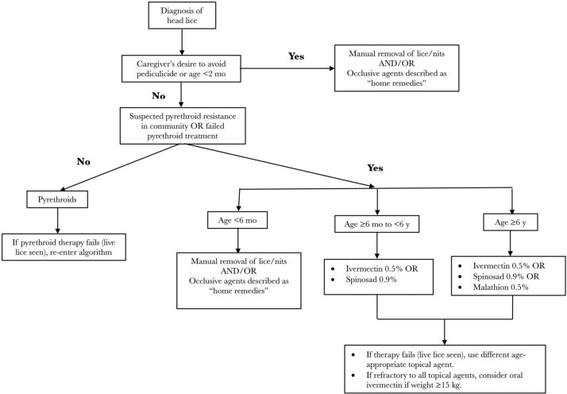
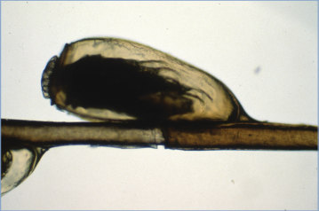
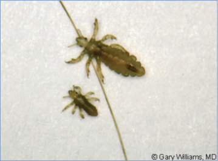
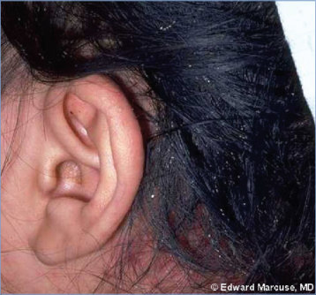
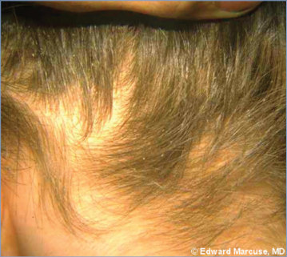

# 105. Pediculosis Capitis (Head Lice)
> Private study reference ([source credits](../../SOURCE_CREDITS.md)). PDF pages 665-671; printed pages 651-657.

## PDF page 665 | printed page 651

(Head Lice)

### CLINICAL MANIFESTATIONS

Itching is the most common symptom of head lice infestation, but many children are asymptomatic. Adult lice (2–3 mm long, tan to grayish white, with claws on all 6 legs) or eggs (match hair color) and nits (empty egg casings, white) are found on the hair and are most readily apparent behind the ears and near the nape of the neck. Excoriations and crusting caused by secondary bacterial infection may occur and often are associated with regional lymphadenopathy. Head lice usually deposit their eggs on a hair shaft 1 to 2 mm from the scalp. Because hair grows at a rate of approximately 1 cm per month, duration of infestation can be estimated by the distance of the nit from the scalp.

### ETIOLOGY

Pediculus humanus capitis is the head louse. Both nymphs and adult lice feed on human blood.

### EPIDEMIOLOGY

Head lice infestation in the United States is most common in children attending child care, preschool, and elementary school. It is not a sign of poor hygiene, and all socioeconomic groups are affected. Head lice infestation is not influenced by hair length, hair texture, or frequency of shampooing or brushing. Head lice are not a health hazard and are not responsible for spread of any disease. Transmission occurs mainly by direct head-to-head contact with hair of infested people. Transmission by contact with personal belongings, such as combs, hairbrushes, sporting gear, and hats, is uncommon. Head lice survive <1 day at room temperature away from the scalp, and their eggs cannot hatch at a lower ambient temperature than that near the scalp.

The incubation period from the laying of eggs to hatching of the first nymph usually is about 8 to 9 days (range, 7 to 12 days). Lice mature to the adult stage approximately 7 days later.

### DIAGNOSTIC TESTS

Identification of eggs, nymphs, and adult lice with the naked eye is possible; diagnosis can be confirmed by using a hand lens, dermatoscope (epiluminescence microscope), or traditional microscope. Nymphal and adult lice shun light and move rapidly to conceal themselves. Wetting the hair with water, oil, or a conditioner to “slow down” the movement of the lice and using a fine-tooth comb may improve ability to diagnose infestation and shorten inspection time. It is important to differentiate nits from dandruff, hair casts (a layer of follicular cells that slide easily off the hair shaft), plugs of desquamated cells, external hair debris, and fungal infections of the scalp. Finding nits attached firmly within 1⁄4 inch of the base of the hair shaft suggests that a person has had infestation, but because nits remain affixed firmly to hair even after hatching or when dead, their mere presence (particularly >1 cm from the scalp) is not a conclusive sign of an active infestation.

### TREATMENT

Treatment should be initiated only if there is a diagnosis of active head lice infestation. A number of effective pediculicidal agents are available to treat head lice infestation (see Table 105.1). Costs and recommended age ranges vary by product. Safety is a major concern with pediculicides, because head lice infestation, itself, presents minimal risk to the host. Instructions on proper use of any product should be explained carefully. Extra amounts should not be used, and multiple products should not be used concurrently. If medication gets into a child’s eyes, it should be flushed out immediately with water. Skin exposure to pediculicide should be limited. Hair should be rinsed over a sink rather than during a shower or bath after topical pediculicide application, and warm rather than hot water should be used to minimize skin absorption attributable to vasodilation. Hair should not be shampooed as part of the rinse process nor for 24 to 48 hours after product is washed out.

Therapy can be initiated with over-the-counter 1% permethrin lotion or with pyrethrin combined with piperonyl butoxide, both of which have good

## PDF page 666 | printed page 652

safety profiles. Prevalence of clinical resistance to these products is highly variable from community to community and country to country. Information about these agents and others are listed below and in Table 105.1. Drugs vary in their residual activity and no treatment is 100% ovicidal. Retreatment may be needed after eggs present at the time of initial treatment have hatched but before new eggs are produced; retreatment intervals vary by product.

• Permethrin (1%) lotion. Permethrin is available without a prescription in a 1% lotion and is approved for infants 2 months or older. Infested hair and scalp are washed first with a nonconditioning shampoo and towel dried. Permethrin then is applied to the scalp and entire length of wet hair, left for 10 minutes, and then rinsed off with water. Permethrin has a low potential for toxic effects and can be highly effective. Although residual permethrin is designed to kill emerging nymphs, many experts advise a second treatment 9 to 10 days after the first treatment if live lice are seen in the interim. An alternate treatment schedule on days 0, 7, and 13 to 15 has been proposed based on the longest possible life cycle of head lice.

• Pyrethrin-based shampoo products. Pyrethrins formulated with piperonyl butoxide are available without a prescription as shampoos or mousse preparations for children

Table 105.1 Pediculicides for the Treatment of Head Lice

Product Brand Name Recommended Age Range Permethrin 1% lotion Multiple products 2 mo

Pyrethrins + piperonyl butoxide shampoo Example: Rid 24 mo

Ivermectin 0.5% lotion Sklice 6 mo

Malathion 0.5% Ovide 6 y (safety not established for ages <6 y)

Spinosad 0.9% suspension Natroba 6 mo (safety not established for ages <4 y)

Ivermectin (oral) Stromectol Any age, if weight 15 kg

24 months or older. The product is applied to dry hair in sufficient amounts to saturate the scalp and entire length of the hair, left for 10 minutes, and then rinsed off with water. Repeat application 9 to 10 days after the first application is necessary to kill newly hatched lice.

• Ivermectin (0.5%) lotion. Ivermectin, a widely used anthelmintic agent, appears to prevent newly hatched lice (nymphs) from surviving. The lotion is applied to dry hair in sufficient amounts to saturate the scalp and entire length of the hair, left for 10 minutes, and then rinsed off with water. It is effective in most patients when given as a single application on dry hair and may be used in children 6 months and older.

• Oral ivermectin. Oral ivermectin is not approved by the U.S. Food and Drug Administration (FDA) for treatment of head lice in pediatrics but is FDA approved for treatment of head lice in adults and has pediatric indications for other parasitic infections. It has been administered as a single oral dose of 200 or 400 μg/kg, with a second dose given after 7 to 10 days. The 400-μg/kg dose has been shown to be comparable to or more effective than 0.5% malathion lotion. Ivermectin should not be used for this indication in children weighing less than 15 kg, because

Retreatment Interval (If Needed) Availability 9–10 days Over the counter

9–10 days Over the counter

Single use Over the counter

7–9 days if live lice are seen after initial dose Prescription

7 days if live lice are seen after initial dose Prescription

7–10 days Prescription

### Geometry-detected table

|Product|Brand Name|Recommended Age Range|Retreatment Interval (If Needed)|Availability|
|---|---|---|---|---|
|Permethrin 1% lotion|Multiple products|2 mo|9–10 days|Over the counter|
|Pyrethrins+ piperonyl butoxide shampoo|Example: Rid|24 mo|9–10 days|Over the counter|
|Ivermectin 0.5% lotion|Sklice|6 mo|Single use|Over the counter|
|Malathion 0.5%|Ovide|6 y (safety not established for ages <6y)|7–9 days if live lice are seen after initial dose|Prescription|
|Spinosad 0.9% suspension|Natroba|6 mo (safety not established for ages <4y)|7 days if live lice are seen after initial dose|Prescription|
|Ivermectin (oral)|Stromectol|Any age, if weight15 kg|7–10 days|Prescription|

[View original table](../../tables/ch105_p0666_1.jpg)

## PDF page 667 | printed page 653

it blocks essential neural transmission if it crosses the blood-brain barrier and young children may be at higher risk of this adverse drug reaction.

o Oral and topical forms of ivermectin for veterinary use are available without a prescription. The dose of active ingredients, presence of inactive ingredients, and different production standards render these products inappropriate for treatment of head lice in humans.

• Malathion (0.5%) lotion. This organophosphate pesticide is available only by prescription as a lotion. Malathion lotion is applied to dry hair in sufficient amounts to saturate the scalp and entire length of the hair, left to dry naturally, and then washed off after 8 to 12 hours by washing and rinsing the hair. The product should be reapplied 7 to 9 days later if live lice are seen in the interim. The high alcohol content of the lotion makes it highly flammable; during treatment the lotion or lotion-coated hair should not be exposed to lighted cigarettes (no smoking around the individual during hair treatment), open flames, or electric heat sources such as hair dryers or curling irons. Malathion should not be used in children younger than 6 years, because safety and effectiveness have not been assessed by the FDA for those children.

• Spinosad (0.9%) suspension. Spinosad has a broad spectrum of activity against insects, including lice. The suspension is applied to dry hair in sufficient amounts to saturate the scalp and entire length of the hair, left for 10 minutes, and then rinsed off with water. A second treatment is applied 7 days later if live lice are seen in the interim. This product contains benzyl alcohol and should not be used in infants younger than 6 months, because systemic absorption may lead to benzyl alcohol toxicity.

• Abametapir (0.74%) lotion (not available in the United States). Abametapir inhibits metalloproteinases, which have a role in physiological processes critical to egg development and survival of lice. Abametapir lotion is applied to dry hair in sufficient amounts to

coat the hair and scalp thoroughly, left on for 10 minutes, and then rinsed off. Treatment involves a single application. This product contains benzyl alcohol and should not be used in infants younger than 6 months, because systemic absorption may lead to benzyl alcohol toxicity. For 2 weeks after abametapir application, the treated individual should avoid taking drugs that are substrates of CYP3A4, CYP2B6, or CYP1A2.

• Lindane (marketed as Kwell), although FDA approved for treatment of head lice, no longer is recommended by the American Academy of Pediatrics because of toxicity.

Detection of living lice on scalp inspection 24 hours or more after treatment suggests incorrect use of pediculicide, hatching of lice after treatment, reinfestation, or resistance to therapy, because pediculicides kill lice shortly after application. After excluding incorrect use, retreatment with a different pediculicide followed by a second application (with the exception of single-use topical ivermectin) at the intervals specified above is recommended in such situations. See Figure 105.1 for a treatment algorithm.

Data are lacking to determine whether heat therapy or suffocation of lice by application of occlusive agents, such as petroleum jelly, olive oil, butter, fat-containing mayonnaise, or desiccating methods are effective methods of treatment. Vinegar-based products claim to loosen the “glue” that attaches the nits to the hair, although clinical benefit has not been demonstrated.

Itching or mild burning of the scalp caused by inflammation of the skin in response to topical therapeutic agents can persist for many days after lice are killed; this is not a reason for retreatment. Topical corticosteroid and oral antihistamine agents may be beneficial for relieving these signs and symptoms.

Manual removal of nits after successful treatment with a pediculicide is helpful to decrease diagnostic confusion and to decrease the small risk of selfreinfestation and social stigmatization. Fine-tooth nit combs designed for this purpose are available, although the type of comb is less important than the actual action of combing.

## PDF page 668 | printed page 654

Figure 105.1 Treatment algorithm for head lice a,b

a Cost and insurance formulary coverage for individual patients should be considered by the prescriber. b Modified from Nolt D, Moore S, Yan AC, Melnick L; American Academy of Pediatrics, Committee on Infectious Diseases, Committee on Practice and Ambulatory Medicine, Section on Dermatology. Head lice. Pediatrics. 2022;150(4):e2022059282

### INFECTION PREVENTION AND CONTROL MEASURES IN HEALTH CARE SETTINGS

Standard precautions plus contact precautions are recommended until the patient has been treated with an appropriate pediculicide.

### CONTROL MEASURES

Household and other close contacts should be examined and treated if infested. Bedmates of infested people should be treated prophylactically at the same time as the infested household members and contacts, even if bedmates do not have identifiable live lice. Children should not be excluded or sent home early from school or child care because of head lice, because head lice have a low contagion in these settings. Parents of children with infestation (ie, at least 1 live, crawling louse) should be notified and informed that their

child should be treated. The presence of nits alone does not justify treatment.

“No-nit” policies requiring that children be free of nits before they return to a child care facility or school should be discouraged. Nits farther from the scalp are easier to discover but are of no consequence. Routine classroom or schoolwide screening for lice is discouraged, because it is not an accurate or cost-effective way of lowering the incidence of head lice in the school setting. Parents who are educated on the diagnosis of lice infestation may screen their own children’s heads for lice regularly (perhaps monthly) and if the child is symptomatic.

Supplemental measures generally are not required to eliminate an infestation. Head lice rarely are transferred via fomites from shared headgear, clothing, combs, or bedding. Special handling of such items, therefore, is not likely to be useful;

## PDF page 669 | printed page 655

protective headgear should not be refused because of fear of head lice. If desired, hats, bedding, clothing, and towels worn or used by the infested person in the 2-day period just before treatment is started can be machine washed and dried using the hot water and hot air cycles, respectively, because lice and eggs are killed by exposure for 5 minutes to temperatures greater than 130°F. Clothing and items that are not washable can be dry-cleaned or sealed in a plastic bag and stored for 2 weeks. Brushes and combs can be soaked in

hot water (at least 130°F) for 5 to 10 minutes. Vacuuming furniture and floors can remove an infested person’s hairs that might have viable eggs attached. Pediculicide spray is not necessary and should not be used. Treatment of dogs, cats, or other pets is not indicated, because they do not play a role in transmission of human head lice.

1 Nolt D, Moore S, Yan AC, Melnick L; American Academy of Pediatrics, Committee on Infectious Diseases, Committee on Practice and Ambulatory Medicine, Section on Dermatology. Head lice. Pediatrics. 2022;150(4):e2022059282

## PDF page 670 | printed page 656

Image 105.1 Nits on the hair shafts. Copyright Edgar K. Marcuse, MD.

Image 105.3 An 8-year-old girl with an earache. This child reported otalgia. During the course of otoscopic evaluation, she was noted to have a very large number of nits in her hair as well as active lice. On questioning, she stated she had had itching of the scalp. She was treated with topical permethrin with temporary resolution. Reinfestation occurred after sharing a riding helmet with a cousin. Courtesy of Will Sorey, MD.

Image 105.5 Louse nit. Copyright James Brien, DO.

Image 105.2 Nits on the hair shaft. Copyright Edgar K. Marcuse, MD.

Image 105.4 Head louse, baby louse, and hair. Copyright Gary Williams, MD.

## PDF page 671 | printed page 657

Image 105.6 The life cycle of the head louse has 3 stages: egg, nymph, and adult. Eggs: Nits are head lice eggs. They are hard to see and are often confused for dandruff or hair spray droplets. Nits are laid by the adult female and are cemented at the base of the hair shaft nearest the scalp (1). They are 0.8 × 0.3 mm, oval, and usually yellow to white. Nits take about 1 week to hatch (range, 6–9 days). Viable eggs are usually located within 6 mm of the scalp. Nymphs: The egg hatches to release a nymph (2). The nit shell then becomes a more visible dull yellow and remains attached to the hair shaft. The nymph looks like an adult head louse but is about the size of a pinhead. Nymphs mature after 3 molts (3, 4) and become adults about 7 days after hatching. Adults: The adult louse is about the size of a sesame seed, has 6 legs (each with claws), and is tan to grayish white (5). In people with dark hair, the adult louse appears darker. Females are usually larger than males and can lay up to 8 nits per day. Adult lice can live up to 30 days on a person’s head. To live, adult lice need to feed on blood several times daily. Without blood meals, the louse will die within 1 to 2 days off the host. Courtesy of Centers for Disease Control and Prevention.

![Image 105.6 The life cycle of the head louse has 3 stages: egg, nymph, and adult. Eggs: Nits are head lice eggs. They are hard to see and are often confused for dandruff or hair spray droplets. Nits are laid by the adult female and are cemented at the base of the hair shaft nearest the scalp (1). They are 0.8 × 0.3 mm, oval, and usually yellow to white. Nits take about 1 week to hatch (range, 6–9 days). Viable eggs are usually located within 6 mm of the scalp. Nymphs: The egg hatches to release a nymph (2). The nit shell then becomes a more visible dull yellow and remains attached to the hair shaft. The nymph looks like an adult head louse but is about the size of a pinhead. Nymphs mature after 3 molts (3, 4) and become adults about 7 days after hatching. Adults: The adult louse is about the size of a sesame seed, has 6 legs (each with claws), and is tan to grayish white (5). In people with dark hair, the adult louse appears darker. Females are usually larger than males and can lay up to 8 nits per day. Adult lice can live up to 30 days on a person’s head. To live, adult lice need to feed on blood several times daily. Without blood meals, the louse will die within 1 to 2 days off the host. Courtesy of Centers for Disease Control and Prevention.](../../figures/ch105_p0671_01.jpg)
