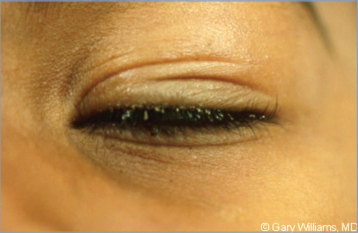

# 107. Pediculosis Pubis (Pubic Lice, Crab Lice)
> Private study reference ([source credits](../../SOURCE_CREDITS.md)). PDF pages 674-676; printed pages 660-662.

## PDF page 674 | printed page 660

(Pubic Lice, Crab Lice)

### CLINICAL MANIFESTATIONS

Pruritus of the anogenital area is a common symptom in pubic lice infestations (“crabs” or “phthiriasis”). Adult lice (1–2 mm long and flattened, tan to grayish white with 4 of its 6 legs terminating in crab-like claws) or eggs (match hair color) and nits (empty egg casings, white) are found on hair, particularly near the hair-skin junction. The parasite most frequently is found in the pubic region, but infestation can involve other coarse body hair, including the eyelashes, eyebrows, beard, axilla, legs, perianal area, and rarely, the scalp. A characteristic sign of heavy pubic lice infestation is the presence of bluish or slate-colored macules (maculae ceruleae) on the chest, abdomen, or thighs.

### ETIOLOGY

Pthirus pubis is the pubic or crab louse. Both nymphs and adult lice feed on human blood. Pubic lice are not a health hazard and are not responsible for the spread of any disease.

### EPIDEMIOLOGY

Pubic lice infestations are more prevalent in teenagers and young adults and usually are spread through sexual contact. Transmission by contact with contaminated items, such as bed linens, towels, or shared clothing, can occur. Pubic lice on the eyelashes or eyebrows of prepubertal children (likely the only areas of coarse hair) may be evidence of sexual abuse, although rarely it may instead be a manifestation of shared sleeping arrangements with infested individuals or fomites. Animals do not get or spread pubic lice.

The incubation period from the laying of eggs to the hatching of the first nymph is 6 to 10 days. Adult lice become capable of reproducing 2 to 3 weeks after hatching. Adult pubic lice can survive away from a host for up to 48 hours, and their eggs can remain viable for up to 10 days under suitable environmental conditions.

### DIAGNOSTIC TESTS

Identification of eggs (nits), nymphs, and lice with the naked eye is possible, although it can be difficult to detect lice unless they have had a recent blood meal. The diagnosis can be confirmed by using a hand lens, traditional microscope, or dermatoscope (epiluminescence microscope) to examine hair shafts. Pubic lice may be difficult to find because of low numbers, and they do not crawl as quickly as head and body lice. If crawling lice are not seen, finding nits in the pubic area strongly suggests infestation and should lead to treatment.

### TREATMENT1

All areas of the body with coarse hair should be examined for evidence of pubic lice infestation. Lice and their eggs can be removed manually (handpicking or wet combing with a lice comb), or the hairs can be shaved to eliminate infestation immediately; topical pediculicides should still be used even when the affected area is shaved. Caution should be used when inspecting, removing, or treating lice on or near the eyelashes. No high-quality data exist for treatment of pubic lice, and thus treatment is extrapolated from head lice. Recommended therapies include either permethrin 1% cream rinse (applied to affected areas and washed off after 10 minutes) or pyrethrins with piperonyl butoxide (applied to the affected areas and washed off after 10 minutes). Both treatments should be repeated in 9 to 10 days. Reported clinical resistance of head lice to permethrin and pyrethrins has been increasing and may be extrapolated to pubic lice, although data are lacking. Reevaluation is recommended after 1 week if symptoms persist. Retreatment might be necessary if lice are found or if eggs are observed at the hair-skin junction. If no clinical response is achieved to one of the recommended regimens, treatment with malathion (0.5% lotion applied to affected areas and washed off after 8–12 hours) or oral ivermectin (250 μg/kg orally, repeated in 7–14 days) is recommended.

Infested people should be examined for other sexually transmitted infections. Pubic lice on the eyelashes or eyebrows of prepubertal children should prompt evaluation for sexual abuse.

## PDF page 675 | printed page 661

### INFECTION PREVENTION AND CONTROL MEASURES IN HEALTH CARE SETTINGS

In addition to standard precautions, contact precautions are recommended until the patient has been treated with an appropriate pediculicide.

### CONTROL MEASURES

Pubic lice are highly contagious; thus, all sexual contacts within the previous month should be treated. Patients should be advised to avoid sexual contact until they and their sex partners have been treated successfully, bedding and clothing have been decontaminated, and reevaluation has

Image 107.1 Pubic lice (Pthirus pubis) in the eyelashes of a 3-year-old boy. The diagnosis can be confirmed by the use of a hand lens or microscope. Copyright Gary Williams, MD.

Image 107.2 This photograph reveals the presence of pubic or crab lice, Pthirus pubis, with reddish brown feces. Pubic lice are generally found in the genital area on pubic hair but may occasionally be found on other coarse body hair, such as leg hair, armpit hair, mustache, beard, eyebrows, and eyelashes. Courtesy of Centers for Disease Control and Prevention/ Reed & Carnrick Pharmaceuticals.

been performed to rule out persistent infestation if persons are still symptomatic. Bedding, towels, and clothing used in the preceding 3 days should be decontaminated by machine washing and drying using the hot water and hot air cycles, respectively, because lice and eggs are killed by exposure for 5 minutes at temperatures greater than 130°F. Clothing and items that are not washable can be dry-cleaned or sealed in a plastic bag and stored for 2 weeks.

1 Centers for Disease Control and Prevention. Sexually transmitted infections treatment guidelines, 2021. MMWR Recomm Rep. 2021;70(RR-4):1–187. Available at: www. cdc.gov/std/treatment-guidelines/

## PDF page 676 | printed page 662

Image 107.3 Pediculosis, the infestation of humans by lice, has been documented for millennia. Three species of lice infest humans: Pediculus humanus humanus, the body louse; Pediculus humanus capitis, the head louse; and Pthirus pubis, the pubic or crab louse. The hallmark of louse infestation is pruritus at the site of bites. Lice are more active at night, frequently disrupting the sleep of the host, which is the derivation of the term “feeling lousy.” Adult pubic lice can survive without a blood meal for 36 hours. Unlike head lice, which may travel up to 23 cm per minute, pubic lice are sluggish, traveling a maximum of 10 cm per day. Viable eggs on pubic hairs may hatch up to 10 days later. Pubic louse infestation is localized most frequently to the pubic and perianal regions but may spread to the mustache, beard, axillae, eyelashes, or scalp hair. Infestation is usually acquired through sexual contact, and the finding of pubic lice in children (often limited to the eyelashes) should raise concern for possible sexual abuse. Courtesy of H. Cody Meissner, MD, FAAP.

![Image 107.3 Pediculosis, the infestation of humans by lice, has been documented for millennia. Three species of lice infest humans: Pediculus humanus humanus, the body louse; Pediculus humanus capitis, the head louse; and Pthirus pubis, the pubic or crab louse. The hallmark of louse infestation is pruritus at the site of bites. Lice are more active at night, frequently disrupting the sleep of the host, which is the derivation of the term “feeling lousy.” Adult pubic lice can survive without a blood meal for 36 hours. Unlike head lice, which may travel up to 23 cm per minute, pubic lice are sluggish, traveling a maximum of 10 cm per day. Viable eggs on pubic hairs may hatch up to 10 days later. Pubic louse infestation is localized most frequently to the pubic and perianal regions but may spread to the mustache, beard, axillae, eyelashes, or scalp hair. Infestation is usually acquired through sexual contact, and the finding of pubic lice in children (often limited to the eyelashes) should raise concern for possible sexual abuse. Courtesy of H. Cody Meissner, MD, FAAP.](../../figures/ch107_p0676_01.jpg)
