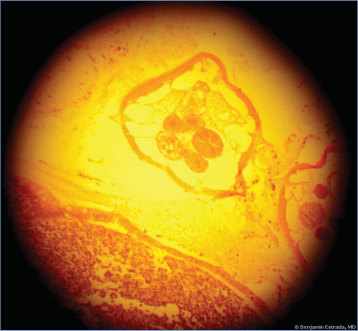
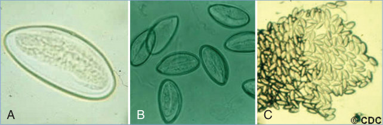

# 110. Pinworm Infection (Enterobius vermicularis)
> Private study reference ([source credits](../../SOURCE_CREDITS.md)). PDF pages 693-696; printed pages 679-682.

## PDF page 693 | printed page 679

(Enterobius vermicularis)

### CLINICAL MANIFESTATIONS

Pinworm infection (enterobiasis) commonly is asymptomatic but may cause pruritus ani and, rarely, pruritus vulvae. Pruritus ani can be severe enough to cause sleep disturbance. Bacterial superinfections can result from scratching and excoriation of the irritated area. Pinworms have been found in the lumen of the appendix, and in some cases, these intraluminal parasites have been associated with signs of acute appendicitis, but they have also been observed in histologically normal appendices removed for incidental reasons. Urethritis, vaginitis, salpingitis, or pelvic peritonitis uncommonly may occur from aberrant migration of an adult worm from the perineum. Eosinophilic enterocolitis has been reported, although peripheral eosinophilia generally is not seen in any form of enterobiasis. No proof of a causal relationship has been established for pinworms causing nonspecific clinical findings such as grinding of teeth at night, weight loss, or enuresis.

### ETIOLOGY

Enterobius vermicularis is a nematode helminth (roundworm).

### EPIDEMIOLOGY

Enterobiasis occurs worldwide and commonly clusters within families. Prevalence rates are higher in preschool- and school-aged children, in primary caregivers of infected children, and in institutionalized people. An estimated 40 million people in the United States have been infected with pinworms, with a prevalence as high as 20% to 30% in some age groups and communities.

Initial infection occurs by ingestion of contaminated food, or contact with hands, clothing, bedding, or other items contaminated with eggs. Infection may also occur by person-to-person transmission, including during sexual activity or via fecal-oral or oral-genital contact. Eggs hatch and release larvae in the small intestine, and adult worms then locate themselves usually in the cecum, appendix, and ascending colon. Adult male worms die soon after copulating. Gravid

female worms migrate, usually at night while the host is resting, to the perianal area to deposit eggs containing larvae, which mature in 6 to 8 hours. Female worms begin to oviposit after 30 days and have an overall lifespan of up to 100 days. Adult female worms and eggs may induce intense perianal pruritus, leading to an autoinfection cycle during which the area is scratched and then eggs are lodged on the hands and under the fingernails and ingested when hands are put in the mouth. Retroinfection, in which newly hatched larvae migrate back into the rectum, has been hypothesized, but its role in transmission of infection is uncertain. A person remains infectious as long as female pinworms are discharging eggs on perianal skin. Eggs may remain infective in an indoor environment for up to 2 weeks. Humans are the only known natural hosts. Pets are not reservoirs of infection.

The incubation period from ingestion of an egg until an adult gravid female worm migrates to the perianal region is 2 to 6 weeks or longer.

### DIAGNOSTIC TESTS

Diagnosis is established via the classic cellulose tape test (“Scotch tape test”) or with a commercially available pinworm paddle test, which is a clear plastic paddle coated with an adhesive surface on one side that is pressed on both sides of the perianal region during the night or at the time of waking and before bathing. The tape or paddle is then pressed on a slide and eggs can be visualized by microscopy. Eggs are 50 to 60 microns by 20 to 30 microns and flattened on one side, giving them a “bean-shaped” appearance. Testing on 3 different days will increase the sensitivity from around 65% for a single test to approximately 90%. Adult female worms, which are white and measure 8 to 13 mm, also can be seen in the perineal region. Stool examination is not helpful, because worms or eggs are found infrequently (only in about 10% or less) in the stool. Neither peripheral eosinophilia nor elevated immunoglobulin E concentrations are typical because of low pinworm invasiveness and, if present, should not be attributed to pinworm infection.

### TREATMENT

Several drugs will treat pinworms, including pyrantel pamoate, mebendazole, and albendazole. Pyrantel pamoate, available as an over-the-counter

## PDF page 694 | printed page 680

drug in the United States, is significantly less expensive than the prescription benzimidazole medications mebendazole and albendazole. Albendazole currently is not approved by the U.S. Food and Drug Administration for treatment of pinworms. Each medication has high potency against adult pinworms, but overall effectiveness of therapy depends on existing larval and egg burden in the child and reinfection from close contacts. Each medication (pyrantel pamoate or a benzimidazole) is recommended to be given in a single dose and repeated in 2 weeks, in order to treat nematodes developed from eggs or larvae during that period. For children younger than 2 years, in whom experience with these 3 drugs is limited and use is off-label, risks and benefits should be considered before drug administration. Ivermectin has been evaluated and is partially effective, but should not be used in children weighing less than 15 kg, because it blocks essential neural transmission if it crosses the bloodbrain barrier and young children may be at higher risk of this adverse drug reaction. Because reinfection is common even when effective therapy is given, treatment of the entire household as a group should be considered. Repeated infections should be treated by the same method as the first infection. Vaginitis is self-limited and does not require separate treatment. “Pulse” treatment with

Image 110.1 Adult pinworm (Enterobius vermicularis; arrow) in the perianal area of a 14-year-old boy. Perianal inspection 2 to 3 hours after the child goes to sleep may reveal pinworms that have migrated outside the intestinal tract. Copyright Gary Williams, MD.

a single dose of mebendazole every 14 days for a period of 16 weeks has been used in refractory cases with multiple recurrences. Alternative diagnoses in cases being attributed to recurrent pinworm infections can include Dipylidium caninum, which is characterized by proglottid segments being visible in the stool, and is definitively diagnosed by stool ova and parasite analysis and treated with praziquantel, as well as, uncommonly, delusional parasitosis.

### INFECTION PREVENTION AND CONTROL MEASURES IN HEALTH CARE SETTINGS

Standard precautions are indicated.

### CONTROL MEASURES

Control is difficult in child care centers and schools, because the rate of reinfection is high. In institutions, mass and simultaneous treatment, repeated in 2 weeks, can be successful. Hygienic measures, such as bathing in the morning to remove eggs, frequent hand hygiene, and clipping of fingernails, all are helpful for decreasing the risk of autoinfection and continued transmission. Bed linens and underclothing of infected children should be handled carefully, should not be shaken (to avoid scattering eggs), and should be laundered promptly.

## PDF page 695 | printed page 681

Image 110.2 Enterobius vermicularis in the lumen of the appendix of a 10-year-old. Pinworms can be found in the lumen of the appendix, but most evidence indicates that they do not cause acute appendicitis. Courtesy of Benjamin Estrada, MD.

A B

Image 110.3 A and B, Enterobius egg(s). C, Enterobius eggs on cellulose tape preparation. Courtesy of Centers for Disease Control and Prevention.

C

## PDF page 696 | printed page 682

Embryonated eggs ingested by human

i

2

1

d

Eggs on perianal folds Larvae inside the eggs mature within 4 to 6 hours

= Infective stage

i

= Diagnostic stage

d

Image 110.4 Eggs are deposited on perianal folds (1). Self-infection occurs by transferring infective eggs to the mouth with hands that have scratched the perianal area (2). Person-to-person transmission can also occur through handling of contaminated clothes or bed linens. Enterobiasis may also be acquired through surfaces in the environment that are contaminated with pinworm eggs (eg, curtains, carpeting). Some small number of eggs may become airborne and inhaled. These could be swallowed and follow the same development as ingested eggs. After ingestion of infective eggs, the larvae hatch in the small intestine (3), and the adults establish themselves in the colon (4). The time from ingestion of infective eggs to oviposition by the adult females is about 1 month. The lifespan of the adults is about 2 months. Gravid females migrate nocturnally outside the anus and oviposit while crawling on the skin of the perianal area (5). The larvae contained inside the eggs develop (the eggs become infective) in 4 to 6 hours under optimal conditions (1). Retroinfection, or the migration of newly hatched larvae from the anal skin back into the rectum, may occur, but the frequency with which this happens is unknown. Courtesy of Centers for Disease Control and Prevention.

Larvae hatch in small intestine

3

Adults in lumen of cecum

4

Gravid migrates to perianal region at night to lay eggs

5

![Image 110.4 Eggs are deposited on perianal folds (1). Self-infection occurs by transferring infective eggs to the mouth with hands that have scratched the perianal area (2). Person-to-person transmission can also occur through handling of contaminated clothes or bed linens. Enterobiasis may also be acquired through surfaces in the environment that are contaminated with pinworm eggs (eg, curtains, carpeting). Some small number of eggs may become airborne and inhaled. These could be swallowed and follow the same development as ingested eggs. After ingestion of infective eggs, the larvae hatch in the small intestine (3), and the adults establish themselves in the colon (4). The time from ingestion of infective eggs to oviposition by the adult females is about 1 month. The lifespan of the adults is about 2 months. Gravid females migrate nocturnally outside the anus and oviposit while crawling on the skin of the perianal area (5). The larvae contained inside the eggs develop (the eggs become infective) in 4 to 6 hours under optimal conditions (1). Retroinfection, or the migration of newly hatched larvae from the anal skin back into the rectum, may occur, but the frequency with which this happens is unknown. Courtesy of Centers for Disease Control and Prevention.](../../figures/ch110_p0696_01.jpg)
