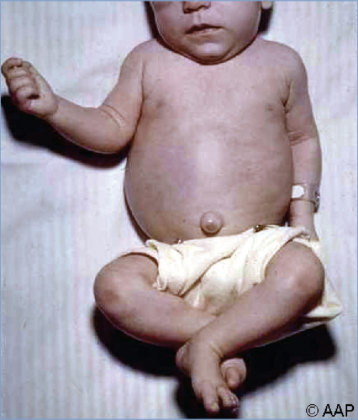
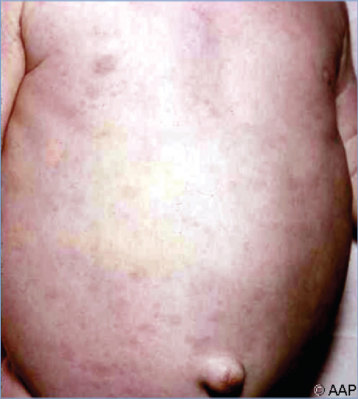

# 120. Rat-Bite Fever
> Private study reference ([source credits](../../SOURCE_CREDITS.md)). PDF pages 754-756; printed pages 740-742.

## PDF page 754 | printed page 740

### CLINICAL MANIFESTATIONS

Rat-bite fever is typically caused by infection with either Streptobacillus moniliformis or Spirillum minus. S moniliformis infection (streptobacillary fever or Haverhill fever) is characterized by relapsing fever, rash, and migratory polyarthritis, although variable presentations outside this classic triad increasingly are reported. There is an abrupt onset of fever, chills, muscle pain, vomiting, headache, and rarely (unlike S minus) lymphadenopathy. A maculopapular, purpuric, or petechial rash develops, predominantly on the peripheral extremities including the palms and soles, typically within a few days of fever onset. The skin lesions may become purpuric or confluent and may desquamate. The bite site usually heals promptly and exhibits no or minimal inflammation. Nonsuppurative migratory polyarthritis or arthralgia follows in approximately 50% of patients and especially affects the knees, followed by wrists, ankles, and occasionally hips. Symptoms of untreated infection may resolve within 2 weeks, but fever occasionally can relapse for weeks or months, and infection can lead to serious complications including soft-tissue and solid-organ abscesses (brain, myocardium), septic arthritis, pneumonia, endocarditis, myocarditis, pericarditis, sepsis, and meningitis. The case fatality rate is 7% to 13% in untreated patients, and fatal cases have been reported in children.

With S minus infection (“sodoku”), a period of initial apparent healing at the site of the bite usually is followed by fever and ulceration, discoloration, swelling, and pain at the site (about 1 to 4 weeks later), regional lymphangitis and lymphadenopathy, and a distinctive rash of red or purple plaques. Arthritis is rare.

### ETIOLOGY

The major causes of rat-bite fever are S moniliformis, a microaerophilic, facultatively anaerobic, gram-negative, pleomorphic bacillus, and S minus, a small, gram-negative, spiral-shaped bacterium with bipolar flagellar tufts. Other members of the Streptobacillus genus, including Streptobacillus notomytis, are rare causes of disease.

### EPIDEMIOLOGY

Rat-bite fever is a zoonotic illness. The natural habitat of S moniliformis and S minus is the oropharynx and nasopharynx of rodents. S moniliformis is transmitted by bites, scratches, or exposure to oral secretions (eg, via kissing pet rodents) of infected rats, other rodents (eg, mice, gerbils, squirrels, weasels), or rodent-eating animals, including cats and dogs. Infection via contact with contaminated fomites (eg, rat cages or bedding) has been reported rarely. Haverhill fever refers to infection after ingestion of unpasteurized milk, water, or food contaminated with urine containing S moniliformis and may be associated with an outbreak of disease. S minus is transmitted by bites of rats and mice. S moniliformis infection accounts for almost all cases of rat-bite fever in the United States; S minus infections occur primarily in Asia.

The incubation period for S moniliformis usually is less than 7 days but can range from 3 days to 3 weeks; for S minus, the incubation period is 7 to 21 days.

### DIAGNOSTIC TESTS

S moniliformis is a fastidious, slow-growing organism isolated from blood, synovial fluid, abscesses, or aspirates from the bite lesion. Growth is best in bacteriologic media enriched with blood (15% rabbit blood seems optimal), serum, and ascitic fluid; cultures should be kept in 5% to 10% carbon dioxide atmosphere at 37°C. Sodium polyanethol sulfonate, a common anticoagulant in blood culture media, inhibits growth. The laboratory should be alerted that S moniliformis is suspected and asked to hold the culture for at least 1 week. Nucleic acid amplification tests are increasingly available in hospital and commercial laboratories. The use of 16S ribosomal RNA gene sequencing and matrix-assisted laser desorption/ionizationtime of flight mass spectrometry improve the diagnostic sensitivity and specificity of culturebased practices.

S minus has not been recovered on artificial media but can be visualized by darkfield microscopy in wet mounts of blood, exudate of a lesion, and lymph nodes or by Giemsa or Wright stain of blood specimens.

## PDF page 755 | printed page 741

### TREATMENT

Penicillin G procaine administered intramuscularly or penicillin G administered intravenously for 7 to 10 days is the treatment for rat-bite fever caused by either agent; currently in the United States and other countries, intravenous administration is the more acceptable route. Conversion to oral penicillin after a minimum of 5 days of intravenous therapy can be considered in uncomplicated cases to complete a full 10-day course. There is limited experience using ampicillin, cefuroxime, ceftriaxone, and cefotaxime for treatment. Doxycycline or streptomycin can be substituted when a patient has a serious allergy to penicillin or while awaiting laboratory results when rickettsial infections (eg, Rocky Mountain spotted fever) are also among the differential diagnoses. Patients with endocarditis should receive intravenous high-dose penicillin G for at least 4 weeks. The addition of streptomycin or gentamicin for initial therapy may be useful in severe infections including endocarditis.

### INFECTION PREVENTION AND CONTROL MEASURES IN HEALTH CARE SETTINGS

Standard precautions are recommended.

### CONTROL MEASURES

Exposed people should be observed for symptoms. Rat control is important in the control of disease. Rodents and other small pets are not recommended for children younger than 5 years or people with weakened immune systems, because they are at a greater risk for serious illness from pathogens that pets can carry. Adults should supervise the touching, feeding, or caring for pets by young children and handwashing for young children. People with frequent rodent exposure should wear gloves and avoid hand-to-mouth contact during animal handling. Regular hand hygiene should be practiced, and surfaces that the rodent contacted should be disinfected.

## PDF page 756 | printed page 742

Image 120.1 The rash of rat-bite fever (Streptobacillus moniliformis) in an infant bitten by a rat on the right side of the face while sleeping.

Image 120.3 Five days after being bitten by a rat, the child in Image 120.2 developed fever, chills, and headache, followed 5 days later by a papulovesicular rash on the hands and feet. Streptobacillus moniliformis was isolated from blood cultures, and the patient responded to intravenous penicillin therapy without complication. Courtesy of George Nankervis, MD.

Image 120.2 Rat-bite wounds on the finger of a 5-year-old boy; 12 hours afterward, the bite appears noninflammatory. Because of fever, chills, headache, and rash 5 days later, blood cultures were obtained that grew Streptobacillus moniliformis. Courtesy of George Nankervis, MD.

Image 120.4 Close-up view of the rash of the same infant as in Image 120.1, who was bitten on the right cheek by a rat. Sodoku, or rat-bite fever caused by Spirillum minus, rarely occurs in the United States.

