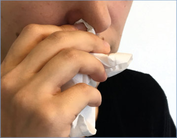

# 122. Rhinovirus Infections
> Private study reference ([source credits](../../SOURCE_CREDITS.md)). PDF pages 766-767; printed pages 752-753.

## PDF page 766 | printed page 752

### CLINICAL MANIFESTATIONS

Rhinoviruses are the most frequent cause of the common cold, or rhinosinusitis. Typical clinical manifestations include sore throat, nasal congestion, and nasal discharge that initially is watery and clear but often becomes mucopurulent and viscous after a few days. Malaise, headache, myalgia, low-grade fever, cough, and sneezing may occur. Symptoms typically peak in severity after 2 to 3 days and have a median duration of 7 days but may persist for more than 10 days in approximately 25% of illnesses. Rhinoviruses also cause otitis media and lower respiratory tract infections (eg, bronchiolitis, pneumonia), particularly in infants, and are associated with approximately 60% to 70% of acute exacerbations of asthma in school-aged children.

### ETIOLOGY

Rhinoviruses are small, nonenveloped, single, positive-stranded RNA viruses classified into 3 species (RV-A, RV-B, and RV-C) in the family Picornaviridae, genus Enterovirus. Nearly 170 rhinovirus types have been identified by immunologic and molecular methods. Infection confers type-specific immunity, but protection is temporary.

### EPIDEMIOLOGY

Rhinovirus infection is ubiquitous in human populations. It is most frequent in infancy and early childhood; more than 20% of infants experience their first rhinovirus infection before 6 months of age. Children typically experience 2 to 4 rhinovirus infections each year, and 93% of adults experience at least 1 rhinovirus infection annually. Rhinoviruses may cause up to two-thirds of cases of the common cold. They can cause sinusitis and otitis media, either as the sole pathogen or with secondary bacterial infections. Rhinovirus infections are a major viral cause of exacerbations of asthma, cystic fibrosis, and chronic obstructive pulmonary disease and have been detected in the lower respiratory tract in patients of all ages hospitalized with wheezing or pneumonia. Rhinovirus infection is associated with increased mortality in hematopoietic cell transplant recipients.

Person-to-person transmission occurs by selfinoculation of contaminated secretions on hands or by large-particle aerosol spread. Infections occur throughout the year, but peak activity occurs during fall and spring. Multiple types circulate simultaneously, and the prevalent types circulating in a given population change from season to season. Viral shedding in nasopharyngeal secretions is most abundant during the first 2 to 3 days of infection and usually ceases by 7 to 10 days. Viral RNA may be detectable in nasal secretions by molecular testing for as long as 30 days, although low amounts of virus detected by nucleic acid amplification tests (NAATs) in an asymptomatic person are unlikely to result in transmission. Young age and child care attendance are associated with more frequent rhinovirus infections. Those at increased risk for severe illness include those born preterm with or without chronic lung disease, respiratory syncytial virus coinfection, congenital heart disease, underlying pulmonary disease, immunocompromise, and history of atopy in the birthing parent.

The incubation period usually is 2 to 3 days.

### DIAGNOSTIC TESTS

Rhinovirus infection is diagnosed by detection of virus in respiratory secretions, although a specific viral diagnosis may not be useful clinically in terms of patient management. Because of the lack of common group antigens among the various types, antigen detection is not practical for clinical diagnosis. If a viral diagnosis is necessary, NAATs are the preferred method to identify rhinovirus infections, with several commercial assays cleared by the U.S. Food and Drug Administration. Most of these assays are designed as multiplexed tests that detect a wide variety of viral and, in some cases, bacterial respiratory pathogens. In general, these assays cannot clearly distinguish rhinoviruses from enteroviruses because of the genetic similarity of the 2 groups. Given the prevalence of rhinovirus infection and the occurrence of shedding following infection, rhinovirus detection, even in symptomatic patients, may not be causal. Serologic diagnosis of rhinovirus infection is impractical because of the large number of antigenic types and the absence of a common antigen.

## PDF page 767 | printed page 753

### TREATMENT

Treatment is supportive. Over-the-counter cough and cold medications are not recommended for use in children younger than 2 years. No specific antiviral therapy is currently available for treatment of rhinovirus infections. Antimicrobial agents should not be used for prevention of secondary bacterial infection, because their use may promote the emergence of resistant bacteria and subsequently complicate treatment for a bacterial infection, and because of the risk of antibiotic-associated adverse effects (eg, Clostridioides difficile disease).

### INFECTION PREVENTION AND CONTROL MEASURES IN HEALTH CARE SETTINGS

In addition to standard precautions, droplet precautions are recommended for symptomatic

Image 122.1 Rhinoviruses are the most frequent cause of the common cold. Typical clinical manifestations include sore throat, nasal congestion, and nasal discharge. Courtesy of National Institute of Allergy and Infectious Diseases.

hospitalized infants and children for the duration of illness. Contact precautions should be added if copious moist secretions and close contact are likely to occur (eg, young infants). In symptomatic immunocompromised patients, the duration of contact precautions should be extended because of possible prolonged shedding.

### CONTROL MEASURES

Appropriate respiratory hygiene and cough etiquette should be followed. Routine handwashing and alcohol-based hand sanitizers are effective for removal of rhinovirus from the hands.

Image 122.2 The structure of a rhinovirus C, showing the spikelike fingers in red. Rhinovirus C, along with rhinoviruses A and B, is a leading cause of common colds. These viruses can also cause severe respiratory infections in infants and young children and cause serious illness for those with asthma and other chronic respiratory conditions. Courtesy of the National Institutes of Health.

