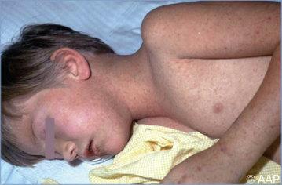
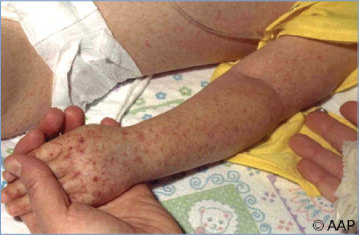
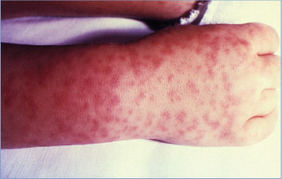
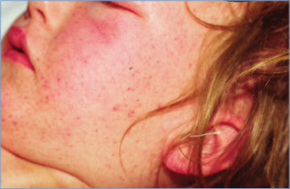
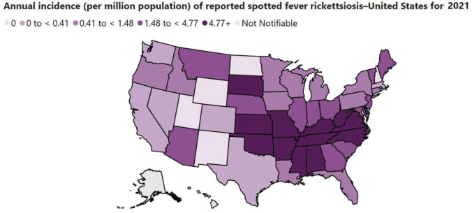

# 125. Rocky Mountain Spotted Fever
> Private study reference ([source credits](../../SOURCE_CREDITS.md)). PDF pages 773-778; printed pages 759-764.

## PDF page 773 | printed page 759

### CLINICAL MANIFESTATIONS

Rocky Mountain spotted fever (RMSF) is a systemic, predominantly small-vessel vasculitis that often involves a characteristic rash. Unlike many other spotted fever rickettsioses, eschars at sites of tick bites do not develop with RMSF. High fever, myalgia, headache (less commonly reported in young children), nausea, vomiting, and malaise are typical presenting symptoms. Abdominal pain and diarrhea can be present and may obscure the diagnosis. Children may also experience peripheral and/or periorbital edema. The rash usually appears 2 to 4 days following the onset of fever; a faint maculopapular rash first appears on the wrists, forearms, or ankles and spreads centripetally to involve the limbs and trunk. The rash associated with RMSF can also involve the palms and soles. Although development of a rash is a useful diagnostic sign, fewer than 50% of patients have a rash during the first 3 days of illness, the early rash may be faint, and rash can be absent altogether in up to 10% of patients. As the disease progresses, the rash can become petechial, which is indicative of worsening small-vessel vasculitis and regional extravasation of red cells. A petechial rash is also indicative of progressive injury to small blood vessels of other organs and tissues. Delayed onset or atypical appearance of the rash is a risk factor for misdiagnosis and poor outcome. Meningismus, altered mental status, cerebral edema leading to life-threatening increases in intracranial pressure, and/or coma can occur with the progression of disease. Thrombocytopenia, elevated liver aminotransferases, and hyponatremia are the laboratory abnormalities seen most frequently and worsen as disease progresses. White blood cell count is often normal until later stages of disease, but leukopenia and anemia can occur. When appropriate antibiotic therapy is initiated during the first few days of infection, patients typically recover completely, and fever resolves in the first 48 hours of treatment. If appropriate antimicrobial treatment is not initiated or is delayed past the fifth day of symptoms, the illness can be severe or life-threatening and can include prominent central nervous system, cardiac, pulmonary,

gastrointestinal tract, and renal involvement; disseminated intravascular coagulation; necrosis of digits and gangrene; and shock leading to death. RMSF can progress rapidly, even in previously healthy people. Case fatality rates of untreated RMSF range from 20% to 80%, with a median time to death of 8 days. Significant long-term sequelae can occur in patients with severe RMSF, even if treated with appropriate antibiotics; these include neurologic (paraparesis; hearing loss; peripheral neuropathy; bladder and bowel incontinence; developmental and language delays; and cerebellar, vestibular, and motor dysfunction) and nonneurologic (disability from limb or digit amputation) sequelae.

### ETIOLOGY

Rickettsia rickettsii, an obligate, intracellular, gram-negative bacillus and a member of the spotted fever group of rickettsiae, is the causative agent of RMSF. The primary targets of infection in mammalian hosts are endothelial cells lining the small blood vessels of all major tissues and organs. Diffuse small vessel vasculitis and vascular injury leads to increased permeability and tissue edema.

### EPIDEMIOLOGY

The pathogen is transmitted to humans by the bites of several genera of hard ticks of the family Ixodidae. The principal recognized vectors of R rickettsii are Dermacentor variabilis (the American dog tick) in the eastern and central United States and Dermacentor andersoni (the Rocky Mountain wood tick) in the northern and western United States. Rhipicephalus sanguineus (the brown dog tick) has been confirmed as a vector of R rickettsii in Arizona and Mexico and may play a role in other regions. Ticks and their small mammal hosts serve as reservoirs of the pathogen in nature. Other wild animals and dogs have been found with antibodies to R rickettsii, but their role as natural reservoirs is not clear. Dogs can experience clinical symptoms similar to those described in humans. People with occupational or recreational exposure to the tick vector (eg, pet owners, animal handlers, and people who spend more time outdoors) are at increased risk of exposure to the organism. People of all ages can be infected. The period of highest incidence in the United States is from April to September, although RMSF

## PDF page 774 | printed page 760

can occur year-round in certain areas with endemic disease. The geographic ranges of many ticks, including those that transmit R rickettsii are expanding because of climate change. Laboratoryacquired infection is rare. Transmission has occurred on rare occasions by blood transfusion. There have been no documented cases of RMSF transmitted via organ transplantation, although it is theoretically possible.

RMSF is the most severe and frequently fatal rickettsial illness in the United States. Patients at higher risk for severe illness include those in whom treatment was delayed, children younger than 10 years, and patients with glucose-6phosphate dehydrogenase deficiency. Children younger than 10 years are 5 times more likely than adults to die of RMSF.

Current national surveillance collects data on spotted fever rickettsioses, including RMSF. They are widespread in the United States, with most cases reported in the south Atlantic, southeastern, and south-central states. The incidence of spotted fever rickettsioses has increased in the past 2 decades; the reported cases in the southwestern United States are largely believed to be secondary to RMSF.

The incubation period is approximately 1 week (typical range, 3–12 days).

### DIAGNOSTIC TESTS1

The diagnosis of RMSF must be made using clinical signs and symptoms and can be confirmed later using diagnostic tests. Treatment should never be delayed while awaiting laboratory confirmation or because of lack of history of tick bite; approximately half of RMSF cases occur in people who do not report a tick bite. The indirect immunofluorescence antibody assay using R rickettsii antigen is considered the reference standard serologic assay. Both immunoglobulin (Ig) G and IgM antibodies begin to increase approximately 7 to 10 days after onset of symptoms; IgM is less specific, and IgG is the preferred test. Confirmation requires a fourfold or greater increase in antigenspecific IgG between serum specimens collected during the acute stage (first 1–2 weeks of illness) and convalescent stage (2–6 weeks following resolution of symptoms). An elevated acute titer may represent prior exposure to RMSF or other spotted

fever group rickettsiae rather than acute infection, and a negative serologic test in the acute phase does not rule out diagnosis of RMSF. Low-level elevated antibody titers can be an incidental finding in a significant proportion of the general population in some regions. Cross-reactivity can be observed with antigens of other spotted fever group rickettsiae, including Rickettsia parkeri and Rickettsia africae. Enzyme-linked immunosorbent assays also can be used for assessing antibody presence in acute and convalescent sera but are less useful for quantifying changes in titer values.

RMSF can be diagnosed by detection of R rickettsii DNA in acute whole blood, tissue, and serum specimens by nucleic acid amplification tests (NAATs). R rickettsii typically does not circulate in large numbers in whole blood until advanced stages of disease; assays relying on detection of DNA can lack sensitivity, and a negative result does not rule out RMSF. Specimens used for NAATs should be obtained before doxycycline administration when possible, but initiation of treatment should not be delayed. Diagnosis can also be confirmed by detection of rickettsial DNA in biopsy or autopsy specimens by NAATs or immunohistochemical visualization of rickettsiae in tissues, although these assays have limited availability.

R rickettsii also can be isolated from acute blood specimens or from infected tissues, but culture requires specialized cell culture techniques and a laboratory with a minimum biosafety level 3 designation. Cell culture cultivation of the organism must be confirmed by molecular methods.

### TREATMENT2

Doxycycline is the drug of choice for treatment of RMSF in patients of any age and should be started as soon as RMSF is suspected. Physicians should treat empirically if RMSF is being considered and should not postpone treatment while awaiting laboratory confirmation. Treatment is most effective if initiated in the first 5 days of symptoms, and treatment started after that time is less likely to prevent death or other adverse outcomes. Antimicrobial treatment should be continued until the patient has been afebrile for at least 3 days and has demonstrated clinical improvement; the usual minimum duration of therapy is 5 to 7 days but can be longer in severe cases. Resistance to

## PDF page 775 | printed page 761

doxycycline or relapses in symptoms after the completion of the recommended course has not been documented. Use of antimicrobial agents other than doxycycline increases risk of mortality. Chloramphenicol can be found in some references as an alternative treatment; however, its use is associated with a higher risk of fatal outcome. Chloramphenicol carries a risk of serious adverse events and is not available as an oral formulation in the United States. Sulfa-containing drugs are associated with clinical worsening and increase the likelihood of death from RMSF. Other antibiotics are not effective. In the case of severe doxycycline allergy, a specialist should be consulted to discuss risks, benefits, and alternatives. Doxycycline desensitization has been described. Experts at the Centers for Disease Control and Prevention (CDC) are available by telephone for consultation with health care providers at 1-800-CDC-INFO (1-800-232-4636).

### INFECTION PREVENTION AND CONTROL MEASURES IN HEALTH CARE SETTINGS

Standard precautions are recommended.

Image 125.1 Rocky Mountain spotted fever in an 8-year-old boy. Sixth day of rash without treatment.

### CONTROL MEASURES

Limiting exposures to ticks and tick bites is the primary means of prevention. Prophylactic use of antimicrobial agents to prevent RMSF is not recommended, even in children with a documented tick bite who are asymptomatic. People who were bitten by a tick in an area with endemic disease should be advised to see a health care provider should they develop signs or symptoms of RMSF. No licensed R rickettsii vaccine is available in the United States. Additional information is available on the CDC website (www.cdc.gov/rmsf/).

1 Biggs HM, Behravesh CB, Bradley KK, et al. Diagnosis and management of tickborne rickettsial diseases: Rocky Mountain spotted fever and other spotted fever group rickettsioses, ehrlichioses, and anaplasmosis-United States. A practical guide for health care and public health professionals. MMWR Recomm Rep. 2016;65(RR-2):1–44 2 Biggs HM, Behravesh CB, Bradley KK, et al. Diagnosis and management of tickborne rickettsial diseases: Rocky Mountain spotted fever and other spotted fever group rickettsioses, ehrlichioses, and anaplasmosis-United States. A practical guide for health care and public health professionals. MMWR Recomm Rep. 2016;65(RR-2):1–44

Image 125.2 Rocky Mountain spotted fever. Sixth day of rash without treatment. This is the same patient as in Image 125.1.

## PDF page 776 | printed page 762

Image 125.3 A 2-year-old boy with obtundation, disorientation, and petechial rash of Rocky Mountain spotted fever, with facial and generalized edema secondary to generalized vasculitis. Rocky Mountain spotted fever is the most severe and frequently reported rickettsial illness in the United States.

Image 125.5 This 8-year-old girl presented with a history of “chickenpox” for 11 days. She had numerous lesions on her chest, face, arms, and proximal aspect of the legs. There were subcutaneous erythematous lesions on the hands, and she had 5 or 6 lesions on her feet. The diagnosis of Rocky Mountain spotted fever was confirmed serologically, and she was treated without any complications. Courtesy of Neal Halsey, MD.

Image 125.4 This is the same patient as in Image 125.3, showing petechial rash and edema of the upper extremity. The rickettsiae multiply in the endothelial cells of small blood vessels, resulting in vasculitis.

Image 125.6 A child’s right hand and wrist displaying the spotted rash and edema of Rocky Mountain spotted fever. Courtesy of Centers for Disease Control and Prevention.

## PDF page 777 | printed page 763

Image 125.7 A 7-year-old girl with severe Rocky Mountain spotted fever. Note the rash and edema secondary to diffuse vasculitis. Courtesy of Larry Frenkel, MD.

Image 125.9 Immunohistochemical staining of Rickettsia rickettsii in vascular endothelial cells in the cerebellum of a child with fatal Rocky Mountain spotted fever. Immunoalkaline phosphatase with naphthol fast red and hematoxylin counterstain (original magnification 3158). Courtesy of Christopher Paddock, MD.

Image 125.10 Annual incidence (per million population) of reported spotted fever rickettsiosis—United States, 2021.

Image 125.8 Immunohistochemical analysis shows the presence of spotted fever group rickettsiae (brown; arrows) in vessels of the brain of a patient with fatal Rocky Mountain spotted fever (magnification 3400). Courtesy of Centers for Disease Control and Prevention/Emerging Infectious Diseases and Marylin Hidalgo.

## PDF page 778 | printed page 764

Image 125.11 This is a female Lone star tick, Amblyomma americanum, which is found in the southeastern and mid-Atlantic United States. This tick is a vector of several zoonotic diseases, including human monocytic ehrlichiosis and Rocky Mountain spotted fever. Courtesy of Centers for Disease Control and Prevention.

Image 125.12 This image depicts a male brown dog tick, Rhipicephalus sanguineus, from a superior, or dorsal, view looking down on this hard tick’s scutum, which entirely covers its back, identifying it as a male. In the female, the dorsal abdomen is only partially covered, thereby offering room for abdominal expansion when she becomes engorged with blood while ingesting her blood meal obtained from her host. Courtesy of Centers for Disease Control and Prevention/James Gathany; William Nicholson.

