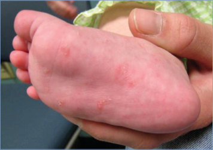
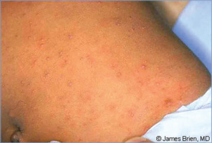
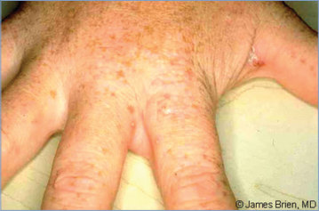
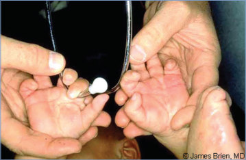
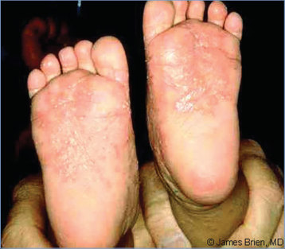
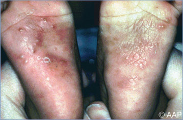
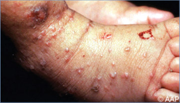
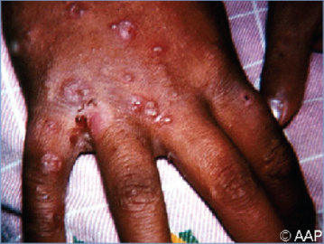
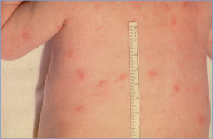
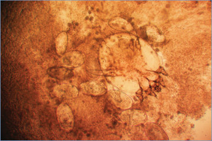

# 129. Scabies
> Private study reference ([source credits](../../SOURCE_CREDITS.md)). PDF pages 807-812; printed pages 793-798.

## PDF page 807 | printed page 793

### CLINICAL MANIFESTATIONS

Scabies is characterized by an intensely pruritic, erythematous eruption that may include papules, nodules, vesicles, or bullae caused by burrowing of adult female mites in upper layers of the epidermis, creating serpiginous burrows. Itching is most intense at night. Sites of predilection in older children and adults are the interdigital folds, flexor aspects of wrists, extensor surfaces of elbows, anterior axillary folds, waistline, thighs, navel, genitalia, areolae, abdomen, intergluteal cleft, and buttocks. In children younger than 2 years, the eruption more often is vesicular and often occurs in areas usually spared in older children and adults, such as the scalp, face, neck, palms, and soles. The eruption is caused by a hypersensitivity reaction to the parasite’s proteins and products.

Characteristic scabietic burrows appear as thin, gray or white, serpiginous, threadlike lines. Excoriations are common, and most burrows are obliterated by scratching before a patient seeks medical attention. Occasionally, 2- to 5-mm red-brown nodules are present, particularly on covered parts of the body, such as the genitalia, groin, and axilla. These scabies nodules are a granulomatous response to dead mite antigens and feces; the nodules can persist for weeks and even months after effective treatment. Cutaneous secondary bacterial infection is a frequent complication and usually is caused by Streptococcus pyogenes or Staphylococcus aureus. Studies have demonstrated a rare correlation between scabies and development of poststreptococcal glomerulonephritis.

Crusted (formerly called Norwegian) scabies is an uncommon clinical syndrome characterized by a large number of mites and widespread, crusted, hyperkeratotic lesions. Crusted scabies usually occurs in people with debilitating conditions, people with developmental disabilities, or people who are immunocompromised, including patients receiving biologic response modifiers. Crusted scabies also can occur in otherwise healthy children after long-term use of topical corticosteroid therapy.

Postscabietic pustulosis is a reactive phenomenon that may follow successful treatment of primary

infestation with scabies. Affected infants and young children manifest episodic crops of sterile, pruritic papules and pustules predominantly in an acral distribution, but lesions may extend to a lesser degree onto the torso.

### ETIOLOGY

The mite Sarcoptes scabiei subspecies hominis is the cause of scabies. The adult female burrows in the stratum corneum of the skin and lays eggs. Larvae emerge from the eggs in 2 to 4 days and molt to nymphs and then to adults, which mate and produce new eggs. The entire cycle takes approximately 10 to 17 days. S scabiei subspecies canis, acquired from dogs with clinical mange, can cause a self-limited and mild infestation in humans, usually involving the area in direct contact with the infested animal.

### EPIDEMIOLOGY

Humans are the source of infestation. Transmission usually occurs through prolonged close, personal contact. Even minimal contact with patients with crusted scabies or their immediate environment can result in transmission because of the large number of mites in exfoliating scales. Infestation acquired from dogs and other animals is uncommon, and these mites do not replicate in humans. Scabies of human origin can be transmitted as long as the patient remains infested and untreated, including during the interval before symptoms develop. Scabies is endemic in many countries and occurs worldwide sporadically and in epidemics, which may be cyclical in some settings. Scabies affects people from all socioeconomic levels without regard to age, gender, or standards of personal hygiene. Scabies in adults may be acquired sexually.1

The incubation period in people without previous exposure usually is 4 to 6 weeks. People who previously were infested are sensitized and develop symptoms 1 to 4 days after repeated infestation with the mite; reinfestations usually are milder than the original episode.

### DIAGNOSTIC TESTS

Diagnosis of scabies typically is made by clinical examination.2 Diagnosis can be confirmed by identification of the mite, mite eggs, or scybala (feces) from scrapings of papules or intact

## PDF page 808 | printed page 794

burrows, preferably from the terminal portion where the mite generally is found. Mineral oil, microscope immersion oil, or water applied to skin facilitates collection of scrapings. A broad-blade scalpel is used to scrape the burrow. Scrapings and oil can be placed on a slide under a glass coverslip and examined microscopically under low power. Adult female mites average 330 to 450 mm in length. Skin scrapings provide definitive evidence of infestation but have low sensitivity. Handheld dermoscopy (epiluminescence microscopy) has been used to identify in vivo the pigmented mite parts or air bubbles corresponding to infesting mites within the stratum corneum. Reflectance in vivo microscopy and polymerase chain reaction assays on swabbed skin material are promising techniques with improved sensitivity and specificity.

### TREATMENT

Topical permethrin 5% cream or off-label use of oral ivermectin both are effective agents for treatment of scabies. Most experts recommend starting with topical 5% permethrin cream as the drug of choice, particularly for infants (not approved for infants younger than 2 months), young children, and pregnant or nursing people. Permethrin kills the scabies mite and eggs. For children and adults, lotion or cream containing this scabicide should be applied over the entire body below the head and removed by bathing after 8 to 14 hours. Because scabies can affect the face, scalp, and neck in infants and young children, treatment of the entire head, neck, and body in this age group is required. Special attention should be given to trimming fingernails and ensuring application of medication to these areas. Two (or more) applications, each about a week apart, may be necessary to eliminate all mites.

A Cochrane review found that oral ivermectin is as effective as topical permethrin for treating scabies. Because ivermectin is not ovicidal, it is given as 2 doses, 7 to 14 days apart. Ivermectin is not approved for treatment of scabies by the U.S. Food and Drug Administration (FDA). Oral ivermectin should be considered for patients who have failed treatment or who cannot tolerate topical permethrin.

Alternative drugs include 10% crotamiton cream or lotion (not FDA approved for children), 5% to 10% precipitated sulfur compounded into petrolatum, or Spinosad 0.9% suspension (approved

by FDA in 2021 for adults and children 4 years and older). Lindane lotion (currently not available in the United States) generally should not be used for treatment of scabies because of safety concerns and availability of other treatments but may be used if all other medications cannot be tolerated or have failed.

Because scabietic lesions are the result of a hypersensitivity reaction to the mite, itching may not subside for several weeks despite successful treatment. Use of oral antihistamines and topical corticosteroids can help relieve itching. Topical or systemic antimicrobial therapy is indicated for secondary bacterial infections of excoriated lesions.

Treatment of crusted scabies can be difficult and typically requires multiple doses of both topical and oral therapy. The most commonly recommended medications are 5% topical permethrin cream and oral ivermectin. Duration of therapy depends on severity of the disease (www.cdc. gov/parasites/scabies/health_professionals/ meds.html).

### INFECTION PREVENTION AND CONTROL MEASURES IN HEALTH CARE SETTINGS

In addition to standard precautions, contact precautions are recommended until the patient has been treated with an appropriate scabicide.

### CONTROL MEASURES

• Most experts recommend prophylactic therapy for household members, particularly those who have had prolonged direct skin-to-skin contact. Manifestations of scabies infestation can appear as late as 2 months after exposure, during which time the mite can be transmitted. Household members should be treated at the same time to prevent reinfestation. Bedding and clothing worn next to the skin during the 3 days before initiation of therapy should be laundered in a washer with hot water and dried using a hot cycle. Mites do not survive more than 3 days without skin contact. Clothing that cannot be laundered should be removed from the patient and stored for several days to a week to avoid reinfestation.

• Children should not be excluded or sent home early from school because of scabies. They can be treated at the end of the day and allowed to

## PDF page 809 | printed page 795

return to child care or school after the first course of treatment has been completed.

• Epidemics and localized outbreaks may require stringent and consistent measures to treat contacts. Health care workers and other caregivers who have had prolonged skin-to-skin contact with patients with infestation may benefit from prophylactic treatment.

• Environmental disinfestation is unnecessary and unwarranted in noncrusted scabies. Thorough vacuuming of environmental surfaces is recommended after use of a room by a patient with noncrusted scabies.

Image 129.1 A 2-year-old girl who had scabies and was adopted from an orphanage in Eastern Europe. Courtesy of Daniel P. Krowchuk, MD, FAAP.

Image 129.3 Scabies in the hands of the mother of the infant in Image 129.2. Copyright James Brien, MD.

• People with crusted scabies and their close contacts must be treated promptly and aggressively to prevent outbreaks. Information about environmental disinfection for crusted scabies is available from the Centers for Disease Control and Prevention (www.cdc. gov/parasites/scabies/health_professionals/ crusted.html).

1 Centers for Disease Control and Prevention. Sexually transmitted infections treatment guidelines, 2021. MMWR Recomm Rep. 2021;70(RR-4):1–187 2 Engelman D, Yoshizumi J, Hay RJ, et al. The 2020 International

Alliance for the Control of Scabies consensus criteria for the diagnosis of scabies. Br J Dermatol. 2020;183(5):808–820

Image 129.2 Scabies rash in an infant. Copyright James Brien, MD.

Image 129.4 Scabies in an infant with striking hand involvement. Copyright James Brien, MD.

## PDF page 810 | printed page 796

Image 129.5 Scabies in an infant with striking involvement of the feet. Copyright James Brien, MD.

Image 129.7 Papulopustules and a widespread eczematous eruption, which represents a hypersensitivity reaction to a scabies infestation.

Image 129.9 A 12-year-old with itching in the axillae and groin for 2 weeks. She recently returned from a family camping trip, where she had shared a tent with “dozens of cousins.” Since returning home, she has had itching in the armpits and in her pubic area. She now has papules and pustules on her fingers, toes, and gluteal furrow. The family is reluctant to inquire about relatives with similar lesions. Examination of scrapings of the lesions indicated a few oval structures suggestive of scabies eggs. She responded to treatment with topical sulfur and oil in lieu of pesticide-based therapy. Courtesy of Will Sorey, MD.

Image 129.6 Papulopustules and excoriation of the soles of the feet of an infant with severe scabies.

Image 129.8 Older children, adolescents, and adults with scabies exhibit erythematous papules, nodules, or burrows in the interdigital webs, as in this patient.

![Image 129.9 A 12-year-old with itching in the axillae and groin for 2 weeks. She recently returned from a family camping trip, where she had shared a tent with “dozens of cousins.” Since returning home, she has had itching in the armpits and in her pubic area. She now has papules and pustules on her fingers, toes, and gluteal furrow. The family is reluctant to inquire about relatives with similar lesions. Examination of scrapings of the lesions indicated a few oval structures suggestive of scabies eggs. She responded to treatment with topical sulfur and oil in lieu of pesticide-based therapy. Courtesy of Will Sorey, MD.](../../figures/ch129_p0810_05.jpg)

## PDF page 811 | printed page 797

Image 129.10 A 9-month-old boy with atypical, eczema-like papulovesicular lesions of scabies on the trunk and extremities. Courtesy of George Nankervis, MD.

Image 129.11 This is a Sarcoptes scabiei subspecies hominis, or itch mite, which is the cause of scabies. Females are 0.3- to 0.4-mm long and 0.25- to 0.35-mm wide. Male mites are slightly more than half that size. Scabies is a highly contagious infestation of the skin caused by a mite affecting humans and animals. Scabies is usually transmitted by intimate interpersonal contact, often sexual in nature, but transmission through casual contact can occur. Courtesy of Centers for Disease Control and Prevention.

Image 129.12 The mite Sarcoptes scabiei subspecies hominis is responsible for scabies in humans. Courtesy of Larry Frenkel, MD.

![Image 129.11 This is a Sarcoptes scabiei subspecies hominis, or itch mite, which is the cause of scabies. Females are 0.3- to 0.4-mm long and 0.25- to 0.35-mm wide. Male mites are slightly more than half that size. Scabies is a highly contagious infestation of the skin caused by a mite affecting humans and animals. Scabies is usually transmitted by intimate interpersonal contact, often sexual in nature, but transmission through casual contact can occur. Courtesy of Centers for Disease Control and Prevention.](../../figures/ch129_p0811_02.jpg)

## PDF page 812 | printed page 798

Image 129.13 Life cycle. Sarcoptes scabiei undergoes 4 stages in its life cycle: egg, larva, nymph, and adult. Females deposit eggs at 2- to 3-day intervals as they burrow through the skin (1). Eggs are oval and 0.1 to 0.15 mm long, (2) and incubation time is 3 to 8 days. After the eggs hatch, the larvae migrate to the skin surface and burrow into the intact stratum corneum to construct almost invisible, short burrows called molting pouches. The larval stage, which emerges from the eggs, has only 3 pairs of legs (3), and this form lasts 2 to 3 days. After larvae molt, the resulting nymphs have 4 pairs of legs (4). This form molts into slightly larger nymphs before molting into adults. Larvae and nymphs may often be found in molting pouches or in hair follicles and look similar to adults, only smaller. Adults are round, saclike eyeless mites. Females are 0.3- to 0.4-mm long and 0.25- to 0.35-mm wide, and males are slightly more than half that size. Mating occurs after the nomadic male penetrates the molting pouch of the adult female (5). Impregnated females extend their molting pouches into the characteristic serpentine burrows, laying eggs in the process. The impregnated females burrow into the skin and spend the remaining 2 months of their lives in tunnels under the surface of the skin. Males are rarely seen. They make a temporary gallery in the skin before mating. Transmission occurs by the transfer of ovigerous females during personal contact. Mode of transmission is primarily person-to-person contact, but transmission may also occur via fomites (eg, bedding, clothing). Mites are found predominantly between the fingers and on the wrists. The mites hold on to the skin by using suckers attached to the 2 most anterior pairs of legs. Courtesy of Centers for Disease Control and Prevention.

![Image 129.13 Life cycle. Sarcoptes scabiei undergoes 4 stages in its life cycle: egg, larva, nymph, and adult. Females deposit eggs at 2- to 3-day intervals as they burrow through the skin (1). Eggs are oval and 0.1 to 0.15 mm long, (2) and incubation time is 3 to 8 days. After the eggs hatch, the larvae migrate to the skin surface and burrow into the intact stratum corneum to construct almost invisible, short burrows called molting pouches. The larval stage, which emerges from the eggs, has only 3 pairs of legs (3), and this form lasts 2 to 3 days. After larvae molt, the resulting nymphs have 4 pairs of legs (4). This form molts into slightly larger nymphs before molting into adults. Larvae and nymphs may often be found in molting pouches or in hair follicles and look similar to adults, only smaller. Adults are round, saclike eyeless mites. Females are 0.3- to 0.4-mm long and 0.25- to 0.35-mm wide, and males are slightly more than half that size. Mating occurs after the nomadic male penetrates the molting pouch of the adult female (5). Impregnated females extend their molting pouches into the characteristic serpentine burrows, laying eggs in the process. The impregnated females burrow into the skin and spend the remaining 2 months of their lives in tunnels under the surface of the skin. Males are rarely seen. They make a temporary gallery in the skin before mating. Transmission occurs by the transfer of ovigerous females during personal contact. Mode of transmission is primarily person-to-person contact, but transmission may also occur via fomites (eg, bedding, clothing). Mites are found predominantly between the fingers and on the wrists. The mites hold on to the skin by using suckers attached to the 2 most anterior pairs of legs. Courtesy of Centers for Disease Control and Prevention.](../../figures/ch129_p0812_01.jpg)
