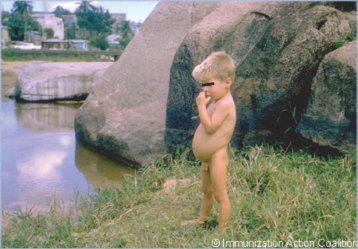
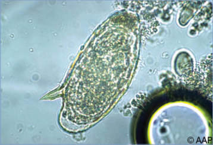
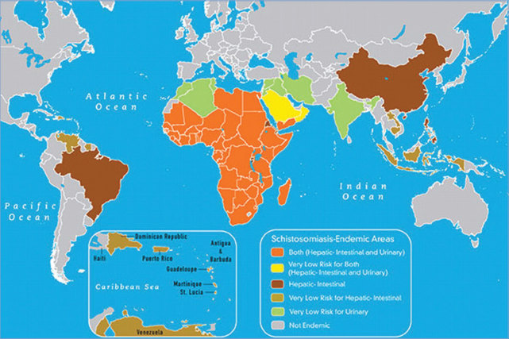

# 130. Schistosomiasis
> Private study reference ([source credits](../../SOURCE_CREDITS.md)). PDF pages 813-818; printed pages 799-804.

## PDF page 813 | printed page 799

### CLINICAL MANIFESTATIONS

Schistosomiasis (bilharziasis) is acquired by skin penetration of infecting larvae (cercariae, shed by freshwater snails). Initial infections often are asymptomatic. Skin manifestations include pruritus at the penetration site a few hours after water exposure, followed in 5 to 14 days by an intermittent pruritic, sometimes papular, eruption. More intense papular eruptions may occur more quickly and last for 7 to 10 days after exposure in people sensitized previously. Cercarial dermatitis (swimmer’s itch) also can be caused by larvae of schistosome parasites of birds or other wildlife. These larvae can penetrate human skin but eventually die in the dermis and do not cause systemic disease.

Parasites capable of causing intestinal and urogenital schistosomiasis enter the bloodstream after penetration of the skin, migrate through the lungs, and eventually mature into adult worms that reside in the venous plexus that drains the intestines or, in the case of Schistosoma haematobium, the urogenital tract. Four to 8 weeks after exposure, worms develop into adults and females begin egg deposition, which can lead to an acute serum sickness-like illness (Katayama syndrome) that manifests as fever, malaise, cough, rash, abdominal pain, hepatosplenomegaly, diarrhea, nausea, lymphadenopathy, and/or eosinophilia. This syndrome is most common among nonimmune hosts, such as travelers. Severity of symptoms associated with chronic infection is partially related to worm burden. People with low to moderate worm burdens may have only subclinical disease or relatively mild manifestations, such as growth stunting or anemia. Higher worm burdens are associated with a range of symptoms primarily caused by inflammation and local fibrosis triggered by the immune response to eggs produced by adult worms. Severe forms of chronic intestinal schistosomiasis (Schistosoma mansoni and Schistosoma japonicum infections) can result in hepatosplenomegaly, abdominal pain, bloody diarrhea, periportal fibrosis, portal hypertension, ascites, esophageal varices, and hematemesis. Urogenital schistosomiasis (S haematobium infections) can result in the bladder becoming inflamed and fibrotic. Urinary tract symptoms and signs

include dysuria, urgency, microscopic and gross hematuria, secondary urinary tract infections, hydronephrosis, and nonspecific pelvic pain. S haematobium is associated with lesions of the lower genital tract (vulva, vagina, and cervix) in women, prostatitis and hematospermia in men, and certain forms of bladder cancer.1 Other organ systems can be involved—for example, eggs can embolize to the lungs, causing pulmonary hypertension. Less commonly, eggs can lodge in the central nervous system, causing severe neurologic complications.

### ETIOLOGY

The trematodes (flukes) S mansoni, S japonicum, Schistosoma mekongi, Schistosoma guineensis, and Schistosoma intercalatum cause intestinal schistosomiasis, and S haematobium causes urogenital disease. All species have similar life cycles.

### EPIDEMIOLOGY

Persistence of schistosomiasis in a population depends on the local presence of an appropriate snail as an intermediate host. Eggs excreted in stool (S mansoni, S japonicum, S mekongi, S intercalatum, and S guineensis) or urine (S haematobium) into fresh water hatch into motile miracidia, which infect snails. After development and asexual replication in snails, cercariae emerge and penetrate the skin of humans in contact with water. In areas with endemic schistosomiasis, children are infected first when they accompany their parents to lakes, ponds, and other open freshwater sources. School-aged children typically are the most heavily infected people in the community because of prolonged wading and swimming in infected waters. Children have greater susceptibility to infection than older people because of a lack of high preexisting immunity to these parasites and are important in maintaining transmission through behaviors such as uncontrolled defecation and urination. Animals play an important zoonotic role (as a source of eggs) in maintaining the life cycle of S japonicum. Animal reservoirs may also play a role in areas of West Africa, where S haematobium has hybridized with the cattle parasite Schistosoma bovis. Infection is not transmissible by person-to-person contact or blood transfusion.

Distribution of schistosomiasis is focal and limited by presence of appropriate snail intermediate hosts, infected human reservoirs, and freshwater sources. S mansoni occurs throughout tropical Africa, in

## PDF page 814 | printed page 800

parts of several Caribbean islands, and in areas of Venezuela, Brazil, Suriname, and the Arabian Peninsula. S japonicum is found in China, the Philippines, and Indonesia. S haematobium occurs in Africa and the Middle East; in 2014, local transmission of S haematobium/S bovis hybrids was reported in Corsica. S mekongi is found in Cambodia and Laos. S intercalatum is found in central Africa, and S guineensis is found in West Africa. Adult worms of S mansoni usually survive for 5 to 7 years but can live as long as 30 years in the human host. Schistosomiasis can be diagnosed in patients many years after they have left an area with endemic transmission. Immunity is incomplete, and reinfection occurs commonly. Swimmer’s itch can occur in all regions of the world after exposure to fresh water, brackish water, or salt water.

The incubation period is variable but is approximately 4 to 6 weeks for S japonicum, 6 to 8 weeks for S mansoni, and 10 to 12 weeks for S haematobium.

### DIAGNOSTIC TESTS

Eosinophilia is common and may be intense in Katayama syndrome (acute schistosomiasis). Infection with S mansoni and other intestinal species is diagnosed by microscopic examination of stool specimens to detect characteristic eggs containing fully differentiated larvae, but results may be negative if performed too early in the course of infection. In light infections, several stool specimens examined by a concentration technique may be needed before eggs are found, or eggs may be seen in a biopsy of the rectal mucosa. S haematobium is diagnosed by examining urine for eggs; filtration or centrifugation and examination of the urinary sediment is required for optimum sensitivity. Egg excretion in urine often peaks between noon and 3 pm. Biopsy of the bladder or vaginal/ cervical mucosa may be used to diagnose S haematobium infection. Urine reagent dipsticks commonly will be positive for blood. Serologic tests, available through the Centers for Disease Control and Prevention and some commercial laboratories, may be helpful for detecting light infections; results of these antibody-based tests remain positive for many years and are not useful in differentiating ongoing infection from past infection or reinfection. Serologic test results are negative during acute infection, turn positive 6 to 12 weeks or more after infection, and may be positive before eggs are detectable. Polymerase chain reaction

and antigen tests for detection of schistosomes have been developed but are considered to be research tools at present.

Swimmer’s itch, which is caused by the cercariae of certain schistosome species whose normal hosts are birds and nonhuman mammals, can be difficult to differentiate from other causes of dermatitis. A skin biopsy may demonstrate larvae, but their absence does not exclude the diagnosis. A history of exposure to water used by waterfowl may be helpful in making the diagnosis.

### TREATMENT

The drug of choice for schistosomiasis caused by any species is praziquantel. Praziquantel does not kill developing worms, so treatment administered early (eg, 4 to 8 weeks after exposure) should be repeated 2 to 4 weeks later to improve parasitologic cure. Initial management of acute schistosomiasis and neuroschistosomiasis includes reduction of inflammation with steroids, although optimal dose and duration are uncertain. Initial treatment with praziquantel may exacerbate symptoms. The optimal timing of adding praziquantel is unknown; treating with this drug when inflammation has subsided generally is favored. Swimmer’s itch is a self-limited disease that may require symptomatic treatment of the rash. More intense reactions may require a course of oral corticosteroids.

### INFECTION PREVENTION AND CONTROL MEASURES IN HEALTH CARE SETTINGS

Standard precautions are recommended. Schistosomiasis cannot be transmitted from person to person or by the fecal-oral route.

### CONTROL MEASURES

Elimination of the intermediate snail host is difficult to achieve in most areas. Mass or selective treatment of infected populations, sanitary disposal of human waste, water sanitation programs, and education about the source of infection are key elements of current control measures. Travelers to areas with endemic schistosomiasis should be advised to avoid any contact with freshwater streams, rivers, ponds, or lakes. Swimming and wading should occur only in chlorinated pools. Human schistosomiasis is not transmitted in seawater.

1 The terms women and men refer to sex assigned at birth.

## PDF page 815 | printed page 801

Image 130.1 A boy with a swollen abdomen caused by schistosomiasis with hepatosplenomegaly. Courtesy of Immunization Action Coalition.

A B

Image 130.2 A–C, Cross section of different human tissues showing Schistosoma species eggs. A, Schistosoma mansoni eggs in intestinal wall. B, Schistosoma japonicum eggs in colon. C, S japonicum eggs in liver. Courtesy of Centers for Disease Control and Prevention.

Image 130.3 Schistosome dermatitis, or swimmer’s itch, occurs when skin is penetrated by a free-swimming, fork-tailed infective cercaria. On release from the snail host, the infective cercariae swim, penetrate the skin of the human host, and shed their forked tail, becoming schistosomula. The schistosomula migrate through several tissues and stages to their residence in the veins. Courtesy of Centers for Disease Control and Prevention.

C

## PDF page 816 | printed page 802

Image 130.4 This micrograph reveals signs of schistosomiasis of the liver, also known as pipestem cirrhosis (magnification 3500). Pipestem cirrhosis occurs when schistosomes infect the liver (ie, hepatic schistosomiasis), which causes scarring to occur, thereby entrapping parasites and their ova in and around the hepatic portal circulatory vessels. Courtesy of Centers for Disease Control and Prevention.

Image 130.5 Histopathologic features of Schistosoma haematobium, bladder. Histopathologic features of the bladder show eggs of S haematobium surrounded by intense infiltrates of eosinophils. Courtesy of Centers for Disease Control and Prevention/ Edwin P. Ewing Jr, MD.

Image 130.6 Schistosoma haematobium ova (original magnification 3400).

## PDF page 817 | printed page 803

Image 130.7 Life cycle. Eggs are eliminated with feces or urine (1). Under optimal conditions, the eggs hatch and release miracidia (2), which swim and penetrate specific snail intermediate hosts (3). The stages in the snail include 2 generations of sporocysts (4) and the production of cercariae (5). On release from the snail, the infective cercariae swim, penetrate the skin of the human host (6), and shed their forked tail, becoming schistosomula (7). The schistosomula migrate (8, 9) through several tissues and stages to their residence in the veins (10). Adult worms in humans reside in the mesenteric venules in various locations, which, at times, seem to be specific for each species (10). For instance, Schistosoma japonicum is more frequently found in the superior mesenteric veins draining the small intestine (A), and Schistosoma mansoni occurs more often in the superior mesenteric veins draining the large intestine (B). However, both species can occupy either location, and they are capable of moving between sites, so it is not possible to state unequivocally that 1 species occurs in only 1 location. Schistosoma haematobium most often occurs in the venous plexus of the bladder (C), but it can also be found in the rectal venules. The females (size 7–20 mm; males slightly smaller) deposit eggs in the small venules of the portal and perivesical systems. The eggs are moved progressively toward the lumen of the intestine (S mansoni and S japonicum) and are eliminated with feces or toward the lumen of the bladder and ureters (S haematobium) and are eliminated with urine (1). Pathological manifestations of S mansoni and S japonicum schistosomiasis include Katayama fever, presinusoidal egg granulomas, Symmers pipestem periportal fibrosis, portal hypertension, and occasional embolic egg granulomas in the brain or spinal cord. Pathological manifestations of S haematobium schistosomiasis include hematuria, scarring, calcification, squamous cell carcinoma, and occasional embolic egg granulomas in the brain or spinal cord. Human contact with water is thus necessary for infection by schistosomes. Various animals, such as dogs, cats, rodents, pigs, horses, and goats, serve as reservoirs for S japonicum; dogs, for S mekongi. Courtesy of Centers for Disease Control and Prevention.

![Image 130.7 Life cycle. Eggs are eliminated with feces or urine (1). Under optimal conditions, the eggs hatch and release miracidia (2), which swim and penetrate specific snail intermediate hosts (3). The stages in the snail include 2 generations of sporocysts (4) and the production of cercariae (5). On release from the snail, the infective cercariae swim, penetrate the skin of the human host (6), and shed their forked tail, becoming schistosomula (7). The schistosomula migrate (8, 9) through several tissues and stages to their residence in the veins (10). Adult worms in humans reside in the mesenteric venules in various locations, which, at times, seem to be specific for each species (10). For instance, Schistosoma japonicum is more frequently found in the superior mesenteric veins draining the small intestine (A), and Schistosoma mansoni occurs more often in the superior mesenteric veins draining the large intestine (B). However, both species can occupy either location, and they are capable of moving between sites, so it is not possible to state unequivocally that 1 species occurs in only 1 location. Schistosoma haematobium most often occurs in the venous plexus of the bladder (C), but it can also be found in the rectal venules. The females (size 7–20 mm; males slightly smaller) deposit eggs in the small venules of the portal and perivesical systems. The eggs are moved progressively toward the lumen of the intestine (S mansoni and S japonicum) and are eliminated with feces or toward the lumen of the bladder and ureters (S haematobium) and are eliminated with urine (1). Pathological manifestations of S mansoni and S japonicum schistosomiasis include Katayama fever, presinusoidal egg granulomas, Symmers pipestem periportal fibrosis, portal hypertension, and occasional embolic egg granulomas in the brain or spinal cord. Pathological manifestations of S haematobium schistosomiasis include hematuria, scarring, calcification, squamous cell carcinoma, and occasional embolic egg granulomas in the brain or spinal cord. Human contact with water is thus necessary for infection by schistosomes. Various animals, such as dogs, cats, rodents, pigs, horses, and goats, serve as reservoirs for S japonicum; dogs, for S mekongi. Courtesy of Centers for Disease Control and Prevention.](../../figures/ch130_p0817_01.jpg)

## PDF page 818 | printed page 804

Image 130.8 Geographic distribution of schistosomiasis. Courtesy of Centers for Disease Control and Prevention.

