# 135. Staphylococcus aureus
> Private study reference ([source credits](../../SOURCE_CREDITS.md)). PDF pages 840-857; printed pages 826-843.

## PDF page 840 | printed page 826

### CLINICAL MANIFESTATIONS

Staphylococcus aureus causes a variety of localized and invasive suppurative infections and 3 toxin-mediated syndromes: toxic shock syndrome (TSS), scalded skin syndrome, and food poisoning. Localized infections include cellulitis, skin and soft-tissue abscesses, furuncles, carbuncles, pustulosis, impetigo (bullous and nonbullous), paronychia, mastitis, omphalitis, hordeola, orbital cellulitis/abscess, sinusitis, peritonsillar abscesses (quinsy), parotitis, lymphadenitis, and wound infections. Bacteremia can be associated with focal complications including osteomyelitis; septic arthritis; endocarditis; pneumonia; pleural empyema; septic pulmonary emboli; pericarditis; softtissue, muscle, or visceral abscesses; and septic thrombophlebitis of small and large vessels. In patients with neutropenia, ecthyma gangrenosum may occur. Primary S aureus pneumonia also can occur after aspiration of organisms from the upper respiratory tract and can occur in the context of concurrent or antecedent viral infections from the community (eg, influenza) or in ventilated patients. Meningitis may occur in preterm infants but otherwise is rare unless accompanied by a foreign body (eg, ventriculoperitoneal shunt) or a congenital or acquired defect in the dura. S aureus causes a variety of infections with and without bacteremia associated with foreign bodies, including intravascular catheters or grafts, peritoneal catheters, spinal instrumentation or intramedullary rods, pressure equalization tubes, pacemakers and other intracardiac devices, vagal nerve stimulators, and prosthetic joints. S aureus infections can be fulminant. Certain chronic diseases, conditions, and events, such as diabetes mellitus, malignancy, prematurity, immunodeficiency, kidney disease, nutritional disorders, dialysis, surgery, and transplantation, increase the risk for severe S aureus infections. Metastatic foci and abscesses need to be drained and foreign bodies should be removed when possible. Prolonged antimicrobial therapy for invasive infection often is necessary to achieve cure.

Staphylococcal TSS, a toxin-mediated disease, usually is caused by strains producing TSS toxin-1 or possibly other related staphylococcal enterotoxins

and characterized by acute onset of fever, generalized erythroderma, rapid-onset hypotension, and signs of multisystem organ involvement, including profuse watery diarrhea, vomiting, conjunctival injection, and severe myalgia (see Table 135.1 for clinical case definition). TSS can occur in menstruating persons using tampons or following childbirth or abortion. TSS also can occur after surgical procedures, in association with cutaneous lesions, or without a readily identifiable focus of infection, and blood cultures are often negative. People with TSS, especially menses-associated illness, are at risk of a recurrent episode.

Prevailing strains (eg, USA300) of methicillinresistant S aureus (MRSA) rarely produce TSS toxin but readily produce other extracellular toxins (eg, leukocidins and enterotoxins) that may lead to clinical presentations that resemble, but do not meet clinical criteria for, TSS. These clinical phenotypes are often referred to as toxinmediated disease.

Staphylococcal scalded skin syndrome (SSSS) is a toxin-mediated disease caused by circulation of exfoliative toxins A and B. The manifestations of SSSS are age related and include Ritter disease (generalized exfoliation) in the neonate, a tender scarlatiniform eruption and localized bullous impetigo in older children, or a combination of these with thick white/brown flaky desquamation of the entire skin, especially on the face and neck, in older infants and toddlers. The hallmark of SSSS is the toxin-mediated cleavage of the stratum granulosum layer of the epidermis (ie, Nikolsky sign). Proper pain management is a mainstay of therapy for SSSS. Healing occurs without scarring. Bacteremia is rare, but dehydration and superinfection can occur with extensive exfoliation.

### ETIOLOGY

Staphylococci are catalase-positive, gram-positive cocci that appear microscopically as grapelike clusters. Staphylococci are ubiquitous and can survive extreme conditions of drying, heat, and lowoxygen and high-salt environments. S aureus has many surface proteins, including the microbial surface components recognizing adhesive matrix molecule receptors, which allow the organism to bind to tissues and foreign bodies coated with fibronectin, fibrinogen, and collagen. This permits

## PDF page 841 | printed page 827

Table 135.1 Staphylococcus aureus Toxic Shock Syndrome: Clinical Case Definitiona

Clinical Findings

• Fever: temperature 38.9°C (102.0°F) or greater • Rash: diffuse macular erythroderma • Desquamation: 1–2 weeks after onset of rash, particularly on palms, soles, fingers, and toes • Hypotension: systolic pressure 90 mm Hg or less for adults; lower than fifth percentile for age for children younger than 16 years • Multisystem organ involvement: 3 or more of the following: 1. Gastrointestinal tract: vomiting or diarrhea at onset of illness 2. Muscular: severe myalgia or creatinine phosphokinase concentration greater than twice the upper limit of normal 3. Mucous membrane: vaginal, oropharyngeal, or conjunctival hyperemia 4. Renal: serum urea nitrogen or serum creatinine concentration greater than twice the upper limit of normal or urinary sediment with 5 white blood cells/high-power field or greater in the absence of urinary tract infection 5. Hepatic: total bilirubin, aspartate aminotransferase, or alanine aminotransferase concentration greater than twice the upper limit of normal 6. Hematologic: platelet count 100,000/mm3 or less 7. Central nervous system: disorientation or alterations in consciousness without focal neurologic signs when fever and hypotension are absent

Laboratory Criteria

• Negative results on the following tests, if obtained: 1. Blood or cerebrospinal fluid cultures; blood culture rarely may be positive for S aureus 2. Serologic tests for Rocky Mountain spotted fever, leptospirosis, or measles

Case Classification

• Probable: a case that meets the laboratory criteria and in which 4 of 5 clinical findings are present • Confirmed: a case that meets laboratory criteria and all 5 of the clinical findings, including desquamation, unless the patient dies before desquamation occurs

a Adapted from https://ndc.services.cdc.gov/case-definitions/toxic-shock-syndrome-2011/.

a low inoculum of organisms to adhere to sutures, catheters, prosthetic valves, and other devices. They also secrete a robust arsenal of extracellular proteins aimed at nutrient acquisition, host cell destruction, and immune evasion.

### EPIDEMIOLOGY

S aureus is the most common cause of skin and soft-tissue infections and musculoskeletal infections in otherwise healthy children. S aureus colonizes the skin and mucous membranes of 30% to 50% of healthy adults and children. The anterior nares, throat, axilla, perineum, vagina, and rectum are usual sites of colonization. S aureus is one of the most common causes of health care-associated bacteremia in all age groups and health careassociated pneumonia in children and is the most common pathogen responsible for surgical site infections. Patients with neutrophil dysfunction, such as those with chronic granulomatous disease, are at increased risk for S aureus infections.

S aureus-mediated TSS was first recognized in 1978 by Dr Jim Todd, and many early cases were associated with tampon use. Although changes in tampon composition and use have resulted in a decreased proportion of cases associated with menses, menstrual and nonmenstrual cases of TSS continue to occur and are reported with similar frequency. Risk factors for TSS include absence of antibody to TSS toxin-1 and focal S aureus infection with a TSS toxin-1–producing strain. TSS toxin-1–producing strains can be part of normal flora of the anterior nares or vagina, and colonization at these sites is believed to result in protective antibody in more than 90% of adults.

Transmission of S aureus

Rates of skin carriage of more than 50% occur in children with desquamating skin disorders or burns and in people with frequent needle use (eg, people who have diabetes mellitus, are on hemodialysis, inject drugs, or receive allergy

## PDF page 842 | printed page 828

shots). Although domestic animals can be colonized, data suggest that colonization is acquired from other humans. Hospitalized children who are colonized with MRSA on admission or acquire MRSA colonization in the hospital are at increased risk for subsequent MRSA infection compared with noncolonized children.

S aureus is transmitted most often by direct contact in community settings and indirectly from patient to patient via transiently colonized hands of health care professionals in health care settings. Health care professionals and family members who are colonized with S aureus in the nares or on skin also can serve as a reservoir for transmission. Contaminated environmental surfaces and objects also can play a role in transmission of S aureus. Although not transmitted by the droplet route routinely, S aureus can be dispersed into the air over short distances. Dissemination of S aureus from people with nasal carriage, including infants, is related to density of colonization, and increased dissemination occurs during viral upper respiratory tract infections. Parental S aureus colonization at a variety of body sites has been associated with neonatal colonization.

Health Care-Associated MRSA

MRSA has been endemic in most U.S. hospitals since the 1980s. Risk factors for health careassociated MRSA infections include hospitalization, surgery, dialysis, long-term care stay within the previous year, presence of an indwelling device, presence of wounds, and history of prior MRSA infection or colonization. The incidence of invasive health care-associated MRSA infections has decreased in many communities since the mid-2000s.

Health care-associated MRSA strains (ie, those that historically were responsible for most health care-associated MRSA infections) have often been resistant to more antibiotic classes (including clindamycin) than community-associated strains.

Community-Associated MRSA

Community-associated MRSA infections attributable to strains different from traditional health care-associated MRSA emerged in the 1990s. These strains most commonly cause skin and soft-tissue abscesses, although they can also cause more severe infections. Clinical infections

are more common in settings where there is crowding; frequent skin-to-skin contact; sharing of personal items, such as towels and clothing; poor personal hygiene; and among those with nonintact skin, including body piercings. Outbreaks have been reported among athletic teams, in correctional facilities, and in military training facilities. Community-associated MRSA strains can also circulate in hospitals and cause health care-associated MRSA infections. Community-associated MRSA strains have tended to be susceptible to a variety of non–b-lactam antibiotics.

Vancomycin-Intermediately Susceptible S aureus

Vancomycin-intermediately susceptible S aureus (VISA) strains (minimum inhibitory concentration [MIC], 4–8 mg/mL) have been isolated from people (historically, dialysis patients) who have received multiple courses of vancomycin. Strains of MRSA can be heterogeneous for vancomycin resistance (see Diagnostic Tests). Extensive vancomycin use allows VISA strains to develop during therapy. Control measures recommended by the Centers for Disease Control and Prevention (CDC) have included using proper methods to detect VISA, using appropriate infection-control measures, and adopting measures to ensure appropriate vancomycin use.

Vancomycin-Resistant S aureus

Vancomycin-resistant S aureus (VRSA) infections (MIC >8 mg/mL) are very rare, and in all confirmed cases, reported patients had underlying medical conditions, a history of MRSA infections, and prolonged exposure to vancomycin.

The incubation period is variable for staphylococcal disease. A long delay can occur between acquisition of the organism and onset of disease. For SSSS, the incubation period usually is 1 to 10 days; for postoperative TSS, the incubation period can be as short as 12 hours. Menses-related cases can develop at any time during menstruation.

### DIAGNOSTIC TESTS

Gram stains of specimens from skin lesions or pyogenic foci showing gram-positive cocci in clusters can provide presumptive evidence of staphylococcal infection. Isolation of organisms

## PDF page 843 | printed page 829

from culture of otherwise sterile body fluid is the method for definitive diagnosis. S aureus is almost never a contaminant when isolated from a blood culture or other sterile site.

Molecular assays have been approved by the U.S. Food and Drug Administration for detection of S aureus from blood cultures growing gram-positive organisms. These assays include nonamplified molecular assays, such as peptide nucleic acid fluorescence in situ hybridization and Verigene, as well as nucleic acid amplification tests, such as BD GeneOhm Staph SR, Xpert MRSA/SA BC, the FilmArray Blood Culture Identification Panel, and the polymerase chain reaction-T2 magnetic resonance sepsis panel. Matrix-assisted laser desorption/ ionization–time-of-flight mass spectrometry can rapidly identify S aureus colonies on culture plates or from growth in blood cultures.

S aureus-mediated TSS is a clinical diagnosis (Table 135.1); S aureus is isolated from blood cultures in fewer than 5% of patients with TSS. Specimens for culture should be obtained from an identified focus of infection, because these sites usually will yield the organism. Because approximately one-third of isolates of S aureus from nonmenstrual cases produce toxins other than TSS toxin-1, and TSS toxin-1–producing organisms can be present as normal flora, TSS toxin-1 production by an isolate is not a useful diagnostic test.

Antimicrobial susceptibility testing should be performed for all S aureus specimens isolated from normally sterile sites. Laboratory practice includes routine screening (D-testing) to exclude inducible clindamycin resistance. Another phenomenon that has been described is heteroresistance to antibiotics, in which the heterogeneous or heterotypic strains appear susceptible by disk diffusion but contain resistant subpopulations that are only apparent when cultured with antibioticcontaining media. When these resistant subpopulations are cultured on antibiotic-free media, they can continue as stable resistant mutants or revert to susceptible strains (heterogeneous resistance). Bacteria expressing heteroresistance grow more slowly than the susceptible bacteria and can be missed at growth conditions greater than 35°C (95°F). The clinical significance of heteroresistance is not clear, but some have suggested that it could be a cause of some vancomycin treatment failures.

S aureus strain genotyping, in conjunction with epidemiologic information, can facilitate identification of the source, extent, and mechanism of transmission in an outbreak. Several molecular typing methods are available for S aureus, including pulsed-field gel electrophoresis, spa typing, multilocus sequence typing, and whole genome sequencing. Choice of method should consider purpose of typing and available resources.

### TREATMENT

Skin and Soft-Tissue Infection

Skin and soft-tissue infections, such as diffuse impetigo or cellulitis attributable to methicillinsusceptible S aureus (MSSA), optimally are treated with oral penicillinase-resistant b-lactam drugs, such as a first- or second-generation cephalosporin. For the patient with penicillin allergy and in cases in which MRSA is considered, trimethoprimsulfamethoxazole, doxycycline, or clindamycin can be used if the isolate is susceptible. Topical mupirocin is recommended for localized impetigo.

The most frequent manifestation of communityassociated MRSA infection is skin and soft-tissue infection, which can range from mild to severe. Drainage is an important component of managing these infections. A randomized placebo-controlled study evaluating treatment strategies for uncomplicated skin infections included children with simple abscesses ≤3 cm (6–11 months of age), ≤4 cm (1–8 years of age), or ≤5 cm (>8 years of age) in diameter and found that drainage plus systemic oral therapy with either clindamycin or trimethoprim-sulfamethoxazole was associated with better outcomes compared with drainage alone.

Invasive Staphylococcal Infections

Empiric therapy for suspected invasive or severe staphylococcal infection, including pneumonia, osteoarticular infection, visceral abscesses, and foreign body-associated infection with bacteremia, is vancomycin plus an antistaphylococcal b-lactam (eg, nafcillin, oxacillin, cefazolin). For children with mild to moderate illness for suspected osteomyelitis attributable to S aureus, empiric therapy may be informed by local susceptibility of S aureus isolates. When rates of community-associated MRSA are low (<10%), oxacillin, nafcillin, or cefazolin may be initiated; when rates of resistance are higher, empiric therapy should include

## PDF page 844 | printed page 830

clindamycin or vancomycin. Subsequent therapy should be based on antimicrobial susceptibility results.

Serious MSSA infections require intravenous therapy with an antistaphylococcal b-lactam antimicrobial agent, such as nafcillin, oxacillin, or cefazolin, because most S aureus strains produce b-lactamase enzymes and are resistant to penicillin and ampicillin (see Table 135.2). The

Table 135.2 Parenteral Antimicrobial Agent(s) for Treatment of Bacteremia and Other Serious Staphylococcus aureus Infections

Antimicrobial Agents I. Initial empiric therapy (organism of unknown susceptibility)

Drugs of choice: Vancomycin (15 mg/kg, every 6 h) + nafcillin or oxacillina,b Vancomycin (15 mg/kg, every 6–8 h)b Clindamycin II. Methicillin-susceptible S aureus (MSSA)

Drugs of choice: Nafcillin or oxacilline

Cefazolin

Alternatives: Clindamycin Vancomycina,b,e

Ampicillin + sulbactam

III. Methicillin-resistant S aureus (MRSA; oxacillin MIC ≥4 mg/mL)

Drugs of choice: Vancomycina,b,e Clindamycin (if strain susceptible) Trimethoprim-sulfamethoxazole

addition of rifampin may be considered for those with invasive disease associated with an indwelling foreign body, especially if removal of the infected implant or device is not feasible. Vancomycin is not recommended for treatment of serious MSSA infections (including endocarditis), because outcomes are inferior with vancomycin compared with antistaphylococcal b-lactams. First- or

Comments

For life-threatening infections (eg, septicemia, pneumonia, endocarditis, CNS infection); ceftaroline or linezolid are alternatives to vancomycin, but there are limited effectiveness data in children For non–life-threatening infection without signs of sepsis (eg, skin infection, cellulitis, osteomyelitis, septic arthritis) when rates of MRSA colonization and infection in the community are substantial; ceftarolinec or linezolidc or daptomycind (if no pneumonia) are alternatives For non–life-threatening infection without signs of sepsis when rates of MRSA colonization and infection in the community are substantial and prevalence of clindamycin resistance is <15%

Preferred for meningitis (cefazolin does not penetrate well into central nervous system)

Only for patients with a serious penicillin allergy and clindamycin-susceptible strain (not for endovascular infections or meningitis) Only for patients with a serious penicillin and cephalosporin allergy infected with a clindamycinresistant strain (or if there is a serious b-lactam allergy and endovascular infection or meningitis)

For patients with polymicrobial infections caused by susceptible isolates

For life-threatening infections, including meningitis or endovascular infections including those complicated by venous thrombosis For pneumonia,a septic arthritis, osteomyelitis, skin or soft-tissue infections (not for endovascular infections or meningitis) For skin or soft-tissue infections

### Geometry-detected table

|Antimicrobial Agents|Col2|Comments|
|---|---|---|
|**I. Initial empiric therapy (organism of unknown susceptibility)**|**I. Initial empiric therapy (organism of unknown susceptibility)**|**I. Initial empiric therapy (organism of unknown susceptibility)**|
|Drugs of choice:|Vancomycin (15 mg/kg, every 6 h) + nafcillin or oxacillina,b|For life-threatening infections (eg, septicemia, pneu- monia, endocarditis, CNS infection); ceftaroline or linezolid are alternatives to vancomycin, but there are limited effectiveness data in children|
|Drugs of choice:|Vancomycin (15 mg/kg, every 6–8 h)b|For non–life-threatening infection without signs of sepsis (eg, skin infection, cellulitis, osteomyelitis, septic arthritis) when rates of MRSA colonization and infection in the community are substantial; ceftarolinec or linezolidc or daptomycind (if no pneumonia) are alternatives|
|Drugs of choice:|Clindamycin|For non–life-threatening infection without signs of sepsis when rates of MRSA colonization and infec- tion in the community are substantial and prevalence of clindamycin resistance is<15%|
|**II. Methicillin-susceptible** **_S aureus_** **(MSSA)**|**II. Methicillin-susceptible** **_S aureus_** **(MSSA)**|**II. Methicillin-susceptible** **_S aureus_** **(MSSA)**|
|Drugs of choice:|Nafcillin or oxacilline|Preferred for meningitis (cefazolin does not penetrate well into central nervous system)|
|Drugs of choice:|Cefazolin||
|Alternatives:|Clindamycin|Only for patients with a serious penicillin allergy and clindamycin-susceptible strain (not for endovascular infections or meningitis)|
|Alternatives:|Vancomycina,b,e|Only for patients with a serious penicillin and cephalosporin allergy infected with a clindamycin- resistant strain (or if there is a seriousb-lactam allergy and endovascular infection or meningitis)|
|Alternatives:|Ampicillin+ sulbactam|For patients with polymicrobial infections caused by susceptible isolates|
|**III. Methicillin-resistant** **_S aureus_** **(MRSA; oxacillin MIC**≥**4 **m**g/mL)**|**III. Methicillin-resistant** **_S aureus_** **(MRSA; oxacillin MIC**≥**4 **m**g/mL)**|**III. Methicillin-resistant** **_S aureus_** **(MRSA; oxacillin MIC**≥**4 **m**g/mL)**|
|Drugs of choice:|Vancomycina,b,e|For life-threatening infections, including meningitis or endovascular infections including those compli- cated by venous thrombosis|
|Drugs of choice:|Clindamycin (if strain susceptible)|For pneumonia,a septic arthritis, osteomyelitis, skin or soft-tissue infections (not for endovascular infections or meningitis)|
|Drugs of choice:|Trimethoprim-sulfamethoxazole|For skin or soft-tissue infections|

[View original table](../../tables/ch135_p0844_1.jpg)

## PDF page 845 | printed page 831

Table 135.2 (continued)

Antimicrobial Agents Alternative (check susceptibility prior to use):

Linezolidc Ceftarolinec Daptomycind Dalbavancinc

Tedizolidc IV. Vancomycin-intermediately susceptible S aureus (VISA; MIC 4 to 16 μg/mL)

Drugs of choice: Optimal therapy is not knownc Linezolidc

Ceftarolinec

Daptomycind

Quinupristin-dalfopristinc

Tigecyclinec

Alternatives: Vancomycinb + linezolid ± gentamicin

Vancomycinb + trimethoprimsulfamethoxazole

CNS indicates central nervous system; MIC, minimum inhibitory concentration.

a For suspected MRSA pneumonia complicating influenza in critically ill children, add clindamycin, ceftaroline, or linezolid to vancomycin empiric treatment. Empiric selection of antibiotics is highly dependent on the local/regional susceptibility data. b The area-under-the-curve to minimum inhibitory concentration (AUC/MIC) has been identified as the most appropriate pharmacokinetic/pharmacodynamic (PK/PD) target for vancomycin in adult patients with MRSA. Although there are limitations in prospective outcomes data in pediatric patients with serious MRSA infections, the most recent consensus guideline from the American Society of Health-System Pharmacists, the Infectious Diseases Society of America, the Pediatric Infectious Diseases Society, and the Society of Infectious Diseases Pharmacists recommends AUC-guided therapeutic monitoring, preferably with Bayesian estimation, for all pediatric age groups receiving vancomycin.f,g,h This estimation accounts for developmental changes of vancomycin clearance from newborn to adolescent. Dosing in children should be designed to achieve an AUC of 400 to 600 mg-hour/L (assuming MIC of 1) and/or trough levels <15 mg/mL to minimize acute kidney injury risks. Bayesian estimation can be completed with 2 levels, with 1 level being recommended 1 to 2 hours after end of vancomycin infusion, and the second level being drawn 4 to 6 hours after end of infusion. Levels can be obtained as early as after the second dose. Software to assist with these calculations is available online and for purchase. It is recommended to avoid AUC >800 mg-hour/L and trough levels >15 mg/mL. Most children younger than 12 years will require higher doses to achieve optimal AUC/MIC compared with older children. Consultation with an infectious disease specialist should be considered to determine which agent to use and duration of use. c Linezolid, ceftaroline, dalbavancin, tedizolid, quinupristin-dalfopristin, and tigecycline are agents with activity in vitro and effectiveness in adults with multidrugresistant, gram-positive organisms, including S aureus. Because experience with these agents in children is limited, consultation with a specialist in infectious diseases should be considered before use. Further, tigecycline should not be used in children younger than 8 years if there are effective alternatives, because there may be reversible inhibition of bone growth and adverse effects on tooth development. Tigecycline also has a black box warning for an increase in all-cause mortality and should be reserved for situations where alternative agents are not suitable. Tedizolid has not been adequately evaluated in patients with severe neutropenia (neutrophil counts <1,000 cells/mm3). d Daptomycin is active in vitro against multidrug-resistant, gram-positive organisms, including S aureus. Daptomycin is approved by the U.S. Food and Drug Administration only for treatment of complicated skin and skin structure infections and for S aureus bloodstream infections for patients 1 year and older. Daptomycin is ineffective for treatment of pneumonia. Because experience with these agents in children is limited, consultation with a specialist in infectious diseases should be considered before use. e Gentamicin and rifampin for the first 2 weeks should be added for endocarditis of a prosthetic device. Addition of rifampin is recommended for other device-related infections (spinal instrumentation, prosthetic joint). f Rybak MJ, Le J, Lodise TP, et al. Therapeutic monitoring of vancomycin for serious methicillin-resistant Staphylococcus aureus infections: a revised consensus guideline and review by the American Society of Health-System Pharmacists, the Infectious Diseases Society of America, the Pediatric Infectious Diseases Society, and the Society of Infectious Diseases Pharmacists. Am J Health Syst Pharm. 2020;77(11):835–864. g Rybak MJ, Le J, Lodise TP, et al. Executive summary: Therapeutic monitoring of vancomycin for serious methicillin-resistant Staphylococcus aureus infections: a revised consensus guideline and review by the American Society of Health-System Pharmacists, the Infectious Diseases Society of America, the Pediatric Infectious Diseases Society, and the Society of Infectious Diseases Pharmacists. J Pediatr Infect Dis Soc. 2020;9(3):281–284. h Heil EL, Claeys KC, Mynatt RP, et al. Making the change to area under the curve-based vancomycin dosing. Am J Health Syst Pharm. 2018;75(24):1986–1995.

Comments

For serious infections caused by clindamycinresistant isolates in patients with renal dysfunction or those intolerant of vancomycin For skin infections, pneumonia, alternative for severe infections Bloodstream infections, skin and soft-tissue infections, infections other than pneumonia For skin or soft-tissue infections

For skin or soft-tissue infections for patients 12 years and over

Consult with an expert in infectious disease; therapy dependent on in vitro susceptibility test results

### Geometry-detected table

|Antimicrobial Agents|Col2|Comments|
|---|---|---|
|Alternative (check susceptibility prior to use):|Linezolidc|For serious infections caused by clindamycin- resistant isolates in patients with renal dysfunction or those intolerant of vancomycin|
|Alternative (check susceptibility prior to use):|Ceftarolinec|For skin infections, pneumonia, alternative for severe infections|
|Alternative (check susceptibility prior to use):|Daptomycind|Bloodstream infections, skin and soft-tissue infections, infections other thanpneumonia|
|Alternative (check susceptibility prior to use):|Dalbavancinc|For skin or soft-tissue infections|
|Alternative (check susceptibility prior to use):|Tedizolidc|For skin or soft-tissue infections for patients 12 years and over|
|**IV. Vancomycin-intermediately susceptible** **_S aureus_** **(VISA; MIC 4 to 16 µg/mL)**|**IV. Vancomycin-intermediately susceptible** **_S aureus_** **(VISA; MIC 4 to 16 µg/mL)**|**IV. Vancomycin-intermediately susceptible** **_S aureus_** **(VISA; MIC 4 to 16 µg/mL)**|
|Drugs of choice:|Optimal therapy is not knownc|Consult with an expert in infectious disease; therapy dependent on in vitro susceptibility test results|
|Drugs of choice:|Linezolidc||
|Drugs of choice:|Ceftarolinec||
|Drugs of choice:|Daptomycind||
|Drugs of choice:|Quinupristin-dalfopristinc||
|Drugs of choice:|Tigecyclinec||
|Alternatives:|Vancomycinb + linezolid ± genta- micin||
|Alternatives:|Vancomycinb + trimethoprim- sulfamethoxazole||

[View original table](../../tables/ch135_p0845_1.jpg)

## PDF page 846 | printed page 832

second-generation cephalosporins (eg, cefazolin) or vancomycin are less effective than nafcillin or oxacillin for treatment of MSSA meningitis. Observational data suggest that clindamycin should not be used as the only treatment of persistent bacteremia or endovascular infection.

Guidelines for management of serious skin/softtissue infection, complicated pneumonia/empyema, central nervous system (CNS) infection, osteomyelitis, and endocarditis caused by MRSA are available.1 For MRSA pneumonia complicating influenza in children, vancomycin monotherapy in the first 24 hours of treatment was associated with higher mortality compared with vancomycin combined with a second antibiotic (clindamycin, linezolid, or ceftaroline) in a retrospective, multicenter study. Thus, a combination of vancomycin plus one of these agents is recommended for empiric treatment of children with life-threatening pneumonia complicating influenza. Antibiotic therapy can be de-escalated to a single agent if there is clinical improvement and antibiotic susceptibility information to guide treatment.

VISA infection is rare in children. If there is concern for inadequate clinical response or reduced susceptibility to vancomycin, consultation with an infectious disease specialist is recommended. Data on the optimal treatment for VISA infection are limited.

Duration of therapy for serious MSSA or MRSA infections depends on the site and severity of infection but usually is 4 weeks or more for endocarditis, necrotizing pneumonia, or disseminated infection, assuming a documented clinical and microbiologic response. For children with uncomplicated staphylococcal osteoarticular infection, particularly those attributable to MSSA, a 3- to 4-week course of therapy may be adequate.2,3 For uncomplicated bacteremia, 14 days of therapy is recommended. Overall, in assessing whether modification of therapy is necessary, clinicians should consider whether the patient is improving clinically, should identify and drain sequestered foci of infection and remove foreign material (such as a central catheter) when possible, and for MRSA strains, should consider consultation with an infectious disease specialist or infection control expert.

Completion of the treatment course with an oral drug can be considered in non-neonates if an endovascular infection (ie, endocarditis or infected

thrombus) or CNS infection is not a concern. For endovascular and CNS infections, parenteral therapy is recommended for the entire treatment course. Drainage of large abscesses, often more than once, and removal of foreign bodies are almost always required in addition to medical therapy. In some cases, multiple débridement procedures are necessary for children with complicated S aureus osteoarticular infection.

Duration of therapy for S aureus central lineassociated bloodstream infections is controversial and depends on several factors—the type and location of the catheter, the site of infection (exit site vs tunnel vs line), the feasibility of using an alternative vascular access site at a later date, the presence or absence of a catheter-related thrombus, and host immunity. Infections are more difficult to treat when associated with a thrombus, thrombophlebitis, or intra-atrial thrombus, and a longer course is suggested if the patient is immunocompromised. Expert opinion differs on recommended treatment duration, but many suggest a minimum of 14 days provided there is no evidence of a metastatic focus, and the patient responds to antimicrobial therapy with rapid sterilization of the blood cultures. If the patient needs a new central line, waiting at least 48 to 72 hours after bacteremia has resolved before insertion, is optimal. If a tunneled catheter is needed for ongoing care, treatment of the infection without removal of the catheter can be attempted but may not always be successful. Vegetations or a thrombus in the heart or great vessels always should be considered when a central line becomes infected and should be suspected more strongly if blood cultures remain positive for more than 2 days on appropriate antimicrobial therapy following removal of the central line or if there are other clinical manifestations associated with endocarditis. Transesophageal echocardiography is the most sensitive technique for identifying vegetations, but transthoracic echocardiography generally is adequate for children younger than 10 years and/or weighing <60 kg.

Management of S aureus Toxin-Mediated Diseases

The principles of therapy for TSS include aggressive fluid management (and vasoactive agents, as needed) to maintain adequate venous return and cardiac filling to prevent end organ damage, source control that includes prompt identification

## PDF page 847 | printed page 833

and removal of any indwelling foreign body (eg, tampon) or drainable focus, and anticipation and management of the commonly observed multiorgan complications of TSS (eg, acute respiratory distress syndrome, renal dysfunction). Consultation with an expert in infectious diseases is recommended. Initial antimicrobial therapy should include a parentally administered antistaphylococcal b-lactam antimicrobial agent and a protein synthesis-inhibiting drug, such as clindamycin, at maximum dosages. Vancomycin should be added to the b-lactam agent in regions where MRSA infections are common, although MRSAassociated TSS is rare in the United States (see Table 135.2). For TSS with a clindamycin-resistant strain, linezolid may be used as the protein synthesis-inhibiting portion of the therapy. Empiric antibiotic therapy should be modified to targeted therapy once antibiotic susceptibilities are known. Active antimicrobial therapy should be continued for 10 to 14 days. Administration of antimicrobial agents can be changed to the oral route once the patient is tolerating oral alimentation. The total duration of therapy is based on the usual duration for established foci of infection (eg, pneumonia, osteomyelitis). Immunoglobulin intravenous (IGIV) can be considered in patients with severe staphylococcal TSS unresponsive to other therapeutic measures, because IGIV may neutralize circulating toxin. Although data on the use of IGIV are not robust, it may be considered for critically ill children with shock that is unresponsive to fluid resuscitation, with an undrainable focus of infection, or with persistent oliguria with pulmonary edema. The optimal IGIV regimen is unknown, but 150 to 400 mg/kg per day for 5 days or a single dose of 1 to 2 g/kg has been used. SSSS in infants should be treated with a parenteral antistaphylococcal b-lactam antimicrobial agent or clindamycin, depending on local susceptibility patterns and the severity of the disease. If MRSA is a consideration, vancomycin or clindamycin (depending on local susceptibility patterns) can be used. Transition to an oral agent is appropriate in non-neonates who have demonstrated excellent clinical response to parenteral therapy.

### INFECTION PREVENTION AND CONTROL MEASURES IN HEALTH CARE SETTINGS

Contact precautions should be added to standard precautions for patients with abscesses or draining

wounds that cannot be covered, regardless of staphylococcal strain (MSSA versus MRSA), and should be maintained until wound drainage ceases or can be contained by a dressing. Infants and young children with staphylococcal furunculosis and patients with SSSS should be placed on contact precautions for the duration of their illness. Although there has been debate about the practice, the CDC continues to recommend contact precautions for patients known to be infected or colonized with MRSA (www.cdc.gov/hai/ prevent/staph-prevention-strategies.html).

To prevent transmission of VRSA, the CDC has issued specific infection control recommendations that should be followed (www.cdc.gov/hai/pdfs/ VRSA-Investigation-Guide-05_12_2015.pdf).

### CONTROL MEASURES

Measures to prevent and control S aureus infections can be considered separately for individual patients and for health care facilities.

Individual Patient

Community-associated S aureus infections in immunocompetent hosts are difficult to prevent in the absence of clearly apparent risk factors or an outbreak, because the organism is ubiquitous and there is no effective vaccine. Strategies focusing on hand hygiene, environmental disinfection, and wound care have been effective at limiting transmission of S aureus and preventing spread of infections in community settings. Specific strategies include appropriate wound care, minimizing skin trauma and keeping abrasions and cuts covered, optimizing hand hygiene and personal hygiene practices (eg, shower after activities involving skin-to-skin contact), avoiding sharing of personal items (eg, towels, razors, clothing), cleaning shared equipment between uses, and regular cleaning of frequently touched environmental surfaces. For patients who experience recurrent S aureus infections or who are predisposed to S aureus infections because of disorders of neutrophil function, chronic skin conditions, or obesity, a variety of techniques have been used to prevent infection, including scrupulous attention to skin hygiene, dilute bleach baths, and the use of clothing and bed linens that minimize sweating, but none have shown definitive effectiveness in preventing recurrent infections with community-associated MRSA. Household

## PDF page 848 | printed page 834

contacts of people with S aureus infections generally do not need to be tested for colonization. For patients with multiple recurrent staphylococcal infections, applying mupirocin to the nares and bathing using chlorhexidine for 5 consecutive days for all family members have been associated with decreased recurrences (www.cdc.gov/drugresistance/microbial-ecology/decolonization. html).

Measures to prevent health care-associated S aureus infections in individual patients include strict adherence to recommended infection control precautions and appropriate intraoperative antimicrobial prophylaxis, and in some circumstances, use of preoperative antimicrobial regimens to attempt to eradicate nasal carriage; use of chlorhexidine in certain patients also can be considered. Guidelines for prevention of surgical site infections can be found at www. cdc.gov/infectioncontrol/guidelines/ssi/ index.html.

Child Care or School Settings

Children with S aureus colonization or infection should not be excluded routinely from child care or school settings. Children with draining or open abrasions or wounds should have these covered with a clean, dry dressing. Routine hand hygiene should be emphasized for personnel and children in these facilities.

General Measures

Published recommendations of the CDC Healthcare Infection Control Practices Advisory Committee (HICPAC)4 for prevention of health care-associated pneumonia should be effective for decreasing the incidence of S aureus pneumonia. CDC/HICPAC guidelines for preventing intravascular catheter-related infections include careful preparation of the skin before surgery, including cleansing of skin before placement of intravascular catheters using barrier methods (www.cdc.gov/ infectioncontrol/guidelines/bsi/updates. html). Meticulous surgical technique with minimal trauma to tissues, maintenance of good oxygenation, and minimal hematoma and dead space formation will minimize risk of surgical site infection. Appropriate hand hygiene, including before and after use of gloves, by health care professionals and strict adherence to contact precautions are of paramount importance.

Intraoperative Antimicrobial Prophylaxis

Most clean surgical procedures do not require antimicrobial prophylaxis. However, antimicrobial prophylaxis is used in surgeries associated with significant rates of infection and in surgeries in which there are severe consequences of infection (eg, insertion of a major prosthetic device, such as a ventriculoperitoneal shunt or a heart valve) or for a known MRSA carrier undergoing a major surgical procedure. If antimicrobial prophylaxis is used, the agent, usually cefazolin, is administered 30 to 60 minutes before the operation (vancomycin should be administered over a longer period, approximately 60–120 minutes before skin incision, generally as a single dose), and prophylaxis may be stopped at the conclusion of the procedure in most cases. Administering a single preoperative dose of vancomycin in addition to cefazolin is reasonable for patients known to be colonized with MRSA for whom antibiotic prophylaxis is indicated.

Eradication of Nasal Carriage

The combination of preoperative chlorhexidine baths and intranasal mupirocin has been demonstrated to be beneficial in reducing deep surgical site infections in adult MRSA carriers, but data are limited in children. Use of intermittent or continuous intranasal mupirocin for eradication of nasal carriage also has been shown to decrease the incidence of invasive S aureus infections in adult patients undergoing long-term hemodialysis or ambulatory peritoneal dialysis. However, long-lasting eradication of nasal carriage of S aureus is difficult, and the practice has not been widely adopted for outpatient dialysis because mupirocin-resistant strains can emerge with repeated or widespread use. A controlled trial in high-risk neonates demonstrated that a regimen of 5 days of mupirocin (intranasal, periumbilical, and perianal) was well-tolerated and led to primary S aureus decolonization in 94% of active drug recipients (compared with <5% for placebo recipients); however, >50% of infants who remained hospitalized were recolonized after 2 to 3 weeks.5 Intranasal mupirocin treatment is not recommended for routine use but is considered for those with recurrent skin abscesses or during institutional outbreaks of S aureus infection.

Institutions

Measures to control spread of S aureus within health care facilities involve use and careful

## PDF page 849 | printed page 835

monitoring of adherence to HICPAC guidelines.6,7,8 The CDC also recommends strategies for controlling spread of MRSA (www.cdc.gov/ drugresistance/index.html). These strategies focus on administrative issues; engagement, education, and training of personnel; judicious use of antimicrobial agents; monitoring of prevalence trends over time; use of standard precautions for all patients; and use of contact precautions when appropriate. The CDC has also published a collection of strategies to prevent hospital-onset S aureus bloodstream infections (www.cdc.gov/ hai/prevent/staph-prevention-strategies. html), which focuses on prevention of device and procedure-associated infections, source control strategies for high-risk patients during high-risk periods, interventions to prevent transmission of MRSA in acute care hospitals, and infrastructure needed for prevention. In addition to those contained in HICPAC guidelines for specific deviceor procedure-associated infections, strategies also include intranasal antistaphylococcal antibiotic/ antiseptic in conjunction with chlorhexidine wash or wipes before high-risk surgery (eg, cardiothoracic, orthopedic, neurologic, especially those with implantable devices). To reduce the risk of central line-associated bloodstream infections, daily chlorhexidine bathing is recommended for intensive care patients who are at least 2 months of age. Some centers use chlorhexidine wash for younger patients being cared for in the pediatric intensive care unit (the package insert recommends using with care in infants younger than 2 months and preterm infants because of concerns about burns). When rates of endemicity are not decreasing despite adherence to these measures, additional interventions, such as use of active surveillance cultures to identify colonized patients and to place them in contact precautions, may be warranted. Decolonization of a health care professional can be considered if the health care professional has been found to be a carrier of S aureus and has been epidemiologically linked as a likely source of ongoing transmission to patients. In this situation, attempts to eradicate carriage with topical nasal mupirocin therapy often are made. Both low-level (MIC 8–256 mg/mL) and high-level (MIC ≥512 mg/mL) resistance to mupirocin have been identified in S aureus, with high-level resistance associated with failure of decolonization.

Recommendations for investigation and control of VRSA have been published by the CDC (www. cdc.gov/hai/pdfs/VRSA-Investigation- Guide-05_12_2015.pdf). The CDC should be contacted for confirmatory testing if S aureus isolates with vancomycin MIC of >8 μg/mL are identified (generally, notification to the local or state health department should occur first; some initial testing can be performed at many public health laboratories). Ongoing review and restriction of vancomycin use is critical in attempts to control the emergence of VISA and VRSA. To date, the use of catheters impregnated with various antimicrobial agents or metals to prevent health care-associated infections has not been evaluated adequately in children.

Nurseries and Neonatal Intensive Care Units

Outbreaks of S aureus infections in newborn nurseries require unique measures of control. Hand hygiene should be emphasized to all personnel and visitors. Standard umbilical cord care currently does not include use of topical products (eg, triple dye). Measures recommended during outbreaks include reinforcement of hand hygiene, alleviating overcrowding and understaffing, surveillance of S aureus colonization of newborn infants at admission and periodically thereafter, use of contact precautions for colonized or infected infants, and cohorting of colonized or infected infants and their caregivers. During an outbreak, decolonization measures for infants can be considered. The optimal approach for decolonization of neonates is not yet clear, and some products, such as chlorhexidine, may be associated with risk of caustic cutaneous effects and systemic absorption. A randomized controlled trial of decolonization of high-risk neonates using a mupirocin regimen was well tolerated and was associated with short-term decolonization, although recolonization occurred after 2 to 3 weeks in many neonates who were still hospitalized (see Eradication of Nasal Carriage). Decolonization of colonized health care professionals who are epidemiologically implicated in S aureus transmission can be attempted but may not be successful. The CDC has issued guidance on the prevention and control of S aureus infections in neonatal intensive care units (www.cdc.gov/infectioncontrol/ guidelines/NICU-saureus/), and the Society

## PDF page 850 | printed page 836

for Healthcare Epidemiology of America has issued a white paper on this subject (https://doi. org/10.1017/ice.2022.53).

1 Liu C, Bayer A, Cosgrove SE, et al. Clinical practice guidelines by the Infectious Diseases Society of America for the treatment of methicillin-resistant Staphylococcus aureus infections in adults and children. Clin Infect Dis. 2011;52(3):e18–e55 2 Woods CR, Bradley JS, Chatterjee A, et al. Clinical practice guideline by the Pediatric Infectious Diseases Society and the Infectious Diseases Society of America: 2021 guideline on diagnosis and management of acute hematogenous osteomyelitis in pediatrics. J Pediatr Infect Dis Soc. 2021;10(8):801–844 3 Woods CR, Bradley JS, Chatterjee A, et al. Clinical practice guideline by the Pediatric Infectious Diseases Society (PIDS) and the Infectious Diseases Society of America (IDSA): 2023 guideline on diagnosis and management of acute bacterial arthritis in pediatrics. J Pediatr Infect Dis Soc. 2023;Nov 6: piad089 4 Centers for Disease Control and Prevention. Guidelines for preventing health-care-associated pneumonia, 2003: recommendations of CDC and the Healthcare Infection Control Practices Advisory Committee. MMWR Recomm Rep. 2004;53(RR-3):1–36

Image 135.1 Scanning electromicrograph of Staphylococcus aureus bacteria. Courtesy of National Institute of Allergy and Infectious Diseases.

5 Kotloff KL, Shirley DAT, Creech CB, et al. Mupirocin for Staphylococcus aureus decolonization of infants in neonatal intensive care units. Pediatrics. 2019;143(1):e20181565 6 Walters M, Lonsway D, Rasheed K, et al. Investigation and control of vancomycin-resistant Staphylococcus aureus: a guide for health departments and infection control personnel. Centers for Disease Control and Prevention; 2015. Available at: www.cdc.gov/hai/pdfs/VRSA-Investigation- Guide-05_12_2015.pdf 7 Siegel JD, Rhinehart E, Jackson M, Chiarello L; Healthcare Infection Control Practices Advisory Committee. 2007 guideline for isolation precautions: preventing transmission of infectious agents in healthcare settings. Recommendations of the Healthcare Infection Control Practices Advisory Committee. Centers for Disease Control and Prevention; 2007. Available at: www.cdc.gov/hicpac/2007IP/2007isolation Precautions.html 8 Siegel JD, Rhinehart E, Jackson M, Chiarello L; Healthcare Infection Control Practices Advisory Committee. Management of multidrug-resistant organisms in healthcare settings, 2006. Centers for Disease Control and Prevention; 2006. Available at: www.cdc.gov/infectioncontrol/guidelines/mdro/ index.html

Image 135.2 Methicillin-resistant Staphylococcus aureus being ingested by a human neutrophil. Courtesy of National Institute of Allergy and Infectious Diseases.

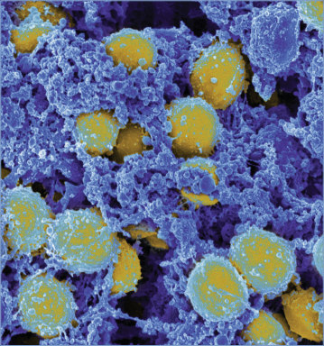

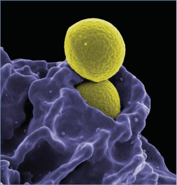

## PDF page 851 | printed page 837

Image 135.3 Scanning electron micrograph of methicillin-resistant Staphylococcus aureus bacteria (red, round items) killing and escaping from a human white cell. Courtesy of National Institute of Allergy and Infectious Diseases.

Image 135.6 Staphylococcal bullous impetigo lesions around the eyes, nose, and mouth in a 6-year-old boy. Also, note the secondary anterior cervical lymphadenopathy. Courtesy of George Nankervis, MD.

Image 135.4 Skin desquamation of the hand in a 7-year-old boy with staphylococcal scalded skin syndrome. Courtesy of Benjamin Estrada, MD.

Image 135.5 Newborn with pustulosis of the perineum and genitalia caused by Staphylococcus aureus. Copyright Michael Rajnik, MD, FAAP.

Image 135.7 Staphylococcus aureus hordeolum (sebaceous gland abscess) in an adolescent girl.

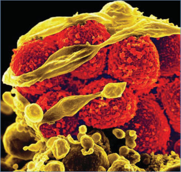

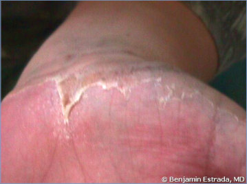

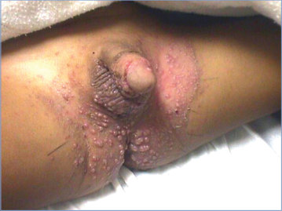

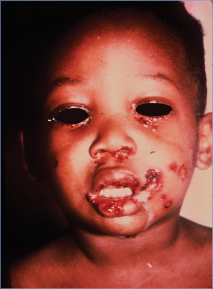

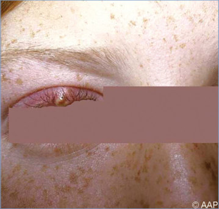

## PDF page 852 | printed page 838

Image 135.8 An infant with orbital cellulitis and ethmoid sinusitis caused by Staphylococcus aureus. Copyright Martin G. Myers, MD.

Image 135.10 A 11/2-year-old boy, atopic, with subauricular lymphadenitis caused by Staphylococcus aureus. Copyright Martin G. Myers, MD.

Image 135.9 Periorbital cellulitis caused by Staphylococcus aureus– infected lesion adjacent to the orbit (most likely secondary to a recent insect bite). Courtesy of Edgar O. Ledbetter, MD, FAAP.

Image 135.11 Staphylococcus aureus abscess of the lobe of the left ear secondary to ear piercing in an adolescent girl. Courtesy of Edgar O. Ledbetter, MD, FAAP.

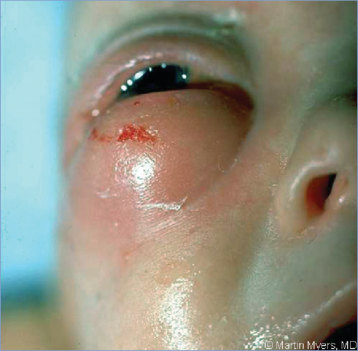

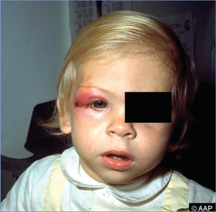

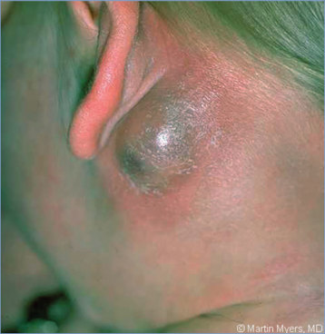

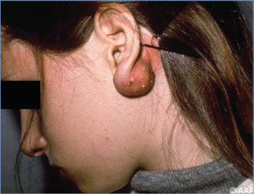

## PDF page 853 | printed page 839

Image 135.12 Subauricular cervical adenitis Staphylococcus aureus in a 2-year-old boy. Copyright Neal Halsey, MD.

Image 135.14 Impetigo (bullous) caused by Staphylococcus aureus.

Image 135.16 Chronic osteomyelitis of the right tibia caused by Staphylococcus aureus.

Image 135.13 Posttraumatic paronychia caused by Staphylococcus aureus of the left great toe of an infant. Courtesy of Edgar O. Ledbetter, MD, FAAP.

Image 135.15 Cellulitis, inguinal, caused by Staphylococcus aureus. Copyright Neal Halsey, MD.

Image 135.17 Osteomyelitis of the calcaneus caused by Staphylococcus aureus with no history of injury.

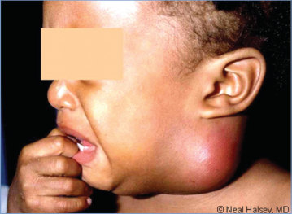

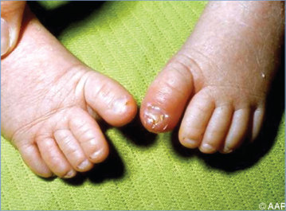

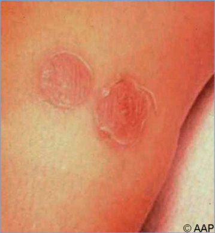

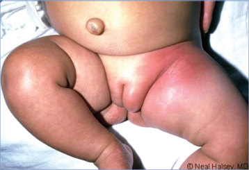

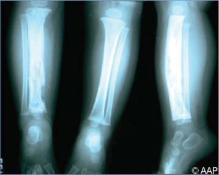

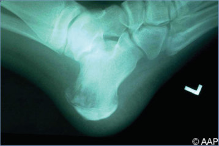

## PDF page 854 | printed page 840

Image 135.18 In a 12-year-old boy, chronic osteomyelitis of the clavicle caused by Staphylococcus aureus.

Image 135.20 Cerebral infarct in a patient with bacterial endocarditis. Courtesy of Dimitris P. Agamanolis, MD.

Image 135.19 Vertebral osteomyelitis in a 13-year-old with a 6-week history of back pain. Magnetic resonance imaging revealed osteolytic changes of the anterior segments of the first and second lumbar vertebrae. A culture of the biopsy specimen grew methicillin-resistant Staphylococcus aureus.

Image 135.21 Staphylococcal scalded skin syndrome with a positive Nikolsky sign.

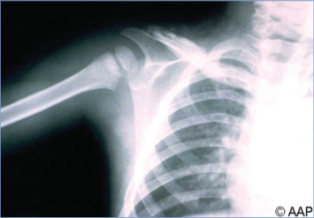

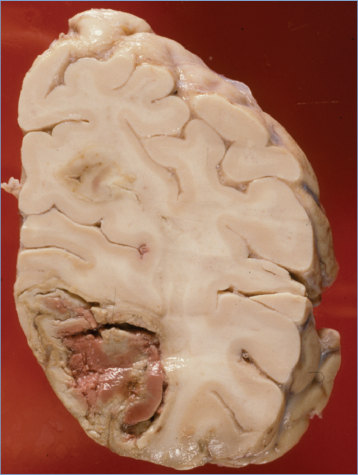

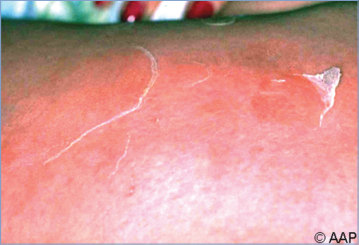

## PDF page 855 | printed page 841

Image 135.22 Staphylococcal pneumonia, primary, with rapid progression and empyema. The infant had only mild respiratory distress and paralytic ileus without fever when first examined.

Image 135.24 Pneumonia caused by Staphylococcus aureus with right lower lobe infiltrate in a preschool-aged child (day 1). Courtesy of Edgar O. Ledbetter, MD, FAAP.

Image 135.23 Staphylococcal pneumonia, primary, with rapid progression and empyema. This is the same patient as in Image 135.22.

Image 135.25 Staphylococcal pneumonia with massive empyema demonstrating the rather rapid progression typical of staphylococcal infection. This is the same patient as in Image 135.24 (day 4). Courtesy of Edgar O. Ledbetter, MD, FAAP.

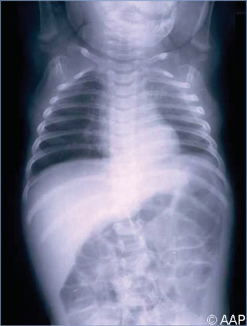

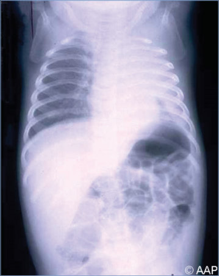

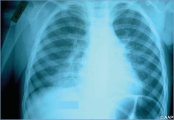

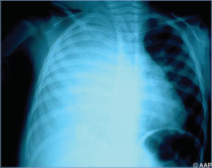

## PDF page 856 | printed page 842

Image 135.26 Erythroderma that blanches on pressure in a patient with toxic shock syndrome. The mortality rate for staphylococcal toxic shock syndrome is lower than that for streptococcal toxic shock syndrome.

Image 135.27 Children who have atopic dermatitis are prone to recurrent skin infections, particularly with Staphylococcus aureus and herpes simplex virus, for several reasons. Exacerbations of eczema disrupt the skin’s protective barrier. The failure to produce endogenous antimicrobial peptides has been offered as a reason.

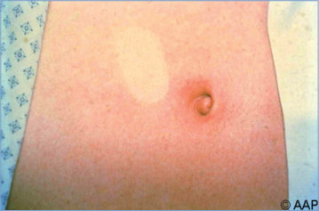

## PDF page 857 | printed page 843

Image 135.28 A Staphylococcus aureus isolate tested by the gradient diffusion method with vancomycin, daptomycin, and linezolid on Mueller-Hinton-IH agar. The minimum inhibitory concentration of each agent is determined by the intersection of the organism growth with the strip as measured by use of the scale inscribed on the strip. Used with permission from Clinical Infectious Diseases.

Image 135.29 D-zone test for clindamycin-induced resistance by Staphylococcus aureus. The left shows a negative result, and the right shows a positive one. Courtesy of Sarah Long, MD, FAAP.

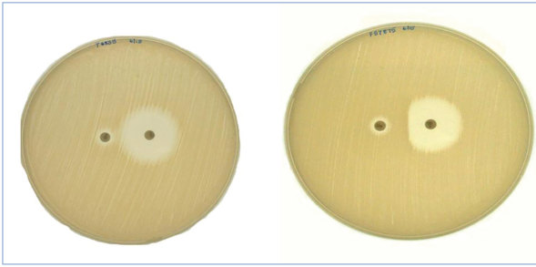
