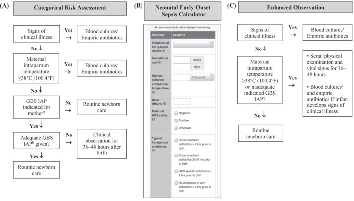
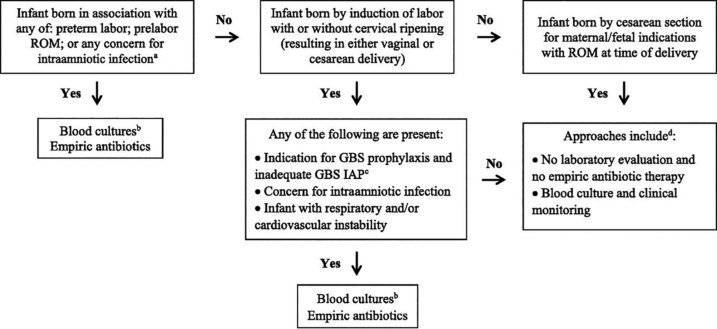
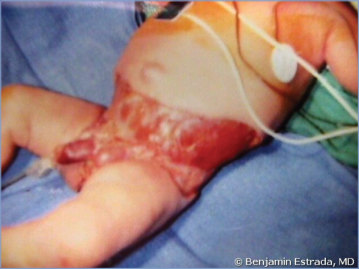
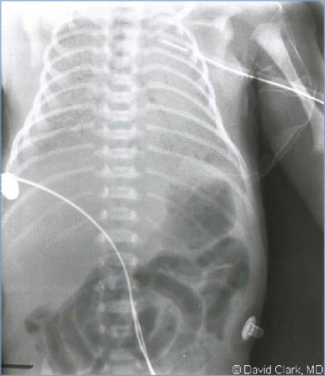
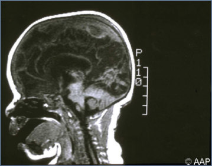
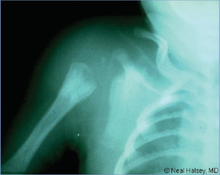
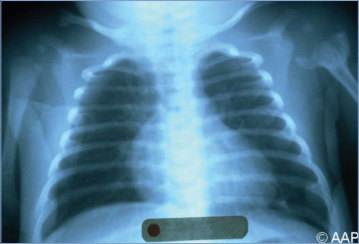

# 138. Group B Streptococcal Infections
> Private study reference ([source credits](../../SOURCE_CREDITS.md)). PDF pages 877-884; printed pages 863-870.

## PDF page 877 | printed page 863

### CLINICAL MANIFESTATIONS

Group B streptococci are a major cause of perinatal infections, including urinary tract infection, bacteremia, intra-amniotic infection (formerly called chorioamnionitis), and endometritis in pregnant and postpartum people, as well as systemic and focal infections in neonates and young infants. In newborn infants, early-onset disease (EOD) usually occurs within the first 24 hours after birth (range, 0 through 6 days), presenting with respiratory distress, apnea, pneumonia, shock and less often, meningitis (5%–10% of cases). Late-onset disease (LOD), which typically occurs at 3 to 4 weeks of age (range, 7 through 89 days), commonly manifests as bacteremia without a focus (60%–65% of cases) or meningitis (approximately 30% of cases); other focal infections, often with concomitant bacteremia, include osteomyelitis, septic arthritis, necrotizing fasciitis, pneumonia, adenitis, and cellulitis. Cases among infants 90 days and older are reported less commonly and typically occur among very preterm infants or infants with immunodeficiency syndromes. Survivors of invasive group B streptococcus (GBS), particularly cases involving meningitis, are at increased risk for neurodevelopmental impairment. A recent study estimated a twofold higher risk for moderate to severe neurodevelopmental impairment by age 10 years for children with invasive neonatal GBS disease in Denmark and a twofold higher risk for the need for educational support compared with uninfected children in the Netherlands.

### ETIOLOGY

Group B streptococci (Streptococcus agalactiae) are gram-positive diplococci that typically produce a narrow zone of beta hemolysis on 5% sheep blood agar. These organisms are divided into 10 types on the basis of capsular polysaccharide structures. Types Ia, Ib, II, III, IV, and V account for approximately 99% of cases in infants in the United States. Type III causes approximately 30% to 60% of EOD and LOD, respectively.

### EPIDEMIOLOGY

Group B streptococci colonize the human gastrointestinal and genitourinary tracts and less commonly the pharynx. The vaginal/rectal colonization rate in pregnant people ranges from 15% to 35% and can be persistent or intermittent. In the 1990s, recommendations were made for prevention of early-onset GBS disease through intrapartum antibiotic prophylaxis (IAP) administered to pregnant people who were found to be colonized or had risk factors for having an infant with EOD (see Control Measures). As a result of widespread implementation of IAP, the incidence of EOD has decreased by approximately 80% to an estimated 0.22 cases per 1,000 live births in 2020. The use of IAP has had no measurable effect on late-onset GBS disease incidence. In 2020, LOD incidence exceeded that of EOD at 0.29 cases per 1,000 live births. The case fatality rate for GBS disease in term infants ranges from 1% to 3% but is higher in preterm neonates (estimated to be 20% for EOD and 8% for LOD). Approximately 70% of EOD and 50% of LOD afflict term neonates.

Transmission from a pregnant person to the infant generally occurs shortly before or during delivery in those who are colonized with GBS organisms. Less commonly, GBS infection may be transmitted in the nursery from health care professionals or visitors or in the community via colonized family members or caregivers. The risk of EOD is increased in preterm infants, infants born 18 hours or more after membrane rupture, and infants born to people with intrapartum fever (temperature ≥38°C [≥100.4°F]), intra-amniotic infection, GBS bacteriuria during the current pregnancy, or a history of a previous infant with invasive GBS disease. A higher incidence of EOD has also been associated with delivering parents who are younger (age <20 years) and Black. However, the independent contribution of these factors is unclear because each of these has been associated with higher rates of both GBS colonization and preterm birth. Infants can remain colonized for several months despite treatment for systemic infection. Recurrent GBS disease affects an estimated 1% to 3% of appropriately treated infants.

The incubation period of EOD is fewer than 7 days. In LOD, the incubation period is unknown.

## PDF page 878 | printed page 864

### DIAGNOSTIC TESTS

Visualization of gram-positive cocci in pairs or short chains from a normally sterile body fluid provides presumptive evidence of infection, but growth of the organism in culture establishes the diagnosis. Multiplex polymerase chain reaction assays are available in many clinical laboratories for direct testing of cerebrospinal fluid (CSF) for GBS and may expedite the diagnosis.

For prenatal GBS screening, swab specimens from lower vaginal and rectal sites are collected (vaginal swab specimens alone underestimate GBS colonization by up to 10%–15%). Culture yield can be increased with the use of commercially available selective broth enrichment media for 18 to 24 hours of incubation before being plated on tryptic soy blood agar or other selective agars for an additional 24 to 48 hours. Alternatively, DNA probe assays, latex agglutination assays, and nucleic acid amplification tests (NAATs) are available to detect GBS in enriched broth specimens. Several NAATs are approved for antepartum or intrapartum detection of GBS organisms from vaginal/rectal swab specimens collected from pregnant people. However, the sensitivity of NAATs may be significantly decreased when used for rapid intrapartum testing, because a preanalysis enrichment incubation step cannot be included in those situations. Cases of neonatal GBS disease have occurred in neonates born to people whose screens were negative during pregnancy.

### TREATMENT1

• Ampicillin plus an aminoglycoside is the empiric treatment of choice for a newborn infant ≤7 days of age with presumptive early-onset GBS infection; this reflects the need for coverage of other pathogens, such as Escherichia coli, which is the second-most common cause of EOD. In a critically ill neonate, particularly one with low birth weight, broader-spectrum empiric therapy should be considered when there is concern about non-GBS ampicillin-resistant infection.

• For empiric therapy of late-onset GBS disease in infants 8 through 28 days of age who are being admitted from the community and are not critically ill and do not have evidence of meningitis, ampicillin plus either gentamicin or

an extended-spectrum cephalosporin (eg, cefotaxime, ceftazidime, cefepime) are recommended. If meningitis is suspected, ampicillin plus an extended-spectrum cephalosporin (eg, cefotaxime, ceftazidime, cefepime) should be used.

• For infants 29 through 89 days of age, ceftriaxone is recommended. If there is evidence of meningitis or critical illness, vancomycin should be added to expand empiric coverage.

• For a preterm infant hospitalized beyond 72 hours, empiric treatment for sepsis should take into account the potential for health careassociated pathogens as well as coverage for pathogens associated with neonatal sepsis, including group B streptococci.

• When GBS infection is identified definitively, penicillin G or ampicillin is recommended.

• For meningitis, especially in the neonate, some experts recommend that a second lumbar puncture be performed approximately 24 to 48 hours after initiation of therapy to assist in management and prognosis. If CSF sterility is not achieved or if increasing protein concentration is noted, a complication (eg, cerebral infarcts, cerebritis, ventriculitis, subdural empyema, ventricular obstruction) is more likely. Additional lumbar punctures and intracranial imaging are indicated if neurologic abnormalities persist, or focal neurological deficits occur. A failed hearing screen or abnormal neurologic examination at discharge mandates careful clinical follow-up.

• For infants with bacteremia without a defined focus or with an isolated urinary tract infection without bacteremia, treatment typically is 10 days of intravenous therapy. On the basis of observational data suggesting that transition to oral therapy for the latter few days of treatment after clinical improvement on intravenous therapy (to complete a total of 10 days) may be effective, some pediatric infectious disease experts have provided oral antibiotics for the last few days of treatment for low-risk patients with uncomplicated late-onset GBS bacteremia who had rapid clearance and clinical improvement and can be followed closely. For infants with uncomplicated meningitis,

## PDF page 879 | printed page 865

14 days of intravenous therapy is recommended, with longer courses of treatment for infants with prolonged or complicated courses. Septic arthritis or osteomyelitis requires treatment for 3 to 4 weeks. Patients who have endocarditis or ventriculitis require intravenous treatment for at least 4 weeks. Consultation with a specialist in pediatric infectious diseases is recommended for complicated infections.

• Because of the reported increased risk of infection, the birth mates of a multiple-birth index case with EOD or LOD should be observed carefully for signs of infection and evaluated and treated empirically for suspected systemic infection if signs of illness occur. There is no evidence to support full antibiotic treatment courses in the absence of confirmed GBS disease.

### INFECTION PREVENTION AND CONTROL MEASURES IN HEALTH CARE SETTINGS

Standard precautions are recommended. Routine cultures to determine whether infants are colonized with group B streptococci are not recommended.

### CONTROL MEASURES

Intrapartum Antibiotic Prophylaxis

Recommendations from the American Academy of Pediatrics (AAP)2 (https://pediatrics.aappublications.org/content/144/2/e20191881) and the American College of Obstetricians and Gynecologists3 (ACOG) (www.acog.org/ clinical/clinical-guidance/committeeopinion/articles/2020/02/prevention-ofgroup-b-streptococcal-early-onset-diseasein-newborns) were published in 2019 and 2020. Components that are directly germane to the management of neonates at risk for GBS include the following:

• All pregnant people should have culture-based screening from vaginal and rectal sites at 36 0/7 to 37 6/7 weeks’ gestation unless IAP for GBS infection is already planned because of predelivery risk factors in the pregnant person. For those who are at increased risk for a planned preterm delivery for medical indications, GBS screening within 5 weeks of anticipated delivery can be considered.

• For those who present with preterm labor, baseline GBS screening should be performed before intravenous GBS IAP is initiated.

• Intravenous penicillin G (5 million U initially, then 2.5 to 3.0 million U, every 4 hours, until delivery) is the preferred agent for GBS IAP because of its effectiveness and narrow spectrum of antimicrobial activity. Intravenous ampicillin (2 g initially, then 1 g every 4 hours until delivery) can be used as an alternative when penicillin is unavailable. Oral or intramuscular antimicrobial agents should not be used as IAP. Pregnant people who report a mild or unknown penicillin allergy should receive intravenous cefazolin for IAP. Those who report penicillin allergies placing them at high risk for anaphylaxis should receive either intravenous clindamycin or vancomycin for IAP, depending on organism susceptibilities, with dosing detailed in the ACOG guidelines (www.acog.org/clinical/clinical-guidance/ committee-opinion/articles/2020/02/ prevention-of-group-b-streptococcalearly-onset-disease-in-newborns).

• Penicillin allergy testing is safe during pregnancy and can be considered for people with a history of allergy to penicillin to optimize the antibiotic choice for GBS IAP.

• For the purpose of newborn evaluation regardless of gestational age, “adequate” GBS IAP is defined as the administration of at least 1 dose of penicillin G, ampicillin, or cefazolin 4 or more hours prior to delivery. Available evidence suggests that administration of penicillin G, ampicillin, or cefazolin for periods of time <4 hours prior to delivery confers some level of protection from GBS EOD. Of note, in the Neonatal Early-Onset Sepsis Risk calculator, “GBS specific antibiotics >2 hours prior to birth” is one of the calculator variables. The 2-hour timing is used because multiple factors in addition to GBS IAP are considered when using these multivariate models.

• The ACOG recommendations updated in 2020 detail the indications for IAP, management of people with penicillin allergy, use of alternative agents, and management of people with preterm prelabor rupture of membranes, taking into account gestational age, presence of labor,

## PDF page 880 | printed page 866

and availability of GBS test results. See www. acog.org/clinical/clinical-guidance/ committee-opinion/articles/2020/02/ prevention-of-group-b-streptococcalearly-onset-disease-in-newborns for full discussion.

Management of Neonates at Risk for Early-Onset GBS Disease

Please refer to the AAP clinical report “Management of Infants at Risk for GBS Disease”4 for detailed discussion. Recommendations include the following:

• Antimicrobial therapy is appropriate only for infants with suspected systemic infection.

• Routine use of antimicrobial chemoprophylaxis for neonates born to people who have received adequate IAP is not recommended. Early-onset GBS disease is diagnosed by blood or CSF culture. Lumbar puncture should be performed for culture and analysis of CSF when there is a high

Figure 138.1 Risk assessment for early-onset group B streptococcal disease among infants born at ≥35 weeks of gestation

Reproduced from Puopolo KM, Lynfield R, Cummings JJ; American Academy of Pediatrics, Committee on Fetus and Newborn, Committee on Infectious Diseases. Management of infants at risk for group B streptococcal disease. Pediatrics. 2019;144(2):e20191881. The screenshot of the Neonatal Early-Onset Sepsis Calculator (https://neonatalsepsiscalculator.kaiserpermanente.org/) was used with permission from Kaiser-Permanente Division of Research.

a Perform lumbar puncture and CSF culture before initiation of empiric antibiotics for infants who are at the highest risk of infection, especially those with critical illness. Lumbar puncture can be deferred if the infant’s clinical condition would be compromised, and antibiotics should be administered promptly and not deferred because of procedure delays. b Adequate GBS IAP is defined as the administration of penicillin G, ampicillin, or cefazolin ≥4 hours before delivery.

suspicion for early-onset GBS disease. All cultures should include testing for antibiotic susceptibility. Complete blood cell counts and measurement of C-reactive protein are not accurate enough to reliably identify infected infants. Chest radiography and other studies should be performed as clinically indicated.

• Infants born at ≥35 weeks’ gestation can be assessed for risk of early-onset sepsis using 1 of 3 methods: (1) a categorical algorithm, (2) a multivariate risk assessment, or (3) enhanced clinical observation (see Fig 138.1).

8 A categorical approach (Fig 138.1A) uses threshold values to identify infants at increased risk for GBS disease. Because thresholds are used, the risk will vary greatly among newborn infants recommended to undergo laboratory evaluation and receive empiric treatment, and it will include relatively low-risk newborn infants.

## PDF page 881 | printed page 867

8 Multivariate risk assessment (Fig 138.1B,

Neonatal Early-Onset Sepsis Calculator, and as an example: https://neonatalsepsiscalculator.kaiserpermanente.org) uses the individual infant’s combination of risk factors for early-onset sepsis (including maternal components) and the infant’s clinical status to estimate the risk of early-onset sepsis, including risk for GBS disease. It provides recommended clinical actions, such as enhanced clinical observation or laboratory evaluation and empiric antibiotics, on the basis of predicted risk estimates. This tool has been prospectively validated in large newborn cohorts.

8 Enhanced clinical observation (Fig 138.1C) is a risk assessment based on newborn clinical conditions. Good clinical condition at birth in term infants is associated with an approximately 60% to 70% reduction in risk for EOD of all infections, including GBS infection. Infants who appear ill at birth and those who develop signs of illness over the first 48 hours after birth will undergo laboratory evaluation and receive empiric antibiotics. This approach can be combined with a categorical or multivariate assessment for risk factors or used on its own for infants born at ≥35 weeks’ gestation. Use of this approach requires processes to ensure serial and structured physical assessments and clear criteria for additional evaluation and empiric antibiotic administration.

• Infants born at ≤34 weeks’ gestation are at higher risk for early-onset sepsis, including GBS sepsis, than are full-term infants. However, the risk varies and is dependent on several maternal, peripartum, and neonatal factors. Management is outlined in Fig 138.2, with additional summary provided in the bullets below.

8 Infants born preterm because of cervical insufficiency, preterm labor, prelabor rupture of membranes, intra-amniotic infection, and/ or acute and otherwise unexplained onset of concerning fetal status are at the highest risk of early-onset sepsis, including from group B streptococci. The administration of GBS IAP can decrease this risk; however, these infants remain at high risk, and a laboratory evaluation should be done and empiric antibiotics

for pathogens causing early-onset sepsis, including group B streptococci, should be given. The most reasonable approach to these infants is to obtain a blood culture and start empiric antibiotic treatment. Lumbar puncture should be performed for culture and analysis of CSF when there is a high suspicion for early-onset GBS disease, unless the procedure will compromise the neonate’s clinical condition.

8 Some infants born at ≤34 weeks’ gestation are at much lower risk for early-onset sepsis, including GBS sepsis, if they have all of the following: (1) delivery for indications in the birthing person (such as preeclampsia, other noninfectious medical illness, or placental insufficiency), (2) birthing parent not in labor, (3) no efforts to induce labor occurred, (4) rupture of membranes did not occur prior to delivery, and (5) delivery occurs by cesarean section. Acceptable initial approaches to these infants include (a) no laboratory evaluation and no empiric antibiotic therapy, or (b) blood culture and clinical monitoring. For infants who do not receive empiric antibiotics and do not improve after initial stabilization and/or those who have severe systemic instability, the administration of empiric antibiotics may be reasonable but is not mandatory, because infants can develop instability attributable to noninfectious factors.

8 Infants born at ≤34 weeks’ gestation who are delivered for indications in the birthing person but who are ultimately born by vaginal or cesarean delivery after efforts to induce labor and/or with rupture of membranes before delivery are subject to factors associated with the pathogenesis of GBS EOD. If the birthing parent has an indication for GBS IAP, including a positive screen, and adequate IAP is not given or if any other concerns for infection occur during delivery, the infant should be managed as recommended for infants born at ≤34 weeks’ gestation who are at highest risk for early-onset sepsis (see first bullet under “Infants born at ≤34 weeks’ gestation”). If there are no concerns for infection based on birthing parent or delivery factors and these preterm infants are clinically well at birth, an acceptable

## PDF page 882 | printed page 868

Figure 138.2 Risk assessment for early-onset group B streptococcal disease among infants born at ≤34 weeks’ gestation

Adapted from Puopolo KM, Lynfield R, Cummings JJ; American Academy of Pediatrics, Committee on Fetus and Newborn, Committee on Infectious Diseases. Management of infants at risk for group B streptococcal disease. Pediatrics. 2019;144(2):e20191881.

a Intra-amniotic infection should be considered when a pregnant person presents with unexplained decreased fetal movement and/ or there is sudden and unexplained poor fetal testing. b Lumbar puncture should be performed for culture and analysis of CSF when there is a high suspicion for early-onset GBS disease, unless the procedure will compromise the neonate’s clinical condition. Antibiotics should be administered promptly and not deferred because of procedural delays. c Adequate GBS IAP is defined as the administration of penicillin G, ampicillin, or cefazolin ≥4 hours before delivery. d For infants who do not improve after initial stabilization and/or those who have severe systemic instability, the administration of empiric antibiotics may be reasonable but is not mandatory.

approach is close observation, escalating to laboratory evaluation and empiric antibiotic therapy for infants with respiratory and/or cardiovascular instability after birth.

Late-Onset GBS Disease and Human Milk

Although there are case reports of human milk being a potential source of late-onset GBS disease, a recent multicenter case control study found no increased risk for late-onset GBS with breastfeeding. The AAP does not recommend culturing human milk in an infant with late-onset GBS disease.

1 Puopolo KM, Lynfield R, Cummings JJ; American Academy of

Pediatrics, Committee on Fetus and Newborn, Committee on Infectious Diseases. Management of infants at risk for group B streptococcal disease. Pediatrics. 2019;144(2):e20191881 2 Puopolo KM, Lynfield R, Cummings JJ; American Academy of

Pediatrics, Committee on Fetus and Newborn, Committee on Infectious Diseases. Management of infants at risk for group B streptococcal disease. Pediatrics. 2019;144(2):e20191881 3 American College of Obstetricians and Gynecologists. Prevention of group B streptococcal early-onset disease in newborns: ACOG Committee Opinion Number 797. Obstet Gynecol. 2020;135(2):e51–e72 4 Puopolo KM, Lynfield R, Cummings JJ; American Academy of

Pediatrics, Committee on Fetus and Newborn, Committee on Infectious Diseases. Management of infants at risk for group B streptococcal disease. Pediatrics. 2019;144(2):e20191881

## PDF page 883 | printed page 869

Image 138.1 Streptococcus agalactiae necrotizing fasciitis in a 3-monthold. Courtesy of Benjamin Estrada, MD.

Image 138.3 Magnetic resonance image obtained after group B streptococcal meningitis.

Image 138.5 Neonatal group B streptococcal septic arthritis of the left shoulder joint and osteomyelitis of the left proximal humerus. Courtesy of Edgar O. Ledbetter, MD, FAAP.

Image 138.2 Bilateral, severe group B streptococcal pneumonia in a neonate. Copyright David Clark, MD.

Image 138.4 Neonatal group B streptococcal septic arthritis of the right shoulder joint and osteomyelitis of the right proximal humerus. Copyright Neal Halsey, MD.

## PDF page 884 | printed page 870

Image 138.6 Streptococcus agalactiae, 24-hour sheep blood agar plate, beta hemolysis, close-up view. Courtesy of Robert Jerris, PhD.

Image 138.7 A full-term 3-week-old who had poor feeding and irritability followed 2 hours later by fever to 38.1°C (100.6°F). On admission to the hospital 3 hours later, he required fluid resuscitation and intravenous antibiotic therapy. His spinal fluid was within reference range, but the blood culture grew group B streptococci. At admission, the physical examination revealed the classic facial and submandibular erythema, tenderness, and swelling characteristic of group B streptococcal cellulitis. Courtesy of Nate Serazin, MD, and C. Mary Healy, MD.

![Image 138.7 A full-term 3-week-old who had poor feeding and irritability followed 2 hours later by fever to 38.1°C (100.6°F). On admission to the hospital 3 hours later, he required fluid resuscitation and intravenous antibiotic therapy. His spinal fluid was within reference range, but the blood culture grew group B streptococci. At admission, the physical examination revealed the classic facial and submandibular erythema, tenderness, and swelling characteristic of group B streptococcal cellulitis. Courtesy of Nate Serazin, MD, and C. Mary Healy, MD.](../../figures/ch138_p0884_01.jpg)

