# 140. Streptococcus pneumoniae (Pneumococcal) Infections
> Private study reference ([source credits](../../SOURCE_CREDITS.md)). PDF pages 891-906; printed pages 877-892.

## PDF page 891 | printed page 877

### CLINICAL MANIFESTATIONS

Streptococcus pneumoniae is a common bacterial cause of acute otitis media (AOM), sinusitis, community-acquired pneumonia, and pediatric conjunctivitis; pleural empyema, mastoiditis, and periorbital cellulitis also occur. It is the most common cause of bacterial meningitis in infants and children ages 2 months to 11 years in the United States. S pneumoniae also may cause endocarditis, pericarditis, peritonitis, pyogenic arthritis, osteomyelitis, soft-tissue infection, and neonatal septicemia. Overwhelming septicemia in patients with splenic dysfunction occurs, and hemolytic-uremic syndrome can accompany pneumococcal infection.

### ETIOLOGY

S pneumoniae organisms (pneumococci) are lancet-shaped, gram-positive, catalase-negative diplococci. They are a-hemolytic. More than 100 pneumococcal serotypes have been identified on the basis of unique polysaccharide capsules.

### EPIDEMIOLOGY

Nasopharyngeal carriage rates in children range from 21% in industrialized settings to more than 90% in resource-limited settings. Transmission is from person to person by respiratory droplet contact. Viral upper respiratory tract infections, including influenza and respiratory syncytial virus, can predispose to pneumococcal infection and transmission. Pneumococcal infections are most prevalent during winter months. The period of communicability is unknown and may be as long as the organism is present in respiratory tract secretions but probably is less than 24 hours after effective antimicrobial therapy is begun.

The incidence and severity of infections are increased in people with congenital or acquired humoral immunodeficiency, HIV infection, absent or deficient splenic function (eg, sickle cell disease, congenital or surgical asplenia), certain complement deficiencies, diabetes mellitus, chronic liver disease, chronic renal failure, nephrotic syndrome, or abnormal innate immune responses.

Children with cochlear implants, particularly those who had placement of an older model that involved a cochlear electrode, have high rates of pneumococcal meningitis, as do children with congenital or acquired cerebrospinal fluid (CSF) leaks.2 Children at presumed high or moderate risk of developing invasive pneumococcal disease (IPD) are listed by underlying medical condition in Table 140.1. Infection rates are highest in infants, young children, and elderly people, and in Black, Alaska Native, and some American Indian populations. Since introduction of the heptavalent pneumococcal conjugate vaccine (PCV7) in 2000 and the 13-valent pneumococcal conjugate vaccine (PCV13) in 2010, racial disparities in vaccine-type pneumococcal disease have diminished; however, rates of IPD among some Alaska Native and American Indian populations remain higher than the rate among children in the general U.S. population. Recent data from Alaska and the southwestern United States indicate that the majority of IPD cases among American Indian/Alaska Native children are now caused by serotypes not contained in the PCV13 vaccine.

By 2019, 9 years after the introduction of PCV13, the incidence of PCV13-type invasive pneumococcal infections decreased by 98% compared with incidence before introduction of PCV7, and the incidence of all IPD decreased by 95% in children younger than 5 years. In adults 65 years and older, IPD caused by PCV13 serotypes decreased 86% compared with pre-PCV7 baseline, and all IPD decreased by 61%. Most of the reduction in cases in this latter group occurred before routine PCV13 use was recommended in 2014 for older adults, indicating the significant indirect (ie, herd effect) benefits of PCV13 immunization achieved by interruption of transmission of pneumococci from vaccinated children to adults. Although S pneumoniae strains that are nonsusceptible to penicillin G, ceftriaxone, and other antimicrobial agents have been identified throughout the United States and worldwide, a reduction in the proportion of isolates that are penicillinnonsusceptible (intermediate or resistant) and ceftriaxone-resistant has been observed since introduction of PCV7 and PCV13.

The incubation period varies by type of infection but can be as short as 1 day.

## PDF page 892 | printed page 878

Table 140.1 Underlying Medical Conditions That Are Indications for Immunization With 23-Valent Pneumococcal Polysaccharide Vaccine (PPSV23)a or PCV20 Among Children, by Risk Groupb,c,d

Risk Group Immunocompetent children Chronic heart diseasee

Chronic kidney disease (excluding maintenance dialysis and nephrotic syndrome) Chronic liver disease Chronic lung diseasef

Diabetes mellitus Cerebrospinal fluid leaks Cochlear implant Children with immunocompromising conditions On maintenance dialysis or nephrotic syndrome Congenital or acquired asplenia or splenic dysfunction Congenital or acquired immunodeficiencies HIV infection Diseases and conditions treated with immunosuppressive drugs or radiation therapy, including malignant neoplasms, leukemias, lymphomas, and Hodgkin disease; or solid organ transplantation Sickle cell disease and other hemoglobinopathies Congenital immunodeficiencyg

a PPSV23 may be used in people ≥24 months of age. b Centers for Disease Control and Prevention. Licensure of a 13-valent pneumococcal conjugate vaccine (PCV13) and recommendations for use among children. Advisory Committee on Immunization Practices (ACIP). MMWR Morb Mortal Wkly Rep. 2010;59(9):258–261; and Centers for Disease Control and Prevention. Use of 13-valent pneumococcal conjugate vaccine and 23-valent pneumococcal polysaccharide vaccine among children aged 6–18 years with immunocompromising conditions: recommendations of the Advisory Committee on Immunization Practices (ACIP). MMWR Morb Mortal Wkly Rep. 2013;62(25):521–524. c Kobayashi M, Farrar JL, Gierke R, et al. Use of 15-valent pneumococcal conjugate vaccine among U.S. children: updated recommendations of the Advisory Committee on Immunization Practices—United States, 2022. MMWR Morb Mortal Wkly Rep. 2022;71(37):1174–1181. d ACIP updates: recommendations for use of 20-valent pneumococcal conjugate vaccine in children—United States, 2023. MMWR Morb Mortal Wkly Rep. 2023;72(39):1072. e Particularly cyanotic congenital heart disease and cardiac failure. f Including moderate persistent or severe persistent asthma. g Includes B- (humoral) or T-lymphocyte deficiency; complement deficiencies, particularly C1, C2, C3, and C4 deficiency; and phagocytic disorders (excluding chronic granulomatous disease).

### DIAGNOSTIC TESTS

Recovery of S pneumoniae from a normally sterile site confirms the diagnosis. The finding of lancetshaped gram-positive organisms and white blood cells in expectorated sputum (older children and adults) or pleural exudate suggests pneumococcal pneumonia. Recovery of pneumococci by culture of an upper respiratory tract swab specimen is not sufficient to assign an etiologic diagnosis of pneumococcal disease involving the middle ear, upper or lower respiratory tract, or sinus.

There are at least 2 multiplexed nucleic acid amplification tests cleared by the U.S. Food and Drug Administration (FDA) to identify S pneumoniae and other bacterial and fungal pathogens from positive blood culture bottles. At least 1 real-time

Condition

polymerase chain reaction (PCR) assay is cleared by the FDA for detection of S pneumoniae in CSF. The assay is a multiplexed PCR designed to detect a number of agents of bacterial, fungal, and viral meningitis or encephalitis. PCR testing should be accompanied by culture of CSF to obtain an isolate, which is needed for antimicrobial susceptibility testing.

Detection of C polysaccharide (common to all pneumococci) in urine for diagnosis of pneumococcal pneumonia may have some utility in adults but is generally not useful in children, because asymptomatically colonized children may have positive test results. Similarly, commercially available antigen detection tests performed on CSF or blood are not recommended for routine use because of low sensitivity.

### Geometry-detected table

|Risk Group|Condition|
|---|---|
|Immunocompetent children|Chronic heart diseasee|
|Immunocompetent children|Chronic kidney disease (excluding maintenance dialysis and nephrotic syndrome)|
|Immunocompetent children|Chronic liver disease|
|Immunocompetent children|Chronic lung diseasef|
|Immunocompetent children|Diabetes mellitus|
|Immunocompetent children|Cerebrospinal fuid leaks|
|Immunocompetent children|Cochlear implant|
|Children with immunocompromising conditions|On maintenance dialysis or nephrotic syndrome|
|Children with immunocompromising conditions|Congenital or acquired asplenia or splenic dysfunction|
|Children with immunocompromising conditions|Congenital or acquired immunodefciencies|
|Children with immunocompromising conditions|HIV infection|
|Children with immunocompromising conditions|Diseases and conditions treated with immunosuppressive drugs or radiation therapy, including malignant neoplasms, leukemias, lymphomas, and Hodgkin disease; or solid organ transplantation|
|Children with immunocompromising conditions|Sickle cell disease and other hemoglobinopathies|
|Children with immunocompromising conditions|Congenital immunodefciencyg|

[View original table](../../tables/ch140_p0892_1.jpg)

## PDF page 893 | printed page 879

Susceptibility Testing

All S pneumoniae isolates from normally sterile body fluids should be tested for antimicrobial susceptibility to determine the minimum inhibitory concentration (MIC) of penicillin, cefotaxime or ceftriaxone, and clindamycin. Susceptibility threshold breakpoints of S pneumoniae isolated from blood differ for CSF isolates (Table 140.2) as defined by the Clinical and Laboratory Standards Institute (CLSI). CSF isolates also should be tested for susceptibility to vancomycin, meropenem, and rifampin. Nonsusceptible strains can also be evaluated for susceptibility to erythromycin, trimethoprim-sulfamethoxazole, levofloxacin, and linezolid to treat various pneumococcal infections.

### TREATMENT

Bacterial Meningitis Possibly or Proven to Be Caused by S pneumoniae

For children with bacterial meningitis possibly or known to be caused by S pneumoniae, vancomycin should be administered in addition to third-generation cephalosporin because of the possibility of S pneumoniae organisms that are nonsusceptible to penicillin and third-generation

Table 140.2 Minimum Inhibitory Concentration Breakpoints (mg/mL) for Streptococcus pneumoniae, by Susceptibility Category, as per the Clinical and Laboratory Standards Institute

Penicillin Breakpoints (by clinical syndrome and administered route)

Nonmeningitis, oral penicillin

Nonmeningitis, IV penicillin

Meningitis, IV penicillin

Cefotaxime or Ceftriaxone Breakpoints (by clinical syndrome and administered route)

Nonmeningitis

Meningitis

IV indicates intravenous; MIC, minimal inhibitory concentration; —, no intermediate category for meningitis. From Clinical and Laboratory Standards Institute (CLSI). Performance Standards for Antimicrobial Testing; 29th Informational Supplement. Wayne, PA: Clinical and Laboratory Standards Institute; 2019. CLSI document M100-S29.

cephalosporins. In neonates, when cefotaxime is not available then ceftazidime or cefepime can be used in addition to vancomycin. Vancomycin should be stopped if susceptibility to thirdgeneration cephalosporins is documented (using central nervous system breakpoints for thresholds of susceptibility, as defined in Table 140.2), if another organism not requiring vancomycin is identified, or if the CSF culture is negative. If the S pneumoniae isolate is nonsusceptible to penicillin or third-generation cephalosporins, treatment options are provided in Table 140.3. Consultation with an infectious disease specialist should be considered for all children with bacterial meningitis.

For children with serious proven hypersensitivity reactions to third- or fourth-generation cephalosporins, a pediatric infectious disease specialist should be consulted for consideration of use of vancomycin plus either meropenem or rifampin.

A repeat lumbar puncture should be considered after 48 hours of therapy in the following circumstances:

• The organism is penicillin nonsusceptible by oxacillin disk or quantitative (MIC) testing, and results from cefotaxime and ceftriaxone

Susceptibility Category MIC (mg/mL)

Susceptible Intermediate Resistant

0.12–1

≤0.06

≥2

4

≤2

≥8

—

≤0.06

≥0.12

2

≤1

≥4

1

<0.5

≥2

### Geometry-detected table

|Col1|Susceptibility Category MIC (mg/mL)|Col3|Col4|
|---|---|---|---|
||**Susceptible**|**Intermediate**|**Resistant**|
|**Penicillin**|**Penicillin**|**Penicillin**|**Penicillin**|
|**Breakpoints** (by clinical syndrome and administered route) Nonmeningitis, oral penicillin Nonmeningitis, IV penicillin Meningitis, IV penicillin|≤0.06 ≤2 ≤0.06|0.12–1 4 —|≥2 ≥8 ≥0.12|
|**Cefotaxime or Ceftriaxone**|**Cefotaxime or Ceftriaxone**|**Cefotaxime or Ceftriaxone**|**Cefotaxime or Ceftriaxone**|
|**Breakpoints** (by clinical syndrome and administered route) Nonmeningitis Meningitis|≤1 <0.5|2 1|≥4 ≥2|

[View original table](../../tables/ch140_p0893_1.jpg)

## PDF page 894 | printed page 880

Table 140.3 Antimicrobial Therapy for Infants and Children With Meningitis Caused by Streptococcus pneumoniae on the Basis of Susceptibility Test Results, as Defined in Table 140.2

Susceptibility Test Results

Susceptible to penicillin

Nonsusceptible to penicillin (intermediate or resistant) AND Susceptible to cefotaxime and ceftriaxone

Nonsusceptible to penicillin (intermediate or resistant) AND Nonsusceptible to cefotaxime and ceftriaxone (intermediate or resistant) AND Susceptible to rifampin

a Initial empiric therapy of nonallergic children older than 1 month of age with presumed bacterial meningitis should be vancomycin and cefotaxime or ceftriaxone. Some experts recommend the maximum dosages. b Some physicians may choose this alternative for convenience but only in treatment of meningitis.

quantitative susceptibility testing are not yet available or the isolate is cefotaxime and ceftriaxone nonsusceptible; or

• The patient’s condition has not improved or has worsened; or

• The child has received dexamethasone, which can interfere with the ability to interpret the clinical response, such as resolution of fever.

Dexamethasone

For infants and children 6 weeks and older, adjunctive therapy with dexamethasone may be considered after weighing the potential benefits and risks. Some experts recommend use of corticosteroids in pneumococcal meningitis, but this issue is controversial and data are not sufficient to make a routine recommendation for children. The Infectious Diseases Society of America recommends use of dexamethasone in adults with suspected or proven pneumococcal meningitis. If used, dexamethasone should be administered before or concurrently with the first dose of parenteral antimicrobial agents.

Nonmeningeal Invasive Pneumococcal Infections Requiring Hospitalization

For nonmeningeal invasive infections in previously healthy children who are not critically ill, antimicrobial

Antimicrobial Managementa

Discontinue vancomycin AND EITHER Continue cefotaxime or ceftriaxone aloneb

OR Begin penicillin (and discontinue cephalosporin)

Discontinue vancomycin AND Continue cefotaxime or ceftriaxone

Continue vancomycin and high-dose cefotaxime or ceftriaxone AND Rifampin may be added in selected circumstances (see text)

agents that treat infections with S pneumoniae and other potential pathogens should be initiated at the usually recommended dosages.

For critically ill infants and children with invasive infections potentially attributable to S pneumoniae, vancomycin, in addition to empiric antimicrobial therapy (eg, cefotaxime or ceftriaxone or others), can be considered. Such patients include those with presumed septic shock, severe pneumonia with empyema, or significant hypoxia or myopericardial involvement. If vancomycin is administered, it should be discontinued as soon as antimicrobial susceptibility test results demonstrate effective alternative agents.

If the organism has in vitro nonsusceptibility to penicillin, cefotaxime, and ceftriaxone according to guidelines of the CLSI (see Table 140.2), therapy should be modified on the basis of clinical response, susceptibility to other antimicrobial agents, and results of follow-up cultures of blood and other infected body fluids. Consultation with an infectious disease specialist should be considered.

For children with severe hypersensitivity to b-lactam antimicrobial agents (ie, penicillins and cephalosporins), initial management should include vancomycin or clindamycin, in addition to antimicrobial

### Geometry-detected table

|Susceptibility Test Results|Antimicrobial Managementa|
|---|---|
|_Susceptible_ to penicillin|Discontinue vancomycin **AND EITHER** Continue cefotaxime or ceftriaxone aloneb **OR** Beginpenicillin(and discontinue cephalosporin)|
|_Nonsusceptible_ to penicillin (_intermediate_ or_resistant_) **AND** _Susceptible_ to cefotaxime and ceftriaxone|Discontinue vancomycin **AND** Continue cefotaxime or ceftriaxone|
|_Nonsusceptible_ to penicillin (_intermediate_ or_resistant_) **AND** _Nonsusceptible_ to cefotaxime and ceftriaxone (_intermediate_ or_resistant_) **AND** _Susceptible_ to rifampin|Continue vancomycin and high-dose cefotaxime or ceftriaxone **AND** Rifampin may be added in selected circumstances (see text)|

[View original table](../../tables/ch140_p0894_1.jpg)

## PDF page 895 | printed page 881

agents for other potential pathogens, as indicated. Vancomycin should not be continued if the organism is susceptible to other appropriate non–b-lactam antimicrobial agents. Consultation with an infectious disease specialist should be considered.

Acute Otitis Media3

According to clinical practice guidelines of the American Academy of Pediatrics and the American Academy of Family Physicians on suppurative AOM, amoxicillin (80–90 mg/kg/day) is recommended for infants younger than 6 months, for those 6 through 23 months of age with bilateral disease, and for those older than 6 months with severe signs and symptoms. A watch-andwait option can be considered for older children and those with nonsevere disease. Optimal duration of therapy is uncertain. For younger children and children with severe disease at any age, a 10-day course is recommended; for children 6 years and older with mild or moderate disease, a duration of 5 to 7 days is appropriate. Otalgia should be treated symptomatically.

Patients who fail to respond to initial management should be reassessed at 48 to 72 hours to confirm the diagnosis of AOM and exclude other causes of illness. If AOM is confirmed in the patient managed initially with observation, amoxicillin should be administered. If initial antibacterial therapy has failed, a change in antibacterial agent is indicated. Suitable alternative agents should be active against penicillin-nonsusceptible pneumococci as well as b-lactamase–producing Haemophilus influenzae and Moraxella catarrhalis. Such agents include high-dose oral amoxicillin-clavulanate; oral cefdinir, cefpodoxime, or cefuroxime; or once-daily doses of intramuscular ceftriaxone for 3 consecutive days. Macrolide resistance in S pneumoniae is common, so clarithromycin and azithromycin are not considered appropriate alternatives for initial therapy even in patients with a type I (immediate, anaphylactic) reaction to a b-lactam agent. In such cases, treatment with clindamycin (if susceptibility is known) or levofloxacin is preferred. For patients with a history of non-type I allergic reaction to penicillin, agents such as cefdinir, cefuroxime, or cefpodoxime can be used orally.

Myringotomy or tympanocentesis should be considered for children failing to respond to secondline therapy, for severe cases to obtain cultures to

guide therapy, and for patients with invasive pneumococcal infection. For multidrug-resistant strains of S pneumoniae, use of levofloxacin or other agents should be considered in consultation with an infectious disease specialist and based on the specific susceptibility profile.

Sinusitis

Antimicrobial agents effective for treatment of AOM also are likely to be effective for acute sinusitis and are recommended when a child meets clinical criteria for diagnosis.

Pneumonia4

Oral amoxicillin at a dose of 45 mg/kg/day in 3 equally divided doses or 90 mg/kg/day in 2 divided portions is likely to be effective in ambulatory children with pneumonia caused by susceptible and relatively resistant pneumococci, respectively. Intravenous ampicillin by intermittent dosing or penicillin by continuous infusion is recommended for therapy of hospitalized cases caused by penicillin-susceptible strains. Cefotaxime or ceftriaxone is recommended for treatment of inpatients infected with pneumococci suspected or proven to be penicillin-nonsusceptible strains, for serious infections including empyema, or in those not fully immunized with PCV13 or the more recently licensed 15-valent or 20-valent pneumococcal conjugate vaccines (PCV15 and PCV20, respectively). Vancomycin should be included in those with life-threatening infection. For patients with isolates nonsusceptible to penicillin (MICs of 4.0 mg/mL or higher; see Table 140.2) or significant allergy to b-lactam antimicrobials, treatment with clindamycin (if susceptible) or levofloxacin should be considered, assuming that concurrent meningitis has been excluded.

### INFECTION PREVENTION AND CONTROL MEASURES IN HEALTH CARE SETTINGS

Standard precautions are recommended, including for patients with infections caused by drug-resistant S pneumoniae.

### CONTROL MEASURES

Active Immunization

Four pneumococcal vaccines are available for use in children in the United States: 3 pneumococcal

## PDF page 896 | printed page 882

conjugate vaccines (PCV13, PCV15, and PCV20), and 1 pneumococcal polysaccharide vaccine (the 23-valent PPSV23). PCV13, PCV15, and PCV20 are licensed for use in infants and children 6 weeks and older as well as in adults. PCV13 is composed of 13 purified capsular polysaccharide serotypes (1, 3, 4, 5, 6A, 6B, 7F, 9V, 14, 18C, 19A, 19F, and 23F). PCV15 contains all PCV13 serotypes plus serotypes 22F and 33F. PCV20 contains all PCV15 serotypes plus serotypes 8, 10A, 11A, 12F, and 15B. PPSV23 is licensed for use in children 2 years and older and adults. PPSV23 is composed of 23 capsular polysaccharides, including all of those in PCV13, PCV15, and PCV20 except 6A. PPSV23 is available in single or multidose vials and single-dose prefilled syringes that do not contain latex. Each available vaccine is recommended in a dose of 0.5 mL to be administered intramuscularly. In contrast to immunization with PCV13, PCV15, and PCV20, immunization with PPSV23 does not induce immunologic memory or boosting with subsequent doses, has no effects on nasopharyngeal carriage, and therefore does not interrupt transmission and indirectly protect unimmunized people.

Routine Immunization With Pneumococcal Conjugate Vaccine

PCV15 or PCV20 is recommended for all infants and children 2 through 59 months of age. There is no preference for one of these vaccines over the other. For infants, the vaccine should be administered at 2, 4, 6, and 12 through 15 months of age; catch-up immunization is recommended for all children 59 months of age or younger (Table 140.4). Infants should begin the PCV15 or PCV20 immunization series in conjunction with other recommended vaccines at the time of the first regularly scheduled health maintenance visit after 6 weeks of age. Infants of very low birth weight (1,500 g or less) should be immunized when they attain a chronologic age of 6 to 8 weeks, regardless of their gestational age at birth. PCV15 or PCV20 can be administered concurrently with all other age-appropriate childhood immunizations (except PPSV23 and MenACWY-D [Menactra], see General Recommendations for Use of Pneumococcal Vaccines, below) using a separate syringe and a separate injection site.

Immunization of Children Under 6 Years of Age Who Are Unimmunized or Incompletely Immunized With PCV13, PCV15, or PCV20

For healthy children 2 through 59 months of age with an incomplete PCV vaccination status, use of either PCV15 or PCV20 according to the currently recommended dosing and schedules is recommended (see Table 140.4). For all children 2 through 71 months who are at high risk or presumed high risk of acquiring invasive pneumococcal infection, as defined in Table 140.1, the recommended use of PCV15, PCV20, and PPSV23 is outlined in Table 140.5.

Immunization of Children 6 Through 18 Years of Age With High-Risk Conditions Who Have Not Received Any Dose of PCV5,6,7

For children 6 through 18 years of age who previously have not received PCV13, PCV15, or PCV20 and who are at increased risk of IPD because of a high-risk condition (defined in Table 140.1), administration of a single PCV15 or PCV20 dose is recommended. When PCV15 is used, it should be followed by either a dose of PCV20 or a dose of PPSV23 at least 8 weeks later.

A second dose of PPSV23 or a first dose of PCV20 (if no prior PCV20 has been administered) is recommended 5 years after the first dose of PPSV23 in children with sickle cell disease or functional or anatomic asplenia, HIV infection, or other immunocompromising conditions, but no more than a total of 2 PPSV23 doses should be administered before 65 years of age.

Immunization of Children 2 Through 18 Years of Age Who Are at Increased Risk of IPD With PPSV23 After PCV13, PCV15, or PCV208,9,10

Children 2 years or older with an underlying medical condition increasing the risk of IPD should receive a dose of PPSV23 at least 8 weeks after completing all recommended doses of PCV13 or PCV15. However, if they have received one or more doses of PCV20, no additional doses of any pneumococcal vaccine, including PPSV23, are indicated. In children who are candidates for solid organ transplantation and in cases when a splenectomy is planned for a patient older than 2 years, a dose of PPSV23 (if they previously had received only

## PDF page 897 | printed page 883

Table 140.4 Recommended Schedule for Doses of PCV15 or PCV20, Including Catch-up Immunizations, for Previously Unimmunized and Partially Immunized Children 2 Through 59 Months of Age

Age at Examination Immunization History

2 through 6 mo 0 doses 4 doses: 3 doses, 8 wk apart; fourth dose at age 12–15 mo 1 dose 3 additional doses: 2 doses, 8 wk apart; last dose at age 12–15 mo 2 doses 2 additional doses: 1 dose 8 wk after most recent dose; last dose ≥8 wk later at age 12–15 mo 3 doses 1 additional dose at age 12–15 mo 7 through 11 mo 0 doses 3 doses: 2 doses, ≥4 wk apart; third dose ≥8 wk later at age 12–15 mo

1 or 2 doses (at age <7 mo) 2 additional doses: 1 dose 8 wk after most recent dose; last dose ≥8 wk later at age 12–15 mo

3 doses (at age <7 mo) 1 additional dose at age 12–15 mo

1 dose (at age ≥7 mo) 2 additional doses: 1 dose 8 wk after most recent dose; last dose ≥8 wk later at age 12–15 mo

2 doses (at age ≥7 mo) 1 additional dose at age 12–15 mo

12 through 23 mo 0 doses 2 doses, ≥8 wk apart

1 dose (at age <12 mo) 2 additional doses: 1 dose ≥8 wk after most recent dose; last dose ≥8 wk later

1 dose (at ≥12 mo) 1 additional dose, ≥8 wk after most recent dose

2 or 3 doses (at <12 mo) 1 additional dose, ≥8 wk after most recent dose 24 through 59 moe

Healthy children Any incomplete schedule 1 dose, ≥8 wk after the most recent dosee

PCV15 indicates 15-valent pneumococcal conjugate vaccine; PCV20, 20-valent pneumococcal conjugate vaccine.

a For children immunized at younger than 12 months, the minimum interval between doses is 4 weeks. Doses administered at 12 months or older should be at least 8 weeks apart. b Centers for Disease Control and Prevention. Licensure of a 13-valent pneumococcal conjugate vaccine (PCV13) and recommendations for use among children. Advisory Committee on Immunization Practices (ACIP). MMWR Morb Mortal Wkly Rep. 2010;59(RR-11):1–18. c Kobayashi M, Farrar JL, Gierke R, et al. Use of 15-valent pneumococcal conjugate vaccine among U.S. children: updated recommendations of the Advisory Committee on Immunization Practices—United States, 2022. MMWR Morb Mortal Wkly Rep. 2022;71(37):1174–1181. d ACIP updates: recommendations for use of 20-valent pneumococcal conjugate vaccine in children—United States, 2023. MMWR Morb Mortal Wkly Rep. 2023; 72(39):1072. e A single dose should be administered to all healthy children 24 through 59 months of age with any incomplete schedule.

PCV13 or PCV15) or one dose of PCV20 should be administered at least 2 weeks before transplant or splenectomy. In candidates for solid organ transplantation not previously vaccinated with PCV13 or PCV15, a dose of PCV15 or PCV20 should be administered, even for those older than 6 years.

A second dose of PPSV23 or a first dose of PCV20 (if no prior PCV20 has been administered) is recommended 5 years after the first dose of PPSV23 in children with sickle cell disease or functional or anatomic asplenia, HIV infection, or other immunocompromising conditions, but no more than a total of 2 PPSV23 doses should be administered before 65 years of age.

Recommended Regimena,b,c,d

General Recommendations for Use of Pneumococcal Vaccines

• PPSV23 should not be given together with a conjugate pneumococcal vaccine (PCV15 or PCV20) but can be administered concurrently with other childhood vaccines, with 1 exception. For children for whom quadrivalent meningococcal conjugate vaccine is indicated, MenACWY-D (Menactra) should not be administered concomitantly OR within 4 weeks of administration of PCV15 or PCV20 immunization to avoid potential interference with the immune response to PCV15 or PCV20. Because of their high risk for IPD, children with

### Geometry-detected table

|Age at Examination|Immunization History|Recommended Regimena,b,c,d|
|---|---|---|
|2 through 6 mo|0 doses|4 doses: 3 doses, 8 wk apart; fourth dose at age 12–15 mo|
|2 through 6 mo|1 dose|3 additional doses: 2 doses, 8 wk apart; last dose at age 12–15 mo|
|2 through 6 mo|2 doses|2 additional doses: 1 dose 8 wk after most recent dose; last dose≥8 wk later at age 12–15 mo|
|2 through 6 mo|3 doses|1 additional dose at age 12–15 mo|
|7 through 11 mo|0 doses|3 doses: 2 doses,≥4 wk apart; third dose≥8 wk later at age 12–15 mo|
|7 through 11 mo|1 or 2 doses (at age<7 mo)|2 additional doses: 1 dose 8 wk after most recent dose; last dose≥8 wk later at age 12–15 mo|
|7 through 11 mo|3 doses(at age <7 mo)|1 additional dose at age 12–15 mo|
|7 through 11 mo|1 dose (at age≥7 mo)|2 additional doses: 1 dose 8 wk after most recent dose; last dose≥8 wk later at age 12–15 mo|
|7 through 11 mo|2 doses(at age ≥7 mo)|1 additional dose at age 12–15 mo|
|12 through 23 mo|0 doses|2 doses,≥8 wk apart|
|12 through 23 mo|1 dose (at age<12 mo)|2 additional doses: 1 dose≥8 wk after most recent dose; last dose≥8 wk later|
|12 through 23 mo|1 dose(at≥12 mo)|1 additional dose,≥8 wk after most recent dose|
|12 through 23 mo|2 or 3 doses(at<12 mo)|1 additional dose,≥8 wk after most recent dose|
|24 through 59 moe Healthy children|Any incomplete schedule|1 dose,≥8 wk after the most recent dosee|

[View original table](../../tables/ch140_p0897_1.jpg)

## PDF page 898 | printed page 884

Table 140.5 Recommendations for Pneumococcal Immunization With PCV15, PCV20, and/or PPSV23 Vaccine for Children at High Risk or Presumed High Risk of Pneumococcal Disease, as Defined in Table 140.1

Age Previous Dose(s) of Any Pneumococcal Vaccine 23 mo or younger None 24 through 71 mo 4 doses of PCV13, PCV15, or PCV20

24 through 71 mo Incomplete series of 3 previous doses of PCV13, PCV15, or PCV20 before 24 mo of age

24 through 71 mo Incomplete series of <3 doses of PCV13, PCV15, or PCV20 before 24 mo of age

24 through 71 mo 1 dose of PPSV23 6 years through 18 years with immunocompromising conditionsa,b,c,d

No previous doses of PCV13, PCV15, PCV20, or PPSV23 1 dose of PCV13, PCV15, or PCV20

≥1 dose of PPSV23 and no previous dose of PCV13, PCV15, or PCV20

PCV13 indicates 13-valent pneumococcal conjugate vaccine; PCV15, 15-valent pneumococcal conjugate vaccine; PCV20, 20-valent pneumococcal conjugate vaccine; PPSV23, 23-valent pneumococcal polysaccharide vaccine.

a Includes anatomic or functional asplenia, HIV infection, cochlear implant, cerebrospinal fluid (CSF) leak, nephrotic syndrome, chronic renal failure, or other immunocompromising conditions. b American Academy of Pediatrics, Committee on Infectious Diseases. Policy statement: immunization for Streptococcus pneumoniae infections in high-risk children. Pediatrics. 2014;134(6):1230–1233. c Kobayashi M, Farrar JL, Gierke R, et al. Use of 15-valent pneumococcal conjugate vaccine among U.S. children: updated recommendations of the Advisory Committee on Immunization Practices—United States, 2022. MMWR Morb Mortal Wkly Rep. 2022;71(37):1174–1181. d ACIP updates: recommendations for use of 20-valent pneumococcal conjugate vaccine in children—United States, 2023. MMWR Morb Mortal Wkly Rep. 2023;72(39):1072. e A second dose of PPSV23 5 years after the first dose is recommended only for children who have functional or anatomic asplenia, HIV infection, or other immunocompromising conditions (Table 140.1). No more than 2 doses of PPSV23 are recommended.

Recommendations PCV15 or PCV20, as in Table 140.4. If none of the prior 4 doses were PCV20: 1 dose of PPSV23 or PCV20, ≥8 wk after last dose of PCV13 or PCV15.

If ≥1 of the prior 4 doses was PCV20: no additional doses of any pneumococcal vaccine are indicated.

1 dose of PCV15 or PCV20. If PCV15 is used for this dose and there are no prior doses of PCV20, 1 dose of PPSV23 ≥8 wk after the last dose of PCV15. If PCV20 is used for this or any prior dose, no additional doses of any pneumococcal vaccine are indicated.

2 doses of PCV15 or PCV20, ≥8 wk after last dose of PCV13, PCV15, or PCV20 (if applicable). If PCV15 is used for this dose, 1 dose of PPSV23 vaccine, ≥8 wk after the last dose of PCV13 or PCV15. If PCV20 is used for this dose, no additional doses of any pneumococcal vaccine are indicated. 2 doses of PCV15 or PCV20, 8 wk apart, beginning at 8 wk after last dose of PPSV23.

1 dose of PCV15 followed by 1 dose of PPSV23 at least 8 weeks later and a second dose of PPSV23 5 years after the firste; OR 1 dose of PCV20 with no additional doses of any pneumococcal vaccine indicated thereafter. If prior dose was with PCV13 or PCV15: 1 dose of PPSV23 and a second dose of PPSV23 5 years after the first.e

If prior dose was with PCV20: no additional doses of any pneumococcal vaccine are indicated.

1 dose of PCV15 or PCV20 (even if PCV7 previously administered) ≥8 weeks after the last PPSV23 dose; if a second PPSV23 dose is indicated,e it should be administered ≥5 years after the first PPSV23 dose.

### Geometry-detected table

|Age|Previous Dose(s) of Any Pneumococcal Vaccine|Recommendations|
|---|---|---|
|23 mo oryounger|None|PCV15 or PCV20, as in Table 140.4.|
|24 through 71 mo|4 doses of PCV13, PCV15, or PCV20|If none of the prior 4 doses were PCV20: 1 dose of PPSV23 or PCV20,≥8 wk after last dose of PCV13 or PCV15.|
|24 through 71 mo|4 doses of PCV13, PCV15, or PCV20|If≥1 of the prior 4 doses was PCV20: no additional doses of any pneumococcal vaccine are indicated.|
|24 through 71 mo|Incomplete series of 3 previous doses of PCV13, PCV15, or PCV20 before 24 mo of age|1 dose of PCV15 or PCV20.|
|24 through 71 mo|Incomplete series of 3 previous doses of PCV13, PCV15, or PCV20 before 24 mo of age|If PCV15 is used for this dose and there are no prior doses of PCV20, 1 dose of PPSV23≥8 wk after the last dose of PCV15.|
|24 through 71 mo|Incomplete series of 3 previous doses of PCV13, PCV15, or PCV20 before 24 mo of age|If PCV20 is used for this or any prior dose, no additional doses of any pneumococcal vaccine are indicated.|
|24 through 71 mo|Incomplete series of<3 doses of PCV13, PCV15, or PCV20 before 24 mo of age|2 doses of PCV15 or PCV20,≥8 wk after last dose of PCV13, PCV15, or PCV20(if applicable).|
|24 through 71 mo|Incomplete series of<3 doses of PCV13, PCV15, or PCV20 before 24 mo of age|If PCV15 is used for this dose, 1 dose of PPSV23 vaccine,≥8 wk after the last dose of PCV13 or PCV15.|
|24 through 71 mo|Incomplete series of<3 doses of PCV13, PCV15, or PCV20 before 24 mo of age|If PCV20 is used for this dose, no additional doses of any pneumococcal vaccine are indicated.|
|24 through 71 mo|1 dose of PPSV23|2 doses of PCV15 or PCV20, 8 wk apart, beginning at 8 wk after last dose of PPSV23.|
|6 years through 18 years with immunocompro- mising conditionsa,b,c,d|No previous doses of PCV13, PCV15, PCV20, or PPSV23|1 dose of PCV15 followed by 1 dose of PPSV23 at least 8 weeks later and a second dose of PPSV23 5 years after the frste; OR 1 dose of PCV20 with no additional doses of any pneumococcal vaccine indicated thereafter.|
|6 years through 18 years with immunocompro- mising conditionsa,b,c,d|1 dose of PCV13, PCV15, or PCV20|If prior dose was with PCV13 or PCV15: 1 dose of PPSV23 and a second dose of PPSV23 5 years after the frst.e If prior dose was with PCV20: no additional doses of any pneumococcal vaccine are indicated.|
|6 years through 18 years with immunocompro- mising conditionsa,b,c,d|≥1 dose of PPSV23 and no previous dose of PCV13, PCV15, or PCV20|1 dose of PCV15 or PCV20 (even if PCV7 previously administered)≥8 weeks after the last PPSV23 dose; if a second PPSV23 dose is indicated,e it should be administered≥5 years after the frst PPSV23 dose.|

[View original table](../../tables/ch140_p0898_1.jpg)

## PDF page 899 | printed page 885

functional or anatomic asplenia should not be immunized with MenACWY-D (Menactra) before 2 years of age so that they can complete their PCV15 or PCV20 series; only MenACWY- CRM (Menveo]) should be used in this age group because it has been shown to not interfere with the immune response to PCV15 or PCV20 and because the only other alternative, MenACWY-TT (MenQuadfi), is only approved in children ≥2 years of age.

• When elective splenectomy is performed for any reason, immunization with PCV15 or PCV20 should be completed at least 2 weeks before splenectomy. Immunization also should precede initiation of immune-compromising therapy or placement of a cochlear implant by at least 2 weeks. PPSV23 should be administered 8 or more weeks after PCV15, but should not be administered if one or more doses of PCV20 has already been given.

• Generally, pneumococcal vaccines should be deferred during pregnancy. However, pregnant people with underlying conditions that warrant pneumococcal immunization may be vaccinated when the benefit of the vaccination is considered to outweigh any potential risks.

Adverse Reactions to Pneumococcal Vaccines

Adverse reactions after administration of polysaccharide or conjugate vaccines generally are mild to moderate. The most commonly reported adverse reactions are local reactions of injection site, pain, redness, or swelling in addition to irritability, decreased appetite, or impaired sleep. Fever may occur within the first 1 to 2 days after injections, particularly after use of conjugate vaccine. Other systemic reactions include fatigue, headache, generalized muscle pain, decreased appetite, and chills.

Chemoprophylaxis

Daily antimicrobial prophylaxis is recommended for certain children with functional or anatomic asplenia, regardless of their immunization status, for prevention of pneumococcal disease on the basis of results of a large, multicenter study. Oral penicillin V (125 mg, twice a day, for children younger than 3 years; 250 mg, twice a day, for children 3 years and older) is recommended. The study, performed before routine use of any of the conjugate pneumococcal vaccines in the

United States, demonstrated that oral penicillin V administered to infants and young children with sickle cell disease decreased the incidence of pneumococcal bacteremia by 84% compared with the placebo control group. Although overall incidence of IPD is decreased after penicillin prophylaxis, cases of penicillin-nonsusceptible IPD and nasopharyngeal carriage of penicillin-nonsusceptible strains in patients with sickle cell disease have increased since these studies were conducted. Parents should be informed that penicillin prophylaxis may not be effective in preventing all cases of IPD. In children with suspected or proven penicillin allergy, erythromycin is an alternative agent for prophylaxis.11

The age at which prophylaxis is discontinued is an empiric decision. Most children with sickle cell disease who have received all recommended pneumococcal vaccines for age and who had received penicillin prophylaxis for prolonged periods, who are receiving regular medical attention, and who have not had a previous severe pneumococcal infection or a surgical splenectomy may discontinue prophylactic penicillin safely at 5 years of age. However, they must be counseled to seek medical attention promptly for all febrile events. The duration of prophylaxis for children with asplenia attributable to other causes is unknown. Some experts continue prophylaxis throughout childhood or longer.

Control of Transmission of Pneumococcal Infection and Invasive Disease Among Children Attending Out-of-Home Child Care

Antimicrobial chemoprophylaxis is not recommended for contacts of children with IPD, regardless of their immunization status.

Public Health Reporting

Cases of IPD should be reported according to state standards. The majority of cases of invasive disease are caused by non-PCV13 serotypes. Therefore, the overwhelming majority of IPD cases occurring among immunized children do not represent vaccine failures. To differentiate PCV13 (or PCV15 or PCV20) failure in an immunized child from disease caused by a serotype not included in PCV13 (or PCV15 or PCV20), the isolate should be serotyped. If the invasive isolate is a serotype included in the vaccine, an evaluation of the

## PDF page 900 | printed page 886

patient’s HIV status and immunologic function should be considered if the child had received an age-appropriate regimen of PCV13, PCV15, or PCV20 at least 2 weeks before the onset of the invasive infection.

1 Centers for Disease Control and Prevention. Prevention of pneumococcal disease among infants and children—use of 13-valent pneumococcal conjugate vaccine and 23-valent pneumococcal polysaccharide vaccine. MMWR Recomm Rep. 2010;59(RR-11):1–18 2 American Academy of Pediatrics, Committee on Infectious Diseases. Policy statement: cochlear implants in children: surgical site infections and prevention and treatment of acute otitis media and meningitis. Pediatrics. 2010;126(2):381–391 3 Lieberthal AS, Carroll AE, Chonmaitree T, et al. Clinical practice guideline: diagnosis and management of acute otitis media. Pediatrics. 2013;131(3):e964–e999 4 Bradley JS, Byington CL, Shah SS, et al. The management of community-acquired pneumonia in infants and children older than 3 months of age: clinical practice guidelines by the Pediatric Infectious Diseases Society and the Infectious Diseases Society of America. Clin Infect Dis. 2011;53(7):e25–e76 5 Centers for Disease Control and Prevention. Use of 13-valent pneumococcal conjugate vaccine and 23-valent pneumococcal polysaccharide vaccine among children aged 6–18 years

Image 140.1 Scanning electron microscope image of Streptococcus pneumoniae bacteria (yellow) being attacked by an irregularly shaped white blood cell (red). Microscopy by Centers for Disease Control and Prevention; layout, colorization, and visual effects by National Institute of Allergy and Infectious Diseases. Courtesy of National Institute of Allergy and Infectious Diseases.

with immunocompromising conditions: recommendations of the Advisory Committee on Immunization Practices (ACIP). MMWR Morb Mortal Wkly Rep. 2013;62(25):521–524 6 Kobayashi M, Farrar JL, Gierke R, et al. Use of 15-valent pneumococcal conjugate vaccine among U.S. children: updated recommendations of the Advisory Committee on Immunization Practices—United States, 2022. MMWR Morb Mortal Wkly Rep. 2022;71(37):1174–1181 7 ACIP updates: recommendations for use of 20-valent pneumococcal conjugate vaccine in children—United States, 2023. MMWR Morb Mortal Wkly Rep. 2023;72(39):1072 8 American Academy of Pediatrics, Committee on Infectious Diseases. Immunization for Streptococcus pneumoniae infections in high-risk children. Pediatrics. 2014;134(6):1230–1233 9 Kobayashi M, Farrar JL, Gierke R, et al. Use of 15-valent pneumococcal conjugate vaccine among U.S. children: updated recommendations of the Advisory Committee on Immunization Practices—United States, 2022. MMWR Morb Mortal Wkly Rep. 2022;71(37):1174–1181 10 ACIP updates: recommendations for use of 20-valent pneumococcal conjugate vaccine in children—United States, 2023. MMWR Morb Mortal Wkly Rep. 2023;72(39):1072 11 American Academy of Pediatrics, Committee on Genetics. Health supervision for children with sickle cell disease. Pediatrics. 2002;109(3):526–535 (Reaffirmed January 2011, February 2016)

Image 140.2 Model of the human body and 3 close-up scanning electron microscope images of Streptococcus pneumoniae bacteria. In the lower right image, round S pneumoniae bacteria (yellow) are being attacked by an irregularly shaped white blood cell (orange). S pneumoniae can cause pneumococcal disease, which includes pneumonia; meningitis; and ear, sinus, and bloodstream infections. Some infections can become invasive, leading to hospitalization and potentially death. S pneumoniae has developed resistance to commonly used antibiotics such as amoxicillin and azithromycin and is developing resistance to other drugs. Microscopy by Centers for Disease Control and Prevention; layout, colorization, and visual effects by National Institute of Allergy and Infectious Diseases. Courtesy of National Institute of Allergy and Infectious Diseases.

![Image 140.2 Model of the human body and 3 close-up scanning electron microscope images of Streptococcus pneumoniae bacteria. In the lower right image, round S pneumoniae bacteria (yellow) are being attacked by an irregularly shaped white blood cell (orange). S pneumoniae can cause pneumococcal disease, which includes pneumonia; meningitis; and ear, sinus, and bloodstream infections. Some infections can become invasive, leading to hospitalization and potentially death. S pneumoniae has developed resistance to commonly used antibiotics such as amoxicillin and azithromycin and is developing resistance to other drugs. Microscopy by Centers for Disease Control and Prevention; layout, colorization, and visual effects by National Institute of Allergy and Infectious Diseases. Courtesy of National Institute of Allergy and Infectious Diseases.](../../figures/ch140_p0900_02.jpg)

## PDF page 901 | printed page 887

Image 140.3 A 31/2-year-old boy with suppurative acute otitis media and mastoiditis caused by Streptococcus pneumoniae. Note the protuberance of the right external ear secondary to mastoid swelling. Courtesy of George Nankervis, MD.

Image 140.5 Streptococcus pneumoniae submental abscess in a 5-year-old girl with dysgammaglobulinemia. There is an increased incidence of pneumococcal disease among children with immunocompromise. Courtesy of Edgar O. Ledbetter, MD, FAAP.

Image 140.4 Child with acute mastoiditis caused by Streptococcus pneumoniae.

Image 140.6 Perionychial abscess caused by Streptococcus pneumoniae in a child with acute lymphoblastic leukemia.

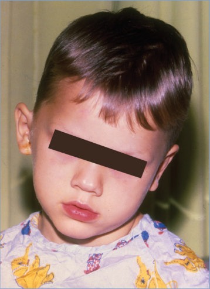

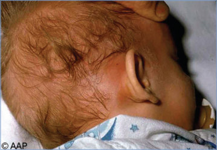

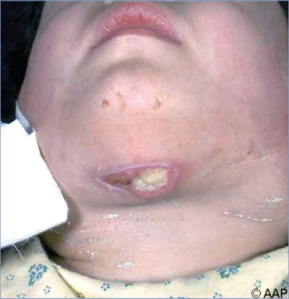

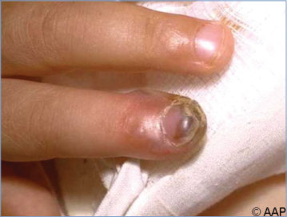

## PDF page 902 | printed page 888

Image 140.7 Segmental (nodular) pneumonia caused by Streptococcus pneumoniae.

Image 140.9 Acute pneumococcal pneumonia of the left upper lobe proven by a positive result from blood culture. This is the same patient as in Image 140.8. Courtesy of Edgar O. Ledbetter, MD, FAAP.

Image 140.8 Acute pneumococcal pneumonia of the left upper lobe proven by a positive result from blood culture. Courtesy of Edgar O. Ledbetter, MD, FAAP.

Image 140.10 Streptococcus pneumoniae pneumonia of the upper lobe of the right lung. The blood culture result was positive, and the infant promptly responded to penicillin therapy.

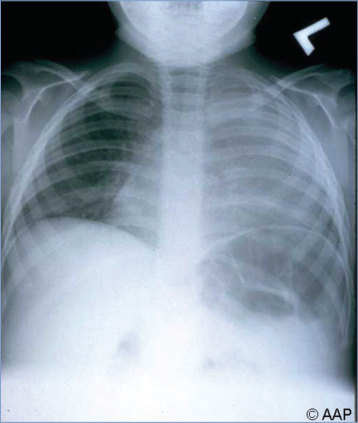

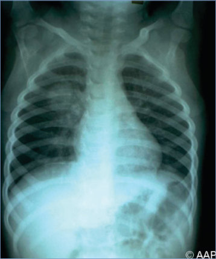

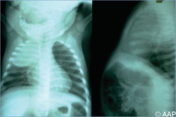

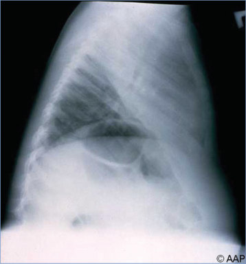

## PDF page 903 | printed page 889

Image 140.11 Pneumococcal pneumonia with pleural effusion on the right. Courtesy of Edgar O. Ledbetter, MD, FAAP.

Image 140.13 Purulent pleural fluid of pneumococcal empyema removed from the patient in Image 140.12. Courtesy of Edgar O. Ledbetter, MD, FAAP.

Image 140.12 Pneumococcal pneumonia with massive effusion pushing the mediastinal structures into the left area of the chest. A delayed clinical response to treatment was not surprising. Courtesy of Edgar O. Ledbetter, MD, FAAP.

Image 140.14 Pneumonia with right subpleural empyema caused by Streptococcus pneumoniae in a child with sickle cell disease.

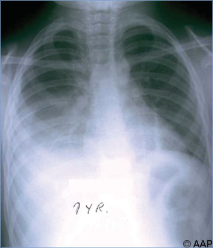

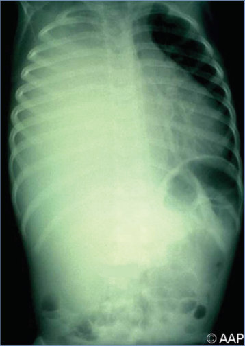

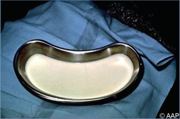

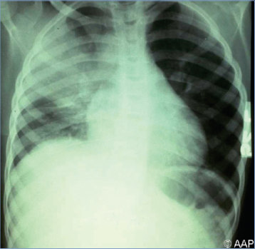

## PDF page 904 | printed page 890

Image 140.15 Pneumonia with subpleural empyema caused by Streptococcus pneumoniae evident on lateral chest radiograph. This is the same patient as in Image 140.14. Note the difference in the level of the right and left hemidiaphragms.

Image 140.17 Pneumonia and purulent pericarditis caused by Streptococcus pneumoniae in a previously healthy infant. Despite clinical improvement with penicillin therapy and repeated needle aspiration of the pericardial space, the infant died of constrictive pericarditis.

Image 140.16 Streptococcus pneumoniae in pleural exudate (Gram stain).

Image 140.18 Pneumonia and pericarditis caused by Streptococcus pneumoniae. Despite pericardial drainage by needle aspiration followed by pericardiostomy drainage, the child died. Surgical drainage is imperative in the management of purulent pericarditis.

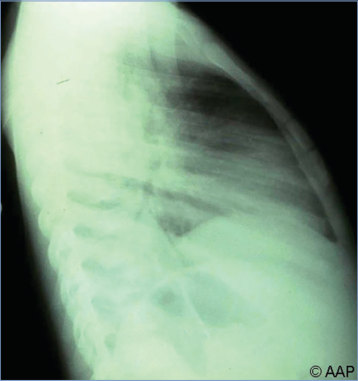

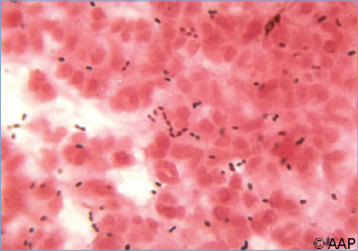

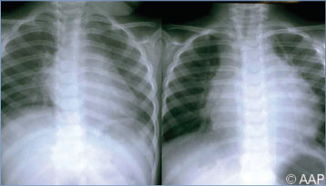

## PDF page 905 | printed page 891

Image 140.19 An axial T1-weighted magnetic resonance image obtained after administration of contrast material shows frontal subdural hygromas (arrows). Also note the enhancing left thalamic infarction secondary to penetrating artery spasm (arrowhead) in a patient with pneumococcal meningitis.

Image 140.21 A ventral view of the brain depicting purulent exudate from fatal Streptococcus pneumoniae meningitis. Courtesy of Centers for Disease Control and Prevention.

Image 140.20 Skull opened at autopsy revealing purulent inflammation of leptomeninges beneath reflected dura in a patient who died of pneumococcal meningitis. Courtesy of Centers for Disease Control and Prevention.

Image 140.22 Streptococcus pneumoniae pneumonia with pneumatocele formation in the left lung. Courtesy of Benjamin Estrada, MD.

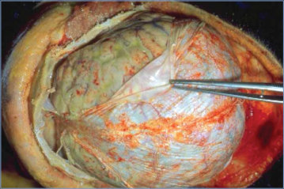

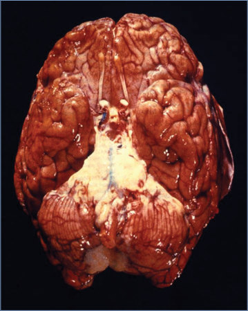

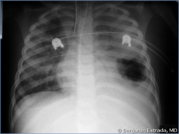

## PDF page 906 | printed page 892

Image 140.23 This is a photo of the brain of a person who died of pneumococcal meningitis. Note the purulence (pus) that covers the brain surface. Courtesy of Centers for Disease Control and Prevention.

Image 140.24 Streptococcus pneumoniae, 24-hour sheep blood agar plate, with a-hemolysis. Courtesy of Robert Jerris, PhD.

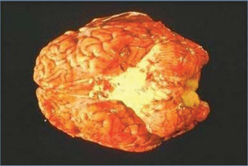

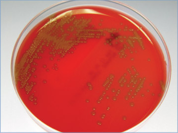
