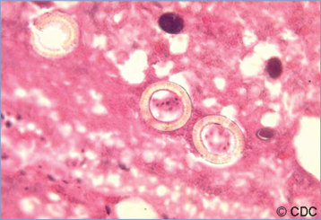
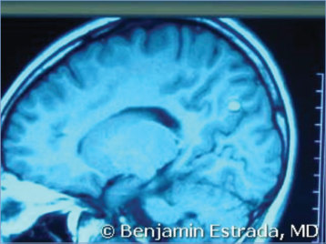
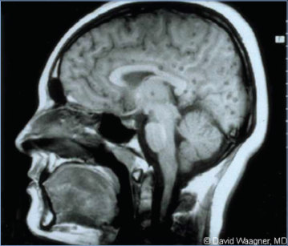
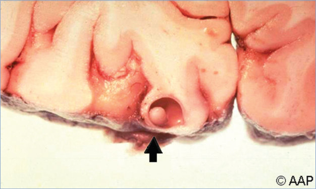
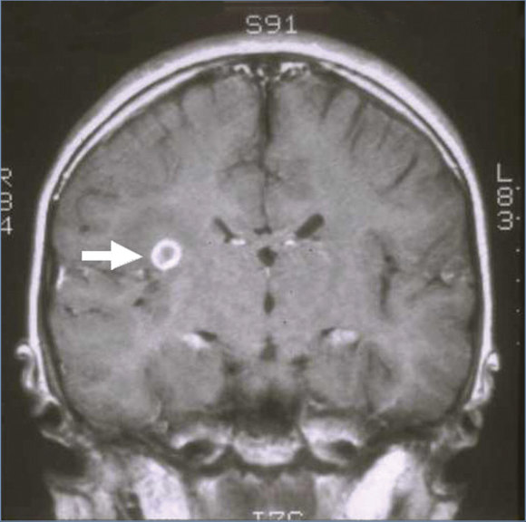
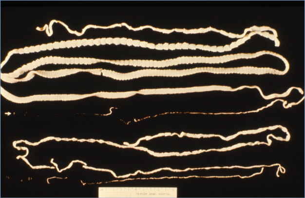
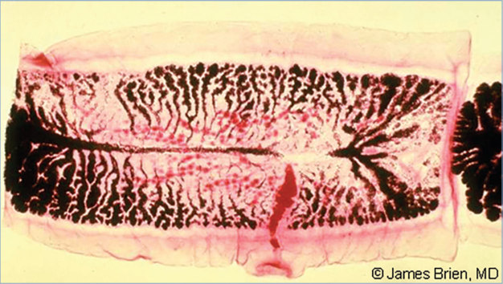
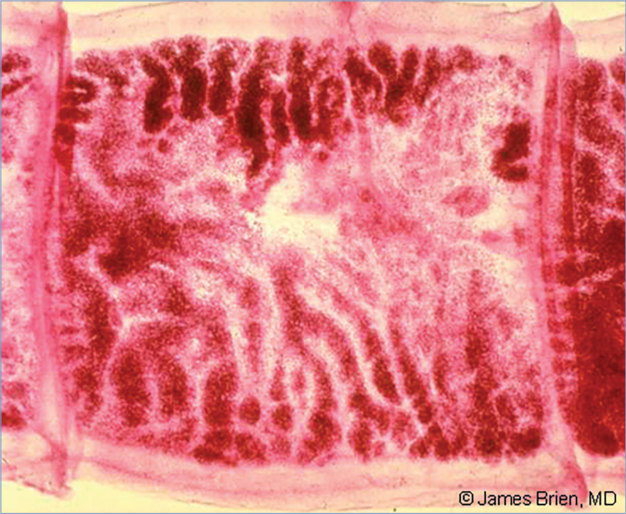

# 143. Tapeworm Diseases (Taeniasis and Cysticercosis)
> Private study reference ([source credits](../../SOURCE_CREDITS.md)). PDF pages 933-940; printed pages 919-926.

## PDF page 933 | printed page 919

(Taeniasis and Cysticercosis)

### CLINICAL MANIFESTATIONS

Taeniasis

Infection with adult tapeworms often is asymptomatic. The most common sign is noting tapeworm segments passing from the anus or in feces. Other mild gastrointestinal tract symptoms, such as nausea or diarrhea, can occur.

Cysticercosis

Cysticercosis, caused by larval pork tapeworm (Taenia solium) infection, can have serious consequences. Manifestations depend on the location and number of pork tapeworm larval cysts (cysticerci) and on the host response. Cysticerci may be found anywhere in the body. The most common and serious clinical manifestations are caused by cysticerci in the central nervous system. Larval cysts of T solium in the brain (neurocysticercosis) can result in seizures, headache, obstructive hydrocephalus, and other neurologic signs and symptoms. Neurocysticercosis is the leading infectious cause of epilepsy in low- and middleincome countries. Most symptoms result from the host reaction to degenerating cysticerci. Cysts in the spinal column can cause gait disturbance, pain, or transverse myelitis. Subcutaneous cysticerci produce palpable nodules, and ocular involvement can cause visual impairment.

### ETIOLOGY

Taeniasis is caused by intestinal infection by the adult tapeworm, Taenia saginata (beef tapeworm) or T solium (pork tapeworm). Taenia asiatica causes taeniasis in Asia. Human cysticercosis is caused only by the larvae of T solium.

### EPIDEMIOLOGY

Tapeworm diseases have worldwide distribution. Prevalence is high in areas with poor sanitation and human fecal contamination in areas where cattle graze or swine are fed. Most cases of T solium infection in the United States are imported from Latin America, although the disease is prevalent in parts of Asia and sub-Saharan Africa as well. T saginata infection occurs at high rates in East Africa and the Middle East and also is

prevalent in Latin America, much of Asia, and Eastern Europe. T asiatica is common in China, Taiwan, and Southeast Asia. Taeniasis is acquired by eating undercooked beef (T saginata), pork (T solium), or pig viscera (T asiatica) that contain encysted larvae.

Cysticercosis in humans is acquired by ingesting eggs of the pork tapeworm (T solium). Transmission is fecal-oral from a person harboring the adult tapeworm—for example, eating food or drinking water contaminated with pork tapeworm eggs from an infected person. Studies in endemic areas show household clustering, suggesting increased risk of exposure for those residing with or near tapeworm carriers. Autoinfection, in which tapeworm carriers infect themselves, also occurs. Humans are the obligate definitive host and the only host to shed eggs. Pigs act as an intermediate host, developing cysts upon acquisition of eggs from human stool contaminating their feeding, and developing cysts in their muscles. Humans who eat undercooked pork swallow cysts in the meat, and larvae come out of these cysts to complete the infection cycle. Eating of undercooked infected pork does not directly cause cysticercosis, but can spread cysticercosis through release of eggs from an infected person and can lead to cysticercosis in the person who eats the undercooked pork through autoinfection. Eggs liberate oncospheres in the intestine that migrate through the blood and lymphatics to tissues throughout the body, including the central nervous system, where the oncospheres develop into cysticerci. Although nearly all cases of cysticercosis in the United States are imported, cysticercosis can be acquired in the United States from tapeworm carriers who emigrated from an area with endemic infection and still have T solium intestinalstage infection. T saginata and T asiatica do not cause cysticercosis.

The incubation period for taeniasis (the time from ingestion of the larvae until segments are passed in the feces) is 2 to 3 months. For cysticercosis, the incubation period between infection and onset of symptoms is typically several years.

### DIAGNOSIS1

Diagnosis of taeniasis (adult tapeworm infection) is based on demonstration of the proglottids or ova in feces or the perianal region, although these techniques are not sensitive, so 3 tests on different days

## PDF page 934 | printed page 920

are recommended for evaluation. Antigen detection, nucleic acid tests, and immunoblot assays for tapeworm stage-specific antibody are more sensitive but are not commercially available. Species identification of the parasite is based on the different structures of gravid proglottids and scolices or on a nucleic acid amplification test (NAAT).

Diagnosis of neurocysticercosis typically depends on clinical presentation and imaging of the central nervous system. Serologic testing also can be helpful in certain cases. Computed tomography (CT) scanning or magnetic resonance imaging (MRI) of the brain or spinal cord are used to demonstrate lesions compatible with cysticerci. CT scans are helpful in identifying calcifications. MRI is better at identifying extraparenchymal cysts (eg, in ventricles or the subarachnoid space) and the invaginated scolex within the parasite cysticercus. Antibody assays that detect specific antibodies to larval T solium in serum can be useful to confirm the diagnosis. Commercially available antibody tests that use crude antigen in an enzyme-linked immunosorbent assay format lack adequate sensitivity and specificity and are not reliable diagnostic techniques. In the United States, immunoblot assays (including the Enzyme-linked ImmunoTransfer Blot) are available through the Centers for Disease Control and Prevention and a few commercial laboratories and are the antibody tests of choice. In general, immunoblot assays are more sensitive with serum specimens than with cerebrospinal fluid specimens. Even immunoblot tests can have limited sensitivity if only 1 cysticercus or only calcified cysticerci are present. Thus, results often are negative in children with solitary parenchymal lesions. A negative serologic test result does not exclude the diagnosis of neurocysticercosis when clinical suspicion is high. A serologic test result could be positive in patients who have T solium cysticerci in parts of the body other than the central nervous system. Antigen-detection assays are available commercially in Europe. NAATs have been used in diagnosis and follow-up of selected cases. Antigen detection and NAATs are available from the National Institutes of Health for selected cases.

### TREATMENT2

Taeniasis

Praziquantel is highly effective for eradicating infection with the adult tapeworm. Praziquantel is

not approved for this indication, but dosing recommendations are available for children 4 years and older. Safety is not established in children younger than 4 years, but this drug has been used successfully to treat cases of Dipylidium caninum infection in children as young as 6 months. Praziquantel is detected in the milk of lactating people, and people should not breastfeed on the day of treatment or during the subsequent 72 hours. Niclosamide is an alternative agent for treatment of taeniasis but is not available commercially in the United States. Albendazole has been used successfully for taeniasis in a small number of individuals and is an alternative treatment if praziquantel and niclosamide are not available.

Cysticercosis

Neurocysticercosis treatment should be individualized based on the number, location, and viability of cysticerci as assessed by neuroimaging studies (MRI and CT scanning) and clinical manifestations. Symptomatic therapy is critical and should include antiseizure medications for patients with seizures and surgery for patients with hydrocephalus. Two antiparasitic drugs— albendazole and praziquantel—are available. Praziquantel is not approved by the U.S. Food and Drug Administration for this indication. Both drugs are cysticercidal and hasten radiologic resolution of cysts, but symptoms resulting from host inflammatory response may be exacerbated by treatment. In symptomatic patients with a single cyst within brain parenchyma, controlled studies demonstrate that clinical resolution and seizure recurrence rates are improved slightly when children are treated with albendazole along with corticosteroids. Two studies have demonstrated that in individuals with more than 2 lesions, the response rate was better when albendazole was coadministered with praziquantel and corticosteroids. When a single agent is used, albendazole is preferred over praziquantel, because it has fewer drugdrug interactions with anticonvulsants and steroids. Patients with calcified cysts do not benefit from antiparasitic treatment. An ophthalmic examination should be performed before antiparasitic treatment to rule out intraocular cysticerci (see below). Coadministration of corticosteroids during antiparasitic therapy decreases adverse effects during treatment and

## PDF page 935 | printed page 921

is recommended for all patients with viable intraparenchymal neurocysticercosis who are treated with antiparasitic drugs, starting before antiparasitic therapy is initiated. Duration of corticosteroid therapy is longer in patients with subarachnoid disease, vasculitis, or encephalitis. Arachnoiditis, vasculitis, or diffuse cerebral edema (cysticercal encephalitis) are treated with corticosteroid therapy until cerebral edema is controlled. Corticosteroids can affect tissue concentrations of albendazole. Patients requiring steroids may need screening for strongyloidiasis, latent tuberculosis, and vitamin D deficiency.

Medical and surgical management of cysticercosis can be highly complex and often needs to be conducted in consultation with a neurologist or neurosurgeon and an infectious disease or other specialist with experience treating neurocysticercosis. Seizures may recur for months or years. Anticonvulsant therapy is recommended until there is neuroradiologic evidence of resolution and seizures have not occurred for 6 months (for a single lesion) or 2 years (for multiple lesions). Calcification of cysts may require prolonged or indefinite use of anticonvulsants. Subarachnoid cysticercosis does not respond well to the regimens used for parenchymal disease and generally should be treated with prolonged courses of antiparasitic and anti-inflammatory medications, monitoring radiologic resolution and NAAT or antigen assay results. Methotrexate and/or tumor necrosis factor inhibitors have been used as steroid-sparing agents. Intraventricular cysticerci and hydrocephalus usually should be treated surgically. Surgical removal of intraventricular cysticerci is the treatment of choice when possible and often can be accomplished by endoscopic surgery (lateral, third, and sometimes fourth ventricles) or open surgery (fourth ventricle). If cysticerci cannot be removed, hydrocephalus should be corrected with placement of intraventricular shunts. Adjunctive chemotherapy with antiparasitic agents and corticosteroids may decrease the

rate of subsequent shunt failure. Ocular cysticercosis is treated by surgical excision of the cysticerci. Ocular cysticercosis generally is not treated with anthelmintic drugs, which can exacerbate inflammation. Spinal cysticercosis may be treated with medical and/or surgical therapy as there is not adequate evidence to guide the choice of therapy.

### INFECTION PREVENTION AND CONTROL MEASURES IN HEALTH CARE SETTINGS

Standard precautions are recommended.

### CONTROL MEASURES

Eating raw or undercooked beef or pork should be avoided. Whole cuts of meat should be cooked to at least 145°F (63°C) and then allowed to rest for 3 minutes before consuming, and ground meat and wild game meat should be cooked to at least 160°F (71°C). Freezing pork or beef below –5°C (23°F) for more than 4 days kills cysticerci. People known to harbor the adult tapeworm of T solium should be treated immediately. Careful attention to hand hygiene and appropriate disposal of fecal material are important preventive measures. People traveling to resource-limited countries with high endemic rates of cysticercosis should avoid eating uncooked vegetables and fruits that cannot be peeled. If someone in a household is found to have cysticercosis, household members should be screened for taeniasis (see Diagnosis), and people with compatible neurologic signs and symptoms should be evaluated for cysticercosis.

1 White AC Jr, Coyle CM, Rajshekhar V, et al. Diagnosis and treatment of neurocysticercosis: 2017 clinical practice guidelines by the Infectious Diseases Society of America (IDSA) and the American Society of Tropical Medicine and Hygiene (ASTMH). Clin Infect Dis. 2018;66(8):1159–1163 2 White AC Jr, Coyle CM, Rajshekhar V, et al. Diagnosis and treatment of neurocysticercosis: 2017 clinical practice guidelines by the Infectious Diseases Society of America (IDSA) and the American Society of Tropical Medicine and Hygiene (ASTMH). Clin Infect Dis. 2018;66(8):1159–1163

## PDF page 936 | printed page 922

Image 143.1 Histopathologic features of Taenia saginata in the appendix.

Image 143.3 Neurocysticercosis in an 11-year-old girl apparent on a computed tomographic scan. Courtesy of Benjamin Estrada, MD.

Image 143.2 Gross pathological features of the membrane and hydatid daughter cysts excised from a human lung. Hydatid disease is a parasitic infestation caused by a tapeworm of the genus Echinococcus. Endemic areas usually involve low-income countries. The liver is the organ most commonly involved, followed by the lungs. Courtesy of Centers for Disease Control and Prevention.

Image 143.4 Cerebral neurocysticercosis with diffuse, scattered, ringenhancing lesions throughout the brain parenchyma with focal edema evident on a computed tomographic scan. Copyright David Waagner, MD.

## PDF page 937 | printed page 923

Image 143.5 Cross section showing cysticercosis (arrow) of the brain at autopsy.

Image 143.6 A young boy with a seizure. Magnetic resonance imaging of the brain revealed a ringlike lesion (arrow) characteristic of neurocysticercosis. Copyright Barbara Ann Jantausch, MD, FAAP.

## PDF page 938 | printed page 924

A B

Image 143.7 A and B, The eggs of Taenia solium and Taenia saginata are indistinguishable from each other, as well as from other members of the Taeniidae family. The eggs are 30 to 35 μm in diameter and are radially striated. The internal oncosphere contains 6 refractile hooks. Taenia species eggs in unstained wet mounts. Courtesy of Centers for Disease Control and Prevention.

Image 143.8 Taenia saginata adult tapeworm. Copyright James Brien, MD.

## PDF page 939 | printed page 925

Image 143.9 Taenia saginata gravid proglottid. Courtesy of James Brien, MD.

Image 143.10 Taenia solium gravid proglottid. Courtesy of James Brien, MD.

## PDF page 940 | printed page 926

Image 143.11 Cysticercosis is an infection of humans and pigs with the larval stages of the parasitic cestode, Taenia solium. This infection is caused by ingestion of eggs shed in the feces of a human tapeworm carrier (1). Pigs and humans become infected by ingesting eggs or gravid proglottids (2). Humans are infected by ingestion of food contaminated with feces or by autoinfection. In the latter case, a human infected with adult T solium can ingest eggs produced by that tapeworm through fecal contamination or, possibly, from proglottids carried into the stomach by reverse peristalsis. Once eggs are ingested, oncospheres hatch in the intestine (3), invade the intestinal wall, and migrate to striated muscles, as well as the brain, liver, and other tissues, where they develop into cysticerci. In humans, cysts can cause serious sequelae if they localize in the brain, resulting in neurocysticercosis. The parasite life cycle is completed, resulting in human tapeworm infection when humans ingest undercooked pork containing cysticerci (4). Cysts evaginate and attach to the small intestine by their scolex (5). Adult tapeworms develop (up to 2–7 m in length and produce <1,000 proglottids, each with approximately 50,000 eggs) and reside in the small intestine for years (6). Courtesy of Centers for Disease Control and Prevention/Alexander J. da Silva, PhD/Melanie Moser.

![Image 143.11 Cysticercosis is an infection of humans and pigs with the larval stages of the parasitic cestode, Taenia solium. This infection is caused by ingestion of eggs shed in the feces of a human tapeworm carrier (1). Pigs and humans become infected by ingesting eggs or gravid proglottids (2). Humans are infected by ingestion of food contaminated with feces or by autoinfection. In the latter case, a human infected with adult T solium can ingest eggs produced by that tapeworm through fecal contamination or, possibly, from proglottids carried into the stomach by reverse peristalsis. Once eggs are ingested, oncospheres hatch in the intestine (3), invade the intestinal wall, and migrate to striated muscles, as well as the brain, liver, and other tissues, where they develop into cysticerci. In humans, cysts can cause serious sequelae if they localize in the brain, resulting in neurocysticercosis. The parasite life cycle is completed, resulting in human tapeworm infection when humans ingest undercooked pork containing cysticerci (4). Cysts evaginate and attach to the small intestine by their scolex (5). Adult tapeworms develop (up to 2–7 m in length and produce ,1,000 proglottids, each with approximately 50,000 eggs) and reside in the small intestine for years (6). Courtesy of Centers for Disease Control and Prevention/Alexander J. da Silva, PhD/Melanie Moser.](../../figures/ch143_p0940_01.jpg)
