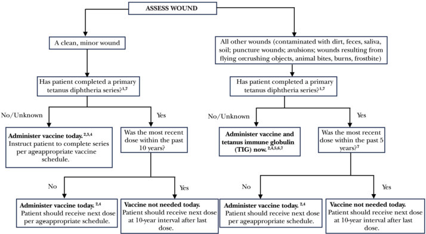
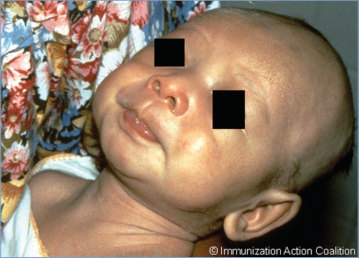
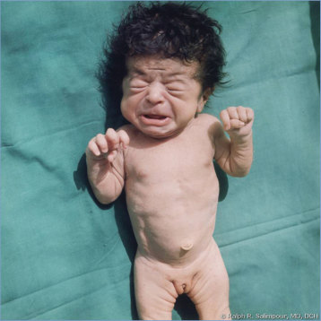
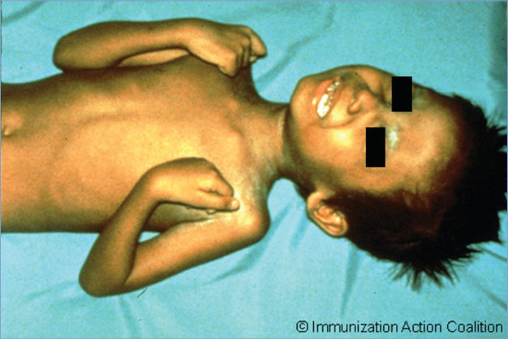
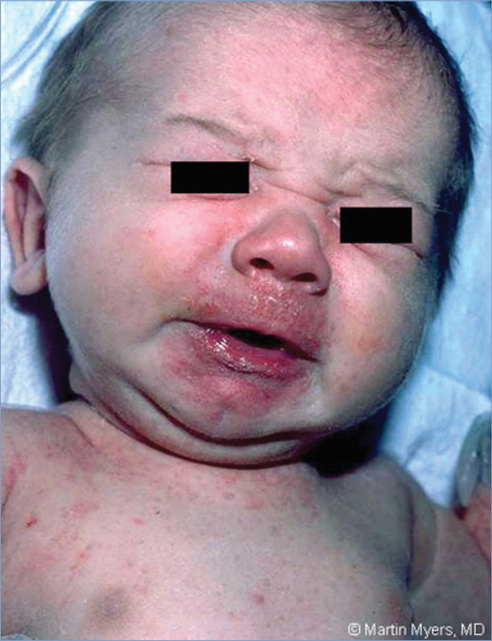

# 145. Tetanus (Lockjaw)
> Private study reference ([source credits](../../SOURCE_CREDITS.md)). PDF pages 948-956; printed pages 934-942.

## PDF page 948 | printed page 934

(Lockjaw)

### CLINICAL MANIFESTATIONS

Tetanus is caused by neurotoxin produced by the anaerobic bacterium Clostridium tetani in a contaminated wound and can manifest in 3 overlapping clinical forms: generalized, local, and cephalic.

Generalized tetanus (lockjaw) is a neurologic disease manifesting as trismus and severe muscular spasms, including risus sardonicus, which is a facial expression characterized by raised eyebrows and grinning distortion of the face resulting from spasm of facial muscles. Onset is gradual, occurring over 1 to 7 days, and symptoms progress to severe painful generalized muscle spasms, which often are aggravated by any external stimulus. Autonomic dysfunction, manifesting as diaphoresis, tachycardia, labile blood pressure, and arrhythmias, often is present. Other potential complications include fractures associated with muscle spasms, laryngospasm, pulmonary embolism, and aspiration pneumonia. Severe spasms persist for 1 week or more and subside over several weeks in people who recover. Neonatal tetanus is a form of generalized tetanus occurring in newborn infants lacking protective passive immunity because their birthing parent was not immune. Early symptoms include inability to suck or breastfeed and excessive crying that then progress to findings typical of generalized tetanus.

Local tetanus manifests as local muscle spasms in areas contiguous to a wound. Cephalic tetanus is the rarest form of tetanus and usually causes flaccid cranial nerve palsies, although trismus can occur. It is associated with infected wounds on the head and neck including, rarely, suppurative otitis media. Local and cephalic tetanus can precede generalized tetanus.

### ETIOLOGY

C tetani is a spore-forming, obligate anaerobic, gram-positive bacillus. This organism is a wound contaminant that causes neither tissue destruction nor an inflammatory response. The vegetative form of C tetani produces a potent plasmidencoded exotoxin (tetanospasmin). The heavy

chain of tetanospasmin binds to the presynaptic motor neuron and facilitates entry of the light chain, a zinc-dependent protease, into the cytosol. As a result, g-aminobutyric acid- and glycinecontaining vesicles are not released, and inhibitory action on motor and autonomic neurons is lost.

### EPIDEMIOLOGY

Tetanus occurs worldwide and is more common in warmer climates and during warmer months, in part because of higher frequency of contaminated wounds associated with those locations and seasons. The organism, a normal inhabitant of soil and animal and human intestines, is ubiquitous in the environment, especially where contamination by excreta is common. Organisms multiply in wounds, recognized or unrecognized, and elaborate toxins in the presence of anaerobic conditions. Contaminated wounds, especially wounds with devitalized tissue and deep-puncture trauma, are at greatest risk. Neonatal tetanus is common in many resource-limited countries where pregnant people are not immunized appropriately against tetanus and nonsterile practices for umbilical cord care are followed. Globally, activities are ongoing to eliminate tetanus in pregnant people and neonates by improving vaccination coverage among pregnant people and promoting safe delivery practices. In December 2020, only 12 countries had not yet achieved tetanus elimination in pregnant people and neonates; globally, the estimated burden of neonatal tetanus has declined by more than 90% since the 1980s.1

Widespread active immunization against tetanus has modified the epidemiology of disease in the United States, where it is now rare. Tetanus is not transmissible from person to person.

In the United States, nearly all cases of tetanus occur in individuals who have never received a tetanus vaccine or who have not received their 10-year booster vaccine. At particular risk are people with immunocompromising conditions, people with diabetes mellitus, or people who use intravenous drugs.

The incubation period ranges from 3 to 21 days, with most cases occurring within 8 days. In general, the farther the injury site from the central nervous system, the longer the incubation period. Shorter incubation periods have been associated

## PDF page 949 | printed page 935

with more heavily contaminated wounds, more severe disease, and a worse prognosis. In neonatal tetanus, the incubation period from birth to onset of symptoms is usually 4 to 14 days, averaging 7 days. Cephalic tetanus may have an incubation period as short as 1 to 2 days.

### DIAGNOSTIC TESTS

The diagnosis of tetanus is made clinically by excluding other causes of tetanic spasms, such as hypocalcemic tetany, phenothiazine reaction, strychnine poisoning, and conversion disorder. Attempts to culture C tetani are associated with poor yield, and a negative culture does not rule out disease. A protective serum antitoxin concentration should not be used to exclude the diagnosis of tetanus, because tetanus disease has been known to occur rarely despite adequate antibody concentrations.

### TREATMENT

Human tetanus immunoglobulin (TIG) binds circulating unbound toxin and prevents further progression of disease, but it does not reverse the effects of already bound toxin. A single dose of human TIG is recommended for treatment. However, the optimal therapeutic dose has not been established. Most experts recommend 500 IU, which appears to be as effective as higher doses ranging from 3,000 to 6,000 IU and causes less discomfort. Available preparations must be administered intramuscularly. Infiltration of part of the dose locally around the wound is recommended, although the effectiveness of this approach has not been proven. Results of studies on the benefit from intrathecal administration of TIG are conflicting. The TIG preparation in use in the United States is not licensed or formulated for intrathecal or intravenous use. If TIG is not available (as is the case in some countries), immunoglobulin intravenous (IGIV) can be used at a dose of 200 to 400 mg/kg. IGIV is not approved by the U.S. Food and Drug Administration (FDA) for this use, and antitetanus antibody concentrations can vary from lot to lot. In some countries, equine tetanus antitoxin may be considered if TIG is not available and the patient is tested for sensitivity and desensitized as necessary. Additional management is as follows:

• All wounds should be cleaned and débrided properly, especially if extensive necrosis is

present. In neonatal tetanus, wide excision of the umbilical stump is not indicated.

• Supportive care and pharmacotherapy to control tetanic spasms and autonomic instability are of major importance.

• Oral (or intravenous) metronidazole is effective in decreasing the number of vegetative forms of C tetani and is the antimicrobial agent of choice. Parenteral penicillin G is an alternative treatment. Therapy for 7 to 10 days is recommended.

• Active immunization against tetanus always should be undertaken during convalescence from tetanus. Because of the extreme potency of tiny amounts of toxin, tetanus disease may not result in immunity.

### INFECTION PREVENTION AND CONTROL MEASURES IN HEALTH CARE SETTINGS

Standard precautions are recommended.

### CONTROL MEASURES

Care of Exposed People (see Fig 145.1)

Risk of tetanus disease depends on the type of wound and immune status of the patient. Depending on the clinical scenario, there are 3 potential interventions to prevent tetanus: wound care, active immunization, and passive immunization. Antimicrobial prophylaxis has not been shown to prevent tetanus and is not recommended.

• Wound care: Although any open wound is a potential source of tetanus, wounds contaminated with dirt, feces, soil, or saliva (eg, animal bites) are at increased risk. Punctures and wounds containing devitalized tissue, including necrotic or gangrenous wounds, frostbite, crush and avulsion injuries, and burns, are particularly conducive to C tetani infection. Wounds with devitalized tissue should be débrided and have dirt removed. It is not necessary or appropriate to débride puncture wounds extensively.

• Active immunization: Immunization status should be assessed for all wounds, and ageappropriate vaccine should be administered (see Immunization) if not contraindicated on the basis of clinical scenario (Fig 145.1). For infants

## PDF page 950 | printed page 936

Figure 145.1 Summary guide to tetanus prophylaxis in routine wound management

1 A primary series consists of a minimum of 3 doses of tetanus- and diphtheria-containing vaccine (DTaP/DTP/Tdap/DT/Td). 2 Age-appropriate vaccine: • DTaP for infants and children 6 weeks up to 7 years of age. • Tetanus-diphtheria (Td) toxoid for persons 7 through 9 years of age and 65 years of age and older. • Tdap for persons 11 through 64 years of age if using Adacel* or 10 years of age and older if using Boostrix*, unless the person has received a prior dose of Tdap.* 3 No vaccine or TIG is recommended for infants younger than 6 weeks of age with clean, minor wounds. (And no vaccine is licensed for infants younger than 6 weeks of age.) 4 Tdap* is preferred for persons 11 through 64 years of age if using Adacel* or 10 years of age and older if using Boostrix* who have never received Tdap. Td is preferred to tetanus toxoid (TT) for persons 7 through 9 years, 65 years and older, or who have received a Tdap previously. If TT is administered, an adsorbed TT product is preferred to fluid TT. (All DTaP/DTP/Tdap/Td products contain adsorbed tetanus toxoid.) 5 Give TIG 250 U IM for all ages. It can and should be given simultaneously with the tetanus-containing vaccine. 6 For infants younger than 6 weeks of age, TIG (without vaccine) is recommended for “dirty” wounds (wounds other than clean, minor). 7 Persons who are HIV positive should receive TIG regardless of tetanus immunization history. * Brand names are used for the purpose of clarifying product characteristics and are not an endorsement of either product. Tdap vaccines: Boostrix (GSK) is licensed for persons 10 years of age and older. Adacel (sanofi) is licensed for persons 11 through 64 years of age. Courtesy of the Minnesota Department of Health (www.health.state.mn.us/diseases/tetanus/hcp/tetwdmgmt.html), with modifications.

younger than 6 months, prior infant doses and maternal tetanus toxoid immunization history at time of delivery should be considered in determining need for infant immunization (and need for TIG, if clinically indicated).

• Passive immunization: Patients with tetanusprone wounds who have not completed a primary series of tetanus vaccine should be considered nonimmune and should receive passive immunization with TIG (in addition to

active immunization with tetanus toxoid vaccine, as clinically appropriate). In patients with HIV or other severe immunodeficiency, TIG should be administered for tetanus-prone wounds regardless of the history of tetanus toxoid immunization. When TIG is required for wound prophylaxis, it is administered intramuscularly in a dose of 250 U (regardless of age or weight). If tetanus toxoid vaccine and TIG are administered concurrently, separate syringes

## PDF page 951 | printed page 937

and sites should be used. Administration of tetanus toxoid vaccine simultaneously with or at an interval after receipt of TIG does not impair development of protective antibody substantially. Efforts should be made to initiate active immunization and arrange for its completion.

Immunization

Antibody to tetanus toxoid is detectable 4 to 7 days after a dose of tetanus vaccine, and its concentration peaks at 2 to 4 weeks. Protective antibody is not reliably achieved following a first dose of vaccine to prevent tetanus disease. After completing a vaccination series, circulating antitoxin usually lasts at least 10 years and for a longer time after a booster dose.

Active immunization against tetanus always should be undertaken during convalescence from tetanus, because this exotoxin-mediated disease usually does not confer immunity.

Active immunization with tetanus toxoid vaccine is recommended for all people. For all appropriate indications, tetanus immunization is administered with diphtheria toxoid-containing vaccines or with diphtheria toxoid- and acellular pertussis-containing vaccines. Vaccine is administered intramuscularly and may be administered concurrently with other vaccines. Conjugate vaccines containing tetanus toxoid (eg, Haemophilus influenzae type b) are not substitutes for tetanus toxoid immunization. Recommendations for use of tetanus toxoidcontaining vaccines (https://publications. aap.org/redbook/pages/Immunization- Schedules) are as follows:

• Immunization for children from 6 weeks through 6 years (up to the seventh birthday) of age:

8 Recommended schedule: should consist of 5 doses of tetanus- and diphtheria toxoidcontaining vaccine. All doses are administered as DTaP (or DTaP-containing vaccines) at 2, 4, and 6 months of age, then a dose at 15 through 18 months of age, and another dose at 4 through 6 years of age (recommended before kindergarten or elementary school entry). DTaP can be administered concurrently with other vaccines. If a dose of Tdap is administered inadvertently instead of DTaP as any one of the primary 3 dose

series, then it should not be counted as valid. DTaP can be administered at any interval after the Tdap dose, and remaining DTaP doses can be administered as per the recommended schedule. If Tdap is inadvertently administered as the 4th or 5th dose in the series, the Tdap dose is counted as valid toward the 5-dose DTaP series.

8 Catch-up vaccination: the 5-dose DTaP series can be administered with a minimum of 4 weeks between each of the first 3 doses and 6 months between doses 3 and 4 as well as doses 4 and 5. If the fourth dose is administered at 4 years or older, the fifth dose is not needed.

8 Pertussis vaccination contraindicated: Contraindications to DTaP and Tdap occur only very rarely, and in questioning about them providers should probe whether a true contraindication actually exists. DTaP and Tdap contraindications are limited to severe allergic reactions (eg, anaphylaxis) and encephalopathy (eg, coma, decreased level of consciousness, or prolonged seizures) not attributable to another identifiable cause within 7 days after administration of a previous dose of diphtheria and tetanus toxoids and pertussis vaccine. Note that as of 2023, DT is no longer available in the United States (www.cdc.gov/vaccines/vpd/dtaptdap-td/hcp/recommendations.html and www.cdc.gov/vaccines/vpd/dtaptdap-td/hcp/td-offlabel.html). For young children with a contraindication to pertussiscontaining vaccines, vaccine providers may administer Td for all recommended remaining doses in place of DTaP. Td contains a lower dose (approximately 1/12th the amount) of diphtheria toxoid compared with DT. The impact of this lower dose on the protection provided against diphtheria in young children is uncertain. Available evidence suggests young children who receive Td in place of DTaP may have suboptimal protection against diphtheria.

8 Series was started with DT, but pertussis vaccination is desired and is not contraindicated: doses of DTaP should be administered to complete the recommended pertussis immunization schedule; however, the total

## PDF page 952 | printed page 938

number of doses of diphtheria and tetanus toxoid vaccines (as DT, DTaP, or DTwP) should not exceed 6 before the seventh birthday.

• Immunization for children ≥7 years (see https://publications.aap.org/redbook/ pages/Immunization-Schedules)2:

8 Adolescents 11 years and older should receive a single dose of Tdap instead of Td for booster immunization against tetanus, diphtheria, and pertussis. The preferred age for Tdap immunizations is 11 through 12 years of age.

8 Adolescents who received Td but not Tdap should receive a single dose of Tdap to provide protection against pertussis regardless of time since receipt of Td.

8 Simultaneous administration of Tdap and all other recommended vaccines is recommended when feasible.

8 Inadvertent administration of DTaP instead of Tdap in people 7 years and older is counted as a valid dose of Tdap.

8 Children 7 through 10 years of age who have not completed their immunization schedule with DTaP before 7 years of age or who have an unknown vaccine history should receive at least 1 dose of Tdap. If further dose(s) of tetanus and diphtheria toxoids are needed in a catch-up schedule, either Td or Tdap can be used. The preferred schedule is Tdap followed by Td or Tdap at 2 months and 6 to 12 months (if needed).

8 Children 7 through 9 years of age who receive Tdap or DTaP for any reason should receive the adolescent Tdap booster at 11 through 12 years of age.

8 A Tdap or DTaP dose received by a 10 yearold for any reason can count as the adolescent Tdap booster dose.

• If more than 5 years have elapsed since the last dose, a booster dose of a tetanus-containing vaccine should be considered for people at risk of occupational exposure in locations where tetanus boosters may not be available readily. Tdap is preferred over Td if the person has not received Tdap previously.

• Tdap is approved by the FDA for use in the third trimester of pregnancy to prevent pertussis in infants younger than 2 months of age. Pregnant people should receive Tdap during each pregnancy, preferably between 27 and 36 weeks’ gestation, but the vaccine may be administered at any time during the pregnancy. Pregnant people who have not completed their primary tetanus series should receive 3 vaccinations containing tetanus and reduced diphtheria toxoids, if time permits. The recommended schedule is 0, 4 weeks, and 6 months or later. The risk of neonatal tetanus is minimal if a previously unimmunized person receives at least 2 properly spaced doses of tetanus toxoidcontaining vaccines. If there is insufficient time, 2 doses of Td or Tdap should be administered at least 4 weeks apart, and the second dose should be administered at least 2 weeks before delivery. Tdap should be used for at least one of the tetanus-containing doses, preferably early in the interval between 27 and 36 weeks’ gestation.

Adverse Events, Precautions, and Contraindications

Severe anaphylactic reactions, Guillain-Barré syndrome (GBS), and brachial neuritis attributable to tetanus toxoid have been reported but are rare. No increased risk of GBS has been observed with use of DTaP in children. For a child with a history of GBS, the decision to administer additional doses of DTaP should be made on the basis of consideration of the benefit of further immunization versus the risk of recurrence of GBS.

An immediate anaphylactic reaction to tetanusand diphtheria toxoid-containing vaccines (ie, DTaP, Tdap, DT, Td, or conjugate vaccine containing diphtheria or tetanus toxoid) is a contraindication to further doses unless the component responsible is determined and the patient can be desensitized to that component. Because of the importance of tetanus vaccination, people who experience anaphylactic reactions should be referred to an allergist to determine whether they have a specific allergy to tetanus toxoid and can be desensitized to tetanus toxoid.

Injection site pain and erythema are common. Fever may occur, and rarely, whole limb swelling occurs (with or without pain and erythema).

## PDF page 953 | printed page 939

Repeat vaccination, as age appropriate, appears to be safe in children who had whole limb swelling.

Arthus-type hypersensitivity reaction has been reported in adults who received excessive doses of Td over a short period and usually is associated with high concentrations of tetanus antitoxin. Arthus reactions are rare in children and did not occur in clinical trials of Tdap vaccines. People who experienced an Arthus-type hypersensitivity reaction after a previous dose of a tetanus toxoidcontaining preparation should not receive dose(s) of tetanus toxoid-containing preparation more frequently than every 10 years, even if they have a wound that is neither clean nor minor.

Other Control Measures

Sterilization of hospital supplies will prevent the rare instances of tetanus that may occur in a

Image 145.1 This infant with tetanus has spasm of the facial muscles with trismus. Copyright Immunization Action Coalition.

hospital from contaminated sutures, instruments, or plaster casts.

For prevention of neonatal tetanus, preventive measures (in addition to immunization of pregnant people) include community immunization programs for people capable of becoming pregnant and appropriate training of obstetric providers (including midwives) in recommendations for immunization and sterile technique.

1 GBD 2019 Diseases and Injuries Collaborators. Global burden of 369 diseases and injuries in 204 countries and territories, 1990-2019: a systematic analysis for the Global Burden of Disease Study 2019. Lancet. 2020;396(10258):1204–1222 2 Havers FP, Moro PL, Hunter P, Hariri S, Berstein H. Use of tetanus toxoid, reduced diphtheria toxoid, and acellular pertussis vaccines: updated recommendations of the Advisory Committee on Immunization Practices-United States, 2019. MMWR Morb Mortal Wkly Rep. 2020;69(3):77–83

Image 145.2 Severe muscular spasms with trismus in a newborn who acquired neonatal tetanus from contamination of the umbilical stump. Courtesy of Ralph R. Salimpour, MD, DCH, FAAP.

## PDF page 954 | printed page 940

Image 145.3 This neonate is displaying a body rigidity produced by Clostridium tetani exotoxin. Neonatal tetanus may occur in neonates born without protective passive immunity, when the mother is not immune. It usually occurs through infection of the unhealed umbilical stump, particularly when the stump is cut with an unsterile instrument. Courtesy of Centers for Disease Control and Prevention.

Image 145.4 A preschool-aged boy with tetanus with severe muscle contractions, generalized, caused by tetanospasmin action in the central nervous system. Courtesy of Immunization Action Coalition.

## PDF page 955 | printed page 941

Image 145.5 This patient is displaying a bodily posture, known as opisthotonos, caused by Clostridium tetani exotoxin. Generalized tetanus, the most common type (about 80%), usually manifests with a descending pattern, starting with trismus or lockjaw, followed by stiffness of the neck, difficulty in swallowing, and rigidity of abdominal muscles. Courtesy of Centers for Disease Control and Prevention.

## PDF page 956 | printed page 942

Image 145.6 The face of an infant with neonatal tetanus with risus sardonicus. Copyright Martin G. Myers, MD.

