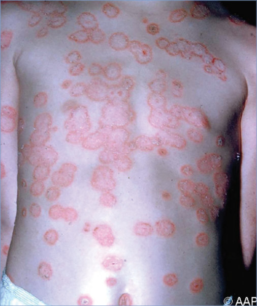
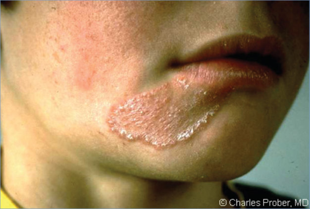
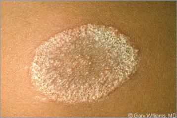
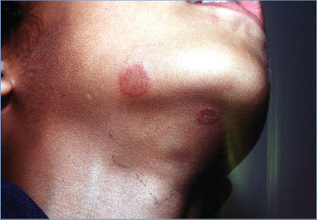
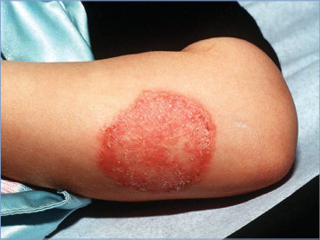
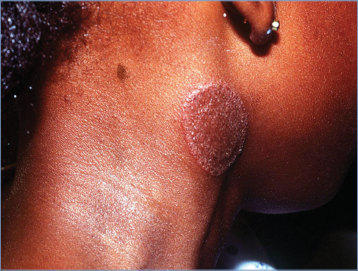

# 147. Tinea Corporis (Ringworm of the Body)
> Private study reference ([source credits](../../SOURCE_CREDITS.md)). PDF pages 962-967; printed pages 948-953.

## PDF page 962 | printed page 948

(Ringworm of the Body)

### CLINICAL MANIFESTATIONS

Superficial fungal infections (superficial mycoses) are called tinea corporis when involving the skin of the trunk and extremities, and tinea faciei when involving the face. Lesions often are ring-shaped or circular (hence, the lay term “ringworm”) and are sharply marginated. Involved skin is slightly erythematous and scaly, with color variations from red to brown. The classic eruption displays a scaly, vesicular, or pustular border (often serpiginous) with central clearing. Small confluent plaques or papules as well as multiple lesions can occur, particularly in wrestlers (tinea gladiatorum).1 Although tinea faciei may have the above clinical features, the findings may be more variable in this location.

The differential diagnosis for tinea corporis includes pityriasis rosea (particularly the herald patch), candidiasis, psoriasis, other dermatitides (seborrheic, atopic, irritant or allergic, generally caused by therapeutic agents applied to the area), pityriasis versicolor (tinea versicolor), nummular eczema, granuloma annulare, erythema annulare centrifugum, impetigo, and erythrasma (an eruption of reddish brown patches resulting from superficial bacterial skin infection caused by Corynebacterium minutissimum).

The typical appearance of the lesions is altered in patients who have been treated erroneously with topical corticosteroids. Known as tinea incognito, this altered appearance includes diminished erythema and absence of typical scaling borders. Such patients also can develop Majocchi granuloma, a fungal invasion of the hair shaft and surrounding dermis, which causes a granulomatous dermal reaction that can extend into the surrounding subcutaneous fat. Majocchi granuloma also can occur without prior use of corticosteroids.

An associated dermatophytic or “id” reaction can be present as a hypersensitivity reaction to the infecting fungus, manifesting as diffuse, pruritic, papular, vesicular, or eczematous lesions,

which can occur at sites distant from the fungal infection. Sometimes id reactions first appear following institution of therapy, but they do not represent a drug allergy.

Skin lesions can occur as grouped papules or pustules without erythema or scaling in patients with diminished T-lymphocyte function (eg, HIV infection). Tinea corporis presenting with rapidly progressive lesions that include vesicles, pusfilled bullae, nonindurated, nontender erythemamimicking cellulitis is called inflammatory tinea. Tinea corporis can occur in association with tinea capitis. The scalp should be examined, particularly in wrestlers and others engaged in contact sports.

### ETIOLOGY

Tinea corporis develops when dermatophytic fungi (dermatophytes) invade the outer skin layers at the affected body region. Primary etiologic agents are Trichophyton species, especially Trichophyton tonsurans, Trichophyton rubrum, and Trichophyton mentagrophytes; Microsporum species, especially Microsporum canis; and Epidermophyton floccosum.

### EPIDEMIOLOGY

Causative fungi occur worldwide and are transmissible by direct contact with infected humans, animals, soil, or fomites (eg, brushes, combs, hats, towels), where organisms can remain viable for prolonged periods. Drug-resistant strains of Trichophyton have been reported globally and are considered endemic in India and Iran. Trichophyton indotineae is antifungal resistant, including to terbinafine, and has caused epidemics in South Asia. It is highly transmissible and characterized by widespread, inflamed, pruritic plaques on the body (tinea corporis), the crural fold, pubic region, and adjacent thigh (tinea cruris), or the face (tinea faciei). T indotineae isolates have recently been reported in the United States.2

Immunocompromised people have an increased susceptibility to dermatophyte infections.

The incubation period is believed to be 1 to 3 weeks but can be shorter, as reported cases have occurred at 3 days of age.

## PDF page 963 | printed page 949

### DIAGNOSTIC TESTS

Tinea corporis is diagnosed by clinical manifestations and can be confirmed by microscopic examination of a potassium hydroxide wet mount of skin scrapings or fungal culture. Skin scrapings, ideally at the scaly edges of lesions for best recovery of organisms, are obtained by gentle scraping of a cleansed, moistened area with a scalpel blade or blunt scalpel, glass microscope slide or brush such as a toothbrush. If fungal culture is desired, a cotton-tipped applicator can be premoistened with sterile saline or water and used to swab an affected area gently. The sample is transported to a mycology laboratory for processing; 2 to 4 weeks of incubation on Sabouraud dextrose agar are required for results. Nucleic acid amplification tests are available but generally are not necessary. Under Wood lamp, tinea is not fluorescent unless the etiologic agent is of the genus Microsporum, in which case a blue-green fluorescence can be

Table 147.1 Recommended Systemic Therapy for Tinea Capitis

Topical Product Age for Use Miconazole (cream, 2%) Age ≥2 y

Clotrimazole (cream or solution, 1%) All ages Tolnaftate (cream or solution, 1%) Age ≥2 y

Ciclopirox (cream or lotion, 0.77%) Age ≥10 y

Ciclopirox (gel, 0.77%) Age ≥16 y for tinea corporis or pedis

Ketoconazole (cream, gel, and foam 2%)a Seborrheic dermatitis, age ≥12 y

Terbinafine (cream, 1%) Age ≥12 y Econazole (cream, foam 1%) Foam for tinea pedis, age ≥12 y

Naftifine (cream and gel, 1% and 2%) 2% products for tinea cruris/pedis: Age ≥12 y

Tinea corporis: Age ≥2 y Luliconazole (cream, 1%) Age ≥2 y for tinea corporis

Age ≥12 y for tinea cruris and pedis Butenafine (cream, 1%) Age ≥12 y Oxiconazole (cream, lotion 1%) All ages Sulconazole (cream or solution, 1%) Adults only Sertaconazole (cream, 2%) Age ≥12 y, for tinea pedis only

a Safety and effectiveness in children have not been established for ketoconazole 2% cream.

seen because it is an ectothrix infection. For recurrent tinea infections, especially those associated with international travel, consideration should be given to obtaining culture for species identification and antifungal susceptibility testing.

### TREATMENT

A myriad of topical antifungal options are available for treatment and should be applied on the lesions and 1 to 2 cm beyond the borders. Some topical agents are approved by the U.S. Food and Drug Administration (FDA) only for certain lesion locations and age groups and with applications specified as once or twice daily (Table 147.1). Any of the following products (applied twice daily) are reasonable first-line therapies if appropriate for age: miconazole, clotrimazole, tolnaftate, or ciclopirox. Any of the following products also can be used (applied once daily) if appropriate for age: ketoconazole, terbinafine, econazole,

Daily Application Twice

Twice Twice

Twice

Twice

Once

Once for tinea corporis and cruris Twice for tinea pedis Once

Once or twice

Once

Once for tinea corporis and tinea cruris Twice for tinea pedis Once or twice Once or twice Twice

### Geometry-detected table

|Topical Product|Age for Use|Daily Application|
|---|---|---|
|Miconazole (cream, 2%)|Age ≥2 y|Twice|
|Clotrimazole(cream or solution, 1%)|All ages|Twice|
|Tolnaftate (cream or solution, 1%)|Age ≥2 y|Twice|
|Ciclopirox (cream or lotion, 0.77%)|Age ≥10y|Twice|
|Ciclopirox (gel, 0.77%)|Age ≥16y for tinea corporis orpedis|Twice|
|Ketoconazole (cream, gel, and foam 2%)a|Seborrheic dermatitis, age≥12 y|Once|
|Terbinafne (cream, 1%)|Age≥12 y|Once for tinea corporis and cruris|
|Terbinafne (cream, 1%)|Age≥12 y|Twice for tineapedis|
|Econazole (cream, foam 1%)|Foam for tineapedis, age ≥12y|Once|
|Naftifne (cream and gel, 1% and 2%)|2% products for tinea cruris/pedis: Age ≥12y|Once or twice|
|Naftifne (cream and gel, 1% and 2%)|Tinea corporis: Age ≥2 y|Tinea corporis: Age ≥2 y|
|Luliconazole (cream, 1%)|Age ≥2 y for tinea corporis|Once|
|Luliconazole (cream, 1%)|Age ≥12y for tinea cruris andpedis|Age ≥12y for tinea cruris andpedis|
|Butenafne (cream, 1%)|Age≥12 y|Once for tinea corporis and tinea cruris|
|Butenafne (cream, 1%)|Age≥12 y|Twice for tineapedis|
|Oxiconazole(cream, lotion 1%)|All ages|Once or twice|
|Sulconazole(cream or solution, 1%)|Adults only|Once or twice|
|Sertaconazole (cream, 2%)|Age ≥12y, for tineapedis only|Twice|

[View original table](../../tables/ch147_p0963_1.jpg)

## PDF page 964 | printed page 950

naftifine, luliconazole, or butenafine. Oxiconazole and sulconazole can be used (once or twice daily) if appropriate for age.

Although clinical resolution may be evident within 2 weeks of therapy, continuing therapy for another 2 to 4 weeks generally is recommended. If significant clinical improvement is not observed after 2 weeks of treatment, an alternate diagnosis and/or systemic therapy should be considered. Topical preparations of antifungal medication combined with a corticosteroid should not be used because of inferior effectiveness, the possibility of leading to Majocchi granuloma, and increase in the rate of relapse, higher cost, and potential for adverse corticosteroid effects.

If lesions are extensive or unresponsive to topical therapy or involving a hair-bearing area such as the beard, griseofulvin (for children ≥2 years) or terbinafine (for children ≥4 years) may be administered orally for 4 to 6 weeks. Terbinafine granules are no longer available in the United States. Griseofulvin may be preferred over terbinafine in cases known to be caused by Microsporum species. Oral itraconazole and fluconazole do not have FDA indications for treatment of many tinea conditions. There are reports of successful treatment of terbinafine-resistant Trichophyton infections with itraconazole. If a Majocchi granuloma is present, oral antifungal therapy is recommended, because topical therapy is unlikely to penetrate adequately to eradicate infection.

Dermatophyte infections in other locations, if present, should be treated concurrently.

### INFECTION PREVENTION AND CONTROL MEASURES IN HEALTH CARE SETTINGS

Standard precautions apply. Recent outbreaks of tinea infection in both acute and chronic care facilities among patients and caregivers illustrate the need for education regarding clinical

manifestations of tinea and infection control procedures in the care of infected individuals.

### CONTROL MEASURES3

Infections should be treated promptly. Direct contact with known or suspected sources of infection should be avoided. Periodic inspections of contacts for early lesions and prompt therapy are recommended. Pet rodents, including guinea pigs, may carry dermatophytes in their claws. Scratches by these animals should be washed immediately. Athletic mats and equipment should be cleaned frequently, and actively infected athletes in sports with person-to-person contact must be excluded from competitions. Athletes with tinea corporis may resume participation in contact sports a minimum of 72 hours after initiation of topical therapy and when the affected area can be covered. Prophylaxis of wrestling team members is controversial. Fluconazole, 100 mg per day for 3 days, given prophylactically before initiation of competitive interscholastic high school wrestling and given again 6 weeks into the season, has been reported to reduce the incidence of T corporis significantly, from 67.4% to 3.5%. The risk-benefit analysis of giving fluconazole prophylactically in this manner has not been determined, however, and its use should be in consultation with an infectious disease expert. Infected pets also should receive antifungal treatment.

1 Davies HD, Jackson MA, Rice SG; American Academy of

Pediatrics, Committee on Infectious Diseases, Council on Sports Medicine and Fitness. Infectious diseases associated with organized sports and outbreak control. Pediatrics. 2017;140(4):e20172477 2 Caplan AS, Chaturvedi S, Zhu Y, et al. Notes from the field: first reported U.S. cases of tinea caused by Trichophyton indotineae—New York City, December 2021–March 2023. MMWR Morb Mortal Wkly Rep. 2023;72(19):536–537 3 Davies HD, Jackson MA, Rice SG; American Academy of

Pediatrics, Committee on Infectious Diseases, Council on Sports Medicine and Fitness. Infectious diseases associated with organized sports and outbreak control. Pediatrics. 2017;140(4):e20172477

## PDF page 965 | printed page 951

Image 147.1 Generalized tinea corporis in a 5-year-old girl.

Image 147.2 Tinea corporis of the face. These annular erythematous lesions have a scaly center. Copyright Charles Prober, MD.

## PDF page 966 | printed page 952

Image 147.3 Tinea corporis of the arm. This 6-year-old girl had an enlarging skin lesion that had been present for 1 week. Copyright Larry I. Corman.

Image 147.5 This patient presented with ringworm on the arm, or tinea corporis, caused by Trichophyton mentagrophytes. The genus Trichophyton inhabits the soil, humans, or animals and is one of the leading causes of hair, skin, and nail infections, or dermatophytosis, in humans. Courtesy of Centers for Disease Control and Prevention.

Image 147.7 Tinea corporis of the chin on a 6-year-old girl with enlarging lesions. The patient was successfully treated with clotrimazole. Copyright Larry I. Corman.

Image 147.4 Tinea corporis lesion in a 10-year-old girl. Copyright Gary Williams, MD.

Image 147.6 A 16-month-old with a pruritic patch on his trunk. It had gotten larger over 3 days. He had a cat with dandruff and hair loss. The cat slept on his bed during the sunny part of the day. The child was treated with antifungal cream. The cat was evaluated by a veterinarian and cultured positive for Microsporum canis. This is tinea corporis, commonly known as ringworm. Courtesy of Will Sorey, MD.

## PDF page 967 | printed page 953

Image 147.8 Tinea corporis involving the neck of a 10-year-old girl with an enlarging lesion that had been present for 9 days. Courtesy of Larry I. Corman.

Image 147.9 This photomicrograph reveals a number of macroconidia of the dermatophytic fungus Epidermophyton floccosum, which is known to be a cause of dermatophytosis leading to tinea corporis (ringworm), tinea cruris (jock itch), tinea pedis (athlete’s foot), and onychomycosis or tinea unguium, a fungal infection of the nail bed. Courtesy of Centers for Disease Control and Prevention.

